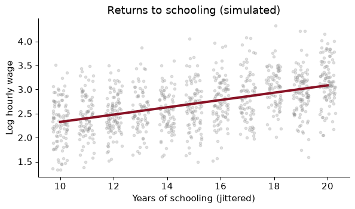
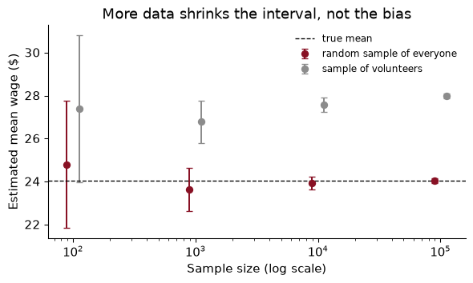
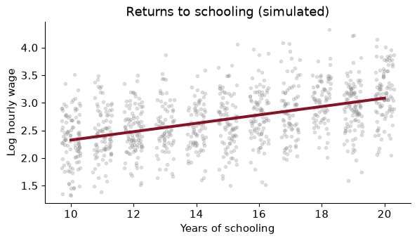

# Chapter 1 — What data science is for

> **The question:** economists now have tax records for every American child, every booking at a hotel, every click on a website and every word the Federal Reserve has published. Which questions do those data let us answer that we could not answer before, and which are exactly as hard as they always were?

## Economics turned empirical

For most of the twentieth century, a typical empirical paper in labour economics used a survey of a few thousand people. The Current Population Survey interviews about 60,000 households a month; the Panel Study of Income Dynamics followed around 5,000 families. Those surveys were, and remain, wonderful. But they set the limits of what you could ask. You could estimate the average return to a year of schooling. You could not say whether the return was different in Lewiston than in Portland, because there were a dozen people from Lewiston in your sample.

Over the last thirty years the profession has turned decisively towards data. The share of papers in the top journals that are empirical, rather than pure theory, has risen from about half in the 1980s to well over two thirds today. And the data themselves have changed in kind, not just in size. Here are the five sources you will meet most often; most of them turn up later in this book:

- **Administrative records.** Tax returns, social-security earnings, school test scores, hospital discharges. Collected by governments to run programmes, then (with a great deal of care about privacy) opened to researchers. They cover *everyone*, not a sample, and they do not depend on people remembering their income correctly.
- **Transaction and scanner data.** Every product scanned at a supermarket checkout, every card payment, every hotel booking. Prices and quantities at the level of the individual purchase, day by day.
- **Satellite and sensor data.** Night-time lights as a proxy for economic activity where GDP statistics are poor; images of crop fields, roofs, ships in ports; phone location pings showing who went where during a lockdown.
- **Text.** Central-bank statements, newspaper archives, patent filings, job adverts, earnings-call transcripts, product reviews. Language that used to be read by people and is now read by machines as well.
- **The web.** Online prices scraped every day, search volumes, social-network ties, and the logs of millions of experiments run by technology firms on their own users.

The most famous example in this book is the **Opportunity Atlas** of Chetty, Friedman, Hendren, Jones and Porter, built from the federal tax records of some 20 million Americans born between 1978 and 1983, linked to their parents. For every county in the United States it reports how children from poor families turned out as adults. In the version we use in Chapter 5, a child whose parents were at the 25th percentile of the national income distribution grows up to reach, on average, somewhere between the 36th percentile (in the bottom tenth of counties) and the 52th percentile (in the top tenth). Same starting point, very different destinations, depending on where you grew up. No survey could have drawn that map: there are 3,208 counties with an estimate, and most of them would have had a handful of respondents in any survey ever run.

> Big data does not replace economic reasoning. It raises the return to it. The new sources let us ask sharper questions, and they punish sloppy ones faster.

The second half of that takeaway is the important one, and it is the theme of the whole chapter. A data set with a hundred million rows will answer whatever question you put to it, including the wrong one, with great confidence.

### Worked example — what is new about each source?

For each of the following, say what one row is, and name one question it lets an economist answer that a household survey could not: (a) the Opportunity Atlas; (b) a supermarket chain’s scanner data; (c) the transcripts of Federal Open Market Committee (FOMC) meetings.

### Solution

**(a)** One row is a county (in the public file; the underlying data are one row per child). It answers *where* mobility is high or low, down to small places, because it covers essentially every child rather than a sample. A survey can estimate national mobility; it cannot rank 3,000 counties.

**(b)** One row is a product scanned in a store on a day (or, aggregated, a product–store–week). It answers how quickly prices respond to a cost shock, or how consumers substitute between brands when one goes on sale, because it sees actual prices and quantities rather than what a household remembers spending.

**(c)** One row is a speaker’s turn in a meeting, or a meeting. It answers how policymakers argue, whether they change what they say when they know their words will be published, and which topics dominate a meeting. A survey of central bankers could ask them; the transcripts show what they actually said.

Notice that in each case the gain is not “more rows” in the abstract. It is coverage of units a survey could not reach, or measurement of something a survey could not measure.

## Three kinds of question

Almost every empirical question in economics is one of three kinds, and the most useful habit you can build this semester is to say, before touching any data, which one you are asking.

**Description: what is the case?** How much does upward mobility vary across counties? How large is the racial wealth gap? What share of hotel bookings cancel? Descriptive questions sound humble, and they are often the most valuable. A good descriptive fact, carefully measured, can reshape a field: the Opportunity Atlas is description, and it has moved policy more than most causal studies. In the hotel data we use in Chapter 12, 37% of 119,390 bookings were cancelled. That is a description, and before you know it you cannot even begin to think about overbooking.

**Prediction: what will happen, or what is the value we cannot see?** Will this booking cancel? Will this borrower default? What is GDP this quarter, before the official figure arrives (that is called *nowcasting*)? What is this house worth? Prediction is the home ground of machine learning, and Part III of this book is mostly about it. The thing to be predicted is usually written $y$ and the prediction $\hat y$, “y-hat”.

**Causation: what would happen if we intervened?** Does a training programme raise earnings? Does a larger minimum wage reduce employment? Does moving a child to a better neighbourhood raise her income as an adult? These are questions about a world we do not observe, the one where the intervention did not happen, and that makes them the hardest of the three. The answer is usually a coefficient, $\hat\beta$, “beta-hat”, with a story about why it can be read as the effect of a change.

Kleinberg, Ludwig, Mullainathan and Obermeyer (2015) made the distinction vivid with a pair of examples. A policymaker deciding whether to build a rain dance needs to know whether dancing *causes* rain: a causal question. A policymaker deciding whether to take an umbrella needs only to know *whether it will rain*: a prediction question. Many real policy decisions are umbrellas, not rain dances. A judge deciding on bail needs to predict whether a defendant will return for trial; she does not need to know what causes people to skip it. A hotel deciding whether to resell a room needs the probability of cancellation, not its cause.

The three kinds call for different tools, and you will meet all of them:

| Question | Example in this book | Data | Chapter |
|----|----|----|----|
| Description | Where is upward mobility highest? | Tax records (Opportunity Atlas) | 5 |
| Prediction | Which hotel bookings will cancel? | 119,390 hotel bookings | 12 |
| Causation | Does moving a gate in a game change retention? | 90,189 randomised players | 7 |
| Measurement, then description | What does the Fed talk about? | FOMC statements and transcripts | 19–21 |

The last row is worth a comment. Text and images do not arrive as numbers. Before you can describe what the Fed talks about, you have to *measure* it: turn words into topic shares, a hawkishness score, an uncertainty index. That measurement step is itself often a prediction problem (does this sentence sound hawkish to a human reader?), and errors in it flow through to everything downstream.

The causal row is a real experiment. The makers of a mobile game randomly assigned players to meet a waiting gate either at level 30 or at level 40. Seven days later, 19.0% of the gate-30 players were still playing, against 18.2% of the gate-40 players. Because the assignment was random, that difference can be read as the effect of the gate’s position, up to sampling noise. Chapter 7 is about doing that carefully.

> Machine learning is very good at $\hat y$. Experiments and research designs deliver credible $\hat\beta$. Much of the damage done with data comes from mistaking one for the other.

### Worked example — sort the questions

Classify each question as description, prediction or causation, and say what would make it hard: (a) “What share of Maine workers are union members?” (b) “Which of today’s job seekers will still be unemployed in a year?” (c) “Would raising Maine’s minimum wage reduce teenage employment?” (d) “Is the Fed’s latest statement more hawkish than the last?”

### Solution

**(a)** Description. The hard part is measurement and coverage: survey non-response, small samples for a single state, and the definition of “member” versus “covered by a contract”.

**(b)** Prediction. The hard part is that the future may not look like the past (a recession changes everything), and that we want the prediction for people we have not seen. We will judge it by how well it does on data held back from fitting (Chapter 9).

**(c)** Causation. The hard part is the counterfactual: we never see Maine in the same year both with and without the raise. Comparing states that raised wages with states that did not mixes the effect of the wage with everything else that differs between them.

**(d)** Measurement, then description. “Hawkish” is not a column in any data set. You need a method that turns words into a score, and you need to believe the score means what you say it means.

## A first regression

Here is the whole job in miniature: simulate some data, describe it, fit a line, draw a picture. The data are made up, which is the point. Because I wrote down the rule that generated them, we know the right answer and can check whether the tools find it.

Each of 1,000 workers has some years of schooling, between 10 and 20, and an “ability” that we will pretend we cannot see. Log wages rise by 0.08 with each year of schooling and by 0.2 with each unit of ability, plus noise:

$$\log(\text{wage}_i) = 1.5 + 0.08\,\text{educ}_i + 0.2\,\text{ability}_i + \varepsilon_i$$

``` python
rng = np.random.default_rng(SEED)
n = 1_000
df = pd.DataFrame({
    "educ": rng.integers(10, 21, n),          # years of schooling
    "ability": rng.normal(0, 1, n),           # unobserved in real data
})
df["log_wage"] = 1.5 + 0.08 * df["educ"] + 0.2 * df["ability"] + rng.normal(0, 0.4, n)
print(df.head().round(3).to_string())
```

       educ  ability  log_wage
    0    20   -0.994     2.770
    1    13    1.042     2.875
    2    16    0.933     3.336
    3    16    0.502     2.743
    4    16    0.246     2.862

The regression of log wages on schooling is one line. `smf.ols` takes a formula, `"y ~ x"`, in the same style as R or Stata’s `regress y x`:

``` python
model = smf.ols("log_wage ~ educ", data=df).fit()
print(model.summary().tables[1])
```

    ==============================================================================
                     coef    std err          t      P>|t|      [0.025      0.975]
    ------------------------------------------------------------------------------
    Intercept      1.5671      0.068     23.020      0.000       1.434       1.701
    educ           0.0760      0.004     17.123      0.000       0.067       0.085
    ==============================================================================

The slope is 0.0760: each extra year of schooling is associated with roughly 7.6% higher wages (a coefficient on a log outcome is approximately a proportional change). The truth, which we wrote down, is 8%. The estimate is close, and the 95% confidence interval, from 0.067 to 0.085, contains it.

``` python
fig, ax = plt.subplots()
ax.scatter(df["educ"] + rng.uniform(-0.3, 0.3, n), df["log_wage"], alpha=0.25, s=10, color=GREY)
grid = np.arange(10, 21)
ax.plot(grid, model.params["Intercept"] + model.params["educ"] * grid, color=GARNET, lw=3)
ax.set(xlabel="Years of schooling (jittered)", ylabel="Log hourly wage",
       title="Returns to schooling (simulated)")
plt.show()
```



I jittered the schooling values sideways a little, so that the thousand dots do not sit on eleven vertical lines. The garnet line is the fitted regression.

Why did it work? Because in this simulation, ability was drawn independently of schooling. The workers with more schooling are not, on average, more able. So leaving ability out of the regression costs us some precision (it is part of the noise) but does not bias the slope. That is a very special world. In the real one, the people who stay in school longer are different in many ways from those who leave, and those differences also affect wages. That is the problem of **omitted variables**, and it is the subject of the next worked example.

### Worked example — when ability and schooling go together

Change one thing: let more able people get more schooling. Specifically, years of schooling are now $14 + 1.5 \times \text{ability}$ plus noise, rounded and kept between 10 and 20. The wage equation is unchanged, so the causal return to a year of schooling is still 0.08. (a) What does the regression of log wages on schooling now estimate? (b) Is the regression still useful for *predicting* wages?

### Solution

``` python
rng2 = np.random.default_rng(SEED)
ability = rng2.normal(0, 1, n)
educ = np.clip(np.round(14 + 1.5 * ability + rng2.normal(0, 2, n)), 10, 20)
log_wage = 1.5 + 0.08 * educ + 0.2 * ability + rng2.normal(0, 0.4, n)
sel = pd.DataFrame({"educ": educ, "ability": ability, "log_wage": log_wage})
short = smf.ols("log_wage ~ educ", data=sel).fit()
long = smf.ols("log_wage ~ educ + ability", data=sel).fit()
print(f"short: {short.params['educ']:.3f}   long: {long.params['educ']:.3f}")
```

    short: 0.127   long: 0.087

**(a)** The short regression now says each year of schooling is worth 0.127, 1.6 times the truth. The slope picks up two things at once: the true effect of schooling, and the fact that people with more schooling have more ability, which raises wages on its own. If we could observe ability and include it (the “long” regression), the slope drops back to 0.087. In real data we cannot, and this is the central difficulty of the economics of education. David Card’s work on the returns to schooling, which we read in Chapter 2, is a long search for variation in schooling that is *not* tied to ability.

**(b)** Yes. If all you want is to guess a worker’s wage from her schooling, the short regression is exactly the right tool: schooling *is* a good predictor of wages, partly because it signals ability. Its $R^2$ is 0.329. The coefficient is a fine $\hat y$ machine and a misleading $\hat\beta$. The same regression, the same numbers, two different questions, and only one of them gets a good answer.

> A coefficient that predicts well is not, for that reason, a coefficient that tells you what would happen if you changed $x$.

## What “big” changes, and what it does not

Now the question in this chapter’s title. If your data set gets a thousand times bigger, what gets better?

Two things get better, and they are important.

**Precision.** Standard errors shrink with the square root of the sample size. Quadruple the data and the confidence interval halves. With millions of observations, sampling noise is often no longer the thing to worry about.

**Resolution.** With more data you can afford to cut it finely: by county, by month, by age and race and sex at once, by a product’s barcode. The Opportunity Atlas is the example. Its contribution is not a more precise national average; it is three thousand local ones. More data also make flexible models possible. A model with a thousand parameters is hopeless on 500 observations and fine on 5 million, which is why machine learning and big data arrived together.

One thing does **not** get better: **bias**. If the process that put people into your data is related to the thing you are measuring, more data from the same process gives you a more precise estimate of the wrong number.

The textbook case is the 1936 US presidential election. The *Literary Digest* mailed ballots to some ten million people, drawn from telephone directories, car registrations and its own subscribers, and over two million came back. It predicted a comfortable win for Alf Landon. Roosevelt won in a landslide. George Gallup, with a far smaller but more carefully drawn sample, called it correctly. In 1936, people with telephones and cars were richer than average, and richer voters leaned Republican; and the people who bothered to mail back a ballot were different again. Two million biased responses lost to a small representative sample.

Let me show you the same thing with wages, so you can see it happen.

Take a population of 1,000,000 workers, and suppose we want their mean hourly wage. We have two options:

- **The big sample.** A jobs website runs a voluntary salary survey. Everyone can answer, and lots of people do, but higher earners are more likely to bother (they are prouder of their salaries, or more often on the site). A large share of the population responds.
- **The small sample.** We draw 500 workers completely at random and get every one of them to answer.

``` python
rng = np.random.default_rng(SEED)
N = 1_000_000
pop_wage = np.exp(rng.normal(3.0, 0.6, N))             # hourly wages, right-skewed
p_respond = 0.8 / (1 + np.exp(-(np.log(pop_wage) - 3.0)))   # richer -> more likely to answer
responds = rng.random(N) < p_respond
big = pop_wage[responds]
small = rng.choice(pop_wage, 500, replace=False)
truth = pop_wage.mean()
```

|  | Sample size | Estimated mean wage | 95% confidence interval |
|----|----|----|----|
| Truth (whole population) | 1,000,000 | \$24.03 |  |
| Big voluntary survey | 399,997 | \$27.98 | \$27.93 to \$28.04 |
| Small random sample | 500 | \$23.46 | \$22.23 to \$24.69 |

The big survey has 800 times as many observations. Its confidence interval is a few cents wide. And it is wrong: the true mean, \$24.03, is nowhere near the interval. It overstates the average wage by 16%. The small sample is noisy (its interval is 2.46 dollars wide) but its interval contains the truth.

The confidence interval of the big survey is not lying about what it measures. It correctly says that *if you ran the same voluntary survey again*, you would get almost exactly the same answer. It just has nothing to say about whether that answer is the one you wanted. **A confidence interval measures sampling noise, not bias.**

To see the two forces separately, take random subsamples of the volunteers of increasing size, and random samples of the population of the same sizes, and watch what happens to the estimates as $n$ grows:

``` python
sizes = [100, 1_000, 10_000, 100_000]
fig, ax = plt.subplots()
for k, (src, color, label) in enumerate([(pop_wage, GARNET, "random sample of everyone"),
                                         (big, GREY, "sample of volunteers")]):
    est = [mean_ci(rng.choice(src, s, replace=False)) for s in sizes]
    x = np.array(sizes) * (1.12 if k else 0.89)          # nudge so the bars don't overlap
    m = np.array([e[0] for e in est])
    ax.errorbar(x, m, yerr=[m - [e[1] for e in est], [e[2] for e in est] - m],
                fmt="o", color=color, capsize=3, label=label)
ax.axhline(truth, color="black", ls="--", lw=1, label="true mean")
ax.set_xscale("log")
ax.set(xlabel="Sample size (log scale)", ylabel="Estimated mean wage ($)",
       title="More data shrinks the interval, not the bias")
ax.legend(frameon=False, fontsize=9); plt.show()
```



Both sets of intervals shrink as the sample grows: that is precision. The garnet intervals close in on the truth. The grey ones close in on a different number, the mean wage *of people who answer salary surveys*, and they do so with increasing confidence. Past a few thousand observations, every additional volunteer makes the picture more precise and no more correct.

This is not an exotic problem. Nearly every big data set in economics is a by-product of something: people who booked a hotel, people who use a bank’s app, firms that file electronically, neighbourhoods with enough phones to show up in location data. The question “how did these rows get into my data?” is always worth asking, and the answer is never “at random”.

> More data reduces variance. Only design reduces bias. A big sample is a precise answer to whatever question its selection process asks.

**Going further.** Meng (2018) gives an exact identity for this. If $f = n/N$ is the share of the population in your sample, $\sigma$ the population standard deviation of $y$, and $\rho$ the correlation between “is in the sample” and $y$, then the error of the sample mean is

$$\bar y_{\text{sample}} - \bar y_{\text{pop}} = \rho \times \sqrt{\frac{1-f}{f}} \times \sigma.$$

Sample size enters only through $f$; there is no $1/\sqrt{n}$. In our simulation $\rho$ is 0.204, which looks tiny, and $f$ is 0.40. The identity gives an error of \$3.95, exactly the gap in the table. Setting this error equal to the standard error of a random sample tells you how big a random sample the volunteers are worth: about $f / ((1-f)\rho^2) \approx$ 16 people. 399,997 biased responses carry the information of 16 random ones.

### Worked example — a million app users

A fintech firm has the transaction records of 1.2 million users of its budgeting app and wants to publish “the average American household’s monthly spending on groceries”. Give two reasons the estimate could be biased, say in which direction, and say what the firm could do about it.

### Solution

*Who uses a budgeting app?* Probably younger, more educated, more financially organised people with smartphones and bank accounts. Their grocery spending could be higher (higher incomes) or lower (they are budgeting). The direction is unclear, which is a reason to check, not to ignore it.

*What does the app see?* Only spending on linked cards. Households that pay cash for groceries, or use a card they did not link, look as if they spend less. That biases the estimate downwards for exactly the households most likely to use cash: older and poorer ones.

What to do: compare the app’s users with a representative survey (the Consumer Expenditure Survey, the CPS) on things both measure, such as age, income and region, and **reweight** the app users so that they match the population on those variables. That fixes bias that runs through the variables you can see, not bias that runs through ones you cannot. And report the result as “the average among households like our users” unless you have done that work. The million rows buy precision and resolution (spending by week, by city, by store), which are genuinely valuable; they do not buy representativeness.

## The road ahead

This book follows the course in four parts. Each one answers a different kind of “how do I…?”

| Part | Chapters | What you will be able to do |
|----|----|----|
| **I. Tools for economic data** | 1–6 | Write Python, organise a reproducible project under Git, wrangle messy tables, map the Opportunity Atlas, and get data from APIs and web pages |
| **II. Experiments and uncertainty** | 7–8 | Design and analyse an A/B test; quantify uncertainty by simulation and the bootstrap |
| **III. Machine learning** | 9–18 | Build, tune and honestly evaluate prediction models: linear models, regularisation, classification, SVMs, trees, ensembles, dimensionality reduction, clustering and neural networks |
| **IV. Language** | 19–21 | Turn text into data, from word counts to embeddings to large language models |

Part I is the plumbing. It is not glamorous, but it is where most real projects succeed or fail. Chapter 2 is Python for people who have used Stata or R; Chapter 3 is how to keep a project in a state where you, a coauthor or a referee can rerun it; Chapters 4 to 6 are getting and cleaning data.

Part II is causation, done the clean way: randomise. It is also where we learn to simulate, which is how we will check almost every method later in the book, exactly as we did with the wages above.

Part III is prediction. Its order follows the standard machine-learning curriculum, but every example is economic: house prices, hotel cancellations, loan defaults, a development index for countries. The organising idea, from Chapter 9 on, is that a prediction model is judged on data it has not seen.

Part IV is text. The Fed’s statements, job adverts, and the language models that now read them for us.

Through all four parts, keep the three kinds of question in view. Part III is mostly $\hat y$. Part II is mostly $\hat\beta$. Part I and Part IV are mostly about measurement and description, which is what makes the other two possible.

### Worked example — which part?

A classmate wants to study whether counties that received more broadband funding saw faster business formation. She has a list of grants from a government website, county business counts from the Census, and newspaper articles about each project. Which parts of the book will she need?

### Solution

Part I to get the data (an API or a scrape for the grants in Chapter 6, a merge on county codes in Chapter 4, maps in Chapter 5) and to keep the project reproducible (Chapter 3). Part IV if she wants to measure something from the articles, such as whether a project was described as delayed. The question itself is causal, and here is the catch: the grants were not randomised. Nothing in Part III will turn a prediction model into a causal estimate. Part II’s simulation tools will help her understand her uncertainty, but she will also need a research design, from her econometrics course, that explains why funded and unfunded counties are comparable. This book will give her the data; it will not give her the identification.

## How to read this book

A few conventions, so that nothing surprises you.

**Every number is computed.** The book is written in Quarto: each chapter is a file in which prose and Python are interleaved, and when the book is built, the code runs and its results are written into the text. When I say that 37% of hotel bookings cancel, that number came from running `hotels["is_canceled"].mean()` on the real file. If the data change, the sentence changes. This is the same habit we will ask of you in problem sets (Chapter 3 explains why).

**The code is meant to be run.** Every chapter’s “In Python” section is a complete pipeline you can paste into a notebook and run top to bottom with the course environment. Data are downloaded once and saved to a `data/` folder, so the second run is fast.

**Worked examples come with solutions.** Try each one before reading the solution. Most take five minutes. Then the exercises at the end, with answers, are the next step up.

**Notation is light.** $y$ is the outcome, $x$ a feature (econometricians say regressor or covariate, machine-learning people say feature; they are the same thing). $\hat y$ is a prediction and $\hat\beta$ an estimated coefficient. $n$ is the number of observations. There is at most one key equation per idea, and anything that needs a derivation lives in a short “Going further” paragraph you can skip.

**The textbook sits alongside.** In Part III, Géron’s *Hands-On Machine Learning* covers the same methods in more engineering detail. This book does not repeat it. It gives you the economist’s version: our data, our questions, and the cautions an economist cares about that an engineer often does not.

## In Python

The chapter’s two simulations in one place: a regression on simulated wages, and the big-biased versus small-random comparison.

``` python
import numpy as np, pandas as pd
import matplotlib.pyplot as plt
import statsmodels.formula.api as smf
SEED = 368
rng = np.random.default_rng(SEED)

n = 1_000
df = pd.DataFrame({"educ": rng.integers(10, 21, n), "ability": rng.normal(0, 1, n)})
df["log_wage"] = 1.5 + 0.08 * df["educ"] + 0.2 * df["ability"] + rng.normal(0, 0.4, n)
model = smf.ols("log_wage ~ educ", data=df).fit()
print(f"return to schooling: {model.params['educ']:.3f} (se {model.bse['educ']:.3f})")
```

    return to schooling: 0.076 (se 0.004)

``` python
N = 1_000_000
pop_wage = np.exp(rng.normal(3.0, 0.6, N))
p_respond = 0.8 / (1 + np.exp(-(np.log(pop_wage) - 3.0)))
big = pop_wage[rng.random(N) < p_respond]
small = rng.choice(pop_wage, 500, replace=False)
for name, x in [("population", pop_wage), ("big volunteer", big), ("small random", small)]:
    se = x.std(ddof=1) / np.sqrt(len(x))
    print(f"{name:>14}: n = {len(x):>9,}  mean = {x.mean():6.2f}  se = {se:.3f}")
```

        population: n = 1,000,000  mean =  24.03  se = 0.016
     big volunteer: n =   400,190  mean =  27.98  se = 0.028
      small random: n =       500  mean =  24.31  se = 0.703

``` python
fig, ax = plt.subplots(figsize=(7, 3.5))
ax.scatter(df["educ"] + rng.uniform(-0.3, 0.3, n), df["log_wage"], s=10, alpha=0.25, color="#8c8c8c")
grid = np.arange(10, 21)
ax.plot(grid, model.params["Intercept"] + model.params["educ"] * grid, color="#881124", lw=3)
ax.set(xlabel="Years of schooling", ylabel="Log hourly wage", title="Returns to schooling (simulated)")
plt.show()
```



## What goes wrong

**Reading a predictive coefficient as causal.** The short regression in the worked example predicted wages perfectly well and overstated the return to schooling by a factor of 1.6. Before you interpret a slope as “the effect of”, ask what else moves with $x$.

**Believing that a big sample fixes bias.** The 400,190-person voluntary survey was 16% too high and more confident than the 500-person random sample. Ask how the rows got into your data, and who is missing.

**Reporting a tiny standard error as if it were accuracy.** With millions of rows, everything is “statistically significant”. A standard error says nothing about selection, measurement error or confounding, which are usually the bigger problems with big data.

**Forgetting what one row is.** The public Opportunity Atlas is one row per county. A correlation across counties (between, say, mobility and the share of two-parent families) is a fact about places, not a fact about individual families. Reading it as one is the *ecological fallacy*.

**Treating a measurement as the thing measured.** A sentiment score from text, night-time lights from a satellite or a “hawkishness” index from Fed statements is a prediction of something we care about, with its own errors. Those errors can be systematic (lights saturate in big cities; sarcasm fools a sentiment dictionary), and they pass straight into every regression that uses the measure.

**Picking the tool before the question.** “I want to use a neural network” is not a research question. Decide first whether you need a description, a prediction or a causal effect; the tool follows.

## Exercises

1.  For each question, say whether it is description, prediction or causation: (a) Did the 2021 expanded Child Tax Credit reduce child poverty? (b) Which counties have the highest share of children in poverty? (c) Which families who are eligible for the credit will fail to claim it?

2.  In the first simulation, the regression of log wages on schooling alone recovered the true return of 0.08 even though ability was left out. Explain in two sentences why, and what would have to change for it to fail.

3.  Rerun the “ability and schooling go together” simulation, but double the effect of ability on wages, from 0.2 to 0.4, leaving everything else as it was. Predict, then compute, the short-regression slope.

4.  Using the big-sample simulation, compute the mean wage of the volunteers with all of the respondents, and with a random 500 of them. Which is closer to the truth? Which has the smaller standard error? What does that tell you?

5.  A random sample of 500 is unbiased but noisy. Draw 1,000 independent random samples of 500 from `pop_wage` and compute each one’s mean. What share of the 95% confidence intervals contain the true mean? What share of the volunteer-survey intervals would?

6.  An economist predicts county-level upward mobility from 50 county characteristics with a flexible model and finds that the share of residents who attend church is one of the strongest predictors. A newspaper reports “Going to church raises your children’s incomes.” What is wrong with the headline, and what would you need to support it?

7.  Give an example of a decision in your own life, or in a business or government you know about, that is an “umbrella” problem (prediction is enough) and one that is a “rain dance” problem (it needs a causal effect).

### Answers

**1.** (a) Causation: the question is what poverty would have been without the credit. (b) Description. (c) Prediction: the agency wants to know *who*, so it can target outreach; it does not need to know why.

**2.** In the simulation, ability was drawn independently of schooling, so leaving it out added noise but no systematic relationship between the error term and schooling; OLS is unbiased when the omitted variable is uncorrelated with the included one. It fails as soon as ability and schooling are correlated, as in the worked example.

**3.**

``` python
rng3 = np.random.default_rng(SEED)
ab3 = rng3.normal(0, 1, n)
ed3 = np.clip(np.round(14 + 1.5 * ab3 + rng3.normal(0, 2, n)), 10, 20)
lw3 = 1.5 + 0.08 * ed3 + 0.4 * ab3 + rng3.normal(0, 0.4, n)
b3 = smf.ols("lw ~ ed", data=pd.DataFrame({"lw": lw3, "ed": ed3})).fit().params["ed"]
print(round(b3, 3))
```

    0.175

The slope is 0.175, against 0.127 when ability’s effect was 0.2, and 0.08 in truth. The bias, the part above 0.08, goes from 0.047 to 0.095: it roughly doubles. That is the omitted-variable formula from econometrics at work. The bias is the omitted variable’s effect on $y$ (now twice as large) times the slope from a regression of the omitted variable on the included one (unchanged, since schooling and ability are generated exactly as before).

**4.**

``` python
sub = rng.choice(big, 500, replace=False)
for name, x in [("all volunteers", big), ("500 volunteers", sub)]:
    print(f"{name}: mean {x.mean():.2f}, se {x.std(ddof=1) / np.sqrt(len(x)):.3f}")
print(f"truth: {pop_wage.mean():.2f}")
```

    all volunteers: mean 27.98, se 0.028
    500 volunteers: mean 27.57, se 0.811
    truth: 24.03

Neither is close: \$27.98 with all the volunteers and \$27.57 with 500 of them, against a truth of \$24.03. The full set of volunteers has a far smaller standard error, but it is just as wrong. Taking more observations from a biased source buys precision about the wrong target.

**5.**

``` python
truth5 = pop_wage.mean()
means = np.array([rng.choice(pop_wage, 500).mean() for _ in range(1_000)])
covers = []
for _ in range(1_000):
    s = rng.choice(pop_wage, 500)
    half = 1.96 * s.std(ddof=1) / np.sqrt(500)
    covers.append(abs(s.mean() - truth5) < half)
print(f"sd of the means {means.std():.3f}; coverage {np.mean(covers):.1%}")
```

    sd of the means 0.710; coverage 94.8%

94.8% of the intervals contain the truth, close to the 95% the method promises. The volunteer-survey intervals essentially never would: they are a few cents wide and centred about \$3.95 too high. Chapter 8 uses exactly this kind of simulation to check whether an interval does what it claims.

**6.** The model found a *predictor*. Church attendance is correlated with many other features of a place (family structure, social ties, income, region), and any of them could be doing the work. The finding is also about counties, not families: it does not even say that churchgoing families’ children do better. To support the headline you would need variation in church attendance that is unrelated to everything else that affects mobility, ideally at the family level, which is a causal design, not a better prediction model.

**7.** Answers will vary. Umbrella: a store deciding how much bread to bake tomorrow needs a forecast of demand, not its causes; a bank screening loan applications needs default probabilities. Rain dance: a city deciding whether to build a bike lane to reduce traffic deaths needs to know what the lane *does*; a firm deciding whether a discount raises profit needs the causal effect of the discount on sales, which is why firms run experiments (Chapter 7).

## Economics reading

**Einav, Liran, and Jonathan Levin (2014). “Economics in the age of big data.” *Science* 346(6210).** [doi.org/10.1126/science.1243089](https://doi.org/10.1126/science.1243089)

Two economists survey how new data, from government records and from private firms, are changing what economists study. They argue that the biggest gains come from granular measurement and from collaborations with companies and agencies that hold the data, and that the hard questions of research design do not go away.

*Think about:* much of the new data belongs to private firms that let researchers in on their own terms. What questions might never get asked if the only data available are those that firms choose to share?

**Mullainathan, Sendhil, and Jann Spiess (2017). “Machine Learning: An Applied Econometric Approach.” *Journal of Economic Perspectives* 31(2): 87–106.** [doi.org/10.1257/jep.31.2.87](https://doi.org/10.1257/jep.31.2.87)

The clearest statement of this chapter’s main distinction. Using house prices from the American Housing Survey, the authors show that machine-learning models predict far better than OLS, but that the variables they rely on change from one random sample to the next, so their coefficients cannot be read as economic parameters. They then show where good $\hat y$ helps economists anyway: measurement, prediction policy problems, and parts of causal estimation.

*Think about:* if two models predict house prices equally well but use different variables, which one tells you the value of an extra bathroom? Why might neither?

**Kleinberg, Jon, Jens Ludwig, Sendhil Mullainathan, and Ziad Obermeyer (2015). “Prediction Policy Problems.” *American Economic Review* 105(5): 491–495.** [doi.org/10.1257/aer.p20151023](https://doi.org/10.1257/aer.p20151023)

A short paper that introduced the umbrella-versus-rain-dance distinction. Its example is hip and knee replacement in Medicare: the surgery is pointless for patients who would die within a year anyway, so predicting who those patients are is enough to improve the decision, with no causal model of what surgery does.

*Think about:* the prediction is made from patients who *did* get surgery. How might the way doctors chose those patients bias the model when it is used for everyone?

**Reading.** Géron, ch. 1, for the machine-learning landscape and its vocabulary (supervised and unsupervised learning, overfitting, the train/test split), which we return to in Chapter 9. Varian (2014), “Big Data: New Tricks for Econometrics”, *Journal of Economic Perspectives*, for an economist’s tour of the tools. Meng (2018), “Statistical Paradises and Paradoxes in Big Data (I)”, *Annals of Applied Statistics*, for the data-defect identity in the Going further paragraph.
