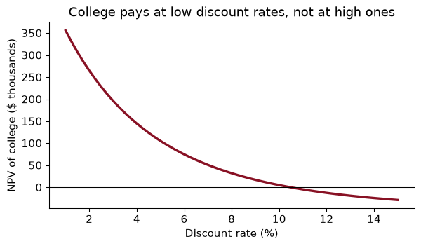
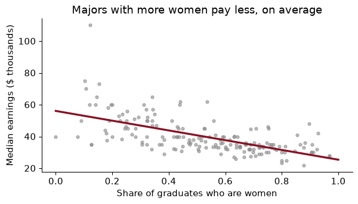

# Chapter 2 — Python for economists

> **The question:** is a four-year degree worth what it costs? Before data can answer that, you need a language in which a present value, a regression and a table of 173 college majors each take a few lines.

## Why Python, and what changes if you know Stata or R

The return to college is one of the most studied numbers in economics, and it is a good one to learn a language on, because it needs every piece of the toolkit. You need to discount a stream of future earnings (a function), compare it across interest rates (a loop), compute it for many majors at once (a data frame), and estimate how earnings vary with what you studied (a regression). By the end of this chapter you will have done each of those in Python.

Why Python rather than Stata or R? Not because the others are worse. R is excellent, and almost everything in this book has a direct R equivalent. Stata is still the language of most applied micro papers. Python earns its place because it is a **general-purpose** language: the same language scrapes a website (Chapter 6), fits a gradient-boosted tree (Chapter 15), trains a neural network (Chapter 18) and calls a large language model (Chapter 21). Learn it once and the whole course is open to you.

The adjustment, if you are coming from Stata, is bigger than it looks. Here are the differences that trip people up in the first week:

| Idea | Stata | R | Python |
|----|----|----|----|
| Data in memory | one dataset at a time | many objects | many objects |
| Indexing starts at | 1 | 1 | **0** |
| Missing value | `.` | `NA` | `None`, `np.nan`, `pd.NA` |
| Install an add-on | `ssc install` | `install.packages()` | `uv pip install` |
| Load an add-on | automatic | `library(x)` | `import x` |
| Power | `^` | `^` | `**` |

The deepest difference is the first row. Stata has *the* dataset; every command acts on it. In Python, as in R, a data set is just one object among many, with a name you gave it, and you can have twenty of them at once. And data frames are not built into Python at all. They come from a library, **pandas**, which we preview at the end of this chapter and use for real from Chapter 4.

The second idea to absorb is that everything is an **object** with **methods**, which you call with a dot. `"lewiston".upper()` calls the `upper` method of a string. `grads["Median"].mean()` calls the `mean` method of a column. When you wonder “how do I do X to this thing?”, the answer is usually a method of the thing.

Where do you write Python? Three places, for three jobs. A **notebook** (`.ipynb`) mixes code, output and notes in cells, which is ideal for exploring. A **script** (`analysis.py`) runs top to bottom with `python analysis.py`, which is what you want for a pipeline that must give the same answer every time (Chapter 3). A **Quarto** document (`.qmd`) mixes prose and code and renders to a report; this book is written in it. My rule: explore in a notebook, then move finished code into scripts and functions.

### Worked example — predict, then run

Before running anything, predict what each line returns: `7 / 2`, `7 // 2`, `7 % 2`, `2 ^ 3`, `2 ** 3`, `"3" * 3`, and `0.1 + 0.2 == 0.3`.

### Solution

``` python
for expr in ["7 / 2", "7 // 2", "7 % 2", "2 ^ 3", "2 ** 3", '"3" * 3', "0.1 + 0.2 == 0.3"]:
    print(f"{expr:<18} -> {eval(expr)!r}")
```

    7 / 2              -> 3.5
    7 // 2             -> 3
    7 % 2              -> 1
    2 ^ 3              -> 1
    2 ** 3             -> 8
    "3" * 3            -> '333'
    0.1 + 0.2 == 0.3   -> False

`/` is true division and always gives a float; `//` is floor division and `%` the remainder. The trap is `^`: in Python it is not a power but “bitwise exclusive or”, an operation on the binary digits of integers, so `2 ^ 3` is 1, silently, with no error. If you write a Mincer equation with `exper^2`, you will get garbage. Use `**`.

`"3" * 3` repeats the string. And `0.1 + 0.2` is not exactly `0.3`, because computers store most decimals in binary with a tiny rounding error. Never compare floats with `==`; compare them with a tolerance, using `math.isclose` or `np.isclose`. (I used `eval` here to loop over the expressions as text; you will rarely need it.)

## Values, types and f-strings

Every value in Python has a **type**. The five you need on day one:

``` python
wage = 23.75          # float: a number with a decimal point
hours = 40            # int: a whole number
name = "Rosa"         # str: text, in quotes
employed = True       # bool: True or False
spouse = None         # NoneType: "nothing here"
for x in [wage, hours, name, employed, spouse]:
    print(type(x).__name__, x)
```

    float 23.75
    int 40
    str Rosa
    bool True
    NoneType None

A variable is a **label on an object**, not a box with a type. You do not declare it; you just assign. Python works out the type from the value.

Python is relaxed about declaring types and strict about mixing them. `"3" + 4` is an error, not `"34"` (as JavaScript would say) or `7` (as Excel might). That strictness is a gift. When you read a CSV in which a number was stored as text, `"12,000"` rather than `12000`, you want the program to complain, not to guess.

**f-strings** are how you will report every number. Put an `f` before the quotes and anything in braces is evaluated and formatted:

``` python
beta, se, n = 0.0812345, 0.0123, 15234
print(f"beta = {beta:.3f} (se {se:.3f}), t = {beta / se:.2f}")
print(f"N = {n:,}")
print(f"Return to schooling: {beta:.1%}")
```

    beta = 0.081 (se 0.012), t = 6.60
    N = 15,234
    Return to schooling: 8.1%

The part after the colon is the format: `.3f` for three decimals, `,` for a thousands separator, `.1%` to multiply by 100 and add a per-cent sign. Learn these three and you can write any table.

Strings have methods for cleaning, which you will need constantly with messy data:

``` python
raw = "  Lewiston, ME  "
city, state = raw.strip().split(", ")
print(city.upper(), state, "ME" in raw)
```

    LEWISTON ME True

### Worked example — one sentence from four numbers

In 2022, union members earned \$36.09 an hour on average and non-members \$33.89 (the figures from the example sentence in Exercise 02). Print one sentence giving both wages, the raw union premium as a percentage, and what the gap is worth over a full-time year of 2,080 hours.

### Solution

``` python
union, nonunion = 36.09, 33.89
premium = union / nonunion - 1
annual_gap = (union - nonunion) * 2080
print(f"Union members earned ${union:.2f}/hr vs ${nonunion:.2f} for non-members: "
      f"a raw premium of {premium:.1%}, or ${annual_gap:,.0f} a year full time.")
```

    Union members earned $36.09/hr vs $33.89 for non-members: a raw premium of 6.5%, or $4,576 a year full time.

“Raw” matters. The premium compares two groups of workers who differ in many ways besides union status (industry, region, age). The data in Exercise 02 also report a regression-adjusted premium, which is smaller. Even the f-string has an economics lesson in it.

## Containers: lists, tuples, dictionaries and sets

Single values get you nowhere. Python has four built-in containers, and you will use all four.

A **list** is an ordered collection you can change. Square brackets:

``` python
years = [2019, 2020, 2021, 2022]
years.append(2023)
print(years[0], years[-1], years[1:3], len(years), 2020 in years)
```

    2019 2023 [2020, 2021] 5 True

Indexing starts at **0**, so `years[0]` is the first element, and negative indices count from the end. A **slice** `x[a:b]` includes position `a` and excludes position `b`. That sounds odd and turns out to be convenient: `x[:3]` is the first three elements, `x[3:]` is the rest, with no overlap and no gap.

A **tuple** is a list you cannot change, written with parentheses. It is how functions return several things at once, and you can unpack it in one line: `b, se = (0.08, 0.012)`.

A **dictionary** maps keys to values. Curly braces, colons:

``` python
min_wage = {"ME": 14.15, "NH": 7.25, "MA": 15.00}
min_wage["VT"] = 13.67
print(min_wage["ME"], min_wage.get("TX", "not found"))
for state, w in min_wage.items():
    print(f"{state}: ${w:.2f}")
```

    14.15 not found
    ME: $14.15
    NH: $7.25
    MA: $15.00
    VT: $13.67

Dictionaries are everywhere in data work. The JSON that comes back from a web API (Chapter 6) is nested dictionaries. Renaming columns in pandas takes a dictionary, `{"old": "new"}`. A data frame is, at heart, a dictionary of columns.

A **set** is an unordered collection with no duplicates. Sets are the fastest way to answer “which IDs are in file A but not in file B?”, which is the first question to ask before any merge:

``` python
states_a = {"ME", "NH", "VT", "MA"}
states_b = {"ME", "NH", "NY"}
print(states_a - states_b, states_a & states_b, states_a | states_b)
```

    {'MA', 'VT'} {'NH', 'ME'} {'NH', 'MA', 'VT', 'NY', 'ME'}

`-` is “in A but not B”, `&` is “in both”, `|` is “in either”. If A and B are the state codes in two files you are about to merge, `states_a - states_b` lists the states that will find no partner, before the merge silently drops or blanks them.

### Worked example — why did my data change?

Predict what this prints, then explain it.

``` python
a = [1, 2, 3]
b = a
b.append(4)
print(a)
```

    [1, 2, 3, 4]

### Solution

It prints \[1, 2, 3, 4\]. The line `b = a` does not copy the list; it puts a second label on the *same* list. Appending through either name changes the one object both names point at. To get an independent copy, write `b = a.copy()`.

Lists, dictionaries and pandas data frames are **mutable**: they can be changed in place. Numbers, strings and tuples are not. This one fact is behind most of the “why did my data change?” questions in the first month. You will meet it again with pandas, where the fix is the same: `df.copy()` when you want a separate table.

## Loops, conditions and comprehensions

Python marks blocks with **indentation**: four spaces after a line ending in a colon. No braces, no `end`. The indentation *is* the syntax.

``` python
def tax_bracket(income):
    """Marginal federal income-tax rate for a single filer (2024 brackets, up to $191,950)."""
    if income < 11_600:
        return 0.10
    elif income < 47_150:
        return 0.12
    elif income < 100_525:
        return 0.22
    else:
        return 0.24

for inc in [9_000, 30_000, 80_000, 150_000]:
    print(f"${inc:>8,}: {tax_bracket(inc):.0%}")
```

    $   9,000: 10%
    $  30,000: 12%
    $  80,000: 22%
    $ 150,000: 24%

(Python lets you write `11_600` for 11600, which makes large numbers readable.)

A `for` loop walks through anything you can iterate over. Two helpers save you from ever writing `range(len(x))`: `enumerate` gives you the position along with each item, and `zip` walks two lists in parallel.

``` python
incomes = [32_000, 45_000, 51_000, 120_000]
names = ["Ana", "Ben", "Cal", "Dee"]
for i, (who, inc) in enumerate(zip(names, incomes)):
    print(i, who, inc)
```

    0 Ana 32000
    1 Ben 45000
    2 Cal 51000
    3 Dee 120000

A **comprehension** builds a new container from an old one in a single readable line:

``` python
logs = [round(math.log(x), 2) for x in incomes]
high = [x for x in incomes if x > 50_000]
rate_by_person = {who: tax_bracket(inc) for who, inc in zip(names, incomes)}
print(logs, high, rate_by_person, sep="\n")
```

    [10.37, 10.71, 10.84, 11.7]
    [51000, 120000]
    {'Ana': 0.12, 'Ben': 0.12, 'Cal': 0.22, 'Dee': 0.24}

Read it as English: “the log of x, for each x in incomes”; “x, for each x in incomes, if x is over 50,000”. If a comprehension does not fit comfortably on one line, write a normal loop instead. Clear beats clever.

### Worked example — marginal versus average tax rates

A single filer has \$80,000 of taxable income. Her marginal rate is 22%. How much tax does she owe, and what is her average rate? Use the 2024 brackets above, and remember that each rate applies only to the income *within* its bracket.

### Solution

``` python
brackets = [(0, 0.10), (11_600, 0.12), (47_150, 0.22), (100_525, 0.24)]   # (floor, rate)

def tax_owed(income):
    owed = 0.0
    for i, (floor, rate) in enumerate(brackets):
        ceiling = brackets[i + 1][0] if i + 1 < len(brackets) else float("inf")
        owed += rate * max(0, min(income, ceiling) - floor)
    return owed

t = tax_owed(80_000)
print(f"tax ${t:,.0f}, average rate {t / 80_000:.1%}")
```

    tax $12,653, average rate 15.8%

She owes \$12,653, an average rate of 15.8%, well below her 22% marginal rate. The first \$11,600 is taxed at 10%, the next slice at 12%, and only the income above \$47,150 at 22%. The economics: the *marginal* rate governs decisions at the margin (is another hour of overtime worth it?), while the *average* rate measures the burden. Confusing the two is the most common mistake in public debate about taxes, and now you can compute both.

## Functions

A function packages a calculation so you can reuse it, test it and give it a name. Here is the calculation behind every “is college worth it?” argument: the **present value** of a stream of cash flows, discounted at rate $r$,

$$PV = \sum_{t=1}^{T} \frac{CF_t}{(1+r)^t}.$$

``` python
def present_value(cash_flows, r=0.05):
    """Discount a list of annual cash flows at rate r.

    The first cash flow arrives in one year.
    """
    return sum(cf / (1 + r) ** (t + 1) for t, cf in enumerate(cash_flows))
```

Three things to notice. `def` starts the definition, and the indented body is the function. `r=0.05` is a **default argument**: if you do not say otherwise, the rate is 5%. And the text in triple quotes is a **docstring**: `help(present_value)` will print it, and so will VS Code when you hover over the name. Write one for every function you expect to use twice.

Now the college decision, in its simplest form. Four years of college cost \$30,000 a year (tuition plus the earnings you give up), followed by 40 years in which a graduate earns \$15,000 a year more than she would have without the degree. These are round illustrative numbers, not estimates:

``` python
college = [-30_000] * 4 + [15_000] * 40
npv5 = present_value(college)
npv10 = present_value(college, r=0.10)
print(f"NPV at 5%: ${npv5:,.0f}   NPV at 10%: ${npv10:,.0f}")
```

    NPV at 5%: $105,374   NPV at 10%: $5,092

`[-30_000] * 4` makes a list of four copies, and `+` joins two lists. At 5%, the degree is worth \$105,374 in today’s money. At 10%, only \$5,092. The costs come first and the benefits are spread over decades, so the higher the discount rate, the less the degree is worth. A student who can borrow only at high rates, or who is impatient, faces a very different decision from one who can borrow cheaply. That is the economics of student loans in one line of arithmetic.

Functions are objects too. You can put them in lists, pass them to other functions, and apply them in a comprehension:

``` python
rates = np.linspace(0.01, 0.15, 57)
npvs = [present_value(college, r) for r in rates]
```

``` python
fig, ax = plt.subplots()
ax.plot(rates * 100, np.array(npvs) / 1000, color=GARNET, lw=2.5)
ax.axhline(0, color="black", lw=0.8)
ax.set(xlabel="Discount rate (%)", ylabel="NPV of college ($ thousands)",
       title="College pays at low discount rates, not at high ones")
plt.show()
```



### Worked example — when does college stop paying?

At what discount rate is the NPV of this investment exactly zero? That rate is the **internal rate of return** (IRR): the return the degree earns on the money put into it.

### Solution

The IRR is the root of the function $r \mapsto PV(r)$. SciPy has a reliable root-finder, `brentq`, which needs the function and two rates on either side of the root. The plot shows the NPV is positive at 1% and negative at 15%:

``` python
from scipy.optimize import brentq
irr = brentq(lambda r: present_value(college, r), 0.01, 0.15)
print(f"IRR = {irr:.2%}")
```

    IRR = 10.50%

`lambda r: ...` is a small anonymous function, here “the NPV of college at rate $r$”. The IRR is 10.50%. The degree pays for any student whose cost of funds is below that, and not for one whose cost of funds is above it.

Two cautions an economist would add. First, the \$15,000 premium is the *causal* effect of the degree on earnings, which is exactly what is hard to measure: graduates would have earned more than non-graduates even without the degree (the ability problem of Chapter 1). Second, it is an average; the return differs across majors, as we will see in a moment, and across students.

## Modules and imports

Python itself is small. Its power comes from **modules**, files of code that someone else wrote and you load with `import`:

``` python
import math                         # the standard library: ships with Python
import numpy as np                  # third party: installed with uv pip install
from statistics import mean, median # import just two names
print(math.sqrt(2), np.log(100), mean([1, 2, 9]), median([1, 2, 9]))
```

    1.4142135623730951 4.605170185988092 4 2

There are three kinds. The **standard library** comes with Python: `math`, `pathlib`, `json`, `re`, `datetime`, `statistics`. **Third-party** libraries must be installed into your environment first: `numpy`, `pandas`, `statsmodels`, `scikit-learn`. And **your own**: any file `helpers.py` in your project can be imported with `import helpers`, which is how you share a cleaning function between scripts (Chapter 3).

Use the conventional aliases. Everyone, including every answer on Stack Overflow and every AI assistant, expects them:

| Import                                  | Alias |
|-----------------------------------------|-------|
| `import numpy as np`                    | `np`  |
| `import pandas as pd`                   | `pd`  |
| `import matplotlib.pyplot as plt`       | `plt` |
| `import statsmodels.formula.api as smf` | `smf` |

And never write `from numpy import *`. It dumps hundreds of names into your session, some of which silently replace built-in ones with the same name.

The course environment is a **virtual environment**, a folder `.venv` containing one particular Python and one particular version of each library, separate from every other project on your laptop. You create it with `uv venv` and record its contents in `requirements.txt`. Chapter 3 explains why that matters for reproducibility. To see what is in yours:

``` python
import sys, importlib.metadata as md
print("python", sys.version.split()[0])
for pkg in ["numpy", "pandas", "statsmodels", "scikit-learn"]:
    print(f"{pkg:<13}{md.version(pkg)}")
```

    python 3.12.15
    numpy        2.5.4
    pandas       3.0.6
    statsmodels  0.15.0
    scikit-learn 1.9.1

### Worked example — two logs

`math.log` and `np.log` both compute natural logarithms. What happens if you give each a list of incomes?

### Solution

``` python
incomes = [32_000, 45_000, 51_000, 120_000]
print(np.log(incomes).round(2))
try:
    math.log(incomes)
except TypeError as err:
    print("math.log failed:", err)
```

    [10.37 10.71 10.84 11.7 ]
    math.log failed: must be real number, not list

`np.log` takes the whole list, converts it to an array and returns the log of every element. `math.log` works on one number at a time and refuses a list. The two functions share a name and do different things, which is exactly why we keep the `np.` prefix: it tells the reader which one you meant. (The `try`/`except` lets the error happen without stopping the program; more on that at the end of the chapter.)

## NumPy: arrays and vectorization

Python lists are flexible: they can hold a number, a string and another list side by side. That flexibility makes them slow for arithmetic, because Python must check the type of every element as it goes. **NumPy arrays** hold one type of thing, packed together in memory, and do arithmetic on the whole array at once in compiled code. That is called **vectorization**, and it is the single biggest speed-up available to you.

``` python
rng = np.random.default_rng(SEED)
x = rng.normal(size=1_000_000)
as_list = x.tolist()

t0 = time.perf_counter(); s_loop = sum(v * v for v in as_list); t1 = time.perf_counter()
s_vec = (x ** 2).sum(); t2 = time.perf_counter()
print(f"loop: {t1 - t0:.4f}s   numpy: {t2 - t1:.4f}s   same answer: {np.isclose(s_loop, s_vec)}")
```

    loop: 0.0222s   numpy: 0.0011s   same answer: True

On this run the vectorized version was about 20 times faster (the exact ratio depends on your laptop, and on what else it is doing). On a million numbers that is the difference between a blink and a pause; on a simulation that repeats the calculation ten thousand times, it is the difference between a minute and a day. The lesson is the same as in R: **operate on whole arrays, not element by element.**

Arrays support everything you would expect, plus **boolean masks**, which select the elements where a condition is true:

``` python
a = np.array([3.0, 1.0, 4.0, 1.0, 5.0])
print(a.shape, a.dtype, a.mean(), np.median(a))
print(a[a > 2])                    # keep the elements greater than 2
print(np.where(a > 2, "hi", "lo")) # vectorized if/else
M = np.arange(12).reshape(3, 4)
print(M.sum(axis=0), M[1, :], M[:, 0])
```

    (5,) float64 2.8 3.0
    [3. 4. 5.]
    ['hi' 'lo' 'hi' 'lo' 'hi']
    [12 15 18 21] [4 5 6 7] [0 4 8]

`axis=0` means “down the rows”, giving one number per column; `axis=1` means “across the columns”, one number per row. Getting the axis wrong is a classic silent bug, so check the shape of what comes out.

**Broadcasting** is the rule that lets arrays of different shapes combine. If you divide a 3 × 4 array by an array of length 4, NumPy stretches the shorter one across every row.

### Worked example — real earnings and within-person changes

Three workers’ nominal earnings over four years are in the array below, and the price index for the four years is 1.00, 1.02, 1.07 and 1.13. (a) Convert the earnings to real terms in year-1 dollars. (b) Express each worker’s earnings as a deviation from her own average.

### Solution

``` python
earn = np.array([[30, 32, 35, 37],
                 [50, 49, 55, 60],
                 [20, 25, 24, 30]]) * 1_000
cpi = np.array([1.00, 1.02, 1.07, 1.13])
real = earn / cpi                                    # (3, 4) / (4,): each column by its year's CPI
demeaned = earn - earn.mean(axis=1, keepdims=True)   # each row minus its own mean
print(real.round(0), demeaned, sep="\n")
```

    [[30000. 31373. 32710. 32743.]
     [50000. 48039. 51402. 53097.]
     [20000. 24510. 22430. 26549.]]
    [[-3500. -1500.  1500.  3500.]
     [-3500. -4500.  1500.  6500.]
     [-4750.   250.  -750.  5250.]]

**(a)** `earn / cpi` divides every row by the same four price levels, so each column is deflated by its own year. Worker 1’s nominal raise from \$30,000 to \$37,000 is a real raise to \$32,743.

**(b)** `earn.mean(axis=1, keepdims=True)` is a 3 × 1 column of each worker’s mean; subtracting it broadcasts across the four years. This **within transformation** is what a fixed-effects regression does: it removes everything that is constant about a worker, like her ability, and leaves only changes over time. One line, no loop.

## OLS by hand

You have run regressions in Stata or R. Here is what the computer is doing. Stack the regressors in a matrix $X$, with a column of ones for the intercept, and the outcome in a vector $y$. The OLS coefficients solve the normal equations, and the answer is

$$\hat\beta = (X'X)^{-1}X'y.$$

That is one line of NumPy. Let me simulate a Mincer earnings equation, log wages on schooling, experience and experience squared, so that we know the right answer:

``` python
rng = np.random.default_rng(SEED)
n = 5_000
educ = rng.integers(8, 21, n)
exper = rng.integers(0, 40, n)
logw = 1.2 + 0.09 * educ + 0.03 * exper - 0.0005 * exper ** 2 + rng.normal(0, 0.4, n)

X = np.column_stack([np.ones(n), educ, exper, exper ** 2])
beta = np.linalg.solve(X.T @ X, X.T @ logw)
resid = logw - X @ beta
sigma2 = resid @ resid / (n - X.shape[1])
se = np.sqrt(np.diag(sigma2 * np.linalg.inv(X.T @ X)))
```

`@` is matrix multiplication, `X.T` the transpose. I used `np.linalg.solve(A, b)`, which solves $A\beta = b$, rather than computing the inverse and multiplying: it gives the same answer and is more accurate when the regressors are nearly collinear. The standard errors are the classical ones, $\sqrt{\hat\sigma^2 (X'X)^{-1}}$ on the diagonal.

Now check against statsmodels:

``` python
sim = pd.DataFrame({"logw": logw, "educ": educ, "exper": exper})
fit = smf.ols("logw ~ educ + exper + I(exper**2)", data=sim).fit()
print(pd.DataFrame({"by hand": beta, "statsmodels": fit.params.values,
                    "se by hand": se, "se statsmodels": fit.bse.values},
                   index=["const", "educ", "exper", "exper2"]).round(5))
print("identical:", np.allclose(beta, fit.params.values), np.allclose(se, fit.bse.values))
```

            by hand  statsmodels  se by hand  se statsmodels
    const   1.23105      1.23105     0.02663         0.02663
    educ    0.08867      0.08867     0.00150         0.00150
    exper   0.02993      0.02993     0.00192         0.00192
    exper2 -0.00052     -0.00052     0.00005         0.00005
    identical: True True

Identical, to the last digit. The estimated return to schooling is 0.0887, against a true 0.09. In the formula, `I(exper**2)` tells statsmodels to compute `exper**2` as arithmetic, rather than read `**` as formula syntax.

Why do this by hand if statsmodels does it for you? Not to replace statsmodels. You will use `smf.ols` for every real regression. It is because the matrix version demystifies what a regression is, and because in Part III we will change one piece of it at a time. Ridge regression (Chapter 11) adds a single term to $X'X$. Gradient descent (Chapter 10) finds the same $\hat\beta$ without solving anything. Once you have written it yourself, those are small steps.

### Worked example — the profile of experience

From the hand-computed coefficients, at how many years of experience do predicted log wages peak?

### Solution

Log wages are $\ldots + \beta_2\,\text{exper} + \beta_3\,\text{exper}^2$. The derivative with respect to experience is $\beta_2 + 2\beta_3\,\text{exper}$, which is zero at $\text{exper}^* = -\beta_2 / (2\beta_3)$.

``` python
peak = -beta[2] / (2 * beta[3])
print(f"peak at {peak:.1f} years (truth: {-0.03 / (2 * -0.0005):.0f})")
```

    peak at 29.0 years (truth: 30)

The estimate is 29.0 years; the truth in the simulation is 30. The concave experience profile, wages rising fast early in a career and then flattening, is one of the most robust facts in labour economics. Notice that a peak is a *ratio* of coefficients, so it is estimated much less precisely than either coefficient alone.

## Random numbers and seeds

Simulations, bootstraps (Chapter 8), train/test splits (Chapter 9) and random forests (Chapter 15) all use random numbers. Computers generate them with an algorithm that starts from a **seed**; the same seed gives the same sequence every time. That is what makes a simulation reproducible.

``` python
rng = np.random.default_rng(SEED)        # the modern Generator; SEED is 368 throughout this book
print(rng.normal(0, 1, 3).round(3))
print(rng.choice(["ME", "NH", "VT"], size=5))
print(rng.binomial(1, 0.3, 10))
rng_again = np.random.default_rng(SEED)
print(rng_again.normal(0, 1, 3).round(3))  # same seed, same first draws
```

    [-0.773 -1.574  1.245]
    ['NH' 'NH' 'VT' 'NH' 'VT']
    [1 1 1 1 1 0 0 0 0 0]
    [-0.773 -1.574  1.245]

Two habits. Use `np.random.default_rng(seed)` and not the old `np.random.seed()`, which sets a hidden global state that any library can disturb. And create one `rng` at the top of your script and pass it to the functions that need randomness, rather than reseeding inside each one.

### Worked example — an uncertain premium

The college premium of \$15,000 a year is uncertain. Suppose a student believes it could be anything from a normal distribution with mean \$15,000 and standard deviation \$8,000. At a 5% discount rate, what is the probability that college has a negative NPV for her?

### Solution

Draw 100,000 premiums and compute the NPV for each. Because the NPV is linear in the premium, we can vectorize: the present value of \$1 a year for years 5 to 44, and of \$1 a year for years 1 to 4, are just two numbers.

``` python
rng = np.random.default_rng(SEED)
premium = rng.normal(15_000, 8_000, 100_000)
pv_benefit_per_dollar = present_value([0] * 4 + [1] * 40)
pv_cost = present_value([30_000] * 4)
npv = premium * pv_benefit_per_dollar - pv_cost
print(f"P(NPV < 0) = {(npv < 0).mean():.1%},  mean NPV = ${npv.mean():,.0f}")
```

    P(NPV < 0) = 17.6%,  mean NPV = $105,582

About 18% of the draws give a negative NPV, even though the average NPV is \$105,582. College is a good bet on average and a risky one for an individual. That risk, and the fact that a student cannot easily borrow against her own future earnings, is one reason governments subsidise student loans and why income-contingent repayment, in which you repay less if your earnings disappoint, is a live policy debate.

## Reading a CSV with pandas: a preview

Everything so far used plain Python and NumPy. Real data arrive as tables, and for tables we use **pandas**. Chapter 4 does it properly; here is enough to load a file and look at it.

The data are FiveThirtyEight’s table of **college majors**, built from the American Community Survey for 2010–2012 and republished by TidyTuesday. One row is a major; columns include the number of recent graduates (under 28), the share who are women, the unemployment rate, and the median earnings of those working full time, year round.

``` python
URL = ("https://raw.githubusercontent.com/rfordatascience/tidytuesday/"
       "main/data/2018/2018-10-16/recent-grads.csv")
grads = pd.read_csv(grads_path)                 # cached copy of URL; see In Python
print(grads.shape)
print(grads[["Major", "Major_category", "Total", "ShareWomen", "Median"]].head().to_string())
```

    (173, 21)
                                           Major Major_category    Total  ShareWomen  Median
    0                      PETROLEUM ENGINEERING    Engineering   2339.0    0.120564  110000
    1             MINING AND MINERAL ENGINEERING    Engineering    756.0    0.101852   75000
    2                  METALLURGICAL ENGINEERING    Engineering    856.0    0.153037   73000
    3  NAVAL ARCHITECTURE AND MARINE ENGINEERING    Engineering   1258.0    0.107313   70000
    4                       CHEMICAL ENGINEERING    Engineering  32260.0    0.341631   65000

`pd.read_csv` returns a **DataFrame**, a table with named columns. `grads["Median"]` picks one column (a **Series**), and every column has the methods you would hope for:

``` python
print(grads[["Median", "ShareWomen", "Unemployment_rate"]].describe().round(3).to_string())
```

               Median  ShareWomen  Unemployment_rate
    count     173.000     172.000            173.000
    mean    40151.445       0.522              0.068
    std     11470.182       0.231              0.030
    min     22000.000       0.000              0.000
    25%     33000.000       0.336              0.050
    50%     36000.000       0.534              0.068
    75%     45000.000       0.703              0.088
    max    110000.000       0.969              0.177

There are 173 majors. The median major’s graduates earn \$36,000; the highest-paid major, Petroleum Engineering, pays \$110,000 and the lowest, Library Science, \$22,000. One major, Food Science, has missing counts of men and women. Before believing the extremes, though, look at `Sample_size`, the number of survey respondents behind each row: Library Science rests on 2 people.

Grouping by field is one line:

``` python
by_cat = grads.groupby("Major_category")["Median"].median().sort_values()
print(by_cat.tail(3), by_cat.head(3), sep="\n\n")
```

    Major_category
    Business                   40000.0
    Computers & Mathematics    45000.0
    Engineering                57000.0
    Name: Median, dtype: float64

    Major_category
    Psychology & Social Work     30000.0
    Arts                         30750.0
    Humanities & Liberal Arts    32000.0
    Name: Median, dtype: float64

### Worked example — what is one row?

A friend computes `grads["Median"].mean()` and reports it as “the average earnings of recent college graduates”. What has she actually computed, and how would you compute what she meant?

### Solution

``` python
unweighted = grads["Median"].mean()
weighted = np.average(grads["Median"], weights=grads["Full_time_year_round"])
print(f"mean across majors: ${unweighted:,.0f}   weighted by full-time workers: ${weighted:,.0f}")
```

    mean across majors: $40,151   weighted by full-time workers: $38,750

One row is a major, not a graduate. Her number, \$40,151, is the average of 173 medians, in which Petroleum Engineering, with 2,339 recent graduates, counts as much as Psychology, with 393,735. Weighting each major by its number of full-time workers gives \$38,750, closer to what she meant, though it is still an average of medians and not the median graduate. **Always ask what one row is before you average.** Chapter 4 makes this a rule.

## Errors and how to read them

You will see more error messages in this course than in all your previous courses together. That is normal, and errors are information. The skill is reading them.

When Python hits an error it prints a **traceback**: a list of the calls that were in progress, from the outermost down to the line that failed, and at the very bottom, the **error type and message**. Read the bottom line first. Then scan upwards for the first line that is in *your* code, as opposed to inside pandas or NumPy.

Here are the errors you will meet most often. Each one is triggered on purpose inside `try`/`except`, which catches the error and lets the program carry on:

``` python
years = [2019, 2020, 2021]
attempts = {
    '"3" + 4':           lambda: "3" + 4,
    'min_wage["TX"]':    lambda: min_wage["TX"],
    'years[3]':          lambda: years[3],
    'grads["median"]':   lambda: grads["median"],
    'int("12,000")':     lambda: int("12,000"),
    '"abc".uppr()':      lambda: "abc".uppr(),
    'unemploymnt + 1':   lambda: unemploymnt + 1,
}
for code, attempt in attempts.items():
    try:
        attempt()
    except Exception as err:
        print(f"{code:<18} -> {type(err).__name__}: {err}")
```

    "3" + 4            -> TypeError: can only concatenate str (not "int") to str
    min_wage["TX"]     -> KeyError: 'TX'
    years[3]           -> IndexError: list index out of range
    grads["median"]    -> KeyError: 'median'
    int("12,000")      -> ValueError: invalid literal for int() with base 10: '12,000'
    "abc".uppr()       -> AttributeError: 'str' object has no attribute 'uppr'
    unemploymnt + 1    -> NameError: name 'unemploymnt' is not defined

Translated:

- **TypeError**: you combined things of the wrong type, here text and a number. Usually a column read in as text.
- **KeyError**: no such key in a dictionary, or no such *column* in a data frame. `grads["median"]` fails because the column is `Median`: names are case-sensitive.
- **IndexError**: a position past the end. `years` has three elements, at positions 0, 1 and 2.
- **ValueError**: the right type, an impossible value. `"12,000"` is a string, but not one `int` can read, because of the comma.
- **AttributeError**: no such method. A typo, `uppr` for `upper`.
- **NameError**: a variable that does not exist, usually a typo or a cell you have not run yet.

The deeper skill is noticing that **where an error appears is not always where the mistake is**. Here is a two-function calculation with a bad input:

``` python
import traceback

def annual(hourly, hours=2080):
    return hourly * hours

def annual_gap(union, nonunion):
    return annual(union) - annual(nonunion)

try:
    annual_gap("36.09", 33.89)                 # the wage arrived as text
except TypeError as err:
    for frame in traceback.extract_tb(err.__traceback__):
        print(f"line {frame.lineno} in {frame.name}: {frame.line}")
    print(f"{type(err).__name__}: {err}")
```

    line 10 in <module>: annual_gap("36.09", 33.89)                 # the wage arrived as text
    line 7 in annual_gap: return annual(union) - annual(nonunion)
    TypeError: unsupported operand type(s) for -: 'str' and 'float'

The error is raised in `annual_gap`, at the subtraction. But the mistake was made earlier: `"36.09" * 2080` is perfectly legal Python (it repeats the string 2,080 times), so `annual` happily returned a very long string, and only the subtraction noticed that something was wrong. The fix is at the source: convert the wage with `float()` when it is read in, and check types early.

> Read the last line of a traceback first, then find your own line. And when the error makes no sense where it appears, follow the bad value back to where it was born.

If you are stuck, the next step is a **minimal reproducible example**: the smallest piece of code, with made-up data, that shows the problem. Chapter 3 shows how to build one.

### Worked example — handling an expected failure

You are looking up state minimum wages from the dictionary above, and for states that are not in it, you want to fall back on the federal minimum of \$7.25. Write it two ways.

### Solution

``` python
def state_min_wage(state):
    try:
        return min_wage[state]
    except KeyError:
        return 7.25

print(state_min_wage("ME"), state_min_wage("TX"), min_wage.get("TX", 7.25))
```

    14.15 7.25 7.25

The `try`/`except` version says “this might fail, and here is what to do if it does”. For dictionaries, `.get(key, default)` does the same in one line. Catch only the error you expect (`KeyError` here). A bare `except:` that catches everything will also swallow your typos and leave you wondering why every state has the federal minimum.

## In Python

The chapter’s pieces in one pipeline: load the majors data (downloading once), check it, run the regression of median earnings on the share of women by hand and with statsmodels, and draw it.

``` python
from pathlib import Path
import urllib.request
import numpy as np, pandas as pd
import matplotlib.pyplot as plt
import statsmodels.formula.api as smf

URL = ("https://raw.githubusercontent.com/rfordatascience/tidytuesday/"
       "main/data/2018/2018-10-16/recent-grads.csv")
path = Path("../data/recent_grads.csv")         # download once, then reuse
if not path.exists():
    path.parent.mkdir(exist_ok=True)
    urllib.request.urlretrieve(URL, path)
grads = pd.read_csv(path)
assert grads["Major"].is_unique                 # one row per major
```

OLS by hand on the rows with no missing share of women, then statsmodels:

``` python
d = grads.dropna(subset=["ShareWomen"])
X = np.column_stack([np.ones(len(d)), d["ShareWomen"]])
y = d["Median"].to_numpy()
b_hand = np.linalg.solve(X.T @ X, X.T @ y)
fit = smf.ols("Median ~ ShareWomen", data=grads).fit()
print(f"by hand: {b_hand.round(1)}   statsmodels: {fit.params.values.round(1)}   n = {int(fit.nobs)}")
```

    by hand: [ 56093.3 -30669.9]   statsmodels: [ 56093.3 -30669.9]   n = 172

``` python
fig, ax = plt.subplots(figsize=(7, 3.5))
ax.scatter(d["ShareWomen"], d["Median"] / 1000, s=14, alpha=0.6, color="#8c8c8c")
grid = np.linspace(0, 1, 50)
ax.plot(grid, (b_hand[0] + b_hand[1] * grid) / 1000, color="#881124", lw=2.5)
ax.set(xlabel="Share of graduates who are women", ylabel="Median earnings ($ thousands)",
       title="Majors with more women pay less, on average")
plt.show()
```



The slope is −\$30,670: a major with a 10-percentage-point higher share of women pays about \$3,067 less, on average. As Chapter 1 would insist, that is a description, not a causal effect. Majors differ in the occupations they lead to, in hours and in who chooses them. Exercise 6 asks what happens when you compare majors only within the same field.

## What goes wrong

**Off by one.** Python counts from 0 and slices exclude their end. `years[1:3]` is the second and third elements. When a loop seems to drop the first or last year, this is why.

**Using `^` for a power.** `exper^2` runs without complaint and returns nonsense (`2 ^ 3` is 1). Use `**`.

**Two names, one object.** `b = a` does not copy a list, dictionary or data frame. Changing `b` changes `a`. Use `.copy()` when you mean a copy.

**Comparing floats with `==`.** `0.1 + 0.2 == 0.3` is `False`. Use `np.isclose`, or ask whether the difference is below a tolerance.

**Running notebook cells out of order.** A notebook remembers every variable you have ever defined, even from a cell you have since deleted. Code that works in your notebook can fail for everyone else. Before you submit, restart the kernel and run all cells from the top; if it breaks, you have found a bug.

**Overwriting a built-in name.** Write `sum = 0` or `list = [...]` and the built-in function of that name is gone for the rest of the session, producing baffling errors later (`'int' object is not callable`). Pick names like `total` and `majors`.

## Exercises

1.  Write a function `future_value(pv, r, t)` that returns the value of `pv` dollars invested for `t` years at rate `r`. Use it to compute what \$10,000 of student debt becomes after 10 years at 6.5% if nothing is repaid.

2.  Using a comprehension, build a dictionary mapping each discount rate in `[0.02, 0.04, 0.06, 0.08, 0.10, 0.12]` to the NPV of `college`. At which of these rates does college first have a negative NPV? Check your answer against the IRR.

3.  Change the college investment so that the premium is \$20,000 a year but lasts only 30 years. Is the new IRR higher or lower than 10.5%? Explain in one sentence why the answer is not obvious.

4.  Time the loop and vectorized versions of the present-value calculation for 10,000 different discount rates. (Hint: for the vectorized version, build a 10,000 × 44 array of discount factors with broadcasting.) How many times faster is NumPy?

5.  Using the OLS-by-hand code, add a column of pure noise, `rng.normal(size=n)`, to the Mincer regressors. What happens to the coefficient on schooling and to its standard error? Why?

6.  Estimate `Median ~ ShareWomen + C(Major_category)` with statsmodels. How much does the slope on `ShareWomen` shrink compared with the regression without field effects? What does the new slope compare?

7.  In the majors data, compute the unemployment rate weighted by each major’s number of graduates in the labour force (`Employed + Unemployed`), and compare it with the simple mean of `Unemployment_rate`. Which is “the” unemployment rate of recent graduates?

### Answers

**1.**

``` python
def future_value(pv, r, t):
    """Value after t years of pv invested at annual rate r, compounded yearly."""
    return pv * (1 + r) ** t

fv = future_value(10_000, 0.065, 10)
print(f"${fv:,.0f}")
```

    $18,771

\$10,000 grows to \$18,771. Debt at 6.5% nearly doubles in a decade, the reason deferred-interest loans are so expensive.

**2.**

``` python
npv_at = {r: round(present_value(college, r)) for r in [0.02, 0.04, 0.06, 0.08, 0.10, 0.12]}
first_negative = min(r for r, v in npv_at.items() if v < 0)
print(npv_at, first_negative)
```

    {0.02: 264852, 0.04: 144887, 0.06: 74818, 0.08: 32110, 0.1: 5092, 0.12: -12534} 0.12

The NPV first turns negative at 12%, consistent with an IRR of 10.50%, which lies between 10% and 12%.

**3.**

``` python
college2 = [-30_000] * 4 + [20_000] * 30
irr2 = brentq(lambda r: present_value(college2, r), 0.01, 0.30)
print(f"IRR = {irr2:.2%}")
```

    IRR = 13.36%

The IRR is 13.36%, higher than before. It is not obvious because the change raises the early benefits and removes the late ones. At a discount rate around 10%, a dollar 35 to 44 years away is worth very little today, so losing those years costs less than the extra \$5,000 a year gains. Total undiscounted benefits are the same, \$600,000 either way, but they arrive earlier, which is what an IRR rewards.

**4.**

``` python
rates4 = np.linspace(0.01, 0.15, 10_000)
t0 = time.perf_counter()
loop = [present_value(college, r) for r in rates4]
t1 = time.perf_counter()
periods = np.arange(1, len(college) + 1)                        # 1, ..., 44
vec = (np.array(college) / (1 + rates4[:, None]) ** periods).sum(axis=1)
t2 = time.perf_counter()
print(f"loop {t1 - t0:.3f}s, numpy {t2 - t1:.4f}s, same: {np.allclose(loop, vec)}")
```

    loop 0.080s, numpy 0.0044s, same: True

On this run NumPy was about 18 times faster, and gave the same answers. `rates4[:, None]` turns the rates into a column (10,000 × 1); raised to the row of 44 periods it broadcasts to a 10,000 × 44 table of discount factors.

**5.**

``` python
rng5 = np.random.default_rng(SEED)
X_mincer = np.column_stack([np.ones(n), educ, exper, exper ** 2])   # X now holds the majors data
X5 = np.column_stack([X_mincer, rng5.normal(size=n)])
b5 = np.linalg.solve(X5.T @ X5, X5.T @ logw)
r5 = logw - X5 @ b5
se5 = np.sqrt(np.diag(r5 @ r5 / (n - X5.shape[1]) * np.linalg.inv(X5.T @ X5)))
print(f"educ: {beta[1]:.5f} -> {b5[1]:.5f}; se {se[1]:.5f} -> {se5[1]:.5f}; noise coef {b5[4]:.4f}")
```

    educ: 0.08867 -> 0.08867; se 0.00150 -> 0.00150; noise coef -0.0022

The schooling coefficient does not move at the fifth decimal (0.08867 to 0.08867) and so does its standard error. The noise column is uncorrelated with everything, so it explains nothing and changes nothing, apart from using up one degree of freedom. Its own coefficient, -0.0022, is close to zero. Adding irrelevant variables is cheap in OLS with 5,000 observations; it becomes expensive when there are many of them relative to the sample, which is the problem Chapter 11 solves.

**6.**

``` python
print(f"without field effects: {fit.params['ShareWomen']:,.0f}   "
      f"with: {fe.params['ShareWomen']:,.0f}")
```

    without field effects: -30,670   with: -15,838

The slope shrinks from −\$30,670 to −\$15,838, by 48%. With field effects, the regression compares majors *within* the same field (one engineering major against another), so the large gap between, say, engineering and education no longer counts. Much of the raw relationship is about which fields women choose, and the rest is about differences within fields. Neither version is a causal effect of the share of women.

**7.**

``` python
lf = grads["Employed"] + grads["Unemployed"]
weighted_u = grads["Unemployed"].sum() / lf.sum()
print(f"simple mean {grads['Unemployment_rate'].mean():.2%}, weighted {weighted_u:.2%}")
```

    simple mean 6.82%, weighted 7.19%

The simple mean across majors is 6.82%; the rate for all recent graduates in the labour force together is 7.19%. The second is “the” unemployment rate of recent graduates, because it counts each graduate once. The first answers a different question: how does the typical *major* do? Both are legitimate; just say which you computed.

## Economics reading

**Card, David (1999). “The Causal Effect of Education on Earnings.” *Handbook of Labor Economics*: 1801–1863.** [doi.org/10.1016/s1573-4463(99)03011-4](https://doi.org/10.1016/s1573-4463(99)03011-4)

The standard survey of what a year of schooling is worth. Card starts from the Mincer equation we estimated by hand, then reviews the studies that try to separate the effect of schooling from ability, using twins, compulsory-schooling laws and distance to a college as sources of variation. A remarkable finding is that many of these designs give returns as large as or larger than plain OLS.

*Think about:* if the people whose schooling is changed by a compulsory-schooling law are the ones who would otherwise have left early, whose return does that design measure, and is it the return that matters for a policy expanding college?

**Avery, Christopher, and Sarah Turner (2012). “Student Loans: Do College Students Borrow Too Much—Or Not Enough?” *Journal of Economic Perspectives* 26(1): 165–192.** [doi.org/10.1257/jep.26.1.165](https://doi.org/10.1257/jep.26.1.165)

A readable treatment of the present-value calculation in this chapter, done with real numbers. The authors compare the lifetime earnings gains from college with the debt students take on. They argue that the evidence does not support a blanket claim that students borrow too much: for many, the return is high enough that borrowing more would pay, while for others, in programmes with low completion or low earnings, the debt is a real burden.

*Think about:* our worked example showed that college can have a high average NPV and still a sizeable chance of losing money. How should that risk change a student’s borrowing, and what kind of loan would share the risk with the lender?

**Altonji, Joseph G., Erica Blom, and Costas Meghir (2012). “Heterogeneity in Human Capital Investments: High School Curriculum, College Major, and Careers.” *Annual Review of Economics* 4(1): 185–223.** [doi.org/10.1146/annurev-economics-080511-110908](https://doi.org/10.1146/annurev-economics-080511-110908)

This survey documents that the earnings gap between the best- and worst-paid college majors is comparable to the gap between college and high-school graduates, and asks how much of it is caused by the major rather than by who chooses it. It uses American Community Survey data much like our majors table, and discusses the models economists use to think about choosing a field.

*Think about:* petroleum engineering tops our table. What would happen to its earnings premium if, attracted by that number, twice as many students chose it, and what does that say about using the table to advise a student?

**Reading.** McKinney, *Python for Data Analysis*, 3rd ed. (2022), chs. 2–4, free online, for Python basics and NumPy. VanderPlas, *Python Data Science Handbook* (2016), ch. 2, for NumPy arrays and broadcasting. Sargent and Stachurski, *Python Programming for Economics and Finance* (QuantEcon), “Python Essentials”, for more economic examples. There is no Géron chapter for this one.
