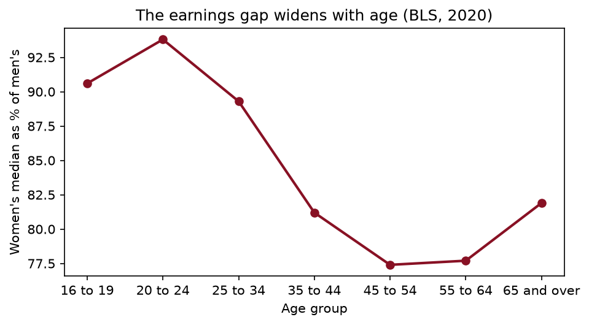

# Chapter 3 — Reproducible projects with Git

> **The question:** a referee asks you to drop 2009 from your sample and redo every table. Can you rebuild every number in the paper with one command, or will you spend six weeks discovering which spreadsheet produced Table 2?

## When results cannot be rebuilt

In 2010 Carmen Reinhart and Kenneth Rogoff, two of the most respected macroeconomists in the world, published a short paper with a striking finding: across twenty advanced economies since the Second World War, when government debt rose above 90% of GDP, economic growth fell sharply, to a slightly negative average. The 90% threshold entered the policy debate in Europe and the United States almost at once, at the height of the arguments over austerity after the financial crisis.

Three years later Thomas Herndon, a graduate student at the University of Massachusetts Amherst, tried to reproduce the result for a class assignment, and could not. Reinhart and Rogoff generously shared their spreadsheet. Herndon, with his professors Michael Ash and Robert Pollin, found three problems. Some years of data for several countries had been left out. The country averages were combined with weights that gave a single bad year in one country as much influence as decades in another. And an Excel formula that averaged across countries stopped five rows short, so that five countries (Australia, Austria, Belgium, Canada and Denmark) were silently excluded. With those corrected, average growth above the 90% threshold was positive, at about 2%: lower than at moderate debt levels, but no cliff.

The economics of public debt is a serious argument, and it did not end there. The lesson I want you to take is narrower. **A single formula range, invisible to anyone who did not open the file, changed a headline number in a debate about the budgets of whole countries.** Nobody had cheated. The workflow simply made the mistake impossible to see.

It is not an isolated case. When economists have tried to rerun published papers from the files the authors and journals provided, they have often failed: the code does not run, a file is missing, or the numbers that come out are not the numbers in the paper. That is why the American Economic Association now has a Data Editor whose office reruns the replication package of every accepted paper before it is published.

This chapter is about the habits that make your own work rebuildable. They are boring, and they are the difference between a project you can defend and one you hope nobody asks about.

> Every number in your work should come from code that you, or anyone, can rerun from the raw data with one command. Everything else in this chapter is a way of making that true.

### Worked example — a range that stops short

Here is a hypothetical version of the spreadsheet problem. Twenty countries’ average growth rates in high-debt years, sorted alphabetically, are in a column. One formula averages all twenty; a second, mistyped one starts five rows too late. How much does the headline change?

### Solution

``` python
rng = np.random.default_rng(SEED)
growth = pd.Series(rng.normal(2.0, 1.5, 20).round(1),
                   index=[f"country_{i:02d}" for i in range(20)])
growth.iloc[:5] += 3.0            # suppose the first five happen to have grown faster
right = growth.mean()             # =AVERAGE(B2:B21)
wrong = growth.iloc[5:].mean()    # =AVERAGE(B7:B21), the range starts five rows late
print(f"all 20: {right:.2f}%   rows 6-20 only: {wrong:.2f}%")
```

    all 20: 2.90%   rows 6-20 only: 2.40%

Averaging all twenty gives 2.90%; the mistyped range gives 2.40%. Nothing on the screen tells you that the second number is wrong. A spreadsheet shows you the result of a formula, not the formula, and certainly not the five rows it skipped.

In code, the same mistake is possible, `growth.iloc[5:]`, but it is *written down* where a coauthor, a referee or you in six months can read it, and you can add a line that would have caught it: `assert len(sample) == 20`. That is the theme of the chapter. Code does not stop you making mistakes. It makes them visible, and it lets you check for them automatically.

## A project layout that explains itself

Gentzkow and Shapiro, two empirical economists, wrote a short guide for their research assistants, *Code and Data for the Social Sciences*. It has eight rules. The first four do most of the work:

1.  **Automate everything.** If you did something by hand (deleted header rows in Excel, copied a coefficient into Word), nobody can repeat it, including you.
2.  **Put everything under version control.** We get to that below.
3.  **Separate directories by function.** Inputs, code, intermediate files and outputs live in different folders.
4.  **Store cleaned data in tables with unique, non-missing keys.** Know what one row is (Chapter 4 makes this a rule).

Here is the layout I want for every problem set and for your final project:

``` text
gender-gap/
├── README.md            what this is, where the data come from, how to run it
├── requirements.txt     the packages and versions it needs
├── main.py              runs every step, in order
├── code/
│   ├── config.py        paths and constants, defined once
│   ├── 01_download.py
│   ├── 02_clean.py
│   ├── 03_analysis.py
│   └── 04_figures.py
├── data/
│   ├── raw/             as downloaded; read-only, never edited by hand
│   └── clean/           made by code
└── output/
    ├── tables/          made by code
    └── figures/         made by code
```

Information flows one way: **raw → clean → output → write-up**. The raw data are never edited; if a value in them is wrong, the *cleaning code* fixes it, with a comment saying why. Everything in `data/clean/` and `output/` is made by code, which means you could delete those folders and rebuild them. If you cannot, the project is not reproducible, and it is better to find out now than when a referee asks.

The numbered script names are not decoration. They tell a reader the order in which things happen without opening a single file.

### Worked example — where does it go?

You are studying the gender earnings gap with the BLS’s quarterly earnings tables. Where does each of these belong? (a) The CSV as downloaded from the BLS. (b) A version with only the rows for all races and all origins. (c) A function that converts quarterly dates. (d) The chart in your paper. (e) A note about which table on the BLS site you downloaded, and when.

### Solution

1)  `data/raw/`, untouched. (b) `data/clean/`, written by `02_clean.py`. (c) In a module in `code/`, so that every script that needs it imports the same function, rather than in five copies that drift apart. (d) `output/figures/`, saved by `04_figures.py`; the write-up reads it from there. (e) In `README.md`, or a `data/raw/README.md`: the source, the URL, the date, and what one row is. Data documentation is the documentation you will be most grateful for later.

## Scripts, notebooks and one command

Notebooks are wonderful for exploring. You run a cell, look at the output, change something, run it again. That is also their weakness: a notebook remembers everything you have run, in whatever order you ran it, including cells you have since edited or deleted. The state of the notebook on your screen may not be reproducible from the cells in the file.

**Scripts** run top to bottom, every time, from a fresh start. A script that does one job, reads its inputs from known places and writes its outputs to known places, is the building block of a reproducible project. Here is the shape of one:

``` python
"""Clean the raw BLS file -> data/clean/earn.parquet."""
import pandas as pd
from config import DATA_RAW, DATA_CLEAN

def clean(raw: pd.DataFrame) -> pd.DataFrame:
    """Keep all races and origins, men and women, the seven age groups."""
    ...

if __name__ == "__main__":
    clean(pd.read_csv(DATA_RAW / "earn.csv")).to_parquet(DATA_CLEAN / "earn.parquet")
```

The docstring says what it reads and writes. The work is in a function. And the last two lines run only when the file is executed as a script (`python code/02_clean.py`), not when another file imports it with `from clean import clean`. That `if __name__ == "__main__":` guard is what lets you reuse a cleaning function in a notebook without rerunning the whole cleaning step.

Then one file, `main.py`, runs every step in order:

``` python
"""Rebuild every result from the raw data: python main.py"""
import subprocess, sys

STEPS = ["code/01_download.py", "code/02_clean.py", "code/03_analysis.py", "code/04_figures.py"]
for step in STEPS:
    print(f"--> {step}")
    subprocess.run([sys.executable, step], check=True)
```

`check=True` stops at the first step that fails, rather than carrying on and leaving you with a mixture of fresh and stale results. (Professional projects use tools like `make` or `snakemake` that rerun only the steps whose inputs changed. For a problem set, `main.py` is plenty.)

The write-up then reads from `output/`. Better still, write it in **Quarto**, as this book is, so that numbers in the text are computed by inline Python expressions when the document is built, rather than typed. Then the referee’s request to drop 2009 is one edit and one command, and every number in the paper updates.

### Worked example — which one reproduces?

Rosa’s notebook has five cells. She ran them in the order 1, 2, 3, 5, then edited cell 2 to drop observations with zero earnings, re-ran cell 2, and ran cell 4. Cell 4 computes the mean earnings and prints it, and she copies that number into her paper. Will a coauthor who opens the notebook and clicks “Run all” get the same number?

### Solution

Not necessarily. Cell 4 used whatever the data looked like after the *edited* cell 2, but also after cell 3 and cell 5 had run on the *old* version of the data. If cell 3 or 5 modified the data frame (dropped rows, created a variable, overwrote a column), the state cell 4 saw was a mixture that “Run all” will never recreate. The fix is a habit: before you take any number from a notebook, **restart the kernel and run all cells**. If the number changes, you have just found out which one was real. Better, once the analysis settles, move it into scripts.

## Paths with pathlib

The single most common reason a classmate’s code will not run on your laptop is a line like this:

``` python
df = pd.read_csv("/Users/rosa/Dropbox/thesis/data/raw/cps.csv")   # works only on Rosa's laptop
```

It is an **absolute path**, and it encodes Rosa’s user name, her Dropbox, her folder structure. The fix has three parts: use paths **relative to the project root**; build them with Python’s `pathlib`, which handles the difference between `/` on a Mac and `\` on Windows; and define the root **once**, in one file.

`pathlib` treats a path as an object, and `/` joins its pieces:

``` python
from pathlib import Path

ROOT = Path("gender-gap")
f = ROOT / "data" / "raw" / "earn.csv"
print(f)
print(f.name, f.stem, f.suffix, f.parent.name, sep=" | ")
print(f.relative_to(ROOT), f.with_suffix(".parquet").name, sep=" | ")
```

    gender-gap/data/raw/earn.csv
    earn.csv | earn | .csv | raw
    data/raw/earn.csv | earn.parquet

The other methods you will use every week: `.exists()`, `.mkdir(parents=True, exist_ok=True)` (make the folder and any missing parents, and do not complain if it is already there), `.glob("*.csv")` (every CSV in a folder), and `.read_text()`.

A **config module** is where the root is defined. Every other script imports from it:

``` python
# code/config.py
from pathlib import Path

ROOT = Path(__file__).resolve().parents[1]     # the folder above code/, wherever it lives
DATA_RAW = ROOT / "data" / "raw"
DATA_CLEAN = ROOT / "data" / "clean"
TABLES = ROOT / "output" / "tables"
FIGS = ROOT / "output" / "figures"
SEED = 368
```

`__file__` is the path of `config.py` itself. `.resolve()` makes it absolute, and `.parents[1]` goes up two levels, from `code/config.py` to the project folder. Because it is computed from where the file *is*, the project can live in your Documents folder, a classmate’s Desktop, or a Codespace, and every path is still right. **No other file in the project contains a path string.**

### Worked example — stacking a folder of files

The BLS posts one file per year. You have saved three of them, `earn_2018.csv` to `earn_2020.csv`, in `data/raw/`. Stack them into one table without typing a file name.

### Solution

I make three small files in a scratch folder so that the example is self-contained:

``` python
raw = Path(tempfile.mkdtemp()) / "data" / "raw"
raw.mkdir(parents=True)
for yr in [2018, 2019, 2020]:
    part = earn[(earn["year"] == yr) & (earn["sex"] == "Both Sexes")].head(4)
    part.to_csv(raw / f"earn_{yr}.csv", index=False)

files = sorted(raw.glob("earn_*.csv"))
panel = pd.concat([pd.read_csv(p) for p in files], ignore_index=True)
print([p.name for p in files], panel.shape)
print(panel.groupby("year").size().to_dict())
```

    ['earn_2018.csv', 'earn_2019.csv', 'earn_2020.csv'] (12, 8)
    {2018: 4, 2019: 4, 2020: 4}

`glob` finds every file matching the pattern, `sorted` puts them in order, and a list comprehension reads each one. When the 2021 file arrives you drop it in the folder and change nothing. (The `sorted` matters: `glob` returns files in whatever order the operating system likes, and you want the same order on every machine.)

## Assertions: tests for your data

An **assertion** is a line that says “this must be true here”, and stops the program if it is not:

``` python
assert condition, "message if it fails"
```

They cost one line each, and they catch the mistakes that otherwise make it all the way into a paper: a merge that duplicated rows, a key that is not unique, an income that is negative, a sample that is the wrong size. Put them **right after every load and every merge**.

Here they are on the real BLS file. Its key, the columns that together identify one row, is sex, race, ethnic origin, age group, year and quarter:

``` python
KEY = ["sex", "race", "ethnic_origin", "age", "year", "quarter"]
assert not earn.duplicated(KEY).any(), "key is not unique"
assert earn[KEY].notna().all().all(), "missing values in the key"
assert earn["median_weekly_earn"].between(100, 5_000).all(), "implausible earnings"
assert earn["year"].between(2010, 2020).all()
print(f"{len(earn):,} rows passed all checks")
```

    4,224 rows passed all checks

Silence is success: an assertion that holds prints nothing. When one fails, Python raises an `AssertionError` with your message. Here is one failing on purpose, caught so that we can see the message:

``` python
bad = pd.DataFrame({"pid": [1, 2, 2], "year": [2019, 2019, 2019],
                    "income": [40_000, -5, 52_000]})
for check, msg in [(not bad.duplicated(["pid", "year"]).any(), "duplicate (pid, year)"),
                   (bad["income"].ge(0).all(), "negative incomes")]:
    try:
        assert check, msg
    except AssertionError as err:
        print("AssertionError:", err)
```

    AssertionError: duplicate (pid, year)
    AssertionError: negative incomes

Two rules. **Fix the data, never the assertion.** If `assert len(df) == 8_984` fails, the response is to find out why the count changed, not to change 8,984 to whatever you got. And **assert substantive facts, not just mechanical ones**: shares between 0 and 1, totals that add up to the published total, ages between 0 and 120, the number of US states equal to 50 (or 51 with DC, and write down which).

For merges, pandas has an assertion built in. `validate="many_to_one"` makes the merge fail if the right-hand table has duplicate keys, which is the merge that silently multiplies your rows:

``` python
people = pd.DataFrame({"pid": [1, 2, 3], "fips": ["23001", "23005", "23001"]})
counties = pd.DataFrame({"fips": ["23001", "23005"], "county": ["Androscoggin", "Cumberland"]})
merged = people.merge(counties, on="fips", how="left", validate="many_to_one")
assert len(merged) == len(people)
print(merged.to_string(index=False))
```

     pid  fips       county
       1 23001 Androscoggin
       2 23005   Cumberland
       3 23001 Androscoggin

### Worked example — the totals that do not add up

The BLS file has rows for “Both Sexes” as well as for men and women. Check, for all races and origins aged 16 and over, that the number of men plus the number of women equals the number of both sexes in every quarter. Then decide what tolerance to allow.

### Solution

``` python
tot = (earn.query("race == 'All Races' and ethnic_origin == 'All Origins' and age == '16 years and over'")
           .pivot_table(index=["year", "quarter"], columns="sex", values="n_persons"))
gap = tot["Men"] + tot["Women"] - tot["Both Sexes"]
print(f"largest discrepancy: {gap.abs().max():,.0f} people out of {tot['Both Sexes'].mean():,.0f}")
assert (gap.abs() <= 1_000).all(), "men + women != both sexes"
```

    largest discrepancy: 1,000 people out of 108,227,841

The largest discrepancy across 44 quarters is 1,000 people out of about 108 million. The BLS publishes counts rounded to the nearest thousand, so a tolerance of 1,000 is what “adds up” means here. This is the kind of check that tells you whether you understand a file. If it had failed, the first suspect would be my filter, not the BLS.

## Minimal reproducible examples

Sooner or later you will be stuck, and you will ask someone: a classmate, me, a TA, Stack Overflow, an AI assistant. How you ask decides how quickly you get help. “My merge doesn’t work” is unanswerable. A **minimal reproducible example** (MRE, or *reprex*) is the smallest self-contained piece of code that shows the problem:

- **Minimal**: strip out everything that is not needed to trigger it.
- **Self-contained**: it makes its own tiny data. Nobody else has `my_file.csv`.
- **Reproducible**: it includes the imports, the seed and the package versions, and it shows the output you got and the output you expected.

``` python
import pandas as pd                     # pandas version printed below
a = pd.DataFrame({"id": [1, 2], "x": [10, 20]})
b = pd.DataFrame({"id": [1, 1, 2], "y": [5, 6, 7]})
m = a.merge(b, on="id")
print(pd.__version__, len(a), len(m))  # expected 2 rows, got 3. Why?
```

    3.0.6 2 3

Anyone can paste that and see the problem in five seconds: `id` 1 appears twice in `b`, so the merge correctly produces two rows for it. `validate="one_to_one"` would have caught it.

The secret about MREs is that building one solves the problem yourself about half the time. In stripping your 300-line notebook down to six lines, you find the line that matters.

### Worked example — from a complaint to an MRE

A classmate writes: “My average earnings come out as an error about strings. Here’s my notebook (400 lines).” Write the MRE she should have sent.

### Solution

The likely culprit is a number stored as text, so the MRE builds exactly that:

``` python
df = pd.DataFrame({"earn": ["754", "1,082", "891"]})   # as read from a CSV with commas
try:
    df["earn"].mean()
except TypeError as err:
    print("TypeError:", err)
print(pd.to_numeric(df["earn"].str.replace(",", "")).mean())
```

    TypeError: Cannot perform reduction 'mean' with string dtype
    909.0

Three rows reproduce the error, and the fix (strip the thousands separators, then convert) is one line. In her real file, `pd.read_csv(..., thousands=",")` would do it at load time. The 400-line notebook was hiding a one-line problem.

## Git: snapshots of a project

You have seen this folder, or one like it:

``` text
analysis.py
analysis_old.py
analysis_rosa_edits.py
paper_FINAL.docx
paper_FINAL_v2_actually_final.docx
```

Which version produced Table 2? What changed between `FINAL` and `FINAL_v2`? How do you combine Rosa’s edits with yours? **Git** answers all three. It is a program that records **snapshots** of a folder over time, lets you go back to any of them, compare any two, and work on several versions in parallel. **GitHub** is a website that hosts Git projects, so that you can back them up, share them, and collaborate. Git is to GitHub roughly what email is to Gmail.

The vocabulary:

- A **repository** (repo) is a folder whose history Git tracks. The history lives in a hidden `.git/` subfolder.
- A **commit** is a snapshot of the whole project, with an author, a date, a message saying why, a pointer to the previous commit, and a unique ID (a *hash*, like `a3f9c2e`).
- The **staging area** is where you assemble the next commit. You change files in your **working directory**, `git add` the changes you want to include, and `git commit` records them.

``` bash
git init                                # start tracking this folder (once)
git status                              # what has changed since the last commit?
git diff                                # exactly which lines changed
git add code/02_clean.py                # stage one file
git commit -m "Drop rows with zero earnings before computing medians"
git log --oneline                       # the history, one line per commit
```

A good history reads like a lab notebook:

``` text
a3f9c2e Winsorize income at the 1st and 99th percentiles
7b21d04 Merge county names with validate="many_to_one"
1c0e9fa Download BLS earnings tables
0d4e3b1 Initial project structure
```

Commit messages are for a future reader: imperative mood, under about 60 characters, saying *what* changed and, where it is not obvious, *why*. “Fix duplicate IDs in county merge” is good. “stuff”, “update” and “asdf” are not. Commit small, logical units, one idea per commit, so that any one of them can be understood and, if necessary, undone.

Undoing is the point. `git restore file.py` throws away uncommitted edits to a file. `git revert a3f9c2e` makes a new commit that undoes an old one. `git show 7b21d04:code/02_clean.py` shows a file as it was. Avoid `git reset --hard` and `git push --force` on anything a coauthor uses: they rewrite history that other people depend on.

> Version control turns “I hope nothing broke” into “I can see exactly what changed, and undo it.”

### Worked example — one afternoon, three commits

In one afternoon you (i) fixed a typo in a variable name in `02_clean.py`, (ii) added a new figure script `04_figures.py`, and (iii) changed the sample in `config.py` from 2010–2020 to 2010–2019 because 2020 is distorted by the pandemic. Write the commits.

### Solution

Three commits, one idea each, in an order in which every commit leaves the project working:

``` bash
git add code/02_clean.py
git commit -m "Fix typo in median earnings column name"
git add code/config.py
git commit -m "End sample in 2019: 2020 earnings distorted by pandemic job losses"
git add code/04_figures.py
git commit -m "Add figure: earnings ratio by age"
```

The sample change gets its own commit, and its message says why, because it is an economic decision that a referee may ask about, and that you may want to reverse. If it were mixed in with the typo fix, undoing it would also undo the fix.

## Branches, merges and conflicts

A **branch** is a separate line of work. `main` is the default. When you want to try something risky, a new specification or a big refactor, you make a branch, work there, and merge it back into `main` only if it works:

``` bash
git switch -c try-lasso          # create a branch and move to it
# ... edit, commit, edit, commit ...
git switch main                  # back to main, untouched by the experiment
git merge try-lasso              # bring the branch's commits into main
git branch -d try-lasso          # delete the merged branch
```

Git merges automatically when two lines of work touch different lines of a file. When they change the **same lines**, it cannot know which you want, and it stops with a **conflict**, marking the disputed lines in the file:

``` text
<<<<<<< HEAD
SAMPLE_YEARS = range(2010, 2020)
=======
SAMPLE_YEARS = range(2010, 2021)
>>>>>>> rosa-extend-sample
```

The part between `<<<<<<<` and `=======` is your version (`HEAD`); the part after is the incoming branch’s. To resolve it, edit the file to say what it should say (one side, the other, or a combination), delete the three marker lines, then `git add` the file and `git commit`. VS Code puts “Accept Current / Accept Incoming / Accept Both” buttons above each conflict.

Conflicts are not errors. They are Git declining to make a decision that is yours. You avoid most of them by pulling often, committing small changes, and agreeing with your coauthor about who is editing which file. Keeping each step of the pipeline in its own script helps here too.

### Worked example — resolving the sample conflict

You ended the sample in 2019 because of the pandemic; Rosa extended it to 2020 to use the latest data. The conflict above is the result. How do you resolve it?

### Solution

Not by clicking a button. This is an economic decision disguised as a merge conflict, and the right resolution is a conversation: is 2020 a valid observation of the gender earnings gap, or is it contaminated by the fact that low-wage workers, disproportionately women, lost their jobs, which *raises* median earnings among those still employed? A reasonable compromise is to keep both, in a form that makes the choice explicit:

``` python
SAMPLE_YEARS = range(2010, 2020)          # main sample: pre-pandemic
ROBUSTNESS_YEARS = range(2010, 2021)      # robustness: includes 2020
```

Then commit with a message explaining the decision. The merge conflict did you a favour: it forced a decision that would otherwise have been made silently by whoever pushed last.

## GitHub: remotes, pull requests and problem sets

A **remote** is a copy of the repository somewhere else, usually on GitHub, conventionally called `origin`. The everyday loop is:

``` bash
git pull                         # bring down your coauthors' commits first
# ... edit, run main.py, check ...
git add -p                       # review each change before staging it
git commit -m "Add binned scatter of mobility against income"
git push                         # send your commits to GitHub
```

**Pull before you push.** If someone pushed while you were working, GitHub will refuse your push until you have pulled and merged their work.

A **pull request** (PR) is a request to merge a branch, made on GitHub, where others can see the diff line by line, comment on it, ask for changes, and finally click **Merge**:

``` bash
git switch -c fix-merge-bug
# ... edit, commit ...
git push -u origin fix-merge-bug
gh pr create --title "Fix many-to-many county merge" --body "Closes #12"
```

Code review through pull requests is the most effective habit in professional data work. A second pair of eyes on a merge or a sample restriction catches the mistakes that tests miss, and it spreads knowledge of the project. **Issues** are GitHub’s to-do list: “the merge drops 312 counties” is an issue, and a commit message that says “closes \#12” closes it automatically.

For this course: each problem set is a repository that **GitHub Classroom** creates for you from a template when you accept the assignment link. You clone it, work in it, commit and push; whatever is on `main` at the deadline is your submission.

``` bash
git clone https://github.com/<course-org>/ps1-wrangling-yourname.git
cd ps1-wrangling-yourname
uv venv --python 3.12 && source .venv/bin/activate
uv pip install -r requirements.txt
```

Commit early and often. Twenty-five commits that show the analysis taking shape tell me far more, and protect you far better, than one commit at 11:58 pm. If your laptop is struggling, **GitHub Codespaces** gives you the same environment in a browser; commit and push before you close the tab, because idle Codespaces are deleted.

### Worked example — a problem set with a partner

You and a partner share a problem-set repository. You are cleaning the data in `02_clean.py`; she is writing the figures in `04_figures.py`, which reads your clean file. Describe a workflow that avoids both conflicts and the “it works on my laptop” problem.

### Solution

Each of you works on a branch (`clean-data`, `figures`) and opens a pull request when a piece works; the other reviews it before it is merged into `main`. Because you edit different files, Git will merge the two without conflicts. Agree early on the *interface* between your scripts, the name and columns of the clean file, and put an assertion at the top of her script that checks it (`assert {"sex", "age", "year"} <= set(df.columns)`), so that if you rename a column, her script fails loudly rather than drawing the wrong thing. Before merging each PR, one of you runs `python main.py` from a fresh clone; if it runs there, it runs anywhere.

## What not to commit: .gitignore, keys and data

Some files must never go into a repository. Git skips anything listed in a file called `.gitignore` at the root of the project:

``` bash
# Python and the environment
__pycache__/
.ipynb_checkpoints/
.venv/

# Secrets
.env
*.key

# Data made by code, and raw data too big or too restricted to share
data/clean/
data/raw/*
!data/raw/README.md
output/

# Operating system and editor clutter
.DS_Store
```

(The `!` line re-includes one file, so that the description of the raw data is committed even though the data are not.)

Three kinds of thing stay out.

**The environment.** `.venv/` is hundreds of megabytes and specific to your machine. `requirements.txt` lets anyone rebuild it in a minute.

**Data you cannot or should not share.** GitHub refuses files over 100 MB. More importantly, much economic data comes with conditions. Restricted-use files (Census microdata in a research data centre, IRS records, the NLSY geocode files, much of IPUMS) must never be made public, and a public repository is public. When the data cannot be shared, commit the code that processes them and a README saying exactly how to obtain them. That is what AEA replication packages do.

**Secrets.** API keys, passwords, tokens. Bots scan GitHub for leaked keys continuously, and a key pushed to a public repository can be in use by someone else within minutes. Keep keys in a `.env` file or an environment variable, which is ignored, and read them in your code:

``` python
import os
fred_key = os.environ.get("FRED_API_KEY")      # set in your shell or a .env file, never in code
print("FRED key found" if fred_key else "no FRED key set: the script would stop here and say so")
```

    no FRED key set: the script would stop here and say so

### Worked example — I pushed my API key

You committed a file containing your FRED API key and pushed it to GitHub an hour ago. You then deleted the line and committed again. Are you safe?

### Solution

No. The key is still in the repository’s **history**: anyone can read the earlier commit, and deleting the line only removed it from the current version. Do two things, in this order. First, **revoke the key** at the provider (FRED lets you delete a key and make a new one); that is the only step that actually protects you. Then stop it happening again: move the key to an ignored `.env` file, read it with `os.environ`, and stop Git tracking any file that held it:

``` bash
git rm --cached .env             # stop tracking the file, keep your local copy
echo ".env" >> .gitignore
git commit -m "Stop tracking .env"
```

Rewriting history to remove the old commit is possible, but it is fiddly and it does not help if someone has already copied the key. Revoke first.

## In Python

Now the whole chapter at once: a small but complete project, built from scratch, answering one question from the BLS earnings tables. *How do women’s median weekly earnings compare with men’s at different ages?* The project lives in a scratch folder, `PROJ`. The cell magic `%%writefile` saves a cell’s contents to a file, so each of the next five cells is one file of the project, exactly as you would write it in VS Code.

``` python
%%writefile {PROJ}/code/config.py
"""Paths and constants shared by every script. No other file contains a path."""
from pathlib import Path

ROOT = Path(__file__).resolve().parents[1]
DATA_RAW, DATA_CLEAN = ROOT / "data" / "raw", ROOT / "data" / "clean"
TABLES, FIGS = ROOT / "output" / "tables", ROOT / "output" / "figures"
for d in [DATA_RAW, DATA_CLEAN, TABLES, FIGS]:
    d.mkdir(parents=True, exist_ok=True)

URL = ("https://raw.githubusercontent.com/rfordatascience/tidytuesday/"
       "main/data/2021/2021-02-23/earn.csv")
AGES = ["16 to 19 years", "20 to 24 years", "25 to 34 years", "35 to 44 years",
        "45 to 54 years", "55 to 64 years", "65 years and over"]
```

``` python
%%writefile {PROJ}/code/01_download.py
"""Download the BLS earnings table once into data/raw/. Never edit it by hand."""
import urllib.request
from config import DATA_RAW, URL

target = DATA_RAW / "earn.csv"
if not target.exists():
    urllib.request.urlretrieve(URL, target)
print(f"raw: {target.name}, {target.stat().st_size:,} bytes")
```

``` python
%%writefile {PROJ}/code/02_clean.py
"""data/raw/earn.csv -> data/clean/earn.parquet: all races and origins, men and women, 7 ages."""
import pandas as pd
from config import DATA_RAW, DATA_CLEAN, AGES

def clean(raw: pd.DataFrame) -> pd.DataFrame:
    keep = (raw["race"].eq("All Races") & raw["ethnic_origin"].eq("All Origins")
            & raw["sex"].isin(["Men", "Women"]) & raw["age"].isin(AGES))
    return raw.loc[keep, ["sex", "age", "year", "quarter", "median_weekly_earn"]]

if __name__ == "__main__":
    df = clean(pd.read_csv(DATA_RAW / "earn.csv"))
    assert not df.duplicated(["sex", "age", "year", "quarter"]).any(), "key not unique"
    assert set(df["age"]) == set(AGES) and df["median_weekly_earn"].between(100, 5_000).all()
    df.to_parquet(DATA_CLEAN / "earn.parquet", index=False)
    print(f"clean: {len(df):,} rows")
```

``` python
%%writefile {PROJ}/code/03_analysis.py
"""data/clean/earn.parquet -> output/tables/ratio_by_age_2020.csv"""
import pandas as pd
from config import DATA_CLEAN, TABLES, AGES

df = pd.read_parquet(DATA_CLEAN / "earn.parquet")
table = (df.query("year == 2020")
           .pivot_table(index="age", columns="sex", values="median_weekly_earn", aggfunc="mean")
           .reindex(AGES)
           .assign(ratio=lambda d: d["Women"] / d["Men"]))
assert table["ratio"].between(0, 1.5).all()
table.round(3).to_csv(TABLES / "ratio_by_age_2020.csv")
print(f"table: {len(table)} age groups")
```

``` python
%%writefile {PROJ}/code/04_figures.py
"""output/tables/ratio_by_age_2020.csv -> output/figures/ratio_by_age_2020.png"""
import matplotlib
matplotlib.use("Agg")                       # draw to a file, no window
import matplotlib.pyplot as plt
import pandas as pd
from config import TABLES, FIGS

t = pd.read_csv(TABLES / "ratio_by_age_2020.csv")
fig, ax = plt.subplots(figsize=(7, 3.5))
ax.plot(t["age"].str.replace(" years", ""), t["ratio"] * 100, "o-", color="#881124", lw=2)
ax.set(xlabel="Age group", ylabel="Women's median as % of men's",
       title="The earnings gap widens with age (BLS, 2020)")
fig.savefig(FIGS / "ratio_by_age_2020.png", dpi=150, bbox_inches="tight")
print("figure saved")
```

And `main.py`, at the root, runs the four steps in order:

``` python
%%writefile {PROJ}/main.py
"""Rebuild every result from the raw data: python main.py"""
import subprocess, sys
from pathlib import Path

HERE = Path(__file__).resolve().parent
for step in ["01_download.py", "02_clean.py", "03_analysis.py", "04_figures.py"]:
    print(f"--> {step}", flush=True)       # flush: print now, before the step's own output
    subprocess.run([sys.executable, HERE / "code" / step], check=True)
```

Now the one command. (Running it from this book, I call it with `subprocess`; in a terminal you would type `python main.py`.)

``` python
def run_main():
    out = subprocess.run([sys.executable, PROJ / "main.py"], capture_output=True, text=True, check=True)
    print(out.stdout)

run_main()
print(sorted(str(p.relative_to(PROJ)) for p in PROJ.rglob("*") if p.is_file()))
```

    --> 01_download.py
    raw: earn.csv, 284,247 bytes
    --> 02_clean.py
    clean: 616 rows
    --> 03_analysis.py
    table: 7 age groups
    --> 04_figures.py
    figure saved

    ['code/01_download.py', 'code/02_clean.py', 'code/03_analysis.py', 'code/04_figures.py', 'code/config.py', 'data/clean/earn.parquet', 'data/raw/earn.csv', 'main.py', 'output/figures/ratio_by_age_2020.png', 'output/tables/ratio_by_age_2020.csv']

The results, read back from `output/`:

``` python
table = pd.read_csv(PROJ / "output" / "tables" / "ratio_by_age_2020.csv", index_col="age")
print(table.to_string())
```

                           Men   Women  ratio
    age                                      
    16 to 19 years      514.25  465.75  0.906
    20 to 24 years      646.00  606.00  0.938
    25 to 34 years      952.75  851.25  0.893
    35 to 44 years     1207.50  980.75  0.812
    45 to 54 years     1264.25  979.00  0.774
    55 to 64 years     1229.25  954.75  0.777
    65 years and over  1102.50  903.25  0.819

``` python
from IPython.display import Image
Image(filename=str(PROJ / "output" / "figures" / "ratio_by_age_2020.png"), width=600)
```



In 2020, women aged 20 to 24 earned 94% of what men of the same age earned at the median; the ratio falls to 77% for ages 45 to 54. The gap widens with age, which is the pattern that research on the “child penalty” (Kleven, Landais and Søgaard 2019, for Denmark) attributes largely to what happens to women’s earnings after the birth of a first child. (This table is a cross-section, so it mixes the effects of age with differences between generations; separating them is a research design problem, not a coding one.)

Finally, the test that matters: **delete everything that code made, rebuild, and check that the results are identical**, byte for byte.

``` python
import hashlib
digest = lambda p: hashlib.sha256(p.read_bytes()).hexdigest()[:12]
before = digest(PROJ / "output" / "tables" / "ratio_by_age_2020.csv")
for generated in ["data/clean", "output"]:
    shutil.rmtree(PROJ / generated)                # gone
run_main()                                         # rebuilt from raw
after = digest(PROJ / "output" / "tables" / "ratio_by_age_2020.csv")
print(f"before {before}, after {after}, identical: {before == after}")
```

    --> 01_download.py
    raw: earn.csv, 284,247 bytes
    --> 02_clean.py
    clean: 616 rows
    --> 03_analysis.py
    table: 7 age groups
    --> 04_figures.py
    figure saved

    before f549fbc73e2f, after f549fbc73e2f, identical: True

If that line says `True` on your machine and on your partner’s, the project is reproducible. That is the standard for every problem set.

## What goes wrong

**Absolute paths.** `"/Users/rosa/Dropbox/..."` works on exactly one laptop. Define the project root once, in `config.py`, from `__file__`, and build every path from it.

**Editing the raw data.** Fixing a typo in the downloaded CSV by hand, or deleting header rows in Excel, is invisible and unrepeatable. Fix it in the cleaning script, with a comment saying why.

**Trusting a notebook’s state.** A number taken from a notebook that has been run out of order may not be reproducible from the notebook itself. Restart and run all before you trust anything, and move settled analysis into scripts.

**Weakening an assertion to make it pass.** When `assert len(df) == 8_984` fails, the data changed or your code did. Find out which. Changing the number defeats the purpose.

**`git add .` without looking.** It stages everything, including the 400 MB data file, the `.venv`, and the `.env` with your API key. Write the `.gitignore` first, run `git status` before every commit, and prefer `git add -p` to review each change.

**Committing a secret and deleting it later.** The key is still in the history. Revoke it at the provider, then fix the repository.

**One giant commit at the deadline.** It cannot be reviewed, cannot be partly undone, and tells nobody how the analysis developed. Commit each logical step as you finish it.

## Exercises

1.  Using `pathlib`, write a function `latest_file(folder, pattern)` that returns the most recently modified file in `folder` matching `pattern` (hint: `max(..., key=lambda p: p.stat().st_mtime)`). Why is a function like this convenient, and why is it risky in a reproducible pipeline?

2.  Add an assertion to `02_clean.py` that checks the cleaned data has exactly one row for each sex × age group × year × quarter, for every year from 2010 to 2020: that is, that the panel is *balanced*. How many rows should there be? Check it.

3.  In the BLS file, check that for every quarter, the number of people aged “16 to 24” equals the sum of those aged “16 to 19” and “20 to 24” (for both sexes, all races and origins), allowing for rounding. Does it hold?

4.  Write a `.gitignore` for a project in which the raw data are a 2 GB file of restricted-use Census microdata, the clean data are Parquet files made by code, and figures are made by code but your coauthor wants them in the repository so she can see them on GitHub. Explain each line.

5.  Your coauthor’s branch changes `AGES` in `config.py` to use the broad groups “16 to 24”, “25 to 54” and “55 and over”; yours adds “65 years and over” to the fine groups. Git reports a conflict. Write down the conflict markers you would see, and resolve it in a way that keeps both analyses.

6.  Use the project in “In Python” to answer the referee’s question: change the analysis to use 2019 instead of 2020, rerun `main.py`, and report how the ratio for ages 45 to 54 changes. How many files did you have to edit?

7.  A paper reports a coefficient of 0.083. You download its replication package, run it, and get 0.079. List three possible explanations, from the most innocent to the most worrying, and what you would check for each.

### Answers

**1.**

``` python
def latest_file(folder, pattern):
    """Most recently modified file in folder matching pattern."""
    return max(Path(folder).glob(pattern), key=lambda p: p.stat().st_mtime)

print(latest_file(PROJ / "code", "*.py").name)
```

    04_figures.py

It saves you from typing the name of this week’s download. It is risky because the answer depends on *when* files were touched, not on what they contain: copy the project, or re-download an old file, and the pipeline silently reads something else. In a reproducible pipeline, name the file you mean in `config.py`.

**2.**

``` python
clean_df = pd.read_parquet(PROJ / "data" / "clean" / "earn.parquet")
expected = 2 * 7 * 11 * 4                          # sexes x ages x years x quarters
counts = clean_df.groupby(["sex", "age", "year"]).size()
assert len(clean_df) == expected and (counts == 4).all(), "panel is not balanced"
print(len(clean_df), expected)
```

    616 616

There should be $2 \times 7 \times 11 \times 4 =$ 616 rows, and there are 616. Checking `len` alone is not enough: a missing quarter in one group and a duplicate in another would cancel out, which is why the second condition checks every group.

**3.**

``` python
y = (earn.query("sex == 'Both Sexes' and race == 'All Races' and ethnic_origin == 'All Origins'")
         .pivot_table(index=["year", "quarter"], columns="age", values="n_persons"))
diff3 = y["16 to 24 years"] - y["16 to 19 years"] - y["20 to 24 years"]
print(f"max |difference|: {diff3.abs().max():,.0f}")
```

    max |difference|: 1,000

The largest discrepancy is 1,000 people, so the age groups nest as they should, up to the BLS’s rounding to the nearest thousand. A check like this is how you learn which rows are subtotals of others, which matters the moment you sum a column.

**4.**

``` bash
# Restricted-use microdata: must never be public, and too big anyway
data/raw/*
# ...but do commit the description of how to obtain it
!data/raw/README.md
# Made by code from raw: regenerate rather than commit
data/clean/
*.parquet
# Rebuilt from requirements.txt
.venv/
# Keys and passwords
.env
# Clutter
__pycache__/
.DS_Store
```

In a `.gitignore`, a `#` starts a comment only at the beginning of a line, so each comment gets a line of its own; `data/clean/   # made by code` would be read as a pattern containing the comment.

Figures are deliberately *not* ignored, since the coauthor wants them on GitHub; agree that only one of you commits them, because regenerated images differ byte by byte and will conflict. And check the data use agreement: some agreements forbid publishing even figures or tables with small cells, which must pass a disclosure review first.

**5.**

``` text
<<<<<<< HEAD
AGES = ["16 to 19 years", "20 to 24 years", "25 to 34 years", "35 to 44 years",
        "45 to 54 years", "55 to 64 years", "65 years and over"]
=======
AGES = ["16 to 24 years", "25 to 54 years", "55 years and over"]
>>>>>>> coauthor-broad-ages
```

Keep both, with names that say what they are, and let the scripts choose explicitly:

``` python
AGES_FINE = ["16 to 19 years", "20 to 24 years", "25 to 34 years", "35 to 44 years",
             "45 to 54 years", "55 to 64 years", "65 years and over"]
AGES_BROAD = ["16 to 24 years", "25 to 54 years", "55 years and over"]
```

Then delete the markers, `git add code/config.py`, and commit with a message that says both groupings are now available.

**6.**

``` python
analysis = PROJ / "code" / "03_analysis.py"
analysis.write_text(analysis.read_text().replace("year == 2020", "year == 2019"))
run_main()
t19 = pd.read_csv(PROJ / "output" / "tables" / "ratio_by_age_2020.csv", index_col="age")
print(f"45-54: 2020 {table.loc['45 to 54 years', 'ratio']:.3f}  2019 {t19.loc['45 to 54 years', 'ratio']:.3f}")
```

    --> 01_download.py
    raw: earn.csv, 284,247 bytes
    --> 02_clean.py
    clean: 616 rows
    --> 03_analysis.py
    table: 7 age groups
    --> 04_figures.py
    figure saved

    45-54: 2020 0.774  2019 0.771

The ratio for ages 45 to 54 is 0.771 in 2019 against 0.774 in 2020. One edit to one file, and one command. Notice the wart, though: the output file is still called `ratio_by_age_2020.csv`. The year should be a constant in `config.py`, used both in the query and in the file name, so that changing it in one place changes it everywhere.

**7.** Most innocent: a different version of a package or of the software changed a default (the optimiser’s tolerance, how missing values are dropped, the random-number generator), which is why replication packages record versions. Check the README for versions and rerun in a matching environment. Next: randomness without a fixed seed, in a bootstrap or a sample split. Check for a seed; rerun twice and see if the number moves. Most worrying: the package does not produce the paper’s numbers because the paper was made from a different version of the data or code than the one deposited, the Reinhart–Rogoff problem. Check whether the sample size you get matches the paper’s; a different $n$ is the quickest sign that the data differ.

## Economics reading

**Herndon, Thomas, Michael Ash, and Robert Pollin (2014). “Does high public debt consistently stifle economic growth? A critique of Reinhart and Rogoff.” *Cambridge Journal of Economics* 38(2): 257–279.** [doi.org/10.1093/cje/bet075](https://doi.org/10.1093/cje/bet075)

The replication that started as a graduate class exercise. Using Reinhart and Rogoff’s own spreadsheet, the authors show how excluded data, unusual weighting and a formula error combined to produce the dramatic growth collapse above 90% debt, and that the corrected relationship between debt and growth is much more gradual.

*Think about:* even with the errors fixed, a correlation between high debt and slow growth could run in either direction. Does slow growth cause debt, or debt slow growth, and what evidence could tell them apart?

**Christensen, Garret, and Edward Miguel (2018). “Transparency, Reproducibility, and the Credibility of Economics Research.” *Journal of Economic Literature* 56(3): 920–980.** [doi.org/10.1257/jel.20171350](https://doi.org/10.1257/jel.20171350)

A survey of the evidence that published economics findings are less reliable than they look: results that cannot be reproduced, publication bias towards significant results, and specification searching. It then reviews the remedies, from data-sharing policies and replication packages to pre-registration and pre-analysis plans, many of which are now standard at economics journals.

*Think about:* who pays the cost of making a project reproducible, and who gets the benefit? What does that imply about whether researchers will do it without journal rules?

**Chang, Andrew C., and Phillip Li (2022). “Is Economics Research Replicable? Sixty Published Papers From Thirteen Journals Say ‘Often Not’.” *Critical Finance Review* 11(1): 185–206.** [doi.org/10.1561/104.00000053](https://doi.org/10.1561/104.00000053)

Two economists tried to reproduce the key results of empirical macroeconomics papers in well-regarded journals, using the data and code that the journals and authors provided. They often could not, even after asking the original authors for help, and the most common reason was that the necessary data or code were simply not in the files.

*Think about:* the authors could only test whether the code reproduces the paper’s numbers, not whether those numbers are right. Why is the first a necessary but not sufficient condition for the second?

**Reading.** Gentzkow and Shapiro (2014), *Code and Data for the Social Sciences: A Practitioner’s Guide*, free online, for the rules behind the project layout. Wilson et al. (2017), “Good Enough Practices in Scientific Computing”, *PLOS Computational Biology*. Bryan (2018), “Excuse Me, Do You Have a Moment to Talk About Version Control?”, *The American Statistician*. Chacon and Straub, *Pro Git*, 2nd ed., chs. 1–3, free at git-scm.com/book. The AEA Data Editor’s template README for replication packages. There is no Géron chapter for this one.
