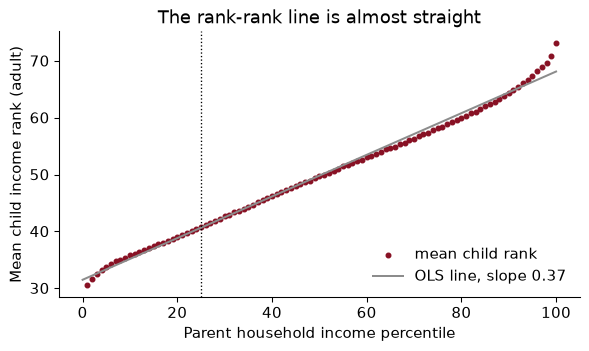
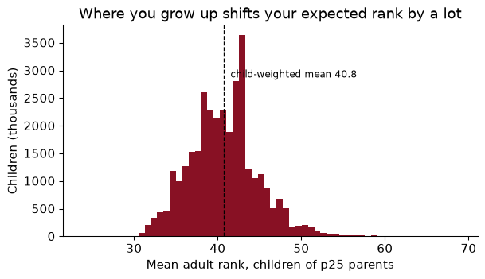
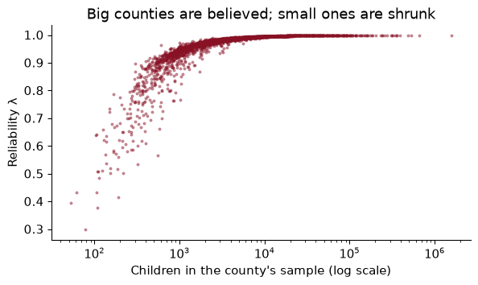
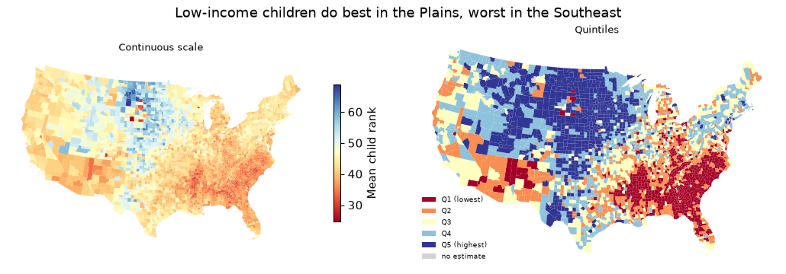
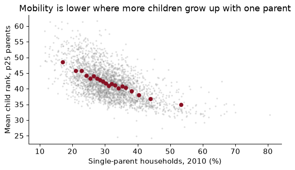
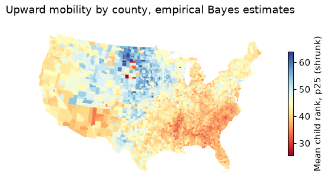
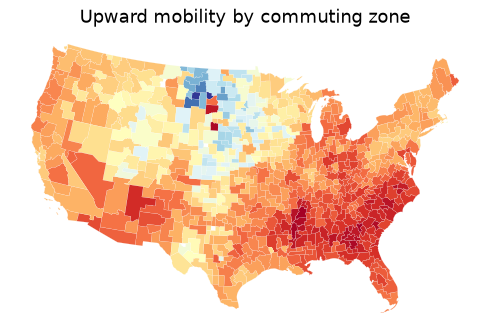

# Chapter 5 — Mapping opportunity

> **The question:** a child grows up in a family at the 25th percentile of the national income distribution. How much does the county she grows up in change where she is likely to end up as an adult, and how much of that is the place itself rather than the families who live there?

## Ranks, not dollars

Ask a simple question: what fraction of American children grow up to earn more than their parents? Chetty, Grusky, Hell, Hendren, Manduca and Narang (2017) found that about 90% of children born in 1940 out-earned their parents, and only about half of those born in the 1980s did. Answering needs something no survey has at scale: parents’ and children’s incomes, linked, decades apart, for millions of families. Their answer came from federal tax records, linking about 20 million children born 1978–1983 to the parents who claimed them as dependents. With that many families you can measure mobility not just for the country but for every county and every Census tract.

That research programme is the template for this part of the course: acquire, wrangle, describe, map, and then ask whether what you see is causal. The public product is the **Opportunity Atlas**, a set of aggregated CSV files the Census Bureau hosts. We use those files.

The first design choice is to measure income in **ranks**. Each parent is ranked against all parents of children in the same birth cohort, from 0 to 100; each child is ranked against everyone else in *their* birth cohort, as an adult in their mid-thirties. Ranks have three virtues over dollars. They handle zeros (there is no log of zero income). They remove inflation and changes in inequality across cohorts, so the 1980 cohort can be compared with the 1940 one. And, empirically, the relationship between parent rank and child rank turns out to be almost perfectly a straight line.



Each dot is the average adult income rank of children whose parents were at that percentile, for the whole country. The line through them is the **rank-rank regression**:

$$\text{ChildRank}_i = \alpha + \beta \cdot \text{ParentRank}_i + \varepsilon_i$$

The slope $\beta$ is **relative mobility**: how much a child’s expected rank rises when her parents’ rank rises by one. If $\beta = 1$, children inherit their parents’ rank exactly; if $\beta = 0$, parents’ rank tells you nothing. In these data $\hat\beta =$ **0.366**, close to the 0.34 that Chetty, Hendren, Kline and Saez (2014) report. (The dots bend a little at the very top and bottom; fitting only percentiles 10 to 90 gives 0.349.)

### Worked example — what a slope of a third means

Using the national line, what is the expected gap in adult income rank between a child born to parents at the 10th percentile and one born at the 90th?

### Solution

The gap is 80 percentiles of parent income times the slope: $80 \times$ 0.366 $=$ 29.3 percentiles. A child from the bottom tenth expects to reach rank 35.2; one from the top tenth, 64.5. Two things are true at once: the gap is large (it is more than a quarter of the whole distribution), and most of the parental gap does *not* pass on, since the children’s expected ranks are much closer together than their parents’. Which of those you emphasize is a matter of what you are arguing, which is a good reason to report the number rather than an adjective.

## Absolute upward mobility

A national slope hides the thing the Atlas is famous for: places differ enormously. For each county, the Opportunity Atlas reports the rank-rank line for children who grew up there, summarized by its predicted value at two points. The headline statistic is the predicted rank at the 25th percentile:

$$\bar y_{25} = \hat\alpha + 25\,\hat\beta$$

This is **absolute upward mobility**: the expected adult rank of a child whose parents were at the 25th percentile, a lower-middle-income family. In the files it is `kfr_pooled_pooled_p25`, which reads as **k**ids’ **f**amily income **r**ank, all races (pooled), all genders (pooled), parents at **p25**. Ranks are stored as fractions; I multiply by 100.

Why a point on the line rather than the slope? Because the slope can fall for reasons nobody would celebrate. A place where rich children do *worse* has a flatter line, so more “relative mobility”, and poor children there are no better off. Absolute mobility asks the policy question directly: how do children from low-income families fare? The two measures are related but distinct; across counties, the correlation between $\bar y_{25}$ and the county slope (from the $p25$ and $p75$ predictions, $(\bar y_{75} - \bar y_{25})/50$) is -0.63. Places where poor children do well tend to be places where parental rank matters less.



Weighting each county by its number of children, the average child from a p25 family reaches rank 40.8. Moving from the county at the 10th percentile of that distribution to the one at the 90th raises it from 35.5 to 46.1, a gap of **10.6 percentiles**. For comparison, the national rank-rank slope says that raising *parents’* income from the 25th to the 50th percentile raises the child’s expected rank by 9.2. Where you grow up appears to matter about as much as a large change in your parents’ income. Whether it *causes* that difference is the question of the last section.

Androscoggin County, home to Bates, sits at 40.9.

### Worked example — three places

Hypothetical counties, each with a straight rank-rank line: **A** has intercept 45 and slope 0.25; **B** intercept 30, slope 0.25; **C** intercept 25, slope 0.45. Rank them by relative mobility and by absolute upward mobility.

### Solution

Relative mobility is the slope, and a *lower* slope means more mobility: A and B tie at 0.25, C is least mobile at 0.45. Absolute mobility is the line’s height at 25: A $= 45 + 25(0.25) = 51.25$, B $= 36.25$, C $= 25 + 25(0.45) = 36.25$. So A beats B for every child, despite the same slope. And C, the “least mobile” place by the slope, is exactly as good as B for a child from a p25 family; it is the children of rich parents in C who do much better. If your question is about poor children, the slope alone would have misled you.

## Small places are noisy

Every number in the Atlas is an estimate from a finite number of children, and many counties are small. The median county has 3,308 children in the sample; 171 counties have fewer than 500. Each estimate comes with a standard error (`_se` columns), and the standard errors are large exactly where the counts are small.

That has a predictable consequence. **If you sort places by a noisy estimate, the extremes are disproportionately the smallest places**, because a small place needs only a little luck to land at the top (or the bottom). It is the winner’s curse, and it is how “the ten best counties to grow up in” lists come to be full of places you have never heard of. The ten highest raw estimates of $\bar y_{25}$ have a median of 389 children each, against 3,308 for all counties.

The fix is **empirical Bayes shrinkage**: pull each estimate towards the overall mean, by more when it is noisier.

$$\hat\theta^{EB}_j = \bar\theta + \lambda_j(\hat\theta_j - \bar\theta), \qquad \lambda_j = \frac{\sigma^2_\theta}{\sigma^2_\theta + s_j^2}$$

Here $s_j$ is county $j$’s standard error and $\sigma^2_\theta$ is the variance of the *true* county values, which we estimate as the variance of the estimates minus the average squared standard error (the part of the spread that is noise). The weight $\lambda_j$ is the **reliability** of county $j$’s estimate: the share of its deviation from the mean that we believe. A big county with a tiny standard error keeps $\lambda \approx 1$; a tiny county with a big one is pulled most of the way to the mean.

``` python
signal_var = d["p25"].var() - (d["p25_se"] ** 2).mean()
d["lam"] = signal_var / (signal_var + d["p25_se"] ** 2)
d["p25_eb"] = d["p25"].mean() + d["lam"] * (d["p25"] - d["p25"].mean())
```



The true spread across counties is large relative to the noise in a typical county: the estimated standard deviation of true $\bar y_{25}$ is 6.1 percentiles, while the median standard error is 0.8. So for most counties $\lambda$ is close to one and shrinkage changes little. It matters at the bottom of the size distribution, where $\lambda$ falls to 0.30. The estimate that moves most is Irion, TX, with 219 children: its raw 60.8 becomes 52.0. 6 of the ten highest raw estimates are still in the top ten after shrinkage in the shrunk top ten. The Great Plains counties at the top really do look exceptional; some of them are just less exceptional than their raw numbers.

At the **tract** level, with a few hundred children per cell, shrinkage matters a great deal, and the Atlas’s published tract maps use it. You have seen the idea before, or will: ridge regression (Chapter 11) shrinks coefficients toward zero for the same reason, and teacher value-added models shrink teacher averages toward the mean.

### Worked example — shrinking one county by hand

*Hypothetical numbers.* The mean of $\bar y_{25}$ across counties is 43 and the true across-county variance is $\sigma^2_\theta = 36$. A small county reports 55 with a standard error of 6. What is its shrunk estimate? What if its standard error were 1?

### Solution

With $s = 6$: $\lambda = 36/(36 + 36) = 0.5$, so $\hat\theta^{EB} = 43 + 0.5(55 - 43) = 49$. Half of the county’s apparent excellence is believed. With $s = 1$: $\lambda = 36/37 \approx 0.97$, and the estimate barely moves, to about 54.7. The rule is not “distrust small places”; it is “distrust a deviation in proportion to how noisy it is”. (There is a second reason for caution in small cells: the Atlas adds a little random noise to every published estimate to protect the privacy of the families in it, Chetty and Friedman’s (2019) method, and that noise is also largest where cells are smallest.)

## Maps need coordinates

A map is a merge between a table of numbers and a table of shapes. Spatial data come in two kinds. **Vector** data are discrete objects with coordinates: points (a firm, a school, a rental listing), lines (a road, a river), polygons (a county, a tract). **Raster** data are grids of pixels, like satellite images of night lights. Counties are polygons, and in Python they live in a **`GeoDataFrame`**: a pandas DataFrame with one special column, `geometry`, holding a shape per row, plus a coordinate reference system. Everything from Chapter 4 (filter, merge, groupby) works on it.

The shapes come from the Census Bureau’s **cartographic boundary files**, generalized versions of its TIGER/Line boundaries, small enough for national maps. `cb_2019_us_county_20m.zip` is the 2019 county file at 1:20 million; `geopandas` reads the zipped shapefile directly.

``` python
shapes = gpd.read_file(DATA / "cb_2019_us_county_20m.zip")
print(type(shapes).__name__, shapes.shape, shapes.crs)
```

    GeoDataFrame (3220, 10) EPSG:4269

### Coordinate reference systems

The last item, `EPSG:4269`, is the **coordinate reference system** (CRS). It says the coordinates are longitude and latitude, in degrees, on the NAD83 model of the Earth’s shape. Coordinates are (x, y) = (**longitude, latitude**), the opposite of the order Google Maps shows you.

A geographic CRS is fine for *storing* locations and useless for *measuring* them, because a degree is not a fixed distance. A degree of latitude is always about 111 km, but a degree of longitude is about 111 km at the equator and about 80 km in Maine. So areas in “square degrees” mean nothing, and geopandas warns you if you compute them. To measure, **project** to a CRS whose units are metres. Every flat map distorts something (area, shape, distance or direction); for a choropleth of the US the standard choice is EPSG:5070, the Albers **equal-area** projection, which preserves area so that a county that looks big really is big.

              county  area in square degrees  area in km² (EPSG:5070)
    Androscoggin, ME                   0.144                     1276
       Aroostook, ME                   2.079                    17685
      Miami-Dade, FL                   0.486                     5410

A square degree is 8,507 km² in Aroostook but 11,128 km² in Miami-Dade, because lines of longitude converge towards the pole. Measured in square degrees, northern counties look bigger, relative to southern ones, than they are.

> Store in longitude and latitude. Project before you compute an area, a distance or a buffer. Use an equal-area projection for choropleths.

### Worked example — how far is Lewiston from Portland?

Bates is at about (−70.20, 44.11) and Portland, Maine, at (−70.26, 43.66). Their “distance” computed on raw coordinates is the straight line in degrees. Why is that number meaningless, and how do you get kilometres?

### Solution

``` python
from shapely.geometry import Point
pts = gpd.GeoSeries([Point(-70.2033, 44.1057), Point(-70.2568, 43.6591)], crs=4326)
deg = pts.iloc[0].distance(pts.iloc[1])
km = pts.to_crs(5070).iloc[0].distance(pts.to_crs(5070).iloc[1]) / 1000
```

In degrees the distance is 0.450, a number with no unit you can use: it mixes a degree of latitude (111 km) with a degree of longitude (about 80 km here) as if they were the same. Projected to EPSG:5070, the distance is 50 km, which is about right for the drive down the turnpike. (For distances across continents, use great-circle distance on the sphere instead; Albers is designed for the contiguous US.)

## Choropleths

A **choropleth** colours each area by a value. Building one is an attribute merge, and the merge key is where most spatial bugs live. County FIPS codes are five-character *strings* with leading zeros: Autauga County, Alabama, is `"01001"`, not `1001`. The Atlas stores `state` and `county` as integers, so we rebuild the string, and then merge with the diagnostics from Chapter 4.

Try first with the newer 2023 boundary file:

``` python
conus23 = shp23[~shp23["STATEFP"].isin(["02", "15", "72"])]
m23 = conus23.merge(cty[["GEOID", "p25"]], on="GEOID", how="left", indicator=True)
print(m23["_merge"].value_counts().to_dict())
print(m23.loc[m23["_merge"] == "left_only", "NAME"].tolist()[:4], "...")
```

    {'both': 3100, 'left_only': 9, 'right_only': 0}
    ['Naugatuck Valley', 'Lower Connecticut River Valley', 'Southeastern Connecticut', 'Western Connecticut'] ...

9 shapes find no data, and all are in Connecticut. In 2022 Connecticut replaced its eight counties with nine “planning regions” for statistical purposes, so the 2023 file has GEOIDs the Atlas, built on the old counties, has never heard of. The lesson is general: **match the vintage of your shapes to the vintage of your data.** The 2019 file matches every county:

``` python
g = (shapes[~shapes["STATEFP"].isin(["02", "15", "72"])]
     .to_crs(5070)
     .merge(cty[["GEOID", "label", "p25", "p25_se", "n_kids", "cz", "czname"]],
            on="GEOID", how="left", validate="one_to_one", indicator=True))
print(g["_merge"].value_counts().to_dict(), "| counties with no estimate:", g["p25"].isna().sum())
```

    {'both': 3108, 'left_only': 0, 'right_only': 0} | counties with no estimate: 4



The map *is* the finding, which is why Chetty and coauthors lead with it. Children from low-income families do best across the Great Plains, from the Dakotas down through Nebraska and Iowa, and in parts of the Northeast and the Mountain West. They do worst across the old cotton belt of the Southeast, on many Native American reservations, and in the industrial Midwest.

A few choices went into that picture, and each one is a choice, not a default:

- **A diverging palette** (red to blue) because the value has a meaningful middle, roughly the national average. For a quantity with no natural midpoint, use a sequential palette (light to dark).
- **Continuous versus classed.** The continuous map shows every difference; the quintile map is easier to read but the break points are arbitrary, and a county just over a break looks very different from one just under.
- **Grey for missing, and say so.** A county with no estimate must not look like a county with a low one.
- **Area is not population.** A choropleth gives a near-empty Nevada county as much ink as Los Angeles. Read the colours as “what places look like”, and use a child-weighted histogram, as in the previous section, for “what children experience”.

### Worked example — a misleading national average

A reporter takes the simple average of $\bar y_{25}$ over all counties on the map and reports it as “how poor children do in America”. What is wrong, and what should she report?

### Solution

``` python
unweighted = g["p25"].mean()
has = g.dropna(subset=["p25", "n_kids"])
weighted = np.average(has["p25"], weights=has["n_kids"])
```

Each county counts once, whether it has two hundred children or two hundred thousand. The simple average is 43.1; weighting by the number of children gives 40.8. The unweighted number describes the typical *county*, which is small and rural; the weighted one describes the typical *child*. The unweighted mean is 2.3 points higher, because the many small rural counties of the Plains have high mobility while big cities, where most children live, are closer to the middle or below it. But the question was about children, so weight by children.

## A spatial join

An attribute merge matches rows by a key. A **spatial join** matches them by *where they are*: which polygon is each point in? That is how you attach a county (or tract, or school district) to anything with coordinates: geocoded firms, schools, crime reports, GPS pings, rental listings.

The Craigslist listings from Chapters 4 and 9 include a latitude and longitude for 4,311 of them. Which county is each in, and what is that county’s upward mobility?

``` python
listings = gpd.GeoDataFrame(geo, geometry=gpd.points_from_xy(geo["lon"], geo["lat"]), crs=4326)
listings = listings.to_crs(shapes.crs)                  # same CRS as the polygons, always
j = gpd.sjoin(listings, shapes[["GEOID", "NAME", "geometry"]], how="left", predicate="within")
agree = (j["NAME"].str.lower() == j["county"]).mean()
outside = j["NAME"].isna().mean()
```

`predicate="within"` asks which polygon each point lies inside. Two checks before trusting it. First, the listings carry their own county label, so we can validate: the spatial join agrees with it for 94.6% of listings. Second, 1.2% of the points fall in no county at all. They are not lost in the ocean: the median one is 195 metres from the nearest county, at the water’s edge in San Francisco and San Mateo. These are cartographic boundaries, simplified to 1:20 million, and a simplified coastline cuts off the edge of the waterfront. For point-in-polygon work near coasts, use the detailed TIGER/Line files or the `500k` cartographic files.

Now attach the Atlas and compare counties:

``` python
bay = (j.query("beds == 2")
        .merge(cty[["GEOID", "p25"]], on="GEOID", validate="many_to_one")
        .groupby("NAME").agg(listings=("price", "size"), median_rent=("price", "median"), p25=("p25", "first"))
        .query("listings >= 20").sort_values("p25"))
print(bay.round(1).to_string())
```

                   listings  median_rent   p25
    NAME                                      
    Santa Cruz           29       1945.0  41.6
    Solano               39       1345.0  42.5
    Contra Costa         88       1850.0  43.9
    Sonoma               88       1757.5  44.5
    Alameda             163       2269.0  44.5
    Santa Clara         418       2595.0  47.5
    San Mateo           145       3000.0  47.5
    Marin                56       2672.5  47.9
    San Francisco       426       3844.0  50.4

Across these 9 Bay Area counties, the correlation between the median two-bedroom rent and upward mobility is 0.91. San Francisco has both the highest rent and the highest mobility. That is the **price of opportunity**: if places matter for children and families know it, the advantage should be capitalized into housing costs, and part of what keeps low-income families out of high-mobility places is the rent. (Nine counties and a handful of listings each is a sketch, not an estimate. Chetty and coauthors find the same pattern nationally, along with “opportunity bargains”: tracts with high mobility and moderate rents.)

### Worked example — what can go wrong in a spatial join

A classmate joins 10,000 school locations to county polygons and gets zero matches. Name two likely causes.

### Solution

The most common: **the two layers are in different CRSs**. Her schools are in longitude and latitude, the polygons in metres (EPSG:5070), so every school sits a few dozen “metres” from the origin, somewhere off the coast of nowhere. `gpd.sjoin` warns about a CRS mismatch; the fix is `points.to_crs(polygons.crs)`. The second: **longitude and latitude swapped** in `points_from_xy`, which puts American schools in Antarctica. Plot both layers on one map before joining and both bugs are obvious in a second.

## Sorting or place?

Why do places differ? The Atlas comes with county covariates, and correlating them with $\bar y_{25}$ (counties with more than 1,000 children) gives a familiar list:

    Single-parent share     -0.60
    Share Black             -0.59
    Poverty rate            -0.50
    Mean commute time       -0.24
    Job growth 2004–13       0.19
    College share            0.19
    3rd-grade math scores    0.38

The strongest correlates are family structure (-0.60 for the single-parent share), the share of Black residents (-0.59), and poverty. Job growth is only weakly related (0.19), which surprises most people: booming local labour markets are not, on their own, where poor children get ahead. Chetty, Hendren, Kline and Saez (2014) found the same five broad factors at the commuting-zone level: segregation, income inequality, school quality, social capital and family structure.



None of this says what would happen to a particular child who moved. There are two very different stories that produce the same map.

- **Sorting.** Families differ in ways the data do not record (wealth, information, persistence, health), and families with advantages choose, or can afford, some places over others. Then high-mobility places are places where advantaged families live, and moving a child there would do little.
- **Place effects.** The place itself, through its schools, its peers, its safety, its networks, changes children’s outcomes. Then moving a child, or improving the place, would raise mobility.

A correlation with the single-parent share does not tell them apart. It is also true of children in two-parent families in those counties (Chetty et al. 2014 show this), which points to something about the *place* rather than only the family, but not decisively.

Separating them needs variation in *exposure* to a place that is unrelated to family traits, the same logic as an experiment (Chapter 7). Two designs have been persuasive.

**Movers.** Chetty and Hendren (2018) compare children in families that move between the same two places but at different ages, often siblings in the same family. If places have causal effects, a child who moves at age 5 should end up closer to the destination’s outcomes than her brother who moved at 15. They find exactly that: outcomes converge to the destination’s by about 4% for each additional year of childhood spent there, a linear “dose–response” in exposure, with no such pattern in the years after age 23, when exposure should no longer matter.

**Experiments.** The Moving to Opportunity experiment of the 1990s randomly offered housing vouchers to families in public housing. Chetty, Hendren and Katz (2016) find that children who moved to lower-poverty neighbourhoods *before age 13* earned substantially more as adults and were more likely to attend college; children who moved as teenagers did not benefit. More recently, Bergman, Chetty, DeLuca, Hendren, Katz and Palmer (2024) ran Creating Moves to Opportunity in Seattle: help with the search and outreach to landlords raised the share of voucher families moving to high-opportunity areas from about 15% to 53%. The barriers to moving were partly informational and logistical, not only preferences.

So the honest summary is: a large part of what the map shows is causal, it works through childhood exposure, and it is not the whole story.

### Worked example — reading a correlation as a policy

A state legislator sees the binscatter and proposes paying couples to marry, “to raise upward mobility”. What would you tell her?

### Solution

That the binscatter is a correlation across counties, and it is consistent with several stories in which her policy does nothing. Single-parent shares are high in places with high poverty, segregation and a history of discrimination, and any of those could be what lowers mobility. Even at the family level, couples who marry differ from those who do not in ways that matter for children; a payment changes who marries, not those underlying differences. Notice too that mobility is lower in high single-parent places *even for children of two-parent families*, which suggests that whatever the single-parent share measures is a feature of the community. If she wants to raise mobility, the causal evidence points at exposure to places, which is what voucher-and-search programmes like CMTO change.

## In Python

The full pipeline: download and cache, build string FIPS codes, merge with checks, shrink, map, and spatially join.

``` python
import urllib.request
from pathlib import Path
import numpy as np, pandas as pd, geopandas as gpd
import matplotlib.pyplot as plt
DATA = Path("../data"); DATA.mkdir(exist_ok=True)
OI = "https://www2.census.gov/ces/opportunity/"
GEO = "https://www2.census.gov/geo/tiger/GENZ2019/shp/cb_2019_us_county_20m.zip"

def fetch(name, url):                                  # download once, then reuse
    path = DATA / name
    if not path.exists():
        urllib.request.urlretrieve(url, path)
    return path

atlas = pd.read_csv(fetch("county_outcomes_simple.csv", OI + "county_outcomes_simple.csv"))
shapes = gpd.read_file(fetch("cb_2019_us_county_20m.zip", GEO))
```

String keys, percentile units, shrinkage.

``` python
atlas = atlas.assign(GEOID=(atlas["state"] * 1000 + atlas["county"]).astype(str).str.zfill(5),
                     p25=100 * atlas["kfr_pooled_pooled_p25"],
                     se=100 * atlas["kfr_pooled_pooled_p25_se"])
est = atlas.dropna(subset=["p25", "se"]).copy()
sig2 = est["p25"].var() - (est["se"] ** 2).mean()
est["p25_eb"] = est["p25"].mean() + sig2 / (sig2 + est["se"] ** 2) * (est["p25"] - est["p25"].mean())
```

Project, merge with diagnostics, map.

``` python
conus = shapes[~shapes["STATEFP"].isin(["02", "15", "72"])].to_crs(5070)
gm = conus.merge(est[["GEOID", "p25", "p25_eb"]], on="GEOID", how="left",
                 validate="one_to_one", indicator=True)
assert (gm["_merge"] == "both").mean() > 0.99, gm["_merge"].value_counts()
ax = gm.plot(column="p25_eb", cmap="RdYlBu", linewidth=0, legend=True, figsize=(7, 4),
             legend_kwds={"shrink": 0.6, "label": "Mean child rank, p25 (shrunk)"},
             missing_kwds={"color": "lightgrey"})
ax.set_axis_off(); ax.set_title("Upward mobility by county, empirical Bayes estimates"); plt.show()
```



## What goes wrong

**Integer FIPS codes.** `1001` is not `"01001"`. A merge on mismatched key types either fails outright or, worse, matches nothing in the states whose codes start with zero (Alabama to Connecticut) and you notice only when the Southeast is grey. Build five-character strings with `str.zfill(5)` and check `_merge`.

**Shapes from the wrong year.** The 2023 county file has Connecticut’s planning regions; data built on the old counties leave 9 holes. Match the vintage of the boundaries to the vintage of the data.

**Measuring in degrees.** Area, distance and buffers in a geographic CRS are meaningless and distorted by latitude. Project first (EPSG:5070 for the contiguous US).

**Ranking noisy small places.** The extremes of a list of noisy estimates are the smallest places. Look at standard errors and counts, and shrink before you rank.

**Treating a map as a population statistic.** Each county gets the same ink regardless of how many children it has, and an unweighted mean over counties describes counties, not children.

**Reading correlates as causes.** Mobility correlates with single-parent share, race and poverty, and all three correlate with each other and with history. The causal evidence comes from movers and from experiments, not from the map.

## Exercises

1.  Using `nat`, estimate the rank-rank slope separately for parent percentiles 1–50 and 51–100. Is the line straighter than you expected? What does a slightly steeper slope at the top mean in words?

2.  Compute the child-weighted mean of $\bar y_{25}$ for each state, and list the five highest and five lowest. How does Maine compare with the national child-weighted mean?

3.  A county has an estimated $\bar y_{25}$ of 60 and a standard error of 4. Using the `signal_var` and mean estimated in the chapter, compute its reliability and its shrunk estimate.

4.  Dissolve counties into commuting zones with `g.dissolve(by="cz", aggfunc=...)`, computing a child-weighted mean of $\bar y_{25}$ for each commuting zone. How many commuting zones are there in the contiguous US? Map them.

5.  Using the counties within 100 km of Bates (a buffer around the projected point, then a spatial join with `predicate="intersects"`), report each county’s $\bar y_{25}$. Is Androscoggin above or below its neighbours?

6.  The Atlas reports $\bar y_{25}$ separately for Black and white children (`kfr_black_pooled_p25`, `kfr_white_pooled_p25`). For counties with more than 500 children in each group, compute the average white–Black gap. What does it mean that the gap exists *within* the same county?

7.  Explain in three or four sentences why the movers design compares children who move at *different ages* rather than movers with non-movers.

### Answers

**1.**

``` python
lo = smf.ols("kid_rank ~ par_pctile", data=nat.query("par_pctile <= 50")).fit().params["par_pctile"]
hi = smf.ols("kid_rank ~ par_pctile", data=nat.query("par_pctile > 50")).fit().params["par_pctile"]
```

The slope is 0.360 over the bottom half and 0.408 over the top half. The line is close to straight, which is why a single slope is a fair summary. A steeper slope at the top means that parents’ rank matters more among richer families: moving up a percentile near the top of the distribution buys a child more than moving up a percentile near the bottom.

**2.**

``` python
st = (ok.assign(st=ok["STATEFP"].map(abbr), w=ok["p25"] * ok["n_kids"])
        .groupby("st")[["w", "n_kids"]].sum()
        .assign(p25=lambda d: d["w"] / d["n_kids"])["p25"].sort_values())
print(st.head(5).round(1).to_dict(), st.tail(5).round(1).to_dict())
```

    {'DC': 34.9, 'SC': 35.6, 'GA': 35.7, 'NC': 35.9, 'MS': 36.1} {'MN': 47.5, 'IA': 47.6, 'SD': 48.6, 'WY': 48.8, 'ND': 53.1}

Maine’s child-weighted mean is 41.9, against 40.8 nationally, so it is above average. The lowest states are in the Southeast and the highest in the northern Plains, the pattern on the map.

**3.**

``` python
lam3 = signal_var / (signal_var + 4 ** 2)
eb3 = d["p25"].mean() + lam3 * (60 - d["p25"].mean())
```

The reliability is 36.8 / (36.8 + 16) = 0.70, and the shrunk estimate is 43.0 + 0.70 × (60 − 43.0) = 54.9. A standard error of 4 is large compared with the typical county’s, so the estimate gives up about 30% of its distance from the mean.

**4.**

``` python
gz = g.dropna(subset=["p25", "cz"]).assign(w=lambda x: x["p25"] * x["n_kids"])
czs = gz.dissolve(by="cz", aggfunc={"w": "sum", "n_kids": "sum"})
czs["p25"] = czs["w"] / czs["n_kids"]
ax = czs.plot(column="p25", cmap="RdYlBu", linewidth=0.1, edgecolor="white", figsize=(7, 4))
ax.set_axis_off(); ax.set_title("Upward mobility by commuting zone"); plt.show()
```



There are 722 commuting zones. `dissolve` is `groupby` plus a geometric union: the counties in each zone are merged into one polygon, and the aggregation adds up the weighted sums. The map is smoother than the county map, as averages over bigger areas always are, but the same regions stand out.

**5.**

``` python
bates = gpd.GeoSeries([Point(-70.2033, 44.1057)], crs=4326).to_crs(5070)
ring = gpd.GeoDataFrame(geometry=bates.buffer(100_000))
near = gpd.sjoin(g, ring, predicate="intersects")[["label", "p25"]].sort_values("p25")
print(near.round(1).to_string(index=False))
```

               label  p25
       Sagadahoc, ME 39.7
           Waldo, ME 40.4
    Androscoggin, ME 40.9
          Oxford, ME 41.3
        Somerset, ME 41.4
            Knox, ME 41.7
         Belknap, NH 41.7
        Kennebec, ME 41.8
            Coos, NH 42.1
       Strafford, NH 42.2
         Lincoln, ME 42.4
      Cumberland, ME 42.5
         Carroll, NH 43.6
         Grafton, NH 43.6
            York, ME 43.7
        Franklin, ME 43.9

16 counties touch the 100 km circle. Androscoggin, at 40.9, is below the median of the group (42.0). The projection matters: `buffer(100_000)` means 100 km only because EPSG:5070 is in metres.

**6.**

``` python
r6 = cty[(cty["black_pooled_count"] > 500) & (cty["white_pooled_count"] > 500)].dropna(
    subset=["kfr_black_pooled_p25", "kfr_white_pooled_p25"])
gap6 = (r6["kfr_white_pooled_p25"] - r6["kfr_black_pooled_p25"]).mean()
```

Across the 1,007 counties with enough children in both groups, white children from p25 families reach an adult rank 11.2 percentiles higher, on average, than Black children from p25 families *in the same county*. Because the comparison holds both the county and the parents’ income rank fixed, the gap cannot be explained by Black families living in worse places or being poorer. Chetty, Hendren, Jones and Porter (2020) show that it is driven largely by the outcomes of Black men, and that it is smallest in low-poverty areas with low measures of racial bias and many Black fathers present.

**7.** Comparing movers with non-movers confounds the effect of the place with whatever made the family move: a new job, a divorce, ambition. All movers share those reasons for moving. Comparing children who move to the same destination at different ages, ideally siblings in the same family, holds the family and the move fixed and varies only *how long* the child is exposed to the new place. If outcomes improve with every extra year of exposure, and the improvement stops at the age when exposure should stop mattering, sorting cannot easily explain the pattern.

## Economics reading

The Opportunity Atlas grew out of a research programme. These three papers take you from the first map, to the evidence that place itself matters, to an experiment.

**Chetty, R., Hendren, N., Kline, P. & Saez, E. (2014). “Where is the Land of Opportunity? The Geography of Intergenerational Mobility in the United States.” *Quarterly Journal of Economics* 129(4): 1553–1623.** [doi.org/10.1093/qje/qju022](https://doi.org/10.1093/qje/qju022)

The paper that started the maps. Using federal tax records that link children to their parents, the authors measure mobility with income ranks, as this chapter does, and show that the chances of a poor child rising vary enormously across commuting zones. They then correlate mobility with local characteristics and find that areas with more residential segregation, more inequality, weaker schools, less social capital and more single-parent families have lower mobility. They are careful to call these correlations, not causes.

*Think about:* the paper uses commuting zones, roughly local labour markets, while our maps use counties. Why might an economist prefer the labour-market unit for a question about adult earnings, and what does each choice do to the “small places are noisy” problem?

**Chetty, R. & Hendren, N. (2018). “The Impacts of Neighborhoods on Intergenerational Mobility I: Childhood Exposure Effects.” *Quarterly Journal of Economics* 133(3): 1107–1162.** [doi.org/10.1093/qje/qjy007](https://doi.org/10.1093/qje/qjy007)

This is the “sorting or place?” question taken head on. The authors follow families who move between areas and compare siblings, or children in different families, who arrive in the same new place at different ages. Children who move to a higher-mobility area earlier end up with adult incomes closer to the outcomes of children raised there, roughly in proportion to the years they spend there. That pattern is hard to explain by sorting alone, because the family is the same and only the timing differs.

*Think about:* the design assumes that whether a family moves when its child is 8 or when she is 14 is unrelated to anything else that affects the child’s future. Name one reason that assumption could fail, and say which way it would bias the estimated effect of place.

**Chetty, R., Hendren, N. & Katz, L. F. (2016). “The Effects of Exposure to Better Neighborhoods on Children: New Evidence from the Moving to Opportunity Experiment.” *American Economic Review* 106(4): 855–902.** [doi.org/10.1257/aer.20150572](https://doi.org/10.1257/aer.20150572)

In the 1990s the Moving to Opportunity programme offered families in public housing, by lottery, a voucher that could be used only in a low-poverty neighbourhood. Early studies found little effect on adults. Linking the children to their later tax records, this paper finds that those who moved when young earned substantially more as adults and were more likely to attend college, while those who moved as teenagers did not gain. Because the voucher was assigned at random, sorting cannot explain the difference.

*Think about:* the Atlas shows that some places produce better outcomes; the experiment shows that moving young children to such places helps them. Would giving every poor family a voucher to the highest-mobility counties reproduce the effect? Think about what might change in those places if many families arrived at once.

**Reading.** Chetty, Hendren, Kline and Saez (2014), “Where is the Land of Opportunity?”, *QJE*. Chetty, Friedman, Hendren, Jones and Porter (2018), “The Opportunity Atlas”, NBER WP 25147. Chetty and Hendren (2018), “The Impacts of Neighborhoods on Intergenerational Mobility I and II”, *QJE*. Chetty, Hendren and Katz (2016), “The Effects of Exposure to Better Neighborhoods on Children”, *AER*. Rey, Arribas-Bel and Wolf, *Geographic Data Science with Python* (2023, free online), chs. 1–4, for geopandas, projections and spatial joins.
