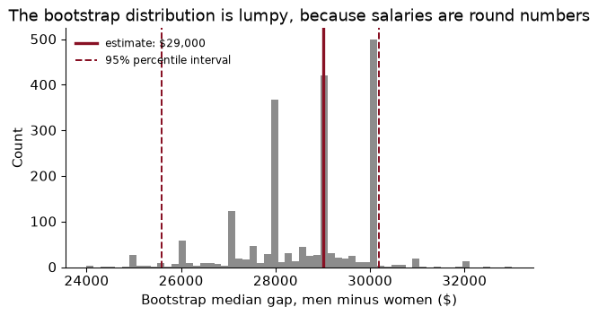
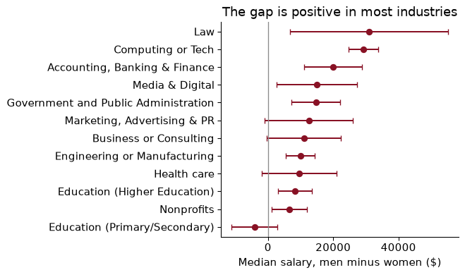

# Chapter 8 — Resampling: simulation and the bootstrap

> **The question:** in a survey of 20,522 American professionals, men’s median salary is \$29,000 higher than women’s. How much of that could be the luck of who answered, when no textbook formula gives the standard error of a median?

## A laboratory where you know the truth

Every estimate you have ever computed came with a standard error, and almost all of those standard errors came from a formula. For a mean it is $s/\sqrt{n}$; for an OLS coefficient the software prints it. The formulas are wonderful when they exist. They run out surprisingly quickly.

Here is a gap they do not cover. The 2021 *Ask a Manager* salary survey, distributed by TidyTuesday, asked readers of a workplace-advice blog what they earn. Keeping annual salaries in US dollars between \$15,000 and \$1 million from people who answered “Man” or “Woman”, we have 20,522 respondents. The median man reports \$104,000, the median woman \$75,000. Salaries are skewed, so the median is the honest summary of a typical salary. But what is the standard error of a *difference in medians*? Of a *ratio* of medians? Of the gap in prediction error between two models? Nobody taught you a formula, because for most of these there is no simple one.

This chapter is about two ways round the problem, and they share an idea: **let the computer do the repeated sampling that the formula was imagining.**

- **Simulation** (also called **Monte Carlo**) makes fake data from a world you design, where you know the truth, and checks whether your method recovers it.
- **The bootstrap** treats your one real sample as a stand-in for the population, resamples from it, and watches how much your estimate moves.

The recipe for a simulation has four steps, and I would like you to know it by heart:

1.  Write a function that **generates data** from a world where you chose the truth.
2.  Write a function that **estimates** something from those data.
3.  **Repeat** many times and store every result.
4.  **Summarise**: the average error (bias), the spread (the standard error), how often the confidence interval covers the truth, how often the test rejects.

Before we go further, a warning about the data. Ask a Manager readers are a self-selected group: 82% of our respondents are women, and they are heavily concentrated in office jobs. Everything in this chapter describes *these respondents*, not the US labour force. Resampling measures sampling noise. It cannot fix a sample that was never representative.

### Worked example — a simulation has a standard error too

You simulate 1,000 experiments and find that your 95% confidence interval covers the truth in 93.1% of them. Is the interval broken, or is that just luck?

### Solution

The coverage rate is itself an estimate: a proportion from $R$ = 1,000 trials. Its standard error is $\sqrt{\hat p(1-\hat p)/R} = \sqrt{0.931 \times 0.069 / 1000} \approx 0.008$. The gap from 95% is 1.9 points, more than two standard errors, so it is probably not luck, but it is not overwhelming either. Run 10,000 replications and the Monte Carlo standard error drops to about 0.0025, enough to tell 93% from 95% firmly. Always report it: “coverage 0.931 (Monte Carlo s.e. 0.008)”.

## Functions, and letting NumPy do the looping

A simulation is code you will run thousands of times, change, and rerun. Two habits make that painless.

**Write small functions with the random number generator passed in.** One function makes data, another estimates; neither knows about the other.

``` python
def simulate_rct(n, effect, sd=1.0, rng=None):
    """Two-arm experiment with a constant effect. Returns outcome y and treatment d."""
    rng = rng if rng is not None else np.random.default_rng()
    d = rng.binomial(1, 0.5, n)
    return effect * d + rng.normal(0, sd, n), d

def diff_in_means(y, d):
    """Difference in means and its unequal-variance standard error (Chapter 7)."""
    y1, y0 = y[d == 1], y[d == 0]
    return y1.mean() - y0.mean(), np.sqrt(y1.var(ddof=1) / len(y1) + y0.var(ddof=1) / len(y0))

diff_in_means(*simulate_rct(500, effect=0.2, rng=np.random.default_rng(SEED)))
```

    (np.float64(0.10395727830629962), np.float64(0.08850217438134314))

Passing `rng` in means the *caller* controls reproducibility: the same generator gives the same answer, and two different ones give independent answers. We will need that when we go parallel.

**Vectorize.** A Python loop handles one number at a time; a NumPy operation on a whole array runs in compiled code.

``` python
x = np.random.default_rng(SEED).normal(size=1_000_000)
t0 = time.perf_counter(); total = 0.0
for v in x:
    total += v ** 2
t_loop = time.perf_counter() - t0
t0 = time.perf_counter(); total_vec = np.sum(x ** 2); t_vec = time.perf_counter() - t0
print(f"loop {t_loop:.3f}s, vectorized {t_vec:.4f}s")
```

    loop 0.103s, vectorized 0.0010s

The vectorized sum ran about 104 times faster on this machine. The same trick applies to whole simulations: instead of looping over 5,000 experiments, draw a 5,000-row matrix, one experiment per row, and compute every row’s estimate at once with `axis=1`. That is how the coverage study in the next section runs in under a second.

### Worked example — what vectorizing costs in memory

To bootstrap the median salary of the 16,904 women without a loop, you would draw a matrix of row indices with $B$ = 2,000 rows and one column per woman. How big is it?

### Solution

It holds 2,000 × 16,904 = 33,808,000 integers at 8 bytes each: about 270 MB, before you even look up the salaries, which doubles it. That fits on a laptop, but only just, and a bigger sample would not. The fully vectorized version wins when each sample is small and $B$ is large; for large samples a loop over $B$, with each step vectorized inside (one `rng.choice` and one `np.median` on a whole array), is fast and uses almost no memory. Vectorize the inner work, not necessarily everything.

## Do confidence intervals really cover?

The promise of a 95% confidence interval is about repeated sampling: if you drew sample after sample and built an interval from each, 95% of the intervals would contain the true value. You never get to check that with real data, because you never know the true value. In a simulation you do.

So let us make one where the “population” is real. Treat the 16,904 women in the survey as the entire population; their mean salary, \$86,891, is now the known truth. Draw a sample of $n$ women, build the usual $t$ interval for the mean, $\bar x \pm t_{0.975, n-1} \cdot s/\sqrt n$, and check whether it covers \$86,891. Do that 5,000 times for each sample size:

``` python
rng = np.random.default_rng(368)
xs = women[rng.integers(0, len(women), (5_000, 30))]       # 5,000 samples of 30, one per row
m, se = xs.mean(axis=1), xs.std(axis=1, ddof=1) / np.sqrt(30)
tc = stats.t.ppf(0.975, 29)
print(((m - tc * se <= women.mean()) & (women.mean() <= m + tc * se)).mean())
```

    0.9332

         coverage  MC s.e.  missed low  missed high
    n                                              
    10      0.917    0.004       0.080        0.003
    30      0.922    0.004       0.073        0.005
    100     0.932    0.004       0.060        0.008
    500     0.950    0.003       0.037        0.013

With samples of 10, the “95%” interval covers only 91.7% of the time; with 30, 92.2%. Only by 500 is it close to 95%. And look at *how* it fails: almost all the misses are on the low side. Salaries have a long right tail, so a small sample usually contains none of the big earners; its mean is too low *and* its standard deviation too small, and the interval sits entirely below the truth. The $t$ interval assumes the sample mean is roughly normal, and with skewed data that takes more observations than the “$n \geq 30$” rule of thumb suggests.

That is the whole point of Monte Carlo. Not proving theorems, but checking whether a method you are about to rely on works *for data that look like yours*.

### Worked example — reading a coverage table

A colleague says: “Our intervals cover 92.2% of the time instead of 95%. That’s close enough.” When is she right, and when is she wrong?

### Solution

She is right that 92.2% is not a disaster, and the Monte Carlo standard error (0.004) confirms the shortfall is real rather than simulation noise. She is wrong to ignore which way the misses go. A one-sided failure is worse than a symmetric one: with salaries, a small survey will understate average pay much more often than it overstates it. If the number feeds a decision (setting a pay band, say), the bias in the misses matters more than the headline coverage.

## The bootstrap

Back to the real question. We have one sample, not 5,000. Ideally we would draw many new samples from the population and see how much the median gap moves, but we cannot. Efron’s (1979) idea was to **treat the sample as if it were the population**, and draw from that:

1.  From each group, draw as many observations as it has, **with replacement**. Some people appear twice, some not at all.
2.  Recompute the statistic, here the median for men minus the median for women.
3.  Repeat $B$ times, say 2,000.

The standard deviation of the $B$ bootstrap estimates is the **bootstrap standard error**. The middle 95% of them, from the 2.5th to the 97.5th percentile, is the **percentile confidence interval**.

``` python
def boot_median_gap(y1, y0, B, rng):
    """B bootstrap draws of median(y1) - median(y0), resampling within each group."""
    draws = np.empty(B)
    for b in range(B):
        draws[b] = (np.median(rng.choice(y1, size=len(y1), replace=True))
                    - np.median(rng.choice(y0, size=len(y0), replace=True)))
    return draws

boot = boot_median_gap(men, women, B=2_000, rng=np.random.default_rng(368))
print(boot.std(), np.percentile(boot, [2.5, 97.5]))
```

    1302.9026584859478 [25588.625 30180.   ]

We resample *within* each group because that mimics how the data arose: a sample of men and a sample of women, each of a given size. The median gap is \$29,000, with a bootstrap standard error of \$1,303 and a 95% percentile interval from \$25,589 to \$30,180. Sampling noise cannot plausibly explain a gap of this size among these respondents. (What *causes* it, whether industry, job title, hours or discrimination, is a different question that no amount of resampling answers.)



Notice the spikes. People report round salaries (\$75,000, \$100,000), so a resampled median keeps landing on the same few values. The interval is not centred on the estimate either: the estimate sits near its upper end. The bootstrap reports that honestly, where a formula of the form “estimate ± 1.96 SE” would force symmetry.

> The bootstrap does not create information. It measures how much the information you have would wobble if the sample had come out differently.

### Worked example — one bootstrap draw by hand

Eight salaries, in thousands of dollars (hypothetical): 28, 35, 41, 47, 52, 60, 75, 120. A random draw of eight positions with replacement gives positions 2, 2, 3, 5, 6, 6, 7, 8. What is the bootstrap sample and its median, and how does it compare with the original median?

### Solution

The bootstrap sample is 35, 35, 41, 52, 60, 60, 75, 120 (the second and sixth values appear twice; the first and fourth not at all). With eight values the median is the average of the fourth and fifth: (52 + 60)/2 = 56. The original median is (47 + 52)/2 = 49.5. Repeat this a few thousand times and the spread of those medians is the standard error. With only eight observations, though, each resample can only rearrange the same eight numbers, which is a warning we come back to.

## A ratio: cents on the dollar

Pay gaps are usually quoted as a ratio: women earn so many cents for every dollar men earn. Among our respondents the median woman earns **72 cents** for each dollar earned by the median man. A ratio of two medians is a statistic with no textbook standard error at all, and the bootstrap does not care:

``` python
rng = np.random.default_rng(368)
ratio_boot = np.array([np.median(rng.choice(women, len(women))) / np.median(rng.choice(men, len(men)))
                       for _ in range(2_000)])
np.percentile(ratio_boot, [2.5, 97.5])
```

    array([0.71428571, 0.74774897])

The 95% interval runs from 71.4 to 74.8 cents. The same few lines would work for a Gini coefficient, a 90/10 percentile ratio, a correlation, or an elasticity computed in two steps. That is the bootstrap’s great virtue: one method for nearly every statistic, with no new algebra each time.

### Worked example — formula or bootstrap?

For which of these could you write down a standard error from intro statistics, and which need the bootstrap? **(a)** The difference in *mean* salary between men and women. **(b)** The difference in median salary. **(c)** The ratio of median salaries. **(d)** The 90th percentile of women’s salaries divided by the 10th.

### Solution

Only **(a)**: it is the Chapter 7 formula, $\sqrt{s_1^2/n_1 + s_0^2/n_0}$. The other three need either the bootstrap or a fair amount of asymptotic theory (there are formulas for the standard error of a median, but they need an estimate of the density of salaries at the median, which is its own headache). A good habit is to bootstrap (a) as a check: the formula gives \$1,162 and the bootstrap \$1,176. When the two agree where both apply, you can trust the bootstrap where only it does.

## When the bootstrap works, and when it does not

Is the bootstrap interval itself any good? We can check it exactly as we checked the $t$ interval. Treat all 20,522 respondents as the population, so the true median gap is the \$29,000 we computed. Draw a sample, bootstrap a 95% interval with $B$ = 500, record whether it covers the truth, and repeat 500 times. That is a simulation wrapped around a bootstrap, half a million medians in all, and it takes a few seconds.

- Samples of 300 respondents (about 53 men): coverage 95.0%.
- Samples of 60 (about 11 men): coverage 92.2%.

(The Monte Carlo standard error with 500 replications is about one percentage point.) For a median, the bootstrap holds up well with a few dozen men in each sample, and starts to slip when there are only a handful. Now try statistics further out in the tail, from samples of 50 women:

| Statistic                | Coverage of the “95%” bootstrap interval |
|--------------------------|------------------------------------------|
| Median (50th percentile) | 96.0%                                    |
| 90th percentile          | 91.2%                                    |
| Maximum                  | 0.0%                                     |

The maximum is a catastrophe. A bootstrap sample can never contain a salary larger than the largest one in the original sample, so the bootstrap distribution of the maximum is piled up at, and below, the sample maximum, which is almost always below the true one. The rule: **the bootstrap struggles at the edges of the data** (maxima, minima, extreme percentiles), **in very small samples** (it can only reshuffle what it has), and **with dependent data resampled as if independent**, which is the next section but one.

### Worked example — how often is the maximum resampled?

In a bootstrap sample of size $n$, what is the chance that the largest original observation appears at least once? Use $n$ = 50.

### Solution

Each draw misses it with probability $1 - 1/n$, so all $n$ draws miss it with probability $(1 - 1/n)^n$, which for $n$ = 50 is 0.364 (close to $e^{-1} \approx 0.368$). So about 64% of bootstrap samples have exactly the original maximum as *their* maximum, and the rest have something smaller. The bootstrap distribution has a big spike at the sample maximum and nothing above it. The same $e^{-1}$ appears again in Chapter 15: about 37% of observations are left out of each bootstrap sample, and random forests use them as a free test set.

## A permutation test

The bootstrap gives an interval. A **permutation test** answers a different question: *if gender had nothing to do with salary, how often would we see a gap this large just from how the labels happened to fall?* If the labels do not matter, shuffling them should not matter either. So shuffle them, recompute the gap, and repeat.

Take the 881 respondents who work in law, 91 of them men. The observed median gap is \$30,950.

``` python
y, is_man = law["annual_salary"].to_numpy(), (law["gender"] == "Man").to_numpy()
rng = np.random.default_rng(368)
perm = np.empty(5_000)
for r in range(5_000):
    shuffled = rng.permutation(is_man)                     # same number of "men", random people
    perm[r] = np.median(y[shuffled]) - np.median(y[~shuffled])
np.mean(np.abs(perm) >= abs(obs_law))
```

    np.float64(0.0)

None of the 5,000 shuffled gaps is as large as the real one, in absolute value. That share is the permutation $p$-value; here all we can say is that it is below 1/5,000 = 0.0002. It assumes almost nothing: not normality, not a large sample, not a formula for the standard error of a median. Its one assumption is that, under the null, the labels are exchangeable, which is exactly true in a randomized experiment and a reasonable description of “no association” in a survey.

Keep the two methods straight:

- The **bootstrap** resamples *observations* to measure how much an estimate would vary. It answers “how precise is my estimate?”
- The **permutation test** reshuffles *labels* to build a world where the null is true. It answers “could this be chance?”

### Worked example — a small industry

In sales there are 209 respondents, only 46 of them men, and the median gap is \$12,050. Run the permutation test on the median and a Welch $t$-test on log salary. Do they agree?

### Solution

The permutation $p$-value is 0.065 and the Welch $p$-value is 0.050. They are close, and both sit right at the conventional line, which is the honest answer: with 46 men, a gap of \$12,050 is suggestive but not conclusive. They test slightly different things (medians against mean logs), so they need not match exactly. And remember the multiple-testing lesson from Chapter 7: if you test every one of the survey’s industries, a couple will cross 0.05 by chance.

## Resample the way the data were collected

The bootstrap’s rule is to **mimic the sampling process**. So far that meant resampling individuals within each gender. But many data sets are not collected one independent person at a time.

Think of a survey that sampled schools and then interviewed every teacher in each school, or a data set of workers grouped in firms, or customers grouped in cities. People in the same cluster resemble each other: teachers in one school share a principal, a budget, a local labour market. Twenty teachers from one school carry less independent information than twenty teachers from twenty schools. Resample individuals as if they were independent and you will understate the noise, sometimes by a factor of several.

The fix is the **cluster bootstrap**: resample whole clusters with replacement, keeping everyone in a drawn cluster together. If there are 50 schools, draw 50 school IDs with replacement, stack all the teachers from the drawn schools, and recompute the statistic. The unit of resampling is the unit of sampling (or, in an experiment, the unit of randomization, as in Chapter 7). In code it is a few lines:

``` python
def cluster_bootstrap(groups, stat, B, rng):
    """groups: dict of cluster id -> array of outcomes. Resample whole clusters."""
    keys = list(groups)
    return np.array([stat(np.concatenate([groups[k] for k in rng.choice(keys, len(keys))]))
                     for _ in range(B)])
```

The Ask a Manager respondents were not sampled by state, so here the clusters are a stretch. Still, the mechanics are instructive. Treat the 118 values of the `state` column as clusters and bootstrap mean log salary: resampling states gives a standard error of 0.0328, resampling individuals 0.0036. Salaries in California resemble other salaries in California, so a sample that happened to draw more Californians would have a different mean, and the cluster bootstrap knows it. When the number of clusters is small (fewer than 30 or so), even this is unreliable, and the **wild cluster bootstrap** is the tool to reach for (Cameron, Gelbach and Miller 2008).

### Worked example — choosing what to resample

What should you resample in each case? **(a)** A wage regression on 10,000 workers from a random household survey. **(b)** Test scores from a programme that was randomized across 40 schools. **(c)** Daily sales at one store over three years.

### Solution

**(a)** Rows (workers), the **pairs bootstrap**: resample whole rows, $(y_i, x_i)$ together. It gives standard errors that match the robust (HC) ones from your econometrics course.

**(b)** Schools. The treatment was assigned by school, so the 40 schools are the independent units, and you resample them with all their students.

**(c)** Not individual days: today’s sales predict tomorrow’s, and shuffling days destroys that dependence. Resample **blocks** of consecutive days (a block bootstrap), long enough to capture the autocorrelation.

## The bootstrap for machine learning

Part III of this book is about prediction, and every prediction model is judged by its error on a test set (Chapter 9). But a test set is a sample too, so a test error is an estimate with its own noise. When a new model beats an old one by a little, is it really better, or did the test set happen to suit it?

The bootstrap answers that. Here is a small example, using only the linear regression you already know. Predict log salary for our respondents with two models:

- a **small** model: dummies for years of experience, education and gender;
- a **big** model: the same plus industry and state.

Fit both on a random 80% of respondents and compute each model’s prediction errors on the other 20%, 4,083 people. The test RMSE (root mean squared error, in log points) is 0.453 for the small model and 0.383 for the big one. To put an interval on the difference, resample the test rows and recompute both RMSEs on *the same* resampled rows:

``` python
rmse = lambda e: np.sqrt(np.mean(e ** 2, axis=-1))      # works row by row on a matrix
idx = np.random.default_rng(368).integers(0, len(te), (2_000, len(te)))   # resampled test rows
diff = rmse(err_small[idx]) - rmse(err_big[idx])          # paired: same rows for both models
np.percentile(diff, [2.5, 97.5])
```

    array([0.06293118, 0.07702318])

The big model’s advantage is 0.070 log points, with a 95% interval from 0.063 to 0.077. The interval is far from zero, so industry and state really do help predict salary, and the gain is not an accident of the split.

Note that we bootstrapped only the *test set*, holding the fitted models fixed. That measures how much the test score would vary with a different test set. It does not capture the variation from refitting on a different training set; for that you would refit inside each bootstrap draw, which is slower and is the idea behind bagging (Chapter 15).

### Worked example — why pair the draws?

Suppose instead you resampled the test rows separately for each model, with two independent index matrices. What happens to the standard error of the difference?

### Solution

It grows a lot: from 0.0036 (paired) to 0.0091 (unpaired), about 2.6 times as large. Some people are hard to predict for *both* models (an unusual job, a salary typed wrongly). When the same rows are drawn for both, those people raise both RMSEs together and cancel out of the difference. Drawn separately, their luck lands on one model and not the other, adding noise that has nothing to do with which model is better. It is the same logic as a paired $t$-test, or as comparing two treatments on the same patients.

## Reproducible seeds and parallel work

Bootstrap draws and simulation replications are independent of one another, so they can run on several processor cores at once; computer scientists call such problems **embarrassingly parallel**. In Python, `joblib` does it in one line. The only subtlety is randomness: each task needs its own independent stream of random numbers, and you want the whole run to give the same answer every time.

NumPy’s `SeedSequence` solves both. Spawn one child seed per task from a single master seed:

``` python
from joblib import Parallel, delayed

def industry_gap(name, seed):
    rng = np.random.default_rng(seed)
    d = sal[sal["industry"] == name]
    m = d.loc[d["gender"] == "Man", "annual_salary"].to_numpy()
    w = d.loc[d["gender"] == "Woman", "annual_salary"].to_numpy()
    b = boot_median_gap(m, w, 1_000, rng)
    return {"industry": name, "gap": np.median(m) - np.median(w), "se": b.std(), "n": len(d)}

inds = sal["industry"].value_counts().index[:12]
seeds = np.random.SeedSequence(368).spawn(len(inds))       # 12 independent streams
```

``` python
t0 = time.perf_counter(); serial = [industry_gap(n, s) for n, s in zip(inds, seeds)]
t_ser = time.perf_counter() - t0
t0 = time.perf_counter()
parallel = Parallel(n_jobs=-1)(delayed(industry_gap)(n, s) for n, s in zip(inds, seeds))
t_par = time.perf_counter() - t0
print(f"serial {t_ser:.1f}s, parallel {t_par:.1f}s, identical: {serial == parallel}")
```

    serial 0.4s, parallel 0.5s, identical: True

The two runs give **identical** results (True), because each industry’s task has its own seed no matter which core runs it, or in what order. On this machine the serial run took 0.4 seconds and the parallel one 0.5. Starting worker processes has a fixed cost, so parallelism pays off for chunky tasks (a bootstrap that takes minutes) and can lose on tiny ones. Vectorize first; parallelize when you still have to wait.

Three rules for seeds, which I enforce in every project:

- **Create one generator at the top** (`rng = np.random.default_rng(368)`) and pass it around. Avoid `np.random.seed()`, which sets a hidden global state that any function can disturb.
- **For parallel work, spawn child seeds** from one `SeedSequence`, never the same seed in every task.
- **Save simulation output to disk** (a Parquet file in `output/`), so that a long run never has to be repeated just to change a figure.

### Worked example — the same seed in every worker

A student parallelizes 1,000 bootstrap draws as 10 tasks of 100, giving each task `np.random.default_rng(368)`. What goes wrong, and what does the resulting standard error look like?

### Solution

Every task draws exactly the same 100 bootstrap samples, so the 1,000 “draws” are 100 draws, each repeated ten times. The standard error computed from them is no better than one from 100 draws, while the student believes it came from 1,000, and if the tasks were Monte Carlo replications, the reported Monte Carlo error would be too small by a factor of about $\sqrt{10}$. Nothing crashes and nothing looks wrong, which is what makes it dangerous. The fix is `np.random.SeedSequence(368).spawn(10)`.

## In Python

The whole analysis, from download to an industry-by-industry chart, runnable top to bottom.

``` python
from pathlib import Path
import numpy as np, pandas as pd, matplotlib.pyplot as plt
from joblib import Parallel, delayed

path = Path("../data/ask_a_manager.csv")              # download once, then reuse
if not path.exists():
    path.parent.mkdir(exist_ok=True)
    pd.read_csv(URL).to_csv(path, index=False)
raw = pd.read_csv(path)
US = {"united states", "usa", "us", "u.s.", "united states of america", "u.s.a.", "u.s", "america"}
sal = raw[(raw["currency"] == "USD") & raw["country"].str.strip().str.lower().isin(US)
          & raw["annual_salary"].between(15_000, 1_000_000)
          & raw["gender"].isin(["Man", "Woman"])].copy()
sal["log_salary"] = np.log(sal["annual_salary"])
```

The bootstrap and the permutation test, as two functions that take a generator.

``` python
def boot_median_gap(y1, y0, B, rng):
    return np.array([np.median(rng.choice(y1, len(y1))) - np.median(rng.choice(y0, len(y0)))
                     for _ in range(B)])

def perm_median_gap(y, is_1, R, rng):
    obs = np.median(y[is_1]) - np.median(y[~is_1])
    null = np.array([(lambda s: np.median(y[s]) - np.median(y[~s]))(rng.permutation(is_1))
                     for _ in range(R)])
    return obs, np.mean(np.abs(null) >= abs(obs))
```

The overall gap, with a percentile interval.

``` python
rng = np.random.default_rng(368)
men = sal.loc[sal["gender"] == "Man", "annual_salary"].to_numpy()
women = sal.loc[sal["gender"] == "Woman", "annual_salary"].to_numpy()
b = boot_median_gap(men, women, 2_000, rng)
print(f"gap ${np.median(men) - np.median(women):,.0f}, SE ${b.std():,.0f}, "
      f"95% CI {np.percentile(b, [2.5, 97.5]).round(0)}")
```

    gap $29,000, SE $1,303, 95% CI [25589. 30180.]

By industry, in parallel with one seed per task, plus a permutation $p$-value for each.

``` python
def one_industry(name, seed):
    rng = np.random.default_rng(seed)
    d = sal[sal["industry"] == name]
    y, is_man = d["annual_salary"].to_numpy(), (d["gender"] == "Man").to_numpy()
    b = boot_median_gap(y[is_man], y[~is_man], 1_000, rng)
    obs, p = perm_median_gap(y, is_man, 1_000, rng)
    return {"industry": name, "gap": obs, "se": b.std(), "p_perm": p, "men": is_man.sum()}

inds = sal["industry"].value_counts().index[:12]
seeds = np.random.SeedSequence(368).spawn(len(inds))
res = pd.DataFrame(Parallel(n_jobs=-1)(delayed(one_industry)(n, s) for n, s in zip(inds, seeds)))
print(res.sort_values("gap").round(3).to_string(index=False))
```

                                industry     gap        se  p_perm  men
           Education (Primary/Secondary) -4150.0  3541.660   0.268   54
                              Nonprofits  6550.0  2732.988   0.010  164
            Education (Higher Education)  8270.0  2608.689   0.000  216
                             Health care  9500.0  5853.674   0.040  124
            Engineering or Manufacturing 10000.0  2264.685   0.000  308
                  Business or Consulting 11000.0  5797.636   0.095   88
             Marketing, Advertising & PR 12500.0  6891.317   0.040   95
    Government and Public Administration 14675.0  3806.975   0.000  167
                         Media & Digital 15000.0  6296.046   0.002  103
           Accounting, Banking & Finance 20000.0  4542.280   0.000  203
                       Computing or Tech 29250.0  2347.238   0.000 1373
                                     Law 30950.0 12335.646   0.000   91

``` python
res = res.sort_values("gap")
fig, ax = plt.subplots(figsize=(7, 4.2))
ax.errorbar(res["gap"], res["industry"], xerr=1.96 * res["se"], fmt="o", color=GARNET, capsize=3)
ax.axvline(0, color=GREY, lw=1)
ax.set(xlabel="Median salary, men minus women ($)", title="The gap is positive in most industries")
plt.tight_layout(); plt.show()
```



In 8 of the 12 largest industries the 95% interval lies entirely above zero, and in none does it lie entirely below. The intervals are much wider in industries with few men, which is the bootstrap telling you how little a few dozen respondents can say.

## What goes wrong

**Resampling the wrong unit.** The bootstrap is only as good as its imitation of how the data were collected. Resample individuals when the data come in clusters (schools, firms, cities) or in time order, and the standard error is too small. Resample clusters, or blocks of time, instead.

**Trusting the bootstrap at the edges.** For the maximum of a sample, the “95%” bootstrap interval covered the truth 0% of the time in our check. Extreme percentiles, maxima, minima, and very small samples are where it breaks. If in doubt, check coverage by simulation, as we did.

**Forgetting that the simulation has noise too.** A coverage rate from 500 replications has a Monte Carlo standard error of about one percentage point. Report it, and use enough replications that it is small compared with the differences you care about.

**Bootstrapping only half the procedure.** If you impute missing values, choose a model, or estimate a first stage, redo all of it inside each bootstrap draw. Bootstrapping only the last step treats the earlier choices as if they were known with certainty.

**The same seed in every parallel task.** It silently turns 1,000 draws into 100 repeated ten times. Spawn independent seeds from one `SeedSequence`.

**Comparing models with unpaired resamples.** When two models are scored on the same test set, resample the same rows for both. Unpaired resampling made the standard error of the difference 2.6 times too large here, enough to hide a real improvement.

## Exercises

1.  A student reports: “The bootstrap 95% interval for the median gender gap is \$25,589 to \$30,180.” Which of these is a correct reading? (a) 95% of men earn between those amounts more than women. (b) If we repeated the survey many times, intervals built this way would contain the true median gap about 95% of the time. (c) There is a 95% chance that the median gap in the US labour force is in this range. Explain what is wrong with the others.

2.  Bootstrap a 95% percentile interval for the difference in *mean* salary between men and women ($B$ = 2,000), and compare it with the formula interval, estimate ± 1.96 × $\sqrt{s_1^2/n_1 + s_0^2/n_0}$.

3.  Bootstrap a 95% interval for the median salary gap between respondents with a PhD and those with a college degree (column `highest_level_of_education_completed`). Is the gap clearly positive?

4.  How many Monte Carlo replications do you need for the standard error of a simulated coverage rate near 95% to be at most 0.002?

5.  Run a permutation test on the difference in *mean log salary* between men and women in the insurance industry, and compare its $p$-value with a Welch $t$-test on the same variable.

6.  Repeat the coverage check for the bootstrap interval of the 90th percentile of women’s salary, but with samples of 400 instead of 50. Does coverage improve?

7.  Change the big model in the machine-learning section by dropping `state`, so it adds only industry to the small model. Bootstrap the paired difference in test RMSE again. How much of the big model’s advantage came from industry?

### Answers

**1.** (b). A confidence interval is a statement about the procedure over repeated samples. (a) confuses an interval for a *median* gap with the spread of individual salary differences; many men earn less than many women. (c) has two problems: it treats the true gap as random (in the frequentist view it is fixed and the interval is random), and, more importantly, it is about the wrong population. These are Ask a Manager readers, not the US labour force, and no interval corrects for who chose to answer.

**2.**

``` python
rng = np.random.default_rng(368)
bm = np.array([rng.choice(men, len(men)).mean() - rng.choice(women, len(women)).mean()
               for _ in range(2_000)])
est_m = men.mean() - women.mean()
se_f = np.sqrt(men.var(ddof=1) / len(men) + women.var(ddof=1) / len(women))
print(np.percentile(bm, [2.5, 97.5]).round(0), (est_m - 1.96 * se_f).round(0), (est_m + 1.96 * se_f).round(0))
```

    [27273. 31789.] 27266.0 31823.0

The mean gap is \$29,544. The bootstrap interval runs from \$27,273 to \$31,789, the formula interval from \$27,266 to \$31,823. They agree closely, as they should with thousands of observations in each group, which is the reassurance we wanted: where a formula exists, the bootstrap reproduces it.

**3.**

``` python
edu = sal["highest_level_of_education_completed"]
phd = sal.loc[edu == "PhD", "annual_salary"].to_numpy()
col = sal.loc[edu == "College degree", "annual_salary"].to_numpy()
b3 = boot_median_gap(phd, col, 2_000, np.random.default_rng(368))
print(np.median(phd) - np.median(col), np.percentile(b3, [2.5, 97.5]))
```

    23000.0 [19337.75 27010.  ]

The median PhD earns \$23,000 more than the median college graduate, with a 95% interval from \$19,338 to \$27,010. Yes, the interval is entirely above zero. As always, this is a description, not the causal return to a PhD: people who do PhDs differ in many ways from those who stop at a degree.

**4.** The Monte Carlo standard error is $\sqrt{p(1-p)/R}$. Setting $\sqrt{0.95 \times 0.05 / R} = 0.002$ gives $R = 0.95 \times 0.05 / 0.002^2$ = 11,875 replications. Precision is expensive: halving the Monte Carlo error takes four times the replications, the same square-root law as in every sample-size calculation.

**5.**

``` python
ins = sal[sal["industry"] == "Insurance"]
y5, m5 = ins["log_salary"].to_numpy(), (ins["gender"] == "Man").to_numpy()
obs5 = y5[m5].mean() - y5[~m5].mean()
rng = np.random.default_rng(368)
null5 = np.array([(lambda s: y5[s].mean() - y5[~s].mean())(rng.permutation(m5)) for _ in range(5_000)])
p5 = np.mean(np.abs(null5) >= abs(obs5))
print(obs5, p5, stats.ttest_ind(y5[m5], y5[~m5], equal_var=False).pvalue)
```

    0.23746942958221418 0.0 0.00023311932607896556

Among 409 insurance respondents (63 men), men’s mean log salary is 0.237 higher, roughly 27%. The permutation $p$-value is below 0.0002 (no shuffle out of 5,000 produced a gap that large) and the Welch $p$-value is 0.00023. Both say the gap is very unlikely to be chance. When the sample is moderate and the outcome is in logs, the $t$-test and the permutation test usually agree; the permutation test earns its keep when samples are small or the statistic has no formula.

**6.**

``` python
rng = np.random.default_rng(368)
cov_q400 = np.mean([covers_quantile(90, 400, rng) for _ in range(500)])
print(cov_q[90], cov_q400)
```

    0.912 0.968

With samples of 50 the interval for the 90th percentile covered 91.2% of the time; with samples of 400 it covers 96.8%. Coverage improves: with more data, the 90th percentile is no longer “at the edge” of the sample, since there are now about 40 observations above it rather than 5. The maximum would not improve this way, because it is always at the edge.

**7.**

``` python
err_ind = test_errors(SMALL + ["industry"])
d7 = rmse(err_small[idx]) - rmse(err_ind[idx])
print(rmse(err_ind), np.percentile(d7, [2.5, 97.5]))
```

    0.4021648614574597 [0.04434709 0.05655391]

With industry but no state, the test RMSE is 0.402, an improvement over the small model of 0.051 log points (95% interval 0.044 to 0.057). That is 72% of the big model’s total gain over the small one; state adds the rest. Industry does most of the work, which makes sense in a survey spanning tech workers and non-profit staff, and state adds the geography of pay.

## Economics reading

Simulation and resampling are how economists check whether their standard errors deserve trust. Two papers do that, and a third puts the chapter’s salary gap in its economic context.

**Bertrand, M., Duflo, E. & Mullainathan, S. (2004). “How Much Should We Trust Differences-in-Differences Estimates?” *Quarterly Journal of Economics* 119(1): 249–275.** [doi.org/10.1162/003355304772839588](https://doi.org/10.1162/003355304772839588)

This is the laboratory idea from the start of the chapter, aimed at a whole literature. The authors take real wage data from the Current Population Survey, invent fake state laws at random dates, and estimate their “effects” the way published papers did. Because the laws are fake, the true effect is zero, yet conventional standard errors declare a significant effect far more often than 5% of the time, because outcomes in a state are correlated from year to year. They then compare fixes, including resampling whole states rather than individual observations.

*Think about:* why is a placebo whose true effect you know to be zero such a powerful check on a method? Connect the paper’s fix to this chapter’s section on resampling the way the data were collected: what is the “cluster” in their setting, and what goes wrong if you bootstrap individual workers instead?

**Young, A. (2019). “Channeling Fisher: Randomization Tests and the Statistical Insignificance of Seemingly Significant Experimental Results.” *Quarterly Journal of Economics* 134(2): 557–598.** [doi.org/10.1093/qje/qjy029](https://doi.org/10.1093/qje/qjy029)

Young re-analyses a large set of randomized experiments published in economics journals using permutation tests, the method of this chapter: shuffle the treatment labels, recompute the estimate many times, and see where the real one falls. Many results that were significant with the authors’ regression standard errors are not significant under the permutation test. In small samples, a few influential observations make the conventional formulas too confident.

*Think about:* a permutation test answers a narrow question, “would I see a difference this large if treatment made no difference to anyone?” Why does it need no formula for the standard error, and when is that sharp null the question a policymaker actually cares about?

**Blau, F. D. & Kahn, L. M. (2017). “The Gender Wage Gap: Extent, Trends, and Explanations.” *Journal of Economic Literature* 55(3): 789–865.** [doi.org/10.1257/jel.20160995](https://doi.org/10.1257/jel.20160995)

A survey of what economists know about the gap between men’s and women’s pay in the United States, built on a long panel of household data. The gap narrowed a great deal in the 1980s and more slowly after. Differences in education and experience now explain little of it; differences in occupation and industry explain more, and a sizeable part remains unexplained. The authors weigh the candidate reasons, from the hours premium in high-paying jobs to discrimination.

*Think about:* the bootstrap in this chapter tells you how much the *Ask a Manager* gap could move if a different set of readers had answered. It says nothing about who chose to read the blog and fill in the survey. Name the kind of error the bootstrap is silent about, and say how a representative survey like the one Blau and Kahn use helps.

**Reading.** ISLP (James, Witten, Hastie, Tibshirani & Taylor 2023), ch. 5, §5.2, for the bootstrap in the statistical-learning setting. Efron & Tibshirani (1993), *An Introduction to the Bootstrap*, for everything else about it, including better intervals than the percentile one. Cameron & Miller (2015), “A Practitioner’s Guide to Cluster-Robust Inference”, *Journal of Human Resources*, for clusters, and Cameron, Gelbach & Miller (2008) for the wild cluster bootstrap. Huntington-Klein (2022), *The Effect*, ch. 15, for simulation as a habit of mind.
