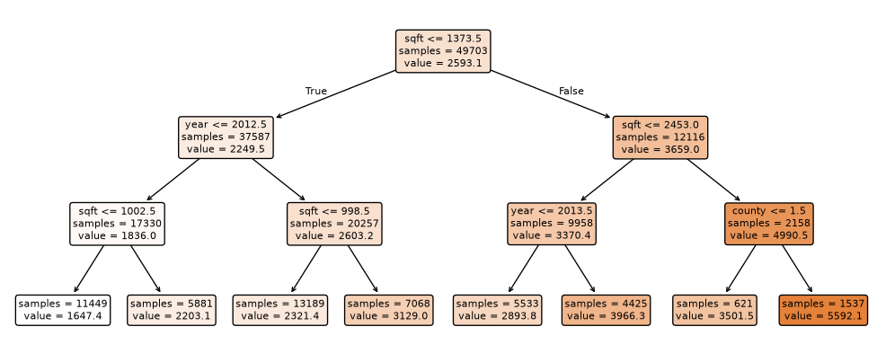
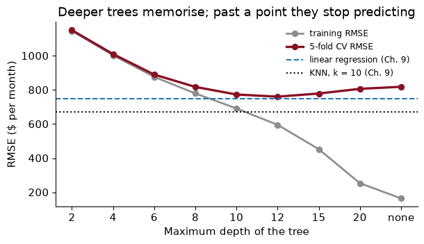
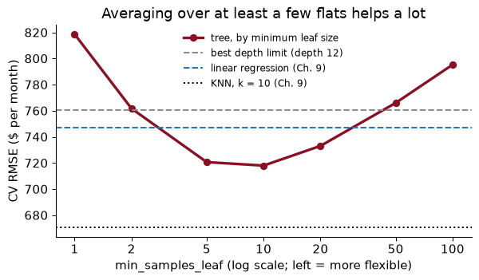
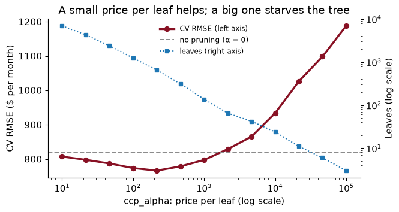
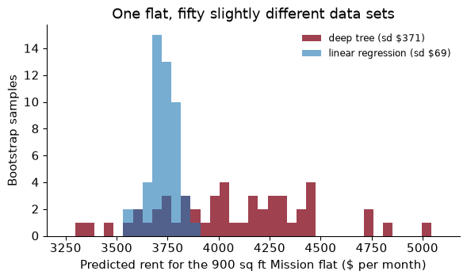
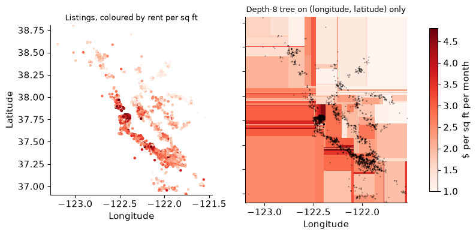

# Chapter 14 — Decision trees

> **The question:** a housing office has to set a voucher rent for a flat nobody has advertised, and then explain the number to a sceptical landlord. Can a short list of yes-or-no questions about the flat price it about as well as a regression, in a form anyone can follow?

## Twenty questions

In the parlour game, one player thinks of an object and the other gets twenty yes-or-no questions to guess it. A good player does not ask “is it a teaspoon?” first. She asks the question that splits the remaining possibilities most evenly, “is it alive?”, and then asks the next question *given the answer*. If it is alive, the next question is about animals; if not, about objects. Each answer sends her down a different branch.

A **decision tree** predicts the same way. To price a flat, it asks a question about one feature (“is it smaller than 1,000 square feet?”), sends the flat left or right depending on the answer, asks another question on that branch, and so on until it runs out of questions. Where it stops is a **leaf**, and the prediction is the average rent of the training flats that ended up in the same leaf.

That is the entire method. There are no coefficients and no distances. A tree chops the feature space into boxes and predicts a constant in each one, and the boxes are chosen by the data.

Trees matter to economists for three reasons. They are **readable**: a short tree is a flowchart a caseworker can follow, and that matters when a prediction has to be defended to the person it affects. They **find interactions by themselves**: if bedrooms matter more in San Francisco than in Solano County, a tree can discover that without being told to look. And they are the building block of the random forests and boosted trees of Chapter 15, which are the most accurate off-the-shelf predictors for spreadsheet-style data. Kleinberg et al. (2018), in their study of bail decisions, used exactly such tree ensembles to predict which defendants would fail to appear in court.

Our data are Chapter 9’s: 62,129 Craigslist rental listings from the Bay Area, with the same cleaning, the same features (square feet, bedrooms, bathrooms, year, county and neighbourhood) and the same train/test split. That means every number in this chapter can be laid next to Chapter 9’s. There, the median baseline had a cross-validated RMSE of \$1,403, linear regression \$747, and nearest neighbours with $k$ = 10 \$671. Those are the numbers to beat.

### Worked example — playing the game well

You must guess a listing’s rent with one yes-or-no question about it. Which is the better first question: “Is it in Napa County?” or “Is it larger than 1,000 square feet?” You do not need data to answer.

### Solution

The size question, almost certainly. A good first question splits the listings into two groups that are each large and that differ a lot in rent. Only 1.6% of listings are in Napa, so the “yes” group is tiny: even if Napa rents were very different, the answer would usually be “no” and you would have learned almost nothing about most flats. About 49% of listings are over 1,000 square feet, so the size question splits the data into two substantial groups, and big flats rent for a lot more than small ones. The tree will make the same judgement, but by computing it.

## Reading a tree

Here is a tree with three levels of questions, fitted to the training listings:



Read it from the top. Each box shows a question, how many training listings reached that box (`samples`), and their average rent (`value`). A flat that answers “yes” goes left; “no” goes right. The eight boxes at the bottom are the leaves.

The first question is about **sqft**: is it at most 1,374? That is the single most useful question the tree could find, and it is not a surprise: size is the strongest predictor of rent, as Chapter 9’s scatter plot showed.

Now look at the second level. On the smaller-flat branch, the next question is about **year**; on the larger-flat branch it is about **sqft**. Different questions on different branches is how a tree builds an **interaction**. In a regression you would have to type in “size × year” to let the effect of the year depend on size; the tree did it without being asked, by asking about the year only where it helped.

Two things should make you a little suspicious. First, the leaves range from \$1,647 to \$5,592, and every flat in a leaf gets the same prediction. A depth-3 tree knows only eight rents. Second, look for a split on `county`. Trees need numbers, so I have coded the ten counties as 0 to 9 *in alphabetical order* (alameda is 0, contra costa is 1, and so on). A question like “county ≤ 1.5” therefore means “is it in Alameda or Contra Costa?”, a grouping that makes sense only because of the alphabet. It works, after a fashion, because a deep tree can keep slicing the codes until it has isolated the counties that matter. But it is clumsy, and Exercise 6 does better.

### Worked example — following a flat down the tree

Send Chapter 9’s flat, a 900 square foot, two-bedroom, one-bath flat in the Mission District advertised in 2016, down the depth-3 tree. Which questions does it answer, and what rent does the tree predict?

### Solution

``` python
Z0 = pd.DataFrame(tree3[0].transform(x0), columns=names)       # the flat, as the tree sees it
nodes = tree3[-1].decision_path(Z0).indices
for node in nodes[:-1]:
    f, thr = names[t3.feature[node]], t3.threshold[node]
    print(f"{f} = {Z0[f].iloc[0]:g}  ≤ {thr:,.1f}?  {'yes' if Z0[f].iloc[0] <= thr else 'no'}")
print(f"leaf: {t3.n_node_samples[nodes[-1]]:,} training listings, average rent ${t3.value[nodes[-1]][0][0]:,.0f}")
```

    sqft = 900  ≤ 1,373.5?  yes
    year = 2016  ≤ 2,012.5?  no
    sqft = 900  ≤ 998.5?  yes
    leaf: 13,189 training listings, average rent $2,321

The flat answers three questions and lands in a leaf with 13,189 training listings, whose average rent, \$2,321, is the prediction. Notice what the tree did *not* ask: nothing about the Mission District, nothing about San Francisco. Every flat that answers those questions the same way gets the same rent, in Vallejo or in Noe Valley. Chapter 9’s nearest-neighbour model, which found five similar Mission flats, would never make that mistake. A shallow tree is readable precisely because it ignores most of what it knows.

## How a split is chosen

How did the tree decide that “square feet at most 1,374” was the best first question? By brute force. For a regression tree, the recipe is:

1.  For every feature, and for every cutpoint between two adjacent values of it, split the listings into two groups: at or below the cutpoint, and above it.
2.  Predict each group by its own average rent, and add up the squared errors in both groups.
3.  Choose the feature and cutpoint with the smallest total.

In symbols, the tree picks the feature $j$ and cutpoint $s$ that minimise

$$\sum_{i:\ x_{ij} \le s} (y_i - \bar y_{\text{left}})^2 \;+\; \sum_{i:\ x_{ij} > s} (y_i - \bar y_{\text{right}})^2$$

which is just the sum of squared residuals you know from OLS, with each group’s mean as its prediction. Then the tree does the same thing again inside each group, and again inside each of those, until a stopping rule tells it to stop.

Two properties of this recipe matter later.

**It is greedy.** At each step the tree takes the best split *now*, without asking whether a worse split now would allow better splits later. It never goes back. A chess player who only ever looked one move ahead would play like this. The result is usually good and rarely the best possible tree, which nobody knows how to find quickly.

**It does not care about units or monotone transformations.** “Is square footage at most 1,000?” and “is log square footage at most 6.9?” send exactly the same flats left. So trees need no scaling and no logs on the features, and a few extreme values of a feature do not drag the splits around. That is a real convenience after Chapters 9 and 13.

### Worked example — the best first split, by hand

Six made-up flats have sizes 500, 650, 800, 1,000, 1,200 and 1,500 square feet, and rents \$1,800, \$2,000, \$2,100, \$2,900, \$3,100 and \$3,300. Find the best single split on size.

### Solution

There are five possible cutpoints, halfway between adjacent sizes. For each, compute each side’s mean rent and the squared errors around it:

     cut at (sq ft) total squared error
              575.0           1,408,000
              725.0             850,000
              900.0             126,667
             1100.0             720,000
             1350.0           1,348,000

The best cut is at 900 square feet: the three small flats average \$1,967 and the three large ones \$3,100. It is where the jump in rents is, which is what your eye would choose. scikit-learn agrees: a depth-1 tree on these six flats splits at 900.

## Classification trees and impurity

Trees also classify. A **classification tree** works the same way, except that each leaf predicts the share of each class among its training cases (a probability, for `predict_proba`) and the majority class (for `predict`). What changes is the yardstick for a good split. Squared error makes no sense for “cancelled” versus “showed up”, so the tree measures how **impure** each group is: how mixed its classes are.

A leaf in which every booking cancelled, or none did, is **pure**: it would classify its own cases perfectly. A leaf that is half and half is as impure as a leaf can be. scikit-learn’s default measure is the **Gini index**, which for two classes with shares $p$ and $1 - p$ is $1 - p^2 - (1 - p)^2$: zero for a pure leaf and 0.5 for a 50/50 one. You can read it as the chance that two cases drawn at random from the leaf belong to different classes. The alternative is **entropy**, a measure from information theory of how surprised you would be, on average, by the class of a case drawn from the leaf: zero for a pure leaf, 1 bit for a 50/50 one. The two almost always choose the same splits. The tree picks the split that makes the impurity of the two groups, weighted by their sizes, as low as possible.

Here is a two-level classification tree for the hotel cancellations of Chapters 12 and 13, on four features:

    |--- non_refund <= 0.50
    |   |--- lead_time <= 11.50
    |   |   |--- weights: [21101.00, 2631.00] class: 0
    |   |--- lead_time >  11.50
    |   |   |--- weights: [53972.00, 27099.00] class: 0
    |--- non_refund >  0.50
    |   |--- lead_time <= 25.50
    |   |   |--- weights: [34.00, 375.00] class: 1
    |   |--- lead_time >  25.50
    |   |   |--- weights: [59.00, 14119.00] class: 1

The `weights` are the counts of kept and cancelled bookings in each leaf. The first question is whether the booking is **non_refund**, and the answer splits off a group in which almost every booking cancels. That is Chapter 12’s non-refundable puzzle, found in one step.

### Worked example — what the first split buys

Compute the Gini impurity of all 119,390 bookings before the first split, of each of the two groups after it, and the size-weighted average after. Then compute the entropy of the same three groups.

### Solution

The share cancelled is 0.370 overall, 0.284 in the left group (104,803 bookings) and 0.994 in the right group (14,587 bookings).

| Group                     | Share cancelled | Gini  | Entropy (bits) |
|---------------------------|-----------------|-------|----------------|
| All bookings              | 0.370           | 0.466 | 0.951          |
| Left (not non-refundable) | 0.284           | 0.406 | 0.860          |
| Right (non-refundable)    | 0.994           | 0.013 | 0.056          |

The weighted Gini after the split is (104,803 × 0.406 + 14,587 × 0.013) / 119,390 = 0.358, down from 0.466. The right group is nearly pure, so it contributes almost nothing. The left group is barely purer than the whole sample, but it holds most of the bookings, which is why the gain is real but not dramatic. Entropy tells the same story on a different scale.

## Grow the whole tree, and watch it overfit

Nothing in the splitting recipe tells the tree when to stop. Left alone, it keeps splitting until every leaf is pure, meaning every listing in it has the same rent, or holds a single listing. Here is what happens as we allow more and more levels:



    depth leaves train    cv
        2      4 1,146 1,151
        4     16 1,003 1,011
        6     64   877   890
        8    248   780   818
       10    842   692   773
       12  2,457   596   761
       15  8,085   453   779
       20 23,174   254   807
     none 32,960   165   819

The grey line is the familiar overfitting picture. Training error falls with every level, all the way to \$165 for the unlimited tree, which has 32,960 leaves for 49,703 training listings. The garnet line, the honest one, falls until depth 12 (\$761) and then climbs again. A very deep tree has leaves holding a handful of listings each, so its predictions are the rents of a few specific flats, noise included. It is nearest neighbours with $k$ close to 1, by a different route.

Look where the best tree sits against Chapter 9’s models. At \$761 it does not beat linear regression (\$747) and loses to nearest neighbours (\$671). And at depth 12 it has 2,457 leaves, which is not a flowchart anyone will read. That is the tension of this chapter in one table: the trees you can read are not accurate, and the accurate ones you cannot read.

### Worked example — why is the unlimited tree’s training error not zero?

The unlimited tree splits until it cannot split any more, yet its training RMSE is \$165, not zero. Why?

### Solution

Because some training listings are identical in every feature but have different rents. A tree can separate two listings only if some feature differs between them; if two 800 square foot one-bedrooms in the same neighbourhood, in the same year, with the same number of bathrooms, ask different rents, no question can tell them apart, and they share a leaf whose prediction is their average. In our training data, 40% of listings belong to such a group of identical-looking listings with more than one rent. It is the same fact Chapter 9 met with $k = 1$ nearest neighbours: the variation our features cannot explain, however flexible the model.

## Depth and leaf size are regularization

Limiting the depth is one way to stop a tree from memorising. It is the tree’s version of the penalties in Chapter 11: a restriction that makes the model less flexible, raising its bias and lowering its variance, with the amount chosen by cross-validation. scikit-learn offers several such knobs, and two do most of the work:

- **`max_depth`**: no more than this many questions on any path. Simple, but blunt: it stops every branch at the same depth, including branches with thousands of listings that could support more questions.
- **`min_samples_leaf`**: no leaf may hold fewer than this many training listings. This is usually the better knob, because it adapts: a crowded region of the data, such as mid-sized flats in Santa Clara, can be split finely, while a thin one, such as five-bedroom houses in Napa, stays coarse. Every prediction is then an average over at least that many flats.



The best minimum leaf size on this grid is 10, with a CV RMSE of \$718, against \$761 for the best depth limit. The curve is a U again, the third time in this book: at the left, leaves of one or two listings chase noise; at the right, leaves of a hundred listings blur real differences.

> A tree’s flexibility is not a number of parameters you can count. It is how small its leaves are allowed to get.

### Worked example — what a minimum leaf size does to a small neighbourhood

31 of the 151 neighbourhoods in the training data have fewer than 50 listings. With `min_samples_leaf=50`, can the tree ever give one of them its own rent level? Is that good or bad?

### Solution

No. A leaf containing only that neighbourhood’s flats would hold fewer than 50 listings, which the rule forbids, so the neighbourhood’s flats always share a leaf with flats from somewhere else. The tree is forced to pool them.

Whether that is bad depends on how different the neighbourhood really is. With twenty listings, its average rent is a noisy estimate, and pooling it with similar flats elsewhere is a sensible hedge, the same reason Chapter 9 lumped rare neighbourhoods into an “infrequent” category. The price is that a genuinely unusual small neighbourhood gets averaged away. Cross-validation is the referee: here, leaves of 10 beat leaves of 50, so on balance the data prefer to let smaller groups stand on their own.

## Cost-complexity pruning

Stopping rules have a flaw: they decide *before* seeing what comes next. A split that looks useless on its own may set up a very useful split below it, and a depth limit kills both. The alternative is to grow a big tree and then cut it back, which is **pruning**.

The standard method is **cost-complexity pruning**. Charge the tree a price, $\alpha$, for every leaf it keeps. A branch survives only if it lowers the training error by more than the price of the extra leaves it adds. With $\alpha = 0$ nothing is pruned. As $\alpha$ rises, the weakest branches go first, then stronger ones, until at a high enough price only the root is left. This is exactly the logic of the LASSO penalty in Chapter 11, with leaves in place of coefficients: you pay for complexity, and the data must earn it back.

In scikit-learn the price is `ccp_alpha`, and it is measured in the units of the training error being saved, here mean squared error in squared dollars per month. Squared dollars are not intuitive, so I search a wide grid, from 0 to 100,000 on a log scale, and let 5-fold cross-validation choose. Every tree starts from the same unlimited tree of the previous section, the one that memorised the training data.



The best price on the grid is $\alpha$ = 215, which cuts the tree from 32,960 leaves to 650 and its CV RMSE from \$819 to \$766. Pruning trims the twigs that were fitting noise. On these data it does not do quite as well as the simple minimum leaf size of 10 (\$718), and the two can be combined, as the In Python section does. Either way, the best tree is still enormous. To get down to a tree of about twenty leaves, a flowchart you could print, takes a price near 10,000, and its CV RMSE is \$934, worse than linear regression.

### Worked example — does this branch earn its keep?

A branch of a tree splits one leaf into three, adding two leaves. On the training data it lowers the mean squared error of the whole tree by 1,500 (dollars squared). With `ccp_alpha` = 500, does the branch survive? With 1,000?

### Solution

The branch costs $\alpha$ for each of the two extra leaves. At $\alpha$ = 500 that is 1,000, less than the 1,500 it saves, so it survives. At $\alpha$ = 1,000 it costs 2,000, more than it saves, so it is pruned. (Strictly, scikit-learn compares the saving per extra leaf, 750, with $\alpha$, which gives the same verdict.) Raising $\alpha$ removes branches in order of how little each saves per leaf, which is why the pruned trees for different values of $\alpha$ are nested: each is a trimmed version of the last.

## Trees are unstable

Here is the trouble with trees, and the reason Chapter 15 exists. Fit a depth-4 tree to 1,000 listings drawn at random from the training data. Then draw a different 1,000 and fit again. Same method, same population, same depth. Here are the top two levels of each:

    Sample 1
    |--- sqft <= 1488.50
    |   |--- year <= 2012.50
    |   |   |--- sqft <= 950.50
    |   |   |   |--- truncated branch of depth 2
    |   |   |--- sqft >  950.50
    |   |   |   |--- truncated branch of depth 2
    |   |--- year >  2012.50
    |   |   |--- sqft <= 935.00
    |   |   |   |--- truncated branch of depth 2
    |   |   |--- sqft >  935.00
    |   |   |   |--- truncated branch of depth 2
    |--- sqft >  1488.50
    |   |--- sqft <= 2885.50
    |   |   |--- year <= 2012.50
    |   |   |   |--- truncated branch of depth 2
    |   |   |--- year >  2012.50
    |   |   |   |--- truncated branch of depth 2
    |   |--- sqft >  2885.50
    |   |   |--- county <= 1.50
    |   |   |   |--- truncated branch of depth 2
    |   |   |--- county >  1.50
    |   |   |   |--- truncated branch of depth 2

    Sample 2
    |--- sqft <= 1373.50
    |   |--- year <= 2014.50
    |   |   |--- sqft <= 937.00
    |   |   |   |--- truncated branch of depth 2
    |   |   |--- sqft >  937.00
    |   |   |   |--- truncated branch of depth 2
    |   |--- year >  2014.50
    |   |   |--- sqft <= 737.00
    |   |   |   |--- truncated branch of depth 2
    |   |   |--- sqft >  737.00
    |   |   |   |--- truncated branch of depth 2
    |--- sqft >  1373.50
    |   |--- year <= 2012.50
    |   |   |--- nhood <= 4.50
    |   |   |   |--- truncated branch of depth 2
    |   |   |--- nhood >  4.50
    |   |   |   |--- truncated branch of depth 2
    |   |--- year >  2012.50
    |   |   |--- sqft <= 2697.50
    |   |   |   |--- truncated branch of depth 2
    |   |   |--- sqft >  2697.50
    |   |   |   |--- truncated branch of depth 2

The first questions are sqft ≤ 1,488 and sqft ≤ 1,374. Below the top, the trees go their own ways. Two trees grown from equally good samples give the same prediction for only 8% of the test listings.

Why so fragile? Because the recipe is greedy and hierarchical. If two candidate splits are nearly tied at the top, a few listings can tip the choice, and once the first split changes, *every* question below it is asked of different groups of flats. A small change at the root cascades down the whole tree. Regression coefficients do not behave like this: drop a few observations and they move a little, not all at once.

With all 49,703 training listings the top of the tree is steadier, but the bottom, where leaves hold a handful of listings, is not. To see it, I drew 50 bootstrap samples of the training data (Chapter 8) and fitted a full tree with leaves of at least 5 to each, then asked every tree to price the Mission flat. I did the same with Chapter 9’s linear regression.



The regression’s predictions barely move: their standard deviation across bootstrap samples is \$69. The tree’s range from \$3,299 to \$5,040, a standard deviation of \$371. That is **variance**, in the bias–variance sense: how much the prediction would change if we had collected a slightly different sample. A deep tree has low bias and very high variance.

There is an obvious remedy. If fifty trees each give a noisy answer, average them. The average of the fifty predictions here is \$4,069, and an average of fifty noisy estimates is much less noisy than any one of them. That idea, called bagging, and its improvement, the random forest, are the start of Chapter 15.

### Worked example — what instability means for the housing office

The housing office uses a single deep tree to set voucher rents. Every year it refits the tree on the latest listings. What will landlords notice, and why does it matter even if the tree’s RMSE stays the same?

### Solution

They will notice that rents for the same kind of unit jump around from year to year by more than the market does: the 900 square foot Mission flat might be set at one level this year and a few hundred dollars different next year, simply because the tree’s splits shifted. The RMSE does not show this, because it measures how far predictions are from rents on average, not how stable they are for a given unit. For a public programme, stability is a value in itself: people plan around the voucher amount, and arbitrary jumps undermine trust in the system. A model with the same accuracy and less variance across refits is strictly better here, which is one more argument for averaging many trees.

## Trees on a map

Location is the feature a tree handles best, and it is worth seeing why. Only 2,862 of our listings come with latitude and longitude (the rest have only a neighbourhood name). On those, let me predict rent *per square foot*, so that size does not get in the way, from nothing but the two coordinates.

A linear regression on latitude and longitude can only fit a tilted plane: rents rising steadily as you go north, say, or west. Real rent maps are nothing like that. They have peaks (downtown San Francisco, Palo Alto) and valleys in between, and the peaks are not on a straight line. A tree does not care: each split is a north–south or east–west line, and enough of them carve the map into rectangles that follow the peaks.



| Model on longitude and latitude only | CV RMSE (\$ per sq ft per month) |
|--------------------------------------|----------------------------------|
| Predict the mean everywhere          | 1.13                             |
| Linear regression (a tilted plane)   | 0.99                             |
| Tree, depth 8 (chosen by CV)         | 0.85                             |

The plane barely beats predicting the mean; the tree cuts the error by much more. With nothing but coordinates, it has found the expensive core of San Francisco and the Peninsula, and priced the East Bay and the North Bay lower. The rectangles are crude (real neighbourhoods are not boxes aligned with lines of longitude), but the tree found them without being told where anything is.

### Worked example — why can’t the plane find San Francisco?

The linear model’s prediction is $a + b \times \text{longitude} + c \times \text{latitude}$. Explain in a sentence why no choice of $a$, $b$ and $c$ can put the highest rents in San Francisco and also lower rents both north of it (Marin, Sonoma) and south of it (San Jose), and what a regression user would do about it.

### Solution

A plane rises in one direction only: if rents go up as you move north from San Jose to San Francisco ($c > 0$), the same $c$ makes them keep rising as you continue north into Sonoma, so a peak in the middle is impossible. A regression user would add squares and interactions of the coordinates (Chapter 10’s polynomials), or distance to downtown, or neighbourhood dummies, each a way of telling the model where the peaks are. A tree needs none of that, which is the point. Its weakness is that it can only draw rectangles: a peak that runs diagonally, along the Peninsula say, takes many small boxes to approximate.

## In Python

The whole chapter in one place: Chapter 9’s data and split, a tree tuned by cross-validation, and one look at the test set next to Chapter 9’s models.

``` python
from pathlib import Path
import numpy as np, pandas as pd
from sklearn.model_selection import train_test_split, KFold, GridSearchCV
from sklearn.compose import ColumnTransformer
from sklearn.pipeline import make_pipeline
from sklearn.preprocessing import OrdinalEncoder
from sklearn.tree import DecisionTreeRegressor
from sklearn.metrics import root_mean_squared_error
SEED = 368

path = Path("../data/rent.csv")                      # download once, then reuse
if not path.exists():
    path.parent.mkdir(exist_ok=True)
    pd.read_csv(URL).to_csv(path, index=False)
rent = pd.read_csv(path)
d = (rent.dropna(subset=["beds", "sqft", "county"])
         .query("room_in_apt == 0 and beds <= 5 and 200 <= sqft <= 5000 and 500 <= price <= 15000"))
num, cat = ["sqft", "beds", "baths", "year"], ["county", "nhood"]
X, y = d[num + cat], d["price"]
X_train, X_test, y_train, y_test = train_test_split(X, y, test_size=0.2, random_state=SEED)
```

Trees need numbers but no scaling, and scikit-learn’s trees handle the missing bathrooms on their own, so the preprocessing is just a code for each category.

``` python
prep = ColumnTransformer([
    ("num", "passthrough", num),
    ("cat", OrdinalEncoder(handle_unknown="use_encoded_value", unknown_value=-1), cat)])
pipe = make_pipeline(prep, DecisionTreeRegressor(random_state=SEED))
grid = {"decisiontreeregressor__min_samples_leaf": [2, 5, 10, 20],
        "decisiontreeregressor__ccp_alpha": [0, 30, 100, 300]}
search = GridSearchCV(pipe, grid, cv=KFold(5, shuffle=True, random_state=SEED),
                      scoring="neg_root_mean_squared_error", n_jobs=-1).fit(X_train, y_train)
print(search.best_params_, f"CV RMSE ${-search.best_score_:,.0f}")
```

    {'decisiontreeregressor__ccp_alpha': 0, 'decisiontreeregressor__min_samples_leaf': 10} CV RMSE $718

Test once, and set it next to Chapter 9’s linear regression and nearest neighbours, refitted on the same training data.

``` python
tree_test = root_mean_squared_error(y_test, search.predict(X_test))
ols_test = root_mean_squared_error(y_test, ols_fit.predict(X_test))
knn_test = root_mean_squared_error(y_test, knn_fit.predict(X_test))
print(f"test RMSE: tree ${tree_test:,.0f} | linear ${ols_test:,.0f} | KNN (k = 10) ${knn_test:,.0f}")
print(f"leaves in the tuned tree: {search.best_estimator_[-1].get_n_leaves():,}")
```

    test RMSE: tree $699 | linear $741 | KNN (k = 10) $668
    leaves in the tuned tree: 3,585

On the 12,426 test listings, the tuned tree misses by \$699 a month, against \$741 for linear regression and \$668 for nearest neighbours. A single tree beats the regression and does not beat KNN, and it needs 3,585 leaves to do it. That is a fair summary of single trees on data like these: competitive, not dominant, and readable only when they are too small to be accurate.

## What goes wrong

**Letting the tree grow until it stops.** An unlimited tree has 32,960 leaves, a training RMSE of \$165 and a CV RMSE of \$819. Training error tells you nothing about a tree. Limit the leaf size or prune, and choose how much by cross-validation.

**Reading a big tree as if it were a small one.** The first two or three splits of a tuned tree are interesting, and the tree that produced them may have a thousand leaves below. Do not tell a policymaker “the model prices flats by size and then by year” when that describes the top of a tree whose accuracy comes from the thousand leaves you did not show.

**Trusting the structure of one tree.** Two trees grown on equally good samples agreed on only 8% of test predictions. If a conclusion depends on which feature a single tree split on first, refit it on a few bootstrap samples and see whether the conclusion survives. Usually it does not.

**Arbitrary codes for categories.** Coding counties or neighbourhoods as integers in alphabetical order lets a tree split on “codes 0 and 1 versus the rest”, which is meaningless. A deep tree recovers from it by splitting many times, at a cost in data. Better: order the categories by their average outcome in the training folds (Exercise 6), use one-hot dummies for a few categories, or use a model with native categorical splits (Chapter 15).

**Expecting smooth predictions.** A tree is a step function. Two flats of 1,373 and 1,374 square feet can get very different rents if a split falls between them, and a flat larger than any in the training data gets the same rent as the largest ones. Trees cannot extrapolate a trend, which matters if you predict next year’s rents with `year` as a feature.

**Reading splits as causes.** A split on square footage says that, in these listings, bigger flats rent for more. It does not say what adding a room would do to the rent of a particular flat. A tree is a $\hat y$ model, as surely as KNN.

## Exercises

1.  A tree’s first split is “beds ≤ 1.5”. A classmate concludes that “the number of bedrooms is the most important determinant of rent”. What is right and what is wrong with that conclusion?

2.  Two flats differ only in that one has 1,370 square feet and the other 1,380. The depth-3 tree predicts rents that differ by hundreds of dollars. Is that a bug? What does it tell you about the tree as a model of the rent market, and when would it matter?

3.  Fit a classification tree of depth 3 to the hotel cancellations of Chapter 12, using Chapter 12’s leak-free features (one-hot encode the categories with `OneHotEncoder` inside a pipeline) and Chapter 12’s split. Report the test AUC and compare it with Chapter 12’s logistic regression. Then read the tree: which questions does it ask?

4.  Repeat the depth curve with `criterion="absolute_error"` (the tree then minimises absolute errors, and leaves predict medians) on a 10,000-listing subsample of the training data, for depths 4, 8 and 12. How do the CV RMSE and CV MAE compare with the default squared-error trees on the same subsample? Which would the housing office prefer?

5.  Make a **time split**, as in Chapter 9’s Exercise 5: train the tuned tree from the In Python section on listings from 2015 and earlier and test on 2016 and later. Compare its RMSE with linear regression’s on the same split. Explain the difference using what a tree does with a value of `year` it has never seen.

6.  **Better codes for neighbourhoods.** Replace the `OrdinalEncoder` for `nhood` with scikit-learn’s `TargetEncoder`, which replaces each neighbourhood by its average rent, computed with cross-fitting so that a listing’s own rent never enters its own code. Keep the ordinal codes for `county`. Does the CV RMSE of the tuned tree improve?

7.  Draw 20 bootstrap samples of the *test-set-free* training data, fit a depth-3 tree to each, and count how often the first split is on `sqft`, and how often each of the second-level splits is on `year`. What does this tell you about which parts of a tree you can trust?

### Answers

**1.** What is right: in these listings, the split that most reduces squared error on its own is on bedrooms, so bedrooms carry a lot of information about rent. What is wrong, three times over. “Most important” is about the first greedy split, and a feature that never wins the first split can still matter a great deal lower down. Bedrooms and square footage are strongly correlated, so the tree splitting on one rather than the other may come down to a few listings (the instability section), and the importance is shared. And “determinant” is a causal word: the split says bigger flats rent for more, not that adding a bedroom would raise a flat’s rent.

**2.** It is not a bug; it is what a step function does. The tree has a cutpoint between the two sizes and treats everything on each side as identical. As a model of the market it is crude: nobody believes that rents jump at 1,374 square feet. It matters when decisions are made near the cutpoints (two near-identical flats getting very different vouchers is hard to defend) and it is one more reason to prefer averages of many trees, whose cutpoints differ, so that the steps blur into a smoother curve.

**3.**

``` python
from sklearn.metrics import roc_auc_score
from sklearn.linear_model import LogisticRegression
LEAKS = ["reservation_status", "reservation_status_date", "assigned_room_type"]
h = hotels.assign(domestic=(hotels["country"] == "PRT").astype(int))
Xh = h.drop(columns=["is_canceled", "non_refund"] + LEAKS + ["agent", "company", "country"])
yh = h["is_canceled"]
Xh_tr, Xh_te, yh_tr, yh_te = train_test_split(Xh, yh, test_size=0.2, stratify=yh, random_state=SEED)
hcat = Xh.select_dtypes(exclude="number").columns.tolist()
hprep = ColumnTransformer([("cat", OneHotEncoder(handle_unknown="ignore", sparse_output=False), hcat)], remainder="passthrough",
                          verbose_feature_names_out=False)
ctree3 = make_pipeline(hprep, DecisionTreeClassifier(max_depth=3, random_state=SEED)).fit(Xh_tr, yh_tr)
auc_tree3 = roc_auc_score(yh_te, ctree3.predict_proba(Xh_te)[:, 1])
logit12 = make_pipeline(ColumnTransformer([
    ("num", make_pipeline(SimpleImputer(strategy="median"), StandardScaler()), Xh.select_dtypes("number").columns.tolist()),
    ("cat", OneHotEncoder(handle_unknown="ignore"), hcat)]), LogisticRegression(max_iter=1000)).fit(Xh_tr, yh_tr)
auc_logit12 = roc_auc_score(yh_te, logit12.predict_proba(Xh_te)[:, 1])
print(f"test AUC: tree {auc_tree3:.3f}, Chapter 12's logistic regression {auc_logit12:.3f}")
print(export_text(ctree3[-1], feature_names=list(ctree3[0].get_feature_names_out()), max_depth=2))
```

    test AUC: tree 0.785, Chapter 12's logistic regression 0.889
    |--- deposit_type_Non Refund <= 0.50
    |   |--- lead_time <= 11.50
    |   |   |--- required_car_parking_spaces <= 0.50
    |   |   |   |--- class: 0
    |   |   |--- required_car_parking_spaces >  0.50
    |   |   |   |--- class: 0
    |   |--- lead_time >  11.50
    |   |   |--- domestic <= 0.50
    |   |   |   |--- class: 0
    |   |   |--- domestic >  0.50
    |   |   |   |--- class: 1
    |--- deposit_type_Non Refund >  0.50
    |   |--- booking_changes <= 0.50
    |   |   |--- previous_bookings_not_canceled <= 6.00
    |   |   |   |--- class: 1
    |   |   |--- previous_bookings_not_canceled >  6.00
    |   |   |   |--- class: 0
    |   |--- booking_changes >  0.50
    |   |   |--- domestic <= 0.50
    |   |   |   |--- class: 0
    |   |   |--- domestic >  0.50
    |   |   |   |--- class: 1

The depth-3 tree has a test AUC of 0.785, well below Chapter 12’s logistic regression at 0.889. With only eight leaves it can give only eight distinct probabilities, so it ranks bookings coarsely: every booking in a leaf is tied with every other. Its questions are about the deposit type, lead time and the like, the same features the logistic regression leaned on, which is reassuring; it just cannot use them finely enough.

**4.**

``` python
Xs = X_train.sample(10_000, random_state=SEED); ys = y_train.loc[Xs.index]
crit = []
for crit_name in ["squared_error", "absolute_error"]:
    for dep in [4, 8, 12]:
        m = make_pipeline(tree_prep(), DecisionTreeRegressor(max_depth=dep, criterion=crit_name, random_state=SEED))
        r = cross_val_score(m, Xs, ys, cv=cv, scoring="neg_root_mean_squared_error", n_jobs=-1).mean()
        a = cross_val_score(m, Xs, ys, cv=cv, scoring="neg_mean_absolute_error", n_jobs=-1).mean()
        crit.append({"criterion": crit_name, "depth": dep, "CV RMSE": -r, "CV MAE": -a})
crit = pd.DataFrame(crit); print(crit.round(0).to_string(index=False))
```

         criterion  depth  CV RMSE  CV MAE
     squared_error      4   1053.0   682.0
     squared_error      8    909.0   540.0
     squared_error     12    938.0   518.0
    absolute_error      4   1097.0   664.0
    absolute_error      8    910.0   532.0
    absolute_error     12    926.0   513.0

The best squared-error tree has a CV RMSE of \$909 and a CV MAE of \$540; the best absolute-error tree has a CV MAE of \$513 and a CV RMSE of \$926. Each tends to win on its own loss, as Chapter 9’s mean-versus-median example predicted. Absolute-error trees are also much slower to fit. The housing office budgets vouchers and is hurt more by big misses, so the squared-error tree, the default, fits its loss.

**5.**

``` python
early, late = d[d["year"] <= 2015], d[d["year"] >= 2016]
from sklearn.base import clone
tree_time = clone(search.best_estimator_).fit(early[num + cat], early["price"])
rmse_tree_late = root_mean_squared_error(late["price"], tree_time.predict(late[num + cat]))
ols_time = make_pipeline(make_prep(), LinearRegression()).fit(early[num + cat], early["price"])
rmse_ols_late = root_mean_squared_error(late["price"], ols_time.predict(late[num + cat]))
print(round(rmse_tree_late), round(rmse_ols_late))
```

    851 802

On listings from 2016 on, the tree misses by \$851 and the linear regression by \$802. A tree treats every year after its last split on `year` as the same year, so it predicts 2016–2018 listings as if they were from the latest year in the training data: rents frozen at 2015 levels. The linear model extrapolates the trend, which helps if the trend continues and hurts if it does not. Here the regression’s extrapolation helps. Either way, neither model knows anything about years it has not seen, and the housing office should be told so.

**6.**

``` python
from sklearn.preprocessing import TargetEncoder
prep_te = ColumnTransformer([
    ("num", "passthrough", num),
    ("county", OrdinalEncoder(handle_unknown="use_encoded_value", unknown_value=-1), ["county"]),
    ("nhood", TargetEncoder(random_state=SEED), ["nhood"])])
best = {k.split("__")[1]: v for k, v in search.best_params_.items()}
tree_te = make_pipeline(prep_te, DecisionTreeRegressor(random_state=SEED, **best))
cv_te = cv_rmse(tree_te).mean()
print(round(cv_te), round(-search.best_score_))
```

    736 718

With target-encoded neighbourhoods the tuned tree’s CV RMSE is \$736, against \$718 with alphabetical codes. It does not improve, which surprised me. Ordering neighbourhoods by their average rent ought to help, since one split can then group all the expensive ones. But the tuned tree, with leaves of only a few listings, had already carved out the neighbourhoods that matter from the alphabetical codes, and the cross-fitted averages are noisy for small neighbourhoods, so the codes themselves wobble from fold to fold. Encodings matter most for shallow trees and for ensembles that cannot afford many splits per tree. The cross-fitting matters either way: without it, each listing’s own rent would leak into its neighbourhood’s code.

**7.**

``` python
rng7 = np.random.default_rng(SEED)
firsts, seconds = [], []
for b in range(20):
    idx = rng7.choice(len(X_train), len(X_train), replace=True)
    t = make_pipeline(tree_prep(), DecisionTreeRegressor(max_depth=3, random_state=SEED)).fit(X_train.iloc[idx], y_train.iloc[idx])[-1].tree_
    firsts.append(names[t.feature[0]])
    seconds += [names[t.feature[t.children_left[0]]], names[t.feature[t.children_right[0]]]]
print(pd.Series(firsts).value_counts().to_dict(), pd.Series(seconds).value_counts().to_dict())
```

    {'sqft': 20} {'year': 20, 'sqft': 20}

The first split is on `sqft` in 100% of the bootstrap trees, and 50% of the second-level splits are on `year` (in these trees, the smaller-flat branch always asks about the year and the larger-flat branch about size again). With 49,703 listings, the top of the tree is stable: size first, then the year, is a robust feature of these data. What varies is the cutpoints and everything further down, where leaves are small, as the bootstrap predictions for the Mission flat showed. Trust the top of a tree fitted to lots of data; distrust the twigs.

## Economics reading

Trees entered economics as easy-to-explain predictors and stayed as building blocks for policy prediction and for causal methods.

**Varian, H. R. (2014). “Big Data: New Tricks for Econometrics.” *Journal of Economic Perspectives* 28(2): 3–28.** [doi.org/10.1257/jep.28.2.3](https://doi.org/10.1257/jep.28.2.3)

Google’s chief economist introduces economists to the machine learner’s toolbox: train and test splits, cross-validation, classification and regression trees, forests, the LASSO and Bayesian methods for forecasting. His tree examples are small enough to read in a glance, which is the selling point of this chapter, and he is candid that the methods are built for prediction and need extra work before they say anything causal.

*Think about:* the housing office wants to show a landlord a three-level tree to justify a voucher. What does the landlord learn from the tree, what does the tree hide about how the number was really produced, and is a simple, slightly worse rule worth the loss in accuracy here?

**Kleinberg, J., Lakkaraju, H., Leskovec, J., Ludwig, J. & Mullainathan, S. (2018). “Human Decisions and Machine Predictions.” *Quarterly Journal of Economics* 133(1): 237–293.** [doi.org/10.1093/qje/qjx032](https://doi.org/10.1093/qje/qjx032)

Judges in New York City decide whether people awaiting trial are released or held, and the decision rests on a prediction: will this person flee or commit a crime? The authors train a tree-based model on past cases and find that it could, in principle, reduce crime at the same jailing rate, or jail far fewer people at the same crime rate. The hard part is evaluation: you only see outcomes for people the judges released, so they use the fact that defendants are assigned to judges who differ in leniency.

*Think about:* this “selective labels” problem has an analogue in our rent data, which contain only flats that were advertised and rented. Which flats are missing, and why might a tree trained on advertised flats misprice the ones a housing office most needs to price?

**Athey, S. & Imbens, G. (2016). “Recursive partitioning for heterogeneous causal effects.” *Proceedings of the National Academy of Sciences* 113(27): 7353–7360.** [doi.org/10.1073/pnas.1510489113](https://doi.org/10.1073/pnas.1510489113)

A tree splits the data into groups whose outcomes differ. Athey and Imbens adapt that idea to find groups whose *treatment effects* differ, in data from a randomized experiment. Their “causal tree” chooses splits to separate people who respond strongly from those who respond weakly, and uses one part of the sample to choose the splits and another to estimate the effects in each leaf, so that the confidence intervals are honest.

*Think about:* why can a tree that predicts rents never tell you the effect of adding a bedroom, while a tree grown on experimental data can tell you who responds most to a treatment? What does randomization supply that the Craigslist listings do not?

**Reading.** Géron, ch. 5, for decision trees, including the CART training algorithm, Gini impurity and entropy, and regularization hyperparameters. ISLP (James, Witten, Hastie, Tibshirani & Taylor 2023), ch. 8.1, for regression and classification trees and cost-complexity pruning. Breiman, Friedman, Olshen & Stone (1984), *Classification and Regression Trees*, for the original. Kleinberg, Lakkaraju, Leskovec, Ludwig & Mullainathan (2018), “Human Decisions and Machine Predictions”, *Quarterly Journal of Economics*, for tree-based prediction in a policy setting.
