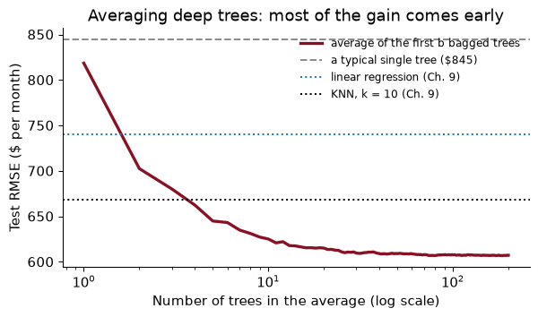
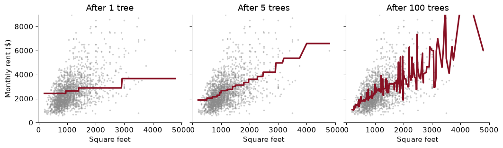
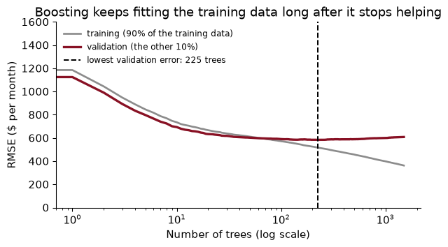
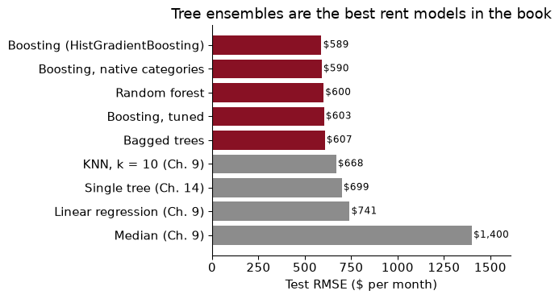
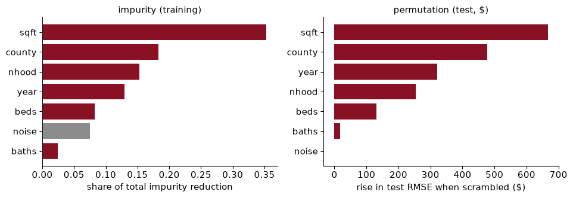
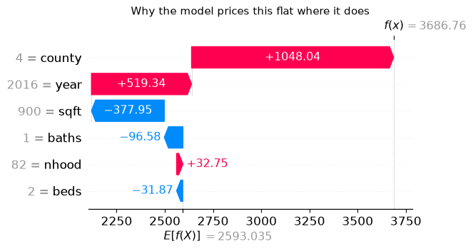
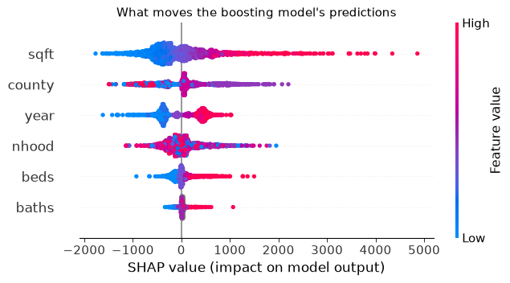
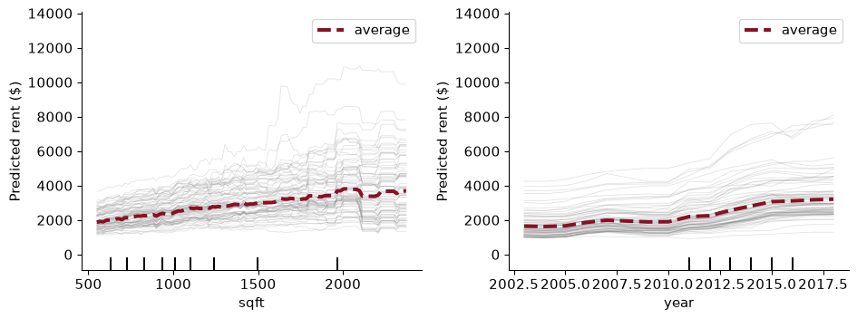

# Chapter 15 — Ensembles: forests and boosting

> **The question:** one appraiser’s estimate of a flat’s rent is an opinion; the average of a hundred appraisers is something better. Can averaging many trees price Bay Area flats better than any single model so far, and if it can, can we still say what drives its prices?

## The wisdom of crowds

In 1906 Francis Galton visited a country fair where about 800 people paid sixpence each to guess the weight of an ox, once slaughtered and dressed. Galton, who did not think much of the judgement of ordinary people, collected the tickets afterwards. The individual guesses were all over the place. Their middle value was within one per cent of the true weight.

The lesson is not that crowds are wise. It is that **independent errors cancel**. Each guesser was wrong, some too high and some too low, and as long as their errors were not all in the same direction, averaging pulled the noise out and left the signal. Economists use the same logic whenever they average forecasts: a consensus of professional forecasters is usually more accurate than most of the forecasters in it.

Chapter 14 ended with a model that badly needs a crowd. A deep decision tree has low bias, because it can follow almost any pattern in the data, and very high variance: refit it on a slightly different sample and its predictions jump around. Fifty trees fitted to fifty bootstrap samples priced the same Mission flat over a range of well over a thousand dollars. Each tree is an erratic appraiser. What happens if we average them?

This chapter builds the two great tree ensembles. **Random forests** average many deep trees, each grown a little differently, and attack variance. **Gradient boosting** adds up many small trees, each fixing the mistakes of the ones before, and attacks bias. On spreadsheet-style data like our rents, these two are the strongest off-the-shelf methods there are. Then comes the harder part: opening them up and asking what they learned, without fooling ourselves.

The numbers to beat, all on Chapter 9’s test listings and all from models fitted to the same training data:

    Median (Ch. 9)               1400.0
    Linear regression (Ch. 9)     741.0
    KNN, k = 10 (Ch. 9)           668.0
    Single tree (Ch. 14)          699.0

### Worked example — how much does averaging help?

How much does averaging help? Suppose each of $B$ appraisers misses a flat’s rent with a standard deviation of \$400. **(a)** If their errors are independent, what is the standard deviation of the average of 100 of them? **(b)** If any two appraisers’ errors have a correlation of 0.5, what is it?

### Solution

The variance of an average of $B$ estimates, each with variance $\sigma^2$ and pairwise correlation $\rho$, is

$$\text{Var}(\text{average}) = \rho\,\sigma^2 + \frac{1 - \rho}{B}\,\sigma^2$$

**(a)** With $\rho = 0$, the variance is $\sigma^2/B$ and the standard deviation is $400/\sqrt{100}$ = \$40: a tenfold improvement.

**(b)** With $\rho = 0.5$, the first term does not shrink as $B$ grows. The standard deviation is $\sqrt{0.5 \times 400^2 + 0.5 \times 400^2/100}$ = \$284. Even with infinitely many appraisers it never falls below $\sqrt{0.5} \times 400$ = \$283.

That one equation is the whole theory of this chapter. Averaging kills the independent part of the errors and leaves the shared part untouched. **An ensemble is only as good as its members are different.** If all the appraisers went to the same school and use the same rules of thumb, a hundred of them are worth little more than one.

## Bagging: many trees, one average

The appraisers need to be different, but we have only one data set. The trick is the bootstrap from Chapter 8. Draw a sample of the same size as the training data, *with replacement*, so that some listings appear twice or three times and others not at all. Grow a deep tree on it. Draw another bootstrap sample, grow another tree. Repeat a few hundred times. To predict a flat, ask every tree and **average** their answers. This is **bagging**, short for *bootstrap aggregating*, and it is due to Breiman (1996).

The trees are deliberately left deep, with no pruning and leaves as small as they like. That sounds backwards after Chapter 14, but it is the point. Each deep tree has low bias and high variance; averaging leaves the low bias alone and removes much of the variance. Pruning each tree would raise its bias, and averaging cannot remove bias.

In scikit-learn, bagged trees are a `RandomForestRegressor` with `max_features=1.0` (the next section explains the name). Here is the test RMSE as trees are added to the average:



A single deep tree misses by about \$845 on the test set: worse than linear regression. The average of ten trees misses by \$625, of fifty by \$609, and of all 200 by \$607, better than every model of Chapters 9 to 14. None of the trees improved; only the averaging did.

Notice the shape of the curve. It falls steeply and then flattens, and it never turns up. **Adding trees to a bagged ensemble cannot make it overfit.** Each extra tree is one more vote in an average; the average settles down, and beyond a few hundred trees you are only paying for computer time. That is unlike depth in Chapter 14, where more was eventually worse.

### Worked example — the Mission flat, by committee

Chapter 14’s fifty bootstrap trees priced the 900 square foot Mission flat with a standard deviation of a few hundred dollars. The bagged ensemble here has 200 trees. What do they say about the flat, individually and together?

### Solution

The 200 trees’ predictions for the flat run from \$1,950 to \$5,400, with a standard deviation of \$493. The ensemble’s prediction is their average, \$3,827.

How stable is that average? If the trees’ errors were independent, its standard deviation would be about \$493 divided by the square root of 200, or \$35. They are not independent, so the truth is somewhere between that and the single-tree spread, which is the subject of the next section. Either way, the housing office’s problem from Chapter 14, voucher rents that jump every time the model is refitted, is much smaller for the committee than for any one member.

## Random forests: make the trees disagree

The bagged trees have a weakness, and the equation in the first section names it. They are all grown by the same greedy recipe from samples that overlap heavily, so they tend to ask the same questions in the same order. Square footage is the best first split in almost every bootstrap sample (Chapter 14, Exercise 7), so almost every tree starts by splitting on square footage at nearly the same place. Their errors are correlated, and correlated errors do not average away.

Breiman’s (2001) fix is beautifully simple. **At each split, let the tree consider only a random subset of the features.** If square footage is not among the candidates at the root of a particular tree, that tree has to start with the year or the county instead, and it grows into something genuinely different. Each tree is a little worse on its own, since it was sometimes denied the best question, but the trees are less alike, and the average gains more from their differences than it loses from their individual handicaps. This is a **random forest**, and the size of the subset is `max_features`: 1.0 means all the features (plain bagging); 0.5 means half of them at each split.

How much less alike? I measured the correlation between the test-set errors of pairs of trees in each ensemble:

|  | Bagging (`max_features=1.0`) | Random forest (`max_features=0.5`) |
|----|----|----|
| Typical single tree, test RMSE | \$845 | \$859 |
| Correlation between two trees’ errors | 0.51 | 0.49 |
| Ensemble of 200 trees, test RMSE | \$607 | \$600 |

Exactly the trade the theory predicts: the forest’s individual trees are worse (\$859 against \$845), their errors are less correlated (0.49 against 0.51), and the ensemble is better (\$600 against \$607). With only six features there is not much room to decorrelate; random forests shine more when there are dozens of features and several strong ones competing for the top.

`max_features` is the forest’s one important hyperparameter. The common defaults are a third of the features for regression and the square root of the number of features for classification, but they are only starting points; cross-validation, or the out-of-bag error of the next section, should choose.

### Worked example — the floor under the forest

Use the variance formula from the first section with the forest’s measured correlation of 0.49 between trees. As the number of trees grows without limit, what share of a single tree’s error variance is left?

### Solution

As $B \to \infty$, the second term $(1-\rho)\sigma^2/B$ vanishes and the variance of the average falls to $\rho\,\sigma^2$: a share 0.49 of a single tree’s error variance. In standard deviations, the floor is the square root of that, 0.70 of a single tree’s.

That is only a guide, because the formula is about the *spread* of the errors around their mean, and a tree’s test error also includes bias that averaging cannot touch. But it explains the flat end of the curve: after a hundred or so trees, $B$ is large enough that the second term no longer matters, and the only way to improve further is to lower $\rho$ (more randomness in the trees) or the bias (better features, or boosting).

## Out-of-bag error: a free validation set

Bagging comes with a gift. Each bootstrap sample leaves out some of the training listings, and the trees grown on that sample never saw them. So for every training listing there is a set of trees, about a third of the forest, for which it is fresh data. Average just those trees’ predictions for it and you have an honest out-of-sample prediction for every training listing, without holding anything back. The error of those predictions is the **out-of-bag (OOB) error**.

Why about a third? A bootstrap sample makes $n$ draws with replacement, and the chance that a given listing is missed by every one of them is $(1 - 1/n)^n$, which for large $n$ is very close to $e^{-1} \approx 0.37$. In one bootstrap draw from our 49,703 training listings, 36.9% were left out.

How good is the free estimate? For the random forest, the OOB RMSE is \$620. Five-fold cross-validation of a 100-tree forest gives \$630, at five times the cost. The test RMSE, which we are not supposed to use for choosing anything, is \$600. All three agree to within about \$29.

So the OOB error is the natural way to tune a forest. Here it is for four values of `max_features`, with 100 trees each:

    max_features
    0.33    648.0
    0.50    625.0
    0.67    625.0
    1.00    631.0

The best is `max_features` = 0.67. The differences are a few dollars, which is typical: forests are forgiving, and their defaults are rarely far off. That is one of their great practical virtues.

### Worked example — why is OOB error honest?

A classmate objects: “Every training listing was used to build the forest. How can its OOB prediction be out-of-sample?” Answer her.

### Solution

The forest as a whole saw every listing, but each listing’s OOB prediction comes only from the trees whose bootstrap samples did *not* contain it. Those trees were built without it, exactly as if it had been a test listing. So its OOB prediction is a genuine prediction for an unseen case. The one difference from a true test set is that the OOB prediction for a listing averages only about a third of the trees, so it is a little noisier than the full forest’s prediction would be; with a few hundred trees that hardly matters. What OOB error cannot protect against is what no validation method can: features that leak the outcome, and choices you made by looking at the test set.

## Gradient boosting: learn from the mistakes

A random forest grows its trees independently, in parallel, and averages them. **Boosting** grows them **in sequence**, each one trained to fix what the ones before it got wrong.

The recipe for squared error is short enough to state in full:

1.  Start by predicting the average rent for every flat.
2.  Compute the **residuals**: actual rent minus the current prediction. These are the mistakes so far.
3.  Fit a *small* tree, two or three levels deep, to the residuals. It learns where the current prediction is too low or too high.
4.  Add a small fraction of that tree’s prediction to the current prediction. The fraction is the **learning rate**, often 0.1.
5.  Go back to step 2, and repeat hundreds of times.

$$\text{new prediction} = \text{old prediction} + \text{learning rate} \times (\text{small tree fitted to the residuals})$$

Here it is on 2,000 training listings and a single feature, square footage, with trees of depth 2 and a learning rate of 0.3:



After one tree the prediction is a crude staircase with four steps, and its rise is damped by the learning rate. After five it has a rough shape. After a hundred it traces the relationship between size and rent, steepening and flattening where the data do. No single tree in the sum knows much; the sum knows a lot.

Boosting and forests attack different problems. A forest averages deep, low-bias trees to cut their **variance**. Boosting starts from shallow, high-bias trees, each nearly useless, and adds them up to cut the **bias**, one correction at a time. The learning rate keeps each correction small, so that no single tree, fitted to the noise in one set of residuals, can push the prediction far. Small steps and many of them generalise better than large steps and few: the same lesson as gradient descent in Chapter 10, and not by accident, since boosting turns out to be gradient descent with trees as the steps (Friedman 2001).

### Worked example — two rounds by hand

Three made-up flats rent for \$2,000, \$3,000 and \$4,000. Boosting starts at their mean. The first small tree splits off the cheapest flat from the other two and fits each side’s average residual. With a learning rate of 0.5, what are the predictions after one round, and what are the new residuals?

### Solution

The starting prediction is \$3,000 for all three, so the residuals are -1,000, +0, +1,000. The tree’s left leaf holds the cheap flat, with an average residual of -1,000; the right leaf holds the other two, with an average of +500. Adding half of that:

| Flat | Rent    | Start   | Tree’s correction | New prediction | New residual |
|------|---------|---------|-------------------|----------------|--------------|
| 1    | \$2,000 | \$3,000 | -1,000            | \$2,500        | -500         |
| 2    | \$3,000 | \$3,000 | +500              | \$3,250        | -250         |
| 3    | \$4,000 | \$3,000 | +500              | \$3,250        | +750         |

Every prediction moved halfway towards its leaf’s target, and the residuals shrank. Flats 2 and 3 still have residuals of opposite sign, because the first tree could not tell them apart; the next tree will split them. Round after round, the residuals left for later trees get smaller and more specific.

## Early stopping

A forest cannot overfit by having too many trees. Boosting can. Each new tree fits the residuals left by the others, and once the real pattern has been captured, what is left in the residuals is noise, which the next trees dutifully start to fit. So the number of trees is a hyperparameter, and an important one.

The standard way to set it is **early stopping**: set aside a slice of the training data as a validation set, add trees one at a time, track the error on the validation slice, and stop once it has not improved for a while. Here is a boosting model with a deliberately high learning rate of 0.3, allowed to run for 1,500 trees so that we can see what early stopping protects against:



The training error keeps falling for as long as we let it. The validation error bottoms out at 225 trees, at \$583, and then drifts up to \$608 by the end. Everything after the dashed line is the model memorising the training listings.

scikit-learn’s **`HistGradientBoostingRegressor`** does this bookkeeping for you. (The “Hist” is because it first sorts each feature into at most 255 bins and only considers splits between bins, which makes it very fast on large data; it also handles missing values, like our bathrooms, natively.) With `early_stopping=True` it holds out 10% of the training data, adds trees until the validation error has not improved for 20 rounds, and keeps the best number:

``` python
hgb = HistGradientBoostingRegressor(max_iter=2000, learning_rate=0.1, early_stopping=True,
                                    n_iter_no_change=20, random_state=368).fit(Z_train, y_train)
```

It stopped after 433 trees, in 5.2 seconds, with a test RMSE of \$589: the best number in this book so far.

### Worked example — slower learning, more trees

Fit the same model with learning rates of 0.03, 0.1 and 0.3, each with early stopping. How many trees does each use, and which predicts best?

### Solution

          trees used  test RMSE
    0.03        1147        590
    0.10         433        589
    0.30         162        595

A smaller learning rate takes smaller steps, so it needs more of them: 1147 trees at 0.03 against 162 at 0.3. The best test RMSE is at a learning rate of 0.1. The usual advice is to pick a small learning rate you can afford and let early stopping choose the number of trees; the gains from going smaller still are typically a few dollars, bought with a lot more computing.

## Tuning, briefly

Boosting has more knobs than a forest: the learning rate, the size of each tree (`max_leaf_nodes`), the minimum leaf size, and a ridge-style penalty on the leaf values (`l2_regularization`). A full grid over four hyperparameters with five values each is 625 combinations, each cross-validated. That is too many.

**`RandomizedSearchCV`** tries a fixed number of combinations drawn at random from ranges you specify. It sounds lazy, and it works remarkably well (Bergstra and Bengio 2012), because usually only one or two of the hyperparameters matter much, and random draws try many more distinct values of each one than a grid of the same size would.

``` python
space = {"learning_rate": loguniform(0.02, 0.3), "max_leaf_nodes": randint(8, 128),
         "min_samples_leaf": randint(5, 200), "l2_regularization": loguniform(1e-3, 10)}
rsearch = RandomizedSearchCV(HistGradientBoostingRegressor(max_iter=1000, early_stopping=True),
                             space, n_iter=12, cv=3, scoring="neg_root_mean_squared_error").fit(Z_train, y_train)
```

`loguniform(0.02, 0.3)` draws learning rates evenly on a log scale, so 0.02 to 0.03 is as likely as 0.2 to 0.3, which is right for a parameter whose effect depends on its order of magnitude. Twelve draws with 3-fold cross-validation took 13 seconds.

The best draw has a cross-validated RMSE of \$625; the default settings, cross-validated the same way, score \$622. Tuning bought essentially nothing. That is a common and useful finding. scikit-learn’s boosting defaults are good, early stopping already chooses the most important hyperparameter, and on six features there is not much structure left for clever settings to find. Tune briefly, check that the defaults are not far off, and spend your effort on features instead.

### Worked example — grid or random?

You have budget for 12 fits per fold. With a grid over two hyperparameters, you could try 4 × 3 combinations. With random search you try 12 random combinations. How many distinct learning rates does each try, and why might that matter?

### Solution

The grid tries only 4 distinct learning rates (or 3, depending on which hyperparameter gets which axis), each repeated with different values of the other. Random search tries 12 distinct learning rates, and 12 distinct values of every other hyperparameter too. If the learning rate turns out to be the one that matters and the other hardly matters, the grid wasted two-thirds of its budget repeating the same 4 learning rates, while random search explored 12. Since you rarely know in advance which hyperparameter matters, random search is the safer bet for more than two.

## The scoreboard

Every model of Part III so far, on the same 12,426 test listings, each fitted once on the same training data and scored once:



The best is **Boosting (HistGradientBoosting)**, at \$589 a month. That is 20% lower than Chapter 9’s linear regression and 12% lower than its nearest neighbours. Three things stand out.

- The four ensembles are close to one another and clearly ahead of everything else. Which ensemble you use matters much less than using one.
- “Native categories” tells `HistGradientBoostingRegressor` that county and neighbourhood are categories, not numbers, so it can group neighbourhoods in any combination at a split instead of slicing the alphabet (the problem from Chapter 14). On these data it changes the test RMSE by only \$1: with hundreds of trees, the alphabetical codes get sliced finely enough that the clumsiness hardly costs anything.
- The bagged forest is built from trees like Chapter 14’s, only deeper and two hundred of them. The difference between the tuned single tree and the forest, about \$91 a month, is entirely the averaging.

### Worked example — reporting to the housing office

Rewrite Chapter 9’s one-sentence report for the housing office using the best model. What has changed, and what has not?

### Solution

“For a typical whole unit in the Bay Area, our model’s rent estimate misses the asking rent by about \$589 a month (root mean squared error on 12,426 held-out listings), compared with \$668 for our earlier nearest-neighbour model.”

What has changed is the size of the typical miss. What has not is everything Chapter 9 said the sentence should not claim. The listings are still mostly from 2011 to 2016, still Craigslist asking rents rather than leases, and still a random split rather than a forecast of next year. A better model of the same data inherits all of the data’s limits.

## Which features matter? Impurity and permutation importance

A forest of 200 deep trees cannot be read like a flowchart. But a landlord, a regulator or a curious economist will ask what drives its predictions, and there are tools that give partial answers. The first and crudest: which features does the model rely on most?

**Impurity importance** (scikit-learn’s `feature_importances_`) adds up, for each feature, how much the splits on that feature reduced the training error, across all the trees. It is free, since it comes out of the fitting.

**Permutation importance** asks a more direct question: if I scramble one column of the *test* data, shuffling its values randomly across listings so that it carries no information, how much worse do the predictions get? A feature the model depends on will hurt a lot when scrambled; a feature it ignores will not hurt at all.

To see the difference, I add a column of pure random noise to the features, refit the forest, and compute both:



Impurity importance ranks the noise column 6th of 7, ahead of real features such as baths. That is absurd, and it has a simple cause. Deep trees split until their leaves are tiny, and once the real features have done their work, a continuous random column with tens of thousands of distinct values offers endless cutpoints that each reduce the *training* error a little, by fitting noise. Impurity importance counts that as credit. Permutation importance, computed on test data, gives the noise column -1.0 dollars: scrambling it does nothing, because it never helped predict anything.

> Impurity importance is biased towards features with many distinct values and is measured on the data the model memorised. Use permutation importance on held-out data.

Permutation importance has its own blind spot: **correlated features share credit**. Square footage and bedrooms are strongly correlated. Scramble bedrooms, and the model can still learn most of what bedrooms told it from square footage, so bedrooms look less important than they are. Neither measure tells you what *would happen* if a feature changed; both describe how the model uses the information it was given.

### Worked example — reading the permutation numbers

Scrambling `sqft` raises the test RMSE by \$667 and scrambling `county` by \$477. Does that mean the model would be \$667 worse without square footage?

### Solution

No. Scrambling a column keeps the model fixed and feeds it nonsense; the trees still split on square footage and now send flats down the wrong branches. *Dropping* the column and refitting lets the model rebuild itself around what is left, leaning harder on bedrooms and bathrooms, which carry much of the same information. A forest refitted without `sqft` has a test RMSE of \$758, against \$600 with it: worse by \$158, which is less than the permutation importance suggests. The two numbers answer different questions: “how much does this model depend on this column?” and “how much does this column add to what the others already carry?”

## SHAP: splitting the credit for one prediction

Importance measures speak about the model as a whole. Often the question is about one prediction: *why did the model price this flat at \$4,000?* The most popular answer today is **SHAP** (Lundberg and Lee 2017), which borrows an idea from cooperative game theory.

Think of a prediction as a bill run up by a team of features, and SHAP as a fair way of splitting it. Start from the **base value**, the model’s average prediction over the training data: what you would guess knowing nothing about the flat. Then each feature gets a **SHAP value**: how far it pushed *this* flat’s prediction above or below the base. The shares are computed by imagining the features joining the team in every possible order and averaging each one’s marginal contribution, which is the **Shapley value** from game theory, and it is the only way of splitting the credit that satisfies a few natural fairness rules. The key property is that the bill adds up exactly:

$$\text{prediction} = \text{base value} + \text{SHAP}(\text{sqft}) + \text{SHAP}(\text{beds}) + \dots + \text{SHAP}(\text{nhood})$$

For tree models, `shap.TreeExplainer` computes these exactly and quickly. Here is the boosting model’s explanation of the Mission flat:



Read it from the bottom. The base value is \$2,593. Each bar adds or subtracts one feature’s contribution, and the top is the prediction, \$3,687. For this flat the biggest push up comes from **county** (+1,048 dollars). The flat is smaller than average, so `sqft` pulls the prediction down by \$378, while being in San Francisco, in the Mission, in 2016 pushes it up.

Averaging the absolute SHAP values over many listings gives a global ranking, and the **beeswarm** plot shows the whole distribution:



Each row is a feature, each dot a listing, placed by how much that feature moved its prediction, and coloured red for a high value of the feature and blue for a low one. For `sqft`, red dots sit far to the right and blue ones to the left: big flats are priced up, small ones down, and the spread is wide. For `year`, late listings (red) are pushed up: the Bay Area boom. The ranking by mean absolute SHAP value is sqft, county, year, nhood, beds, baths. For `county` and `nhood` the colours mean little, because the codes are alphabetical, which is one more reason to read SHAP for categories with care.

### A SHAP value is not a treatment effect

This deserves its own heading, because it is the mistake that matters most. “Being in San Francisco adds \$1,048 to this flat’s predicted rent” is a statement about **the model**: about how it combines the features it was given to produce a number. It is not a statement about **the world**: it does not say that moving this flat to San Francisco would raise its rent by that amount, or that a policy raising some feature would raise rents.

The reasons are the ones you know from econometrics. The model was trained to predict, not to isolate causes, and county stands in for everything that comes with it in these data: commuting time, schools, amenities, the kind of flat that gets built there. SHAP divides the credit for a prediction among correlated features by a fairness rule, not by a causal design. Mullainathan and Spiess’s warning from Chapter 9 applies with full force: many different models predict equally well and split the credit differently. **SHAP explains the model, not the economy.** If you want what a feature does, you need a research design (Chapter 7’s experiments, or the identification strategies of econometrics), not a better explanation of a predictor.

### Worked example — checking that the bill adds up

Verify the additivity property for the Mission flat: add the base value and the six SHAP values, and compare with the model’s prediction.

### Solution

``` python
print(f"base value          {base:>9,.2f}")
for f, v in contrib.items():
    print(f"  + SHAP({f:<6})    {v:>+9,.2f}")
print(f"= sum               {base + contrib.sum():>9,.2f}")
print(f"model prediction    {pred0:>9,.2f}")
```

    base value           2,593.03
      + SHAP(sqft  )      -377.95
      + SHAP(beds  )       -31.87
      + SHAP(baths )       -96.58
      + SHAP(year  )      +519.34
      + SHAP(county)    +1,048.04
      + SHAP(nhood )       +32.75
    = sum                3,686.76
    model prediction     3,686.76

The sum is \$3,686.76 and the prediction is \$3,686.76: the same, up to rounding in the last digit. Every dollar of the prediction is assigned to some feature, and none is left over. That is what makes SHAP easy to present (“here is where your \$3,687 comes from”) and also what makes it easy to over-read: a tidy accounting identity looks like an explanation of causes, and it is not one.

## Partial dependence: one feature at a time

A **partial dependence plot** (PDP) shows how the model’s prediction changes as one feature changes, on average over the data. Take 1,000 test listings. Set every one of them to 500 square feet, leaving all their other features as they are, and average the model’s predictions. Then set them all to 600, and so on. The curve of those averages is the partial dependence on square footage. The thin lines are **individual conditional expectation** (ICE) curves: the same exercise for each listing separately, before averaging.



The size curve rises fairly steadily across the range where most flats are (the plot covers the middle 90% of sizes), and turns jagged near the top, where listings thin out and the model has little to go on. Notice that it is not a straight line drawn by assumption: the model learned the shape, steps and all. Averaged over the listings, going from 900 to 1,100 square feet raises the predicted rent by \$360. The year curve is flat-ish until the early 2010s and then climbs steeply: on average the model predicts \$1,147 more for an otherwise identical listing in 2016 than in 2010. That is the boom, as the model sees it.

The ICE lines for size fan out: for some listings the curve is steep and for others nearly flat. Lines that are not parallel mean an **interaction**: the effect of size on the prediction depends on the other features, most obviously on where the flat is. A partial dependence curve averages that away, so always draw the ICE lines too.

PDPs carry two warnings. First, by setting every listing to 500 square feet while keeping its five bedrooms, the plot asks the model about flats that do not exist, and a model’s answers about impossible flats are guesses. Second, and once again, the curve describes the model. It says what the model predicts when you change one input; it does not say what would happen to a real flat’s rent if you changed it.

### Worked example — the landlord’s wall

A landlord reads the partial dependence plot and says: “Going from 900 to 1,100 square feet adds \$360 to predicted rent. If I knock through into the storeroom and add 200 square feet, I’ll get \$360 more a month.” Give two reasons why that does not follow.

### Solution

First, the curve is a comparison between flats, not a change to one flat. In the training data, flats of 1,100 square feet differ from flats of 900 in many ways the model only partly sees: they are in different buildings, with different finishes, more often have parking or a view, and are rented to different tenants. The model’s \$360 is how much more it predicts for *a bigger flat*, carrying whatever comes with bigger flats in these listings. Knocking through a wall changes the size and nothing else.

Second, the plot holds the other features fixed at combinations that may not exist. A 1,100 square foot flat with one bedroom, which is what the knocked-through flat would be, may be rare in the data, so the model is extrapolating. A better (still imperfect) approach would compare listings that differ mainly in size within the same building and year; a convincing one would need something like a design, such as renovations in similar units at different times. That is a $\hat\beta$ question, and Chapter 9 warned us not to ask it of a $\hat y$ model.

## In Python

The whole pipeline in one place: Chapter 9’s data and split, Chapter 14’s coding of the categories, a random forest tuned by its out-of-bag error, boosting with early stopping, one look at the test set, and an explanation.

``` python
from pathlib import Path
import numpy as np, pandas as pd
from sklearn.model_selection import train_test_split
from sklearn.compose import ColumnTransformer
from sklearn.preprocessing import OrdinalEncoder
from sklearn.ensemble import RandomForestRegressor, HistGradientBoostingRegressor
from sklearn.inspection import permutation_importance
from sklearn.metrics import root_mean_squared_error
import shap
SEED = 368

path = Path("../data/rent.csv")                      # download once, then reuse
if not path.exists():
    path.parent.mkdir(exist_ok=True)
    pd.read_csv(URL).to_csv(path, index=False)
rent = pd.read_csv(path)
d = (rent.dropna(subset=["beds", "sqft", "county"])
         .query("room_in_apt == 0 and beds <= 5 and 200 <= sqft <= 5000 and 500 <= price <= 15000"))
num, cat = ["sqft", "beds", "baths", "year"], ["county", "nhood"]
X_train, X_test, y_train, y_test = train_test_split(d[num + cat], d["price"], test_size=0.2, random_state=SEED)
```

Code the categories as integers, learning the list of categories from the training data only.

``` python
enc = ColumnTransformer([
    ("num", "passthrough", num),
    ("cat", OrdinalEncoder(handle_unknown="use_encoded_value", unknown_value=-1), cat)],
    verbose_feature_names_out=False).set_output(transform="pandas")
Z_train, Z_test = enc.fit_transform(X_train).astype(float), enc.transform(X_test).astype(float)
```

A forest, choosing `max_features` by out-of-bag error, and boosting with early stopping.

``` python
oob = {}
for mf in [0.33, 0.5, 0.67]:
    f = RandomForestRegressor(200, max_features=mf, oob_score=True, n_jobs=-1, random_state=SEED).fit(Z_train, y_train)
    oob[mf] = (root_mean_squared_error(y_train, f.oob_prediction_), f)
mf_star = min(oob, key=lambda k: oob[k][0])
forest = oob[mf_star][1]
boost = HistGradientBoostingRegressor(max_iter=2000, early_stopping=True, random_state=SEED).fit(Z_train, y_train)
```

Test once, then explain the better model with permutation importance and SHAP.

``` python
for name, m in [(f"forest (max_features={mf_star})", forest), (f"boosting ({boost.n_iter_} trees)", boost)]:
    print(f"{name:<28} test RMSE ${root_mean_squared_error(y_test, m.predict(Z_test)):,.0f}")
perm = permutation_importance(boost, Z_test, y_test, n_repeats=5, random_state=SEED,
                              scoring="neg_root_mean_squared_error", n_jobs=-1)
shap_values = shap.TreeExplainer(boost)(Z_test.iloc[:2000])
print(pd.DataFrame({"permutation ($)": perm.importances_mean,
                    "mean |SHAP| ($)": np.abs(shap_values.values).mean(axis=0)}, index=Z_test.columns).round(0))
```

    forest (max_features=0.5)    test RMSE $600
    boosting (313 trees)         test RMSE $594
            permutation ($)  mean |SHAP| ($)
    sqft              625.0            523.0
    beds              167.0            127.0
    baths              20.0             35.0
    year              302.0            404.0
    county            482.0            419.0
    nhood             312.0            242.0

## What goes wrong

**Pruning the trees in a forest.** The trees in a bagged ensemble or random forest should be deep: averaging removes variance but cannot remove bias. Limit them too much and the forest inherits the bias of shallow trees. (The opposite is true for boosting, whose trees should be small.)

**Running boosting without early stopping.** A forest cannot overfit by having more trees; boosting can. With a learning rate of 0.3, the validation error was lowest at 225 trees and rose to \$608 by 1,500. Always use early stopping, or choose the number of trees by cross-validation.

**Trusting impurity importance.** It is computed on the training data and favours features with many distinct values, so a column of random noise ranked 6th of 7. Use permutation importance on held-out data, and add a noise column as a sanity check whenever you report importances.

**Over-tuning.** Random search over four boosting hyperparameters found a best cross-validated RMSE of \$625, against \$622 for the defaults. A long search is another chance to fit the noise in the folds. Tune briefly and coarsely; features matter more.

**Reading SHAP values or partial dependence as causal effects.** “San Francisco adds \$1,048 to this prediction” describes how the model uses the county code alongside correlated features. It is not what moving the flat would do. These tools explain a predictor; they do not identify anything.

**Explaining categories coded as arbitrary numbers.** With alphabetical codes, a PDP or beeswarm for `nhood` plots neighbourhoods in alphabetical order, as if code 40 were “more” neighbourhood than code 39. Read such plots for categories with great care, or use target-ordered codes (Chapter 14, Exercise 6). And `shap.TreeExplainer` does not correctly handle `HistGradientBoosting`’s native categorical splits, so do not use it on that model.

## Exercises

1.  A colleague fits a random forest with 2,000 trees instead of 200 and worries that it “will overfit, like a tree that is too deep”. Is she right? What *does* change when you add trees?

2.  A random forest’s trees each have a test RMSE of about \$850 and their errors have a pairwise correlation of 0.5. Roughly what RMSE should you expect from a forest of 500 trees, ignoring bias? Compare your answer with the forest in this chapter. Why can’t the formula be the whole story?

3.  Tune the random forest’s `min_samples_leaf` (1, 2, 5, 10) and `max_features` (0.33, 0.5, 0.67) together using out-of-bag error, with 100 trees each. Which combination is best? Is the improvement over the defaults worth reporting?

4.  Exercise 18 in the course fits the models to **log** rent. Fit `HistGradientBoostingRegressor` with early stopping to log rent, convert its test predictions back to dollars with `np.exp`, and compute the test RMSE in dollars. Compare it with the model fitted to dollars. Which is better on RMSE, and why might a model fitted in logs do worse on a dollar loss?

5.  Make a **time split**: train boosting on listings from 2015 and earlier and test on 2016 and later, and compare its RMSE with linear regression’s on the same split (Chapter 14, Exercise 5 did this for a single tree). Does the ensemble’s advantage survive? Use the year partial dependence plot to explain what the boosting model predicts for 2017.

6.  The SHAP beeswarm shows that late listings (high `year`) have positive SHAP values. A journalist writes: “Machine learning shows that time itself caused Bay Area rents to rise.” Rewrite the sentence so that it says only what the model shows.

7.  Repeat the noise-feature experiment for the boosting model instead of the forest: add a noise column, refit `HistGradientBoostingRegressor` with early stopping, and compute mean absolute SHAP values and permutation importance. Does SHAP give the noise column credit? Why is the boosting model less fooled than the forest’s impurity importance?

### Answers

**1.** She is wrong. More trees in a forest only make the average more stable: the test error falls quickly and then levels off, and it does not rise. The overfitting she has in mind comes from each tree being too flexible, which the number of trees does not change. What changes is cost: fitting, storing and predicting with 2,000 trees takes ten times as long as with 200, for a gain of a few dollars at most. (For *boosting*, her worry would be right.)

**2.** Ignoring bias, the variance of the average is $\rho\sigma^2 + (1-\rho)\sigma^2/B = 0.5 \times 850^2 + 0.5 \times 850^2/500$, so the standard deviation is about $850 \times \sqrt{0.501}$ ≈ \$602. The forest in this chapter, with trees at about \$859 and a measured correlation of 0.49, actually reaches \$600. The formula is about the variation of errors around their average, but RMSE also includes bias, the part of the error all trees share because none of them can learn it from these features. Averaging cannot remove that; the formula treats the whole error as if it could, at least down to $\rho\sigma^2$.

**3.**

``` python
oob3 = {(msl, mf): rmse(y_train, RandomForestRegressor(100, max_features=mf, min_samples_leaf=msl, oob_score=True,
                                                       n_jobs=-1, random_state=SEED).fit(Z_train, y_train).oob_prediction_)
        for msl in [1, 2, 5, 10] for mf in [0.33, 0.5, 0.67]}
oob3 = pd.Series(oob3).unstack(); print(oob3.round(0))
```

         0.33   0.50   0.67
    1   648.0  625.0  625.0
    2   661.0  626.0  622.0
    5   701.0  648.0  641.0
    10  733.0  671.0  665.0

The best combination is `min_samples_leaf` = 2 and `max_features` = 0.67, with an OOB RMSE of \$622. The worst on the grid is \$733. Within the sensible part of the grid (small leaves, half or more of the features) the differences are a few dollars, well inside the noise. Larger leaves hurt, because they make each tree more biased, and averaging cannot remove bias. I would report “the forest is insensitive to its settings”, not the third digit of the best one.

**4.**

``` python
hgb_log = HistGradientBoostingRegressor(max_iter=2000, early_stopping=True, random_state=SEED).fit(Z_train, np.log(y_train))
rmse_log = rmse(y_test, np.exp(hgb_log.predict(Z_test)))
print(round(rmse_log), round(test["Boosting (HistGradientBoosting)"]))
```

    598 589

Fitted in logs and converted back, boosting has a test RMSE of \$598, against \$589 when fitted in dollars. The log model does worse on the dollar loss. A model fitted to log rent minimises errors in *percentages*, so it cares as much about a 10% miss on a \$1,500 studio as on a \$9,000 house, while dollar RMSE is dominated by the expensive units. And $e^{\widehat{\log y}}$ estimates something closer to the median rent than the mean, which biases dollar predictions down for a right-skewed outcome. Choose the scale of the fit from the loss you will be judged on.

**5.**

``` python
early, late = X[d["year"] <= 2015], X[d["year"] >= 2016]
y_early, y_late = y[d["year"] <= 2015], y[d["year"] >= 2016]
hgb_time = HistGradientBoostingRegressor(max_iter=2000, early_stopping=True, random_state=SEED).fit(enc.transform(early).astype(float), y_early)
ols_time = make_pipeline(make_prep(), LinearRegression()).fit(early, y_early)
r_boost_late = rmse(y_late, hgb_time.predict(enc.transform(late).astype(float)))
r_ols_late = rmse(y_late, ols_time.predict(late))
print(round(r_boost_late), round(r_ols_late))
```

    706 802

On listings from 2016 onwards, boosting trained on earlier years misses by \$706 and linear regression by \$802. The ensemble’s advantage survives, but it shrinks. A tree ensemble cannot extrapolate: its year partial dependence curve is flat beyond the last year it was trained on, so it prices a 2017 flat as if it were a 2015 one. Linear regression extends the trend, which helps when the boom continues. For forecasting, a common fix is to model the trend separately (or to predict rents relative to a current price index) and let the trees handle the rest.

**6.** Something like: “A machine-learning model trained on Craigslist listings predicts higher rents for listings posted in later years, holding fixed the size, bedrooms and location it can see.” The model shows that later listings rent for more than earlier listings with the same recorded features. It says nothing about why: the year stands in for everything that changed in the Bay Area over the period (jobs, incomes, construction, interest rates) and for changes in which flats were advertised on Craigslist. “Caused” claims a counterfactual the model never estimated.

**7.**

``` python
hgb_noise = HistGradientBoostingRegressor(max_iter=2000, early_stopping=True, random_state=SEED).fit(Zn_train, y_train)
sv_noise = shap.TreeExplainer(hgb_noise)(Zn_test.iloc[:2000])
perm_b = permutation_importance(hgb_noise, Zn_test, y_test, n_repeats=5, random_state=SEED, n_jobs=-1,
                                scoring="neg_root_mean_squared_error")
noise_tab = pd.DataFrame({"mean |SHAP| ($)": np.abs(sv_noise.values).mean(axis=0),
                          "permutation ($)": perm_b.importances_mean}, index=Zn_test.columns)
print(noise_tab.round(1))
```

            mean |SHAP| ($)  permutation ($)
    sqft              536.9            631.9
    beds              108.0            118.3
    baths              34.2             13.5
    year              408.6            293.6
    county            421.0            468.3
    nhood             214.7            275.9
    noise               6.1              0.1

The boosting model’s mean absolute SHAP value for the noise column is \$6.1, against \$34 for the least important real feature, and its permutation importance is +0.1 dollars. The boosting model is less fooled because its trees are small and early stopping halts it before it starts fitting noise, so it rarely has a reason to split on the noise column at all. SHAP faithfully reports how the model uses each feature: if a model had leaned on noise, SHAP would show it. It is a tool for describing a model, good or bad, not for certifying that the model learned something true.

## Economics reading

Ensembles are the workhorse predictors in empirical finance and in the economics of decisions. These papers use them and show what it takes to get from a good forecast to an economic conclusion.

**Gu, S., Kelly, B. & Xiu, D. (2020). “Empirical Asset Pricing via Machine Learning.” *Review of Financial Studies* 33(5): 2223–2273.** [doi.org/10.1093/rfs/hhaa009](https://doi.org/10.1093/rfs/hhaa009)

Can you predict which stocks will do well next month from a long list of firm characteristics and economic conditions? The authors run a horse race among linear regression, penalised regression, random forests, boosted trees and neural networks. The flexible methods, trees and networks among them, predict better than linear models, largely because they capture interactions among predictors, and the most useful predictors are measures of recent price trends, liquidity and volatility.

*Think about:* a rent model that predicts well can go on predicting well. A model that predicts stock returns well is a profit opportunity that other investors will try to exploit. Why might its edge shrink once it is published, and why does that make the economics of prediction different in asset markets?

**Wager, S. & Athey, S. (2018). “Estimation and Inference of Heterogeneous Treatment Effects using Random Forests.” *Journal of the American Statistical Association* 113(523): 1228–1242.** [doi.org/10.1080/01621459.2017.1319839](https://doi.org/10.1080/01621459.2017.1319839)

The “causal forest” adapts the random forest of this chapter to estimate how a treatment effect varies from person to person, and to give a valid confidence interval for each estimate. Its trees are “honest”: one subsample decides where to split and a different one estimates the effect in each leaf. It has become a standard tool for asking who gains most from a programme or an intervention.

*Think about:* the chapter warns that SHAP values and partial dependence describe how the rent forest uses a feature, not what changing the feature would do. What does a causal forest need from the data that the rent forest does not have, and why can no amount of tuning give the rent forest that?

**Mullainathan, S. & Obermeyer, Z. (2022). “Diagnosing Physician Error: A Machine Learning Approach to Low-Value Health Care.” *Quarterly Journal of Economics* 137(2): 679–727.** [doi.org/10.1093/qje/qjab046](https://doi.org/10.1093/qje/qjab046)

Doctors decide whom to test for a heart attack. The authors build a flexible machine-learning model of each patient’s risk from electronic health records and compare it with doctors’ choices. Doctors test many patients the model says are very low risk, and fail to test some high-risk patients who go on to have bad outcomes, so the problem is not simply too much testing but testing the wrong people.

*Think about:* to conclude that the doctors erred, rather than that they saw something the model did not, the authors must deal with information the doctor had and the data lack. How would you check that, and what is the equivalent worry if you compared the rent forest’s prices with an experienced landlord’s?

**Reading.** Géron, ch. 6, for ensembles: voting, bagging and pasting, out-of-bag evaluation, random forests, boosting and stacking. ISLP (James, Witten, Hastie, Tibshirani & Taylor 2023), ch. 8.2, for bagging, random forests and boosting, with the variance argument. Breiman (2001), “Random Forests”, *Machine Learning* 45; Friedman (2001), “Greedy Function Approximation: A Gradient Boosting Machine”, *Annals of Statistics* 29. Lundberg & Lee (2017), “A Unified Approach to Interpreting Model Predictions”, *NeurIPS*, for SHAP, and Molnar, *Interpretable Machine Learning* (online), for partial dependence, ICE and their pitfalls.
