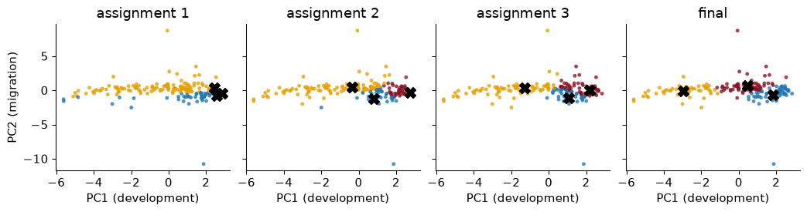
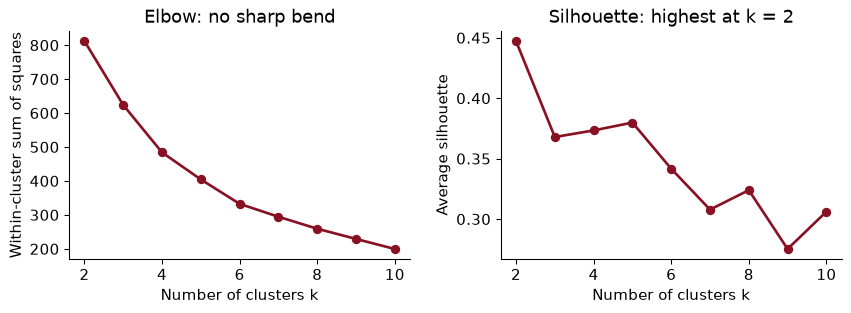
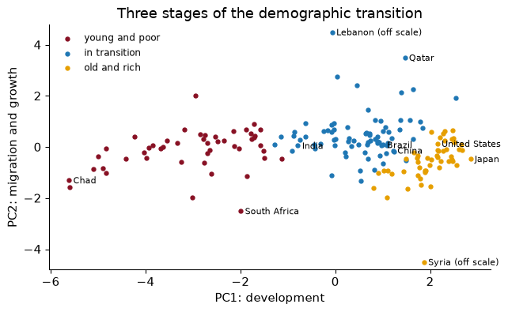
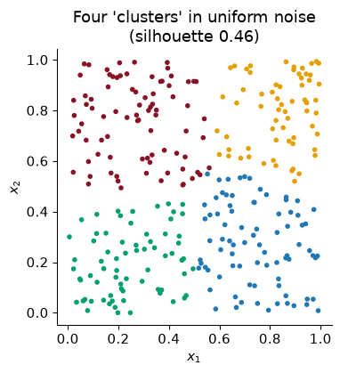
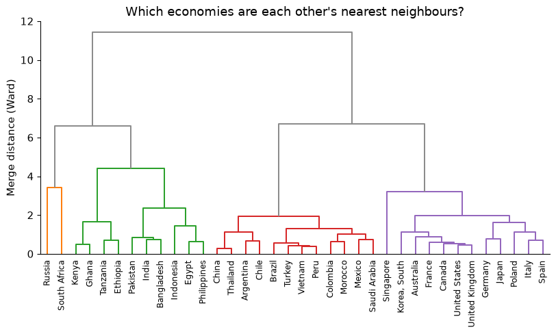

# Chapter 17 — Clustering

> **The question:** which countries are each other’s peers? If we sort the world into groups using health and demography alone, do we get back the World Bank’s income groups, or something different?

## Groups without labels

Economists sort things into groups all the time, and usually someone else has drawn the lines. The World Bank divides countries into four income groups by cutting gross national income per head at three thresholds; statistical agencies sort firms into industries with codes written decades ago. Each grouping is a choice of which differences matter.

**Clustering** asks the data to draw the lines. Give it a table of observations described by several variables, and it returns groups, or **clusters**, of observations that are similar to each other and different from the rest. There is no outcome $y$, no right answer to check against, and no test error. It is the second half of the **unsupervised** toolkit that Chapter 16 began. PCA compressed the *columns* of the table into a few components; clustering compresses the *rows* into a few groups.

We keep Chapter 16’s data: the CIA World Factbook as distributed by TidyTuesday, with eight indicators of health and demography for the 177 countries that report all of them. Chapter 16 found that one direction, development, carries about half the variance, and that a second, migration, carries much of the rest. A cluster analysis asks a different question of the same table: are there *types* of country, or just a smooth continuum along which every country sits somewhere?

Why should an economist care? Because “compared with whom?” is the first question in benchmarking a country’s health spending or debt, and a peer group built from many indicators is more defensible than one built from income alone. Because a firm choosing which prices to offer which customers is clustering, whether it calls it that or not. And, as the end of the chapter shows, because clusters can become measurements and inputs to estimation.

### Worked example — income groups as a clustering

The World Bank’s income groups put every country into one of four bins using a single variable, GNI per head. Is that a clustering? What would a cluster analysis of the Factbook add?

### Solution

It is a grouping, but of a very particular kind: one variable, and thresholds chosen by people rather than found in the data. Nothing guarantees that countries just below a threshold are more like each other than like countries just above it. A cluster analysis of eight indicators asks whether the countries *themselves* fall into groups, using all eight dimensions at once, with no thresholds chosen in advance. If the answer looks like the income groups, health and demography line up with income. If it does not, the disagreements are interesting, and we will look for them at the end of the chapter.

## k-means in words and pictures

The most widely used clustering method is **k-means**. You choose the number of clusters, $k$. Each cluster has a **centre** (also called a centroid), which is simply the average of its members, and every observation belongs to the cluster whose centre is closest. The best clustering is the one that makes the observations as close to their own centres as possible:

$$\text{within-cluster sum of squares} = \sum_{\text{clusters } c}\ \sum_{i \in c} \lVert x_i - \bar x_c \rVert^2$$

where $\bar x_c$ is the centre of cluster $c$ and $\lVert \cdot \rVert$ is ordinary straight-line distance across all the variables. scikit-learn calls this quantity **inertia**.

Trying every possible grouping is hopeless (there are more ways to split 177 countries into three groups than there are atoms in the universe), so k-means uses a simple back-and-forth known as **Lloyd’s algorithm**:

1.  Pick $k$ starting centres, usually $k$ randomly chosen observations.
2.  **Assign:** put each observation in the cluster of its nearest centre.
3.  **Update:** move each centre to the average of the observations now assigned to it.
4.  Repeat steps 2 and 3 until no observation changes cluster.

Each step can only lower the within-cluster sum of squares, so the algorithm always stops. To watch it work, here it is run on just the countries’ scores on Chapter 16’s first two principal components (so that every step can be drawn), starting from three deliberately bad centres, the positions of Japan, Germany and Canada:



In the first panel almost every country is assigned to the same centre, because all three starting points sit together among the rich countries. After one update the centres have moved towards the middle of their members, and after 11 rounds of assign-and-update nothing changes. The final clusters cut the development axis into three bands.

Two features follow from the recipe. k-means likes clusters that are **round and of similar spread**, because “nearest centre” draws straight boundaries halfway between centres. And the answer can depend on the start: Lloyd’s algorithm finds a *local* best, which no single reassignment can improve, but not necessarily the best overall.

To see how much this matters, I ran k-means with four clusters on all eight standardized indicators from 50 different random starts, once each. They ended in 32 different solutions, with inertias from 484.7 to 595.9; only 6% of the starts found the best one. The cure is cheap: run from many starts and keep the best. That is what `n_init=20` does in scikit-learn, and scikit-learn’s default starting rule (**k-means++**, which spreads the starting centres out) helps too.

### Worked example — one round by hand

Hypothetical numbers: five countries have life expectancies of 55, 60, 72, 78 and 82 years. Run k-means with $k = 2$, starting from centres at 55 and 60.

### Solution

**Assign.** 55 is nearest 55; 60, 72, 78 and 82 are all nearer 60 than 55. Clusters: {55} and {60, 72, 78, 82}.

**Update.** The centres move to the averages: 55 and (60 + 72 + 78 + 82)/4 = 73.

**Assign again.** 60 is 5 from 55 and 13 from 73, so it switches. Clusters: {55, 60} and {72, 78, 82}.

**Update.** Centres 57.5 and 77.3. **Assign again:** nobody moves, so we stop, with “short lives” and “long lives”, as you would have drawn by eye. The bad start cost a few rounds but did not change the answer here; with more dimensions and clusters, it can.

## Standardize first

k-means measures closeness by distance, and distance, like variance in Chapter 16, depends on units. Maternal mortality is in deaths per 100,000 births, with a standard deviation across countries of 222; internet use is a share, with a standard deviation of 0.27. Run k-means with three clusters on the raw numbers and look at maternal mortality within each cluster:

       lowest maternal mortality  highest  countries
    1                        2.0    170.0        122
    2                      180.0    510.0         39
    3                      540.0   1100.0         16

The ranges do not overlap. The “clusters” are three bins of maternal mortality, and the other seven indicators had almost no say. This is the same failure as unstandardized PCA, for the same reason.

So we **standardize** each column before clustering, which gives every indicator the same say. That is a choice, not a law of nature: it says that one standard deviation of internet use matters as much as one of infant mortality. You could weight variables you care about more, or log a skewed one first. Whatever you do, do it on purpose, because the scaling *is* the definition of “similar”.

### Worked example — what counts as close?

Two countries differ by 10 years in life expectancy and by 10 percentage points in internet use. In raw units, which difference contributes more to the distance between them? And after standardizing?

### Solution

In raw units the life-expectancy gap contributes $10^2 = 100$ to the squared distance and the internet gap $0.1^2 = 0.01$, so life expectancy counts ten thousand times as much, purely because of how the two are recorded. After standardizing, 10 years is 1.13 standard deviations of life expectancy and 10 points is 0.37 standard deviations of internet use, so the two gaps count about equally (life expectancy a little more). Standardizing makes it a comparison of how unusual each gap is, which is usually what we mean.

## Choosing k: the elbow and the silhouette

k-means needs $k$ before it starts, and the data do not announce it. Two pictures help.

The **elbow plot** draws the within-cluster sum of squares against $k$. It always falls (with one cluster per country it is zero), so we look for the “elbow” where adding a cluster stops buying much.

The **silhouette** asks, for each observation, whether it sits comfortably in its own cluster. Let $a_i$ be its average distance to the other members of its cluster and $b_i$ its average distance to the members of the *nearest other* cluster. Its silhouette is $(b_i - a_i)/\max(a_i, b_i)$: close to 1 when it is much nearer its own cluster than any other, near 0 when it is on a border, negative when it is probably in the wrong cluster. The average silhouette over all observations measures how well separated the clusters are.



The honest reading is that neither plot gives a sharp answer, which is normal with real data. The elbow bends gently everywhere. The silhouette is highest at $k$ = 2 (0.45), and for $k$ = 3 to 5 it sits around 0.37–0.38.

Then look at what each $k$ actually produces. The cluster sizes are a quick check:

    k = 2: cluster sizes [50, 127]
    k = 3: cluster sizes [48, 52, 77]
    k = 4: cluster sizes [1, 48, 50, 78]
    k = 5: cluster sizes [1, 1, 48, 50, 77]

With four clusters, one “cluster” is a single country, and with five there are two: Syria and Lebanon, whose net migration rates (refugees leaving one and arriving in the other) put each far from everyone, the feature Chapter 16 found on its second component. A cluster of one is an outlier with a label, not a type of country, and it flatters the silhouette, because an isolated point sits perfectly in its own cluster.

So I use $k$ = 3: the largest number that gives real groups, with a silhouette close to the best and a clean interpretation. **Interpretability is a legitimate criterion.** A clustering is a summary for people to use, and a summary nobody can describe has failed, whatever its silhouette.

### Worked example — one country’s silhouette

With three clusters, Mexico’s average distance to the other countries in its own cluster is $a$ = 1.440, and its average distance to the countries of the nearest other cluster is $b$ = 2.776 (both in standardized units). What is its silhouette, and what does it mean?

### Solution

$(b - a)/\max(a, b)$ = (2.776 − 1.440) / 2.776 = 0.481, which matches scikit-learn’s `silhouette_samples` (0.481). Mexico is clearly closer to its own cluster than to the next one, though not by a huge margin. The average silhouette is just this number averaged over every country, so it rewards clusterings in which most countries sit well inside their groups.

## Three kinds of country

Here are the three clusters’ average values of the original, unstandardized indicators, ordered by life expectancy:

                             young and poor  in transition  old and rich
    birth_rate                        33.55          18.93         11.06
    death_rate                        10.28           5.52          9.95
    infant_mortality_rate             59.73          20.29          6.65
    internet_pc                        0.04           0.24          0.62
    life_exp_at_birth                 58.29          73.58         77.73
    maternal_mortality_rate          458.33          80.23         17.29
    net_migration_rate                -0.93           0.70         -1.63
    population_growth_rate             2.23           1.41         -0.05
    countries                         48.00          77.00         52.00

     young and poor (48): Somalia, Ghana, Guinea, Gabon, Haiti, Timor-Leste, Uganda, Comoros
      in transition (77): Cabo Verde, Maldives, Kuwait, Tonga, Mongolia, Bhutan, Grenada, Mauritius
       old and rich (52): Poland, Hungary, France, Lithuania, Italy, Norway, New Zealand, Austria

I have named them, and the names are my reading of the profile table, not something the algorithm supplied:

- **Young and poor** (48 countries): a birth rate of 34 per thousand, infant mortality of 60 per thousand births, life expectancy of 58 years and very little internet use. 85% of them are in sub-Saharan Africa; the rest include Afghanistan, Yemen, Haiti and Timor-Leste.
- **In transition** (77): birth rates and infant mortality well down, the *lowest* crude death rate of the three (5.5), because these populations are young but no longer dying young. China, India, Brazil, Mexico, Indonesia and much of the Middle East are here.
- **Old and rich** (52): low births, long lives, high internet use, and a death rate of 10.0, higher than the middle group’s, because these are ageing populations. Europe, North America, Japan, Australia, and the former Soviet Union.

That is the demographic transition again, now cut into three stages rather than drawn as one axis. Here are the clusters on Chapter 16’s development–migration map:



The clusters were found in all eight dimensions; the map is only how we look at them. They line up mostly along PC1, because development carries about half the variance and k-means spends its effort where the variance is.

Two things in the picture are worth saying out loud. First, the boundaries fall in a continuum: there is no empty space between “young and poor” and “in transition”, and countries on either side of the line are more like each other than like the far ends of their own clusters. The clusters are *bands*, useful the way income brackets are useful, not natural kinds. Second, South Africa sits among the young and poor despite being an upper-middle-income country: its life expectancy and mortality, shaped by HIV, look like its neighbours’, not like its income peers’. Clusters built from health say something different from groups built from income, and we will count how different.

### Worked example — reading a profile

A student writes: “The ‘old and rich’ cluster has a higher death rate than the ‘in transition’ cluster, so people in rich countries are less healthy.” What is wrong?

### Solution

The crude death rate is deaths per thousand people, of all ages, and it depends on the age structure. Rich countries have many old people, who die at higher rates even when health care is excellent; transition countries have many young adults, who rarely die. Life expectancy, which corrects for age structure, is 4.1 years higher in the “old and rich” cluster. The lesson is about clustering as much as demography: a profile table shows averages of whatever you put in, and you must know what each variable measures before you name a cluster after it.

## k-means always finds clusters

Here is the most important warning in the chapter. Ask k-means for four clusters in data with no clusters at all, and it gives you four clusters. Below, 300 points scattered uniformly at random over a square:



The colours are tidy, the boundaries are crisp, and the grouping means nothing. k-means is a partitioning machine: it divides space into $k$ regions whatever is there. If a consultant hands you “five customer segments” from k-means, the existence of five segments is not a finding. It was an input.

No test is perfect, but three checks help.

**Compare with noise.** Scatter uniform noise in eight dimensions, as many points as we have countries, and cluster it. Its average silhouette for $k$ = 2 to 6 is between 0.11 and 0.13. The countries score 0.37 at $k$ = 3. So the Factbook clusters are better separated than noise, though not dramatically: this is structure along a continuum, not separate islands.

**Check stability.** Re-run with different random seeds, on random subsamples of the data, with $k$ one higher and one lower, and with another method (hierarchical clustering, next). Clusters that survive are worth naming. Here, ten different seeds give the same three clusters every time: the agreement with the first run, measured by the adjusted Rand index that we meet below, is 1.00 or better for every one of them.

**Check meaning.** Do the clusters differ on things you did *not* cluster on, such as income? That comparison comes at the end of the chapter.

### Worked example — a segmentation pitch

A data vendor tells a retailer: “We ran k-means on your customers’ purchase histories and found exactly six segments, with an average silhouette of 0.12.” What should the retailer ask?

### Solution

First, where did “six” come from? k-means returns whatever number it is given, so “found exactly six” is not evidence. Second, a silhouette of 0.12 is about what uniform noise produces: our benchmark scored between 0.11 and 0.13. Third, are the segments stable across seeds and subsamples, and do they differ in something not used to build them, such as response to a past promotion? Slices of a continuum can still be useful for targeting, but the retailer should pay for a convenient summary, not a discovery.

## Hierarchical clustering

**Hierarchical clustering** avoids choosing $k$ at the start. Begin with every country as its own cluster. Find the two closest clusters and merge them. Repeat until everything is one cluster. The record of merges is a tree, drawn as a **dendrogram**: the height at which two branches join is how far apart they were when merged. Cut the tree at any height and you get a clustering; cut it low for many small clusters, high for a few big ones.

“Closest clusters” needs a rule for the distance between two *groups*, called the **linkage**:

- **Ward** merges the pair whose merger increases the within-cluster sum of squares the least. It is k-means’ objective, applied one merge at a time, and the usual default.
- **Complete** linkage uses the farthest pair of points, one from each group; **average** uses the average over all pairs.
- **Single** linkage uses the closest pair. It tends to produce long chains, in which one big cluster swallows everything a step at a time.

Here is a Ward dendrogram for 36 large or familiar economies, using the same eight standardized indicators:



Read it from the bottom. The first pair to merge is China and Thailand, the two most similar countries in the list on these eight indicators. Low merges also join the rich economies to each other, and Latin American countries to each other and to Turkey, Vietnam and Morocco. Higher up, three big branches form: the rich and ageing economies; the middle-income “transition” economies; and a branch holding the African and South Asian countries with Egypt, Indonesia and the Philippines.

One pair is a surprise: Russia and South Africa merge with each other before joining anyone else. They are similar on these indicators for completely different reasons. Both have high crude death rates (13.8 and 17.5 per thousand) and short lives for their income (70 and 50 years), but Russia’s come from an old population and high adult male mortality, South Africa’s from HIV in a young population. Distance cannot tell these stories apart. Clustering finds countries that *look* alike in the columns you chose, and only you can say whether they are alike in any sense that matters.

Now cluster all 177 countries and cut each tree into three groups. The linkage matters a great deal:

         ward: cluster sizes [78, 50, 49]
     complete: cluster sizes [175, 1, 1]
      average: cluster sizes [175, 1, 1]
       single: cluster sizes [175, 1, 1]

Ward gives three substantial groups, and they agree closely with k-means (adjusted Rand index 0.95). The other three linkages all do the same unhelpful thing: two “clusters” are lone outliers, Syria and Lebanon again, and the other 175 countries are in one big group. Single linkage chains, because one close pair is enough to join two groups; complete and average linkage are less prone to that, but at the top of the tree the two outliers are still farther from everyone than any two real groups are from each other. Ward, which charges for making a group loose, is the one to use when the aim is a summary of economic data.

Hierarchical clustering has two advantages over k-means: the tree shows structure at every scale at once, and there is no random start, so the answer is the same every time. Its costs are that a merge, once made, is never undone, and that it needs the distance between every pair of observations, which is fine for 177 countries and impossible for ten million customers.

### Worked example — cutting the tree

In the 36-country dendrogram, how would you get exactly four clusters? Why might a researcher cut at a different height for a different question?

### Solution

Draw a horizontal line across the tree where it crosses exactly four vertical branches; the leaves below each branch form one cluster (`fcluster(L, 4, criterion="maxclust")` in code). The height is a choice about **granularity**. A development agency treating countries alike in a lending programme might want three or four broad groups; a researcher looking for a few close comparators for one country wants the bottom of the tree, where only very similar countries have merged. The same tree serves both.

## Gaussian mixtures: soft assignments

k-means makes **hard** assignments: every country is in exactly one cluster, whether at its centre or on its border. A **Gaussian mixture model** makes **soft** ones. It assumes the data come from $k$ groups, each a bell-shaped (normal) cloud with its own centre, spread and correlations, and fitting it by maximum likelihood gives each country a *probability* of belonging to each group. Econometricians know this as a **finite mixture** or **latent class** model, used to estimate unobserved “types” of consumers or workers.

Unlike k-means, each cloud can be stretched and tilted, so clusters need not be round. And because there is a likelihood, we can choose $k$ with a penalised fit criterion, the **BIC** (Bayesian information criterion), which rewards fit and charges for every extra parameter; smaller is better:

    k
    1    937.0
    2    179.0
    3    160.0
    4    115.0
    5    200.0
    6    216.0

The BIC prefers $k$ = 4. Treat that as one more opinion: each cloud with its own full covariance has 44 parameters in eight dimensions, so the 4-component model has about 179 parameters for 177 countries, far from the large samples the BIC was designed for.

With three components, for comparison with k-means, the mixture agrees with k-means fairly well (adjusted Rand index 0.66), and 97% of countries are assigned to one component with probability above 0.9. The interesting ones are the rest. The countries whose assignment is least certain are below, with each component named after the k-means cluster it overlaps most:

               old and rich  in transition  young and poor
    country                                               
    Mongolia           0.00           0.62            0.38
    Indonesia          0.00           0.38            0.62
    Ireland            0.69           0.31            0.00
    Honduras           0.00           0.71            0.29
    Vanuatu            0.00           0.74            0.26
    Belize             0.00           0.11            0.89

These are the border countries that k-means silently forces to one side. A soft assignment is the honest description of a country in the middle of a continuum.

### Worked example — using a probability

A mixture model says a country belongs to the “in transition” component with probability 0.55 and the “young and poor” component with probability 0.45. A donor wants to allocate aid by cluster. What would you advise?

### Solution

Do not treat it as a confident member of either group: a hard rule would give it the full treatment of one group on the strength of a near coin toss. Allocate on the underlying indicators instead, or blend the two groups’ allocations with weights 0.55 and 0.45, or review border countries case by case. A cluster label is an estimate, and the mixture model tells you how uncertain it is.

## Comparing clusters with known labels

Now the question we started with. TidyTuesday’s copy of the World Bank’s Worldwide Bureaucracy Indicators includes a country table (`wwbi_country.csv`) with each country’s income group. Joining it to the Factbook takes a little work, because the two sources spell countries differently: “Korea, South” against “Korea, Rep.”, “Burma” against “Myanmar”, “Turkey” against “Türkiye”. A dictionary of 22 renamings matches all but 4 of the 177 countries (Venezuela, Cuba, West Bank, Gaza Strip have no income group in this table).

Cross-tabulating the three clusters against the four income groups:

    country         Low income  Lower middle income  Upper middle income  High income
    cluster                                                                          
    young and poor          25                   18                    5            0
    in transition            0                   30                   30           13
    old and rich             1                    1                   11           39

The clusters line up with income without being told about it: no “old and rich” country is low income, and no “young and poor” country is high income. But they are not the same grouping. 13 high-income countries sit in the “in transition” cluster: Saudi Arabia, Chile, Oman, United Arab Emirates, Panama, Israel, Kuwait, the Bahamas, Qatar, Cyprus, Brunei, Bahrain, Singapore. Six are Gulf oil states, whose populations are young, growing and swollen by migrant workers; most of the rest are richer economies whose populations are still younger than Europe’s. Upper-middle-income countries are spread across all three clusters.

To put one number on the agreement we cannot use accuracy, because cluster labels are arbitrary: “cluster 0” has no reason to mean “Low income”. The **adjusted Rand index** (ARI) looks instead at every *pair* of countries and asks whether the two groupings agree about it (both put the pair together, or both put it apart), then adjusts for chance agreement. 0 means no better than a random grouping with the same sizes; 1 means identical groupings, whatever the labels are called.

The ARI between the k-means clusters and the income groups is 0.28 for three clusters (0.20, 0.29 and 0.29 for two, four and five). Shuffling the cluster labels at random gives 0.00, as it should. So: clearly related, far from identical. Health and demography follow income, but loosely, and the gap between them is where the economics is.

### Worked example — the surprising countries

Which countries are in a cluster that “should not” match their income group, and why?

### Solution

The table gives the upper-middle- or high-income countries in the “young and poor” cluster, and the low- or lower-middle-income countries in the “old and rich” one:

                              cluster         income group
    country                                               
    South Africa       young and poor  Upper middle income
    Namibia            young and poor  Upper middle income
    Ukraine              old and rich  Lower middle income
    Botswana           young and poor  Upper middle income
    Gabon              young and poor  Upper middle income
    Syria                old and rich           Low income
    Equatorial Guinea  young and poor  Upper middle income

                       life_exp_at_birth  infant_mortality_rate  birth_rate
    country                                                                
    South Africa                    49.6                   41.6        18.9
    Namibia                         51.8                   45.6        20.3
    Ukraine                         69.1                    8.1         9.4
    Botswana                        54.1                    9.4        21.3
    Gabon                           52.1                   47.0        34.6
    Syria                           68.4                   15.8        22.8
    Equatorial Guinea               63.5                   71.1        33.8

Each is a real story rather than an error. In South Africa, Namibia and Botswana, the HIV epidemic cut life expectancy far below what income alone would predict, so their health indicators look like their poorer neighbours’. Gabon and Equatorial Guinea have oil incomes that have not yet turned into the health and fertility of their income peers: income can arrive faster than the demographic transition. Ukraine is a lower-middle-income country with the old, low-fertility population of a European one; its demography belongs to the former Soviet Union, its income does not. And Syria lands among the “old and rich” for the worst of reasons: its population is *shrinking* (growth of -9.7% a year in these data), like an ageing European country’s, but because millions fled a war. The general lesson: when clusters and known labels disagree, look at the disagreements one by one. Sometimes they reveal a data problem; often they reveal that the known labels and the clusters measure different things.

## Clustering in principal-component space

A natural combination is to compress the columns with PCA, then cluster the rows in the compressed space. If the last components are mostly noise, dropping them cleans up the distances; with hundreds of features, where the curse of dimensionality makes all distances look alike, it is often essential.

Here, clustering on the first two principal components (78% of the variance) gives clusters that agree with the eight-dimensional ones with an ARI of 0.46; with three components (91%), 0.95. Their agreement with the income groups is 0.22 and 0.27, against 0.28 in the full space.

Two components are not enough, and Chapter 16 tells us why. Its third component was mostly the crude death rate, the age-structure dimension that separates the ageing “old and rich” countries from the young “in transition” ones at similar levels of development. Drop it and that border blurs. With three components the clusters are nearly the eight-dimensional ones. With eight well-chosen indicators there is little noise to remove, so compressing first gains nothing here; keep the idea for Part IV, where each document is described by thousands of word counts and clustering the raw counts works poorly.

The general caution: PCA chases variance, not separation, so a direction that splits two groups but has little variance overall can be thrown away before the clustering sees it.

### Worked example — where should the clusters live?

You have 3,000 counties, each described by 400 census variables, and want to group them into “types of place”. Would you cluster the raw 400 standardized variables, or their first 10 principal components?

### Solution

The first 10 components, probably. With 400 dimensions, distances concentrate (Chapter 16’s curse), so “nearest centre” is driven by the accumulated noise of hundreds of weakly informative columns; ten components keep the main differences between places and drop much of the noise. Then check the choice: compare clusterings with 5, 10 and 20 components using the ARI, and see whether the clusters differ on something not used to build them (mobility, say, from Chapter 5). As this section showed, a small component can carry exactly the distinction you need.

## What economists do with clusters

Economists use clusters in three ways. As a **summary**: peer groups, segments, types of place, where everything in this chapter applies. As a **measurement**: Hoberg and Phillips (2016) replace official industry codes with groups of firms whose product descriptions use similar words, and the test of the new measure is whether it predicts what the old one could not. And as an **input to estimation**: if units come in a few unobserved types, each with its own intercept or slope, a regression can estimate the types along with everything else. Bonhomme and Manresa (2015) build a k-means step into a panel estimator; Bonhomme, Lamadon and Manresa (2019) group firms into classes with k-means before studying how workers move between them. Heterogeneity becomes tractable: a few groups rather than thousands of individual effects.

That last use comes with a warning economists should recognise. A cluster estimated from the data is a **generated regressor**: using it as if it were observed without error understates the uncertainty of everything downstream. And clusters built from variables that include the outcome, or are caused by the treatment, smuggle the answer into the question.

### Worked example — clusters in a regression

A researcher clusters countries into three groups using the eight Factbook indicators, then regresses GDP growth on cluster dummies and reports that “young and poor” countries grow faster. What questions would you ask?

### Solution

First, what does it mean? A coefficient on a cluster dummy is a difference in average growth between descriptive bands of demography, not the effect of being “young and poor”, which no policy can switch on or off. Second, how sure are we of membership? Border countries could change cluster with a different seed, $k$ or scaling, and the standard errors ignore that; re-run with other choices and see whether the coefficient survives. Third, is anything circular? Population growth is a clustering variable, and total GDP growth contains population growth by construction. If changing which variables went into the clustering changes the answer, the finding is about those choices, not about countries.

## In Python

The whole analysis, runnable top to bottom: data, k-means, choosing $k$, hierarchical clustering, a mixture model, and the comparison with income groups.

``` python
from pathlib import Path
import numpy as np, pandas as pd
from sklearn.preprocessing import StandardScaler
from sklearn.cluster import KMeans
from sklearn.metrics import silhouette_score, adjusted_rand_score
TT = "https://raw.githubusercontent.com/rfordatascience/tidytuesday/main/data/2024/"

def cached(name, url):                                    # download once, then reuse
    path = Path("../data") / name
    if not path.exists():
        path.parent.mkdir(exist_ok=True)
        pd.read_csv(url).to_csv(path, index=False)
    return pd.read_csv(path)

cia = cached("cia_factbook.csv", TT + "2024-10-22/cia_factbook.csv")
wbc = cached("wwbi_country.csv", TT + "2024-04-30/wwbi_country.csv")
cia["internet_pc"] = cia["internet_users"] / cia["population"]
df = cia.dropna(subset=FEAT).set_index("country")
Z = StandardScaler().fit_transform(df[FEAT])             # distances need common units
```

Choose $k$ by looking at inertia, silhouette and cluster sizes together.

``` python
for k in range(2, 7):
    km = KMeans(k, n_init=20, random_state=368).fit(Z)
    print(k, round(km.inertia_, 1), round(silhouette_score(Z, km.labels_), 3),
          np.bincount(km.labels_).tolist())
```

    2 812.6 0.447 [127, 50]
    3 624.3 0.368 [52, 48, 77]
    4 484.7 0.374 [78, 48, 1, 50]
    5 405.1 0.38 [48, 77, 50, 1, 1]
    6 333.1 0.342 [50, 22, 70, 33, 1, 1]

Fit $k$ = 3 and profile the clusters in the original units.

``` python
km = KMeans(3, n_init=20, random_state=368).fit(Z)
df["cluster"] = km.labels_
print(df.groupby("cluster")[FEAT + ["population"]].mean().round(1).T)
```

    cluster                           0           1           2
    birth_rate                     11.1        33.6        18.9
    death_rate                     10.0        10.3         5.5
    infant_mortality_rate           6.6        59.7        20.3
    internet_pc                     0.6         0.0         0.2
    life_exp_at_birth              77.7        58.3        73.6
    maternal_mortality_rate        17.3       458.3        80.2
    net_migration_rate             -1.6        -0.9         0.7
    population_growth_rate         -0.1         2.2         1.4
    population               25544932.6  17077959.4  61146234.6

Hierarchical clustering and a Gaussian mixture, compared with k-means.

``` python
from scipy.cluster.hierarchy import linkage, fcluster
from sklearn.mixture import GaussianMixture
ward = fcluster(linkage(Z, method="ward"), 3, criterion="maxclust")
gm = GaussianMixture(3, covariance_type="full", n_init=5, random_state=368).fit(Z)
print("Ward vs k-means:", round(adjusted_rand_score(km.labels_, ward), 3))
print("mixture vs k-means:", round(adjusted_rand_score(km.labels_, gm.predict(Z)), 3))
```

    Ward vs k-means: 0.947
    mixture vs k-means: 0.658

Join the World Bank income groups and compare.

``` python
income = df.rename(index=FIX).index.map(wbc.set_index("table_name")["income_group"])
m = df.assign(income_group=income).dropna(subset=["income_group"])
print(pd.crosstab(m["cluster"], m["income_group"]))
print("ARI:", round(adjusted_rand_score(m["income_group"], m["cluster"]), 3))
```

    income_group  High income  Low income  Lower middle income  Upper middle income
    cluster                                                                        
    0                      39           1                    1                   11
    1                       0          25                   18                    5
    2                      13           0                   30                   30
    ARI: 0.282

## What goes wrong

**Forgetting to standardize.** Raw k-means on the Factbook sorted countries into bins of maternal mortality, because it is measured in the biggest units. Standardize, or choose another scaling deliberately; the scaling is the definition of similarity.

**Believing the clusters exist because the algorithm found them.** k-means split uniform noise into four tidy groups. Compare the silhouette with a noise benchmark, check stability across seeds, subsamples and methods, and check whether the clusters differ on things you did not cluster on.

**Taking $k$ from one plot.** The elbow rarely has a clean bend, and the silhouette rewarded clusterings that isolated a single country. Look at the plots, the cluster sizes and the profiles together, and be willing to say that $k$ is a judgement.

**Letting outliers define clusters.** Syria and Lebanon each became a “cluster” of one at $k$ = 4 and 5. Look at cluster sizes; consider whether an extreme variable should be transformed or treated separately.

**Over-reading names.** “Young and poor” is my label for a band of a continuum, not a type of country that the data discovered. Border countries could change cluster with small changes in the inputs; a Gaussian mixture shows which ones.

**Using cluster labels as if they were data.** In a regression, an estimated cluster is a generated regressor with uncertainty that ordinary standard errors ignore, and clusters built from variables related to the outcome make the result circular.

## Exercises

1.  Explain why the within-cluster sum of squares always falls as $k$ rises, but the average silhouette need not. What would the silhouette be if every country were its own cluster?

2.  Re-run k-means with $k$ = 3 but with `n_init=1, init="random"` for seeds 0 to 19. How many distinct solutions do you get, and what share of seeds reproduce the clusters from the chapter (ARI above 0.99)?

3.  Drop `net_migration_rate` and `population_growth_rate`, re-standardize and re-cluster with $k$ = 4. Is there still a cluster of one? Compare the clusters with the chapter’s three using the ARI, and explain what changed.

4.  Log-transform maternal and infant mortality before standardizing (as in Chapter 16’s Exercise 4), re-cluster with $k$ = 3 and report the ARI against the income groups. Does the transformation bring the clusters closer to income?

5.  Build a Ward tree for all countries and cut it into 2, 3 and 4 clusters. For each, report the ARI with k-means at the same $k$. Where do the two methods agree most?

6.  Use the region column in `wwbi_country.csv`. Cross-tabulate the three clusters against World Bank regions and compute the ARI. Are the clusters more regional or more income-based?

7.  An economist proposes using the “old and rich” cluster as the comparison group for evaluating a health policy in Poland. What are the advantages over using “high-income countries”, and what could go wrong?

### Answers

**1.** Adding a centre can never move any point farther from its nearest centre (in the best solution, you could always keep the old centres and add one more), so the within-cluster sum of squares can only fall, and with one cluster per country it is zero. The silhouette compares distance to one’s own cluster with distance to the nearest other cluster; splitting a natural group in two puts its members close to the other half, so $b_i$ shrinks and the silhouette falls. With every country in its own cluster, $a_i$ is not defined: there is no other member to be close to. By convention a singleton’s silhouette is 0, so the average would be 0, and scikit-learn refuses to compute it at all (it needs fewer clusters than observations).

**2.**

``` python
sols = [KMeans(3, n_init=1, init="random", random_state=s).fit(Z) for s in range(20)]
n_sol = len({round(s_.inertia_, 1) for s_ in sols})
same = np.mean([adjusted_rand_score(cl3, s_.labels_) > 0.99 for s_ in sols])
print(n_sol, same)
```

    5 0.45

There are 5 distinct solutions among 20 single random starts, and 45% of seeds reproduce the chapter’s clusters. With three clusters the landscape is simpler than with four, but a single random start is still a gamble, which is why we use many starts.

**3.**

``` python
six = [f for f in FEAT if f not in ("net_migration_rate", "population_growth_rate")]
Z6 = StandardScaler().fit_transform(df[six])
lab6 = KMeans(4, n_init=20, random_state=368).fit_predict(Z6)
print(np.bincount(lab6), round(adjusted_rand_score(cl3, lab6), 3))
```

    [50 33 72 22] 0.781

The cluster sizes are now \[22, 33, 50, 72\], so there is no longer a cluster of one: Syria and Lebanon stood out only because of migration. The ARI with the chapter’s three clusters is 0.78. With four real groups instead of three-plus-an-outlier, the development axis is cut into four bands rather than three, so the agreement is high but not perfect. Which variables go in decides what “similar” means.

**4.**

``` python
logged = df[FEAT].assign(maternal_mortality_rate=np.log(df["maternal_mortality_rate"]),
                         infant_mortality_rate=np.log(df["infant_mortality_rate"]))
lab_log = KMeans(3, n_init=20, random_state=368).fit_predict(StandardScaler().fit_transform(logged))
ari_log = adjusted_rand_score(inc[ok], lab_log[ok.to_numpy()])
print(round(ari_log, 3), round(ari_inc[3], 3))
```

    0.301 0.282

The ARI against the income groups is 0.30 with logs, against 0.28 without. Logging brings the clusters closer to income. Logging stretches out differences among low-mortality countries and compresses them among high-mortality ones, which shifts where the boundaries fall in the middle of the distribution, where most of the disagreement with income groups lives.

**5.**

``` python
Lw = linkage(Z, method="ward")
agree = {k: adjusted_rand_score(fcluster(Lw, k, criterion="maxclust"), fits[k].labels_) for k in [2, 3, 4]}
print({k: round(v, 3) for k, v in agree.items()})
```

    {2: 0.977, 3: 0.947, 4: 0.964}

The ARIs are 0.98 for k = 2, 0.95 for k = 3, 0.96 for k = 4. The methods share an objective (Ward minimises the within-cluster sum of squares one merge at a time), so they agree closely when the groups are clear, and disagree at the levels where one method’s greedy merges and the other’s free reassignment draw a border through the continuum differently.

**6.**

``` python
region = pd.Series(df.rename(index=FIX).index.map(wbc.set_index("table_name")["region"]), index=df.index)
okr = region.notna()
print(pd.crosstab(cl3[okr].map(NAMES), region[okr]).T)
ari_reg = adjusted_rand_score(region[okr], cl3[okr])
```

    cluster                     in transition  old and rich  young and poor
    country                                                                
    East Asia & Pacific                    18             4               3
    Europe & Central Asia                   9            38               0
    Latin America & Caribbean              23             6               1
    Middle East & North Africa             15             2               2
    North America                           0             2               0
    South Asia                              7             0               1
    Sub-Saharan Africa                      2             0              41

The ARI against regions is 0.37, against 0.28 for income groups. The clusters are more regional than income-based. The crosstab shows why: sub-Saharan Africa is almost entirely in the “young and poor” cluster, and Europe and Central Asia almost entirely in “old and rich”, while Latin America, the Middle East and North Africa, and East and South Asia are mostly “in transition”. Demography has a strong regional pattern because the demographic transition spread regionally.

**7.** *Advantages:* the comparison countries resemble Poland in health and demography, the things a health policy acts on, not merely in income; “high income” would include Gulf states with young, migrant populations. *What could go wrong:* the cluster was built from outcomes the policy might affect (life expectancy, mortality), so membership is partly defined by the outcome. The cluster is also broad; a careful comparison wants the closest few countries (the bottom of the dendrogram) or a method built for the job, such as synthetic control, and should not depend on $k$ or the seed.

## Economics reading

**Bonhomme, S., Lamadon, T. & Manresa, E. (2019). “A Distributional Framework for Matched Employer Employee Data.” *Econometrica* 87(3): 699–739.** [doi.org/10.3982/ecta15722](https://doi.org/10.3982/ecta15722)

How much of wage inequality comes from *which firm* you work for, and how much from *who you are*? With Swedish data linking workers to employers, the authors first group firms into a small number of classes with k-means, using the distribution of wages each firm pays, and then model how workers of different types are paid in, and move between, those classes. Clustering is what makes the model estimable: a handful of firm classes instead of hundreds of thousands of firms.

*Think about:* the firm classes are built from the wages firms pay, and the model then explains wages. When is grouping on the same variable you are trying to explain harmless, and when would it build the answer into the question?

**Hoberg, G. & Phillips, G. (2016). “Text-Based Network Industries and Endogenous Product Differentiation.” *Journal of Political Economy* 124(5): 1423–1465.** [doi.org/10.1086/688176](https://doi.org/10.1086/688176)

Official industry codes put firms in fixed boxes chosen long ago. Hoberg and Phillips instead measure how similar two firms’ products are from the words in their annual-report product descriptions, and build industries, and each firm’s set of closest rivals, from those similarities. The text-based groupings change as firms reposition, and explain profitability and competition better than the codes do.

*Think about:* antitrust authorities must define a “market” before they can say whether a merger reduces competition. What would be gained, and what could be gamed, if markets were defined by clustering firms’ own descriptions of their products?

**Bonhomme, S. & Manresa, E. (2015). “Grouped Patterns of Heterogeneity in Panel Data.” *Econometrica* 83(3): 1147–1184.** [doi.org/10.3982/ecta11319](https://doi.org/10.3982/ecta11319)

Panel regressions usually give every unit its own fixed effect, constant over time. This paper lets units fall into a few unobserved groups, each with its own time path, and estimates the groups and the regression together using a k-means-style step. The application revisits whether income and democracy move together across countries, letting groups of countries follow different democratic trajectories.

*Think about:* letting the data group countries by their time paths is more flexible than one fixed effect per country. Why might it also make a causal story easier to believe, or harder?

**Reading.** Géron, ch. 8, for k-means and its variants, DBSCAN, and Gaussian mixtures. ISLP (James, Witten, Hastie, Tibshirani & Taylor 2023), §12.4, for k-means and hierarchical clustering. Rousseeuw (1987), “Silhouettes: A Graphical Aid to the Interpretation and Validation of Cluster Analysis”, for the silhouette; Hubert & Arabie (1985), “Comparing Partitions”, for the adjusted Rand index.
