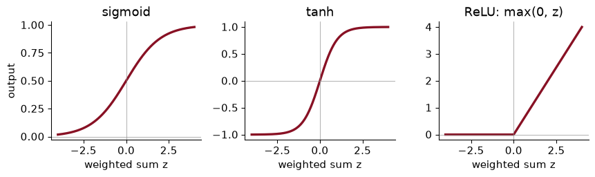
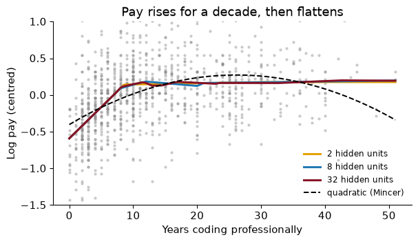
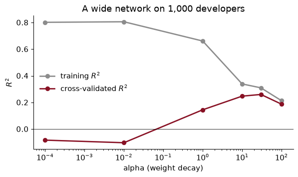
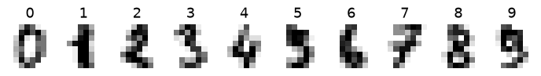
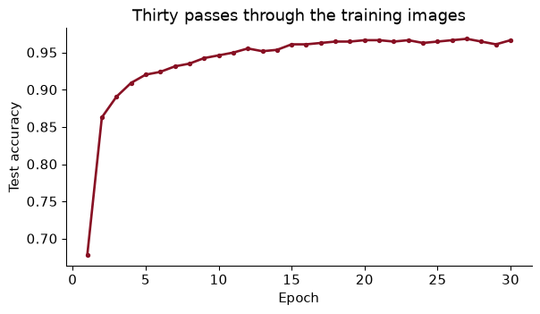

# Chapter 18 — Neural networks

> **The question:** can a far more flexible model predict what American software developers are paid better than a regression can, and if not, what are these models good for?

## From logistic regression to a neuron

Every model in Part III so far has been built by hand, in a sense. We chose the features, decided whether to add squares or interactions, and let the method pick coefficients or splits. **Neural networks** go further: they build their own features out of the raw inputs, layer by layer, and then predict from those. That is why they read handwriting, translate languages and recognise faces, tasks where nobody could write down the right features in advance. Whether that power helps with the spreadsheets economists usually work with is the question of this chapter, and the answer is more interesting than “yes”.

Our main data are the same as in the course exercises: the 2024 Stack Overflow Developer Survey, as distributed by TidyTuesday, restricted to professional developers in the United States paid in dollars, with annual pay between \$10,000 and \$1 million. That leaves 6,311 developers. We predict **log** pay from years of coding, years of coding professionally, education, age band, job type, firm size and remote-work status. It is a Mincer-style wage equation with a machine-learning twist, and log pay has a standard deviation of 0.52 across these developers.

Start with something you know. Logistic regression (Chapter 12) takes a weighted sum of the features and squashes it through the sigmoid curve:

$$\hat p = \sigma(b + w_1 x_1 + \dots + w_p x_p), \qquad \sigma(z) = \frac{1}{1 + e^{-z}}$$

In the vocabulary of neural networks this is **one neuron**. A neuron does two things: it forms a weighted sum of its inputs, and it passes that sum through a fixed curve called an **activation function**. The coefficients are called **weights**, the intercept is the **bias**. With no activation at all (the identity), a neuron is a linear regression. Everything else in this chapter is neurons, connected.

### Worked example — a neuron that is a logit

Define a developer as “highly paid” if their pay is above the training-set median, and fit a logistic regression on standardized years of professional coding. The bias is -0.114 and the weight is 0.604. Professional experience has mean 12.9 years and standard deviation 9.9. What probability does this neuron give a developer with 10 years’ professional experience?

### Solution

Standardize: (10 − 12.9) / 9.9 = -0.298. Weighted sum: -0.114 + 0.604 × -0.298 = -0.295. Activation: $1/(1 + e^{-(\text{that})})$ = 0.427, the same as `predict_proba` gives (0.427). So a logistic regression *is* a one-neuron network; nothing about neural networks is mysterious at the level of a single unit. The power comes from putting many of them together.

## Activations, and why stacking needs them

Three activation functions cover almost everything you will meet:



The **sigmoid** squashes any number into (0, 1), so it is the natural last step when the output is a probability. **tanh** is the same shape, centred on zero. The **ReLU** (rectified linear unit) is zero for negative inputs and the input itself otherwise. It is the default inside modern networks, because it is cheap and its slope does not fade away for large inputs, which makes training easier.

Why have an activation at all? Suppose we stack two layers of neurons with no activation, so that each layer just forms weighted sums. A weighted sum of weighted sums is still a weighted sum. The two layers collapse into one, and the “deep” network is a linear regression with extra steps. Here is the check on random numbers:

``` python
rng = np.random.default_rng(368)
W1, b1 = rng.normal(size=(5, 3)), rng.normal(size=3)     # layer 1: 5 inputs -> 3 units
W2, b2 = rng.normal(size=(3, 1)), rng.normal(size=1)     # layer 2: 3 units -> 1 output
x = rng.normal(size=(4, 5))                               # four observations
two_layers = (x @ W1 + b1) @ W2 + b2
one_layer = x @ (W1 @ W2) + (b1 @ W2 + b2)                # a single linear map
print(np.allclose(two_layers, one_layer))
```

    True

Put a ReLU between the layers and the collapse no longer happens. Each hidden ReLU unit is a **hinge**: flat on one side of a threshold, a straight line on the other. Adding hinges with different thresholds and slopes builds a curve with kinks wherever it needs them, like a spline (Chapter 10) that **chooses its own knots**. With enough hinges, a network with one hidden layer can approximate any reasonable function as closely as you like; this is the **universal approximation** result. It says such a network exists, not that we can find it from finite data, which is the part that matters in practice.

### Worked example — collapsing two layers by hand

Hypothetical numbers: one input $x$. Layer 1 has two units with no activation, $h_1 = 2x + 1$ and $h_2 = -x + 3$. Layer 2 outputs $\hat y = 0.5 h_1 + 2 h_2 - 1$. Write $\hat y$ as a function of $x$. Then put a ReLU on the hidden units and evaluate at $x = 4$.

### Solution

Without activation: $\hat y = 0.5(2x + 1) + 2(-x + 3) - 1 = x + 0.5 - 2x + 6 - 1 = -x + 5.5$, a straight line. The second layer added nothing. With a ReLU, at $x = 4$: $h_1 = \max(0, 9) = 9$ and $h_2 = \max(0, -1) = 0$, so $\hat y = 4.5 + 0 - 1 = 3.5$, whereas the linear version gives 1.5. The second unit switched off for $x > 3$, which bends the function at $x = 3$: below it, $\hat y = -x + 5.5$; above it, $\hat y = x - 0.5$. One hinge, one kink.

## The multilayer perceptron

A **multilayer perceptron** (MLP) is layers of neurons, each feeding the next. The **input layer** is the features. Each **hidden layer** is a set of neurons whose inputs are the previous layer’s outputs; these are the network’s self-made features. The **output layer** produces the prediction: one number for a regression, one probability per class for a classification. “Deep” learning means many hidden layers, nothing more.

For developer pay, one-hot encoding turns our seven features into 65 input columns. A network with hidden layers of 64 and 32 ReLU units then has 65 × 64 + 64 weights and biases into the first hidden layer, 64 × 32 + 32 into the second, and 32 + 1 into the output: 6,337 parameters in all, against 66 for a linear regression on the same inputs. Parameters add up fast, and a model with this many can memorise a few thousand rows. Controlling that is not optional; it is most of the craft.

**Training** a network means choosing all the weights to make a **loss** small on the training data. The loss is the measure of wrongness, and you have met the main ones:

| Task | Output layer | Loss | Econometric cousin |
|----|----|----|----|
| Regression | one number, no activation | mean squared error | OLS |
| Yes or no | one sigmoid unit | log loss | logit |
| Several classes | one unit per class, **softmax** | log loss over classes | multinomial logit |

The **softmax** turns a score for each class into probabilities that add to one: exponentiate each score, divide by the total. Minimising log loss is maximum likelihood, exactly as for a logit; a network classifier is a multinomial logit whose inputs are features the network built itself.

### Worked example — what a confident mistake costs

Log loss charges $-\log(\hat p)$, where $\hat p$ is the probability the model gave to what actually happened. Compare the cost of saying 0.6 and 0.01 for an event that then happens.

### Solution

$-\log(0.6)$ = 0.51 and $-\log(0.01)$ = 4.61: the confident mistake costs 9 times as much. A network trained on log loss therefore learns to hedge when it is unsure, which is why its probabilities can be used for decisions (Chapter 12). Mean squared error on a probability would charge only $(1 - 0.01)^2 \approx 0.98$ against $(1 - 0.6)^2 = 0.16$, about six times as much, and is much more forgiving of overconfidence.

## Gradient descent and backpropagation

There is no formula for the best weights of a network, as there is for OLS, so we search. **Gradient descent** (Chapter 10) does it by walking downhill: compute the slope of the loss with respect to every weight (the **gradient**), step each weight a little in the downhill direction, repeat. The step size is the **learning rate**, the most important setting in neural-network training: too small and training crawls, too large and it overshoots and diverges.

Three refinements make this work at scale. **Mini-batches**: instead of computing the gradient on all the data at each step, estimate it from a random batch of, say, 64 rows; the estimate is noisy but cheap, and many cheap steps beat a few expensive ones. One pass through the training data is an **epoch**. **Adam**, the default optimiser almost everywhere, adapts the step size separately for each weight. And unlike OLS, the loss has many valleys, so different random starting weights give different networks. Fix the seed, and never interpret an individual weight.

How is the gradient computed for thousands of weights at once? By **backpropagation**, which is the chain rule from calculus organised efficiently. Run the network forward and keep every intermediate value. At the output, the error is just prediction minus truth. Each output weight’s slope is that error times what fed into the weight. Then pass the error back through the output weights to the hidden units, through each unit’s activation (a ReLU passes it if the unit was on and blocks it if the unit was off), and repeat: each hidden weight’s slope is the error that reached its unit times its input. One backward pass gives every slope.

Here is a whole one-hidden-layer network in numpy, with the backward pass written out. It is the network from the course slides, and it fits log pay to standardized professional experience for a random 1,000 developers:

``` python
def relu(z): return np.maximum(0, z)

def init(p, H, rng):                                       # random starting weights
    return {"W": rng.normal(0, 1, (p, H)), "b": rng.normal(0, 1, H),
            "v": rng.normal(0, 1 / np.sqrt(H), H), "c": 0.0}

def forward_backward(prm, X, y):
    Zh = X @ prm["W"] + prm["b"]                           # weighted sums, one column per hidden unit
    Hh = relu(Zh)                                          # hidden-unit outputs
    yhat = Hh @ prm["v"] + prm["c"]                        # prediction
    d_out = (yhat - y) / len(y)                            # error at the output
    d_hid = np.outer(d_out, prm["v"]) * (Zh > 0)           # error pushed back through each ReLU
    grads = {"v": Hh.T @ d_out, "c": d_out.sum(), "W": X.T @ d_hid, "b": d_hid.sum(0)}
    return 0.5 * np.mean((yhat - y) ** 2), grads
```

``` python
sub = df.sample(1000, random_state=368)
xs = ((sub["years_code_pro"] - sub["years_code_pro"].mean()) / sub["years_code_pro"].std()).to_numpy()[:, None]
ys = np.log(sub["comp_total"]).to_numpy()
ys = ys - ys.mean()                                        # centre the outcome
nets = {}
for H in [2, 8, 32]:
    prm = init(1, H, np.random.default_rng(368))
    for step in range(3000):
        loss, g = forward_backward(prm, xs, ys)
        prm = {k: prm[k] - 0.05 * g[k] for k in prm}       # one gradient-descent step
    nets[H] = (prm, loss)
```



Every network finds the same shape: pay rises steeply over roughly the first decade of a career and then goes flat. Labour economists have described the concave experience profile with a quadratic since Mincer, and the dashed line shows its limits here: a parabola has to rise too slowly at first and then turn down at the end, because that is the only shape it has. The networks put a kink where the data have one. Their final losses (half the mean squared error) are 0.1043, 0.1043 and 0.1044 for 2, 8 and 32 hidden units, against 0.1094 for the quadratic. Notice that two hinges do as well as thirty-two: with one input and a simple shape, extra capacity buys nothing, a preview of the rest of the chapter.

**Going further.** For this network, with hidden sums $z = Wx + b$, hidden outputs $h = \text{ReLU}(z)$, prediction $\hat y = v^\top h + c$ and loss $\tfrac12(\hat y - y)^2$, the chain rule gives $\partial \ell / \partial v = (\hat y - y)\,h$ and $\partial \ell / \partial W = \big[(\hat y - y)\, v \odot \mathbb 1(z > 0)\big]\, x^\top$, where $\odot$ multiplies element by element. Those are the lines `d_out` and `d_hid` in the code. Libraries such as PyTorch compute these derivatives automatically for any network you can write down (“automatic differentiation”), which is why nobody writes backward passes by hand any more.

### Worked example — checking a gradient

How would you know the backward pass is right? Nudge one weight up and down by a tiny amount $\epsilon$ and see how the loss changes: the slope should be approximately $[L(w + \epsilon) - L(w - \epsilon)] / 2\epsilon$. For the first weight of an 8-unit network at its random starting values, backpropagation says 0.152767. What does the nudge say?

### Solution

With $\epsilon = 10^{-5}$ the numerical slope is 0.152767, matching backpropagation to 12 decimal places. This **gradient check** is how people debug hand-written networks. Why not always compute gradients this way? Because it takes two passes through the data *per weight*; for the 6,337-parameter pay network that is thousands of passes per step, where backpropagation needs one.

## Neural nets in scikit-learn

scikit-learn’s `MLPRegressor` and `MLPClassifier` fit multilayer perceptrons with the same `fit` and `predict` as everything else. A network needs its inputs prepared: categories one-hot encoded (a job-type code of 16 is not “bigger” than 3) and numbers standardized. Both go in a pipeline, so that cross-validation never sees test data (Chapter 9):

``` python
pre = make_column_transformer((StandardScaler(), num), (OneHotEncoder(handle_unknown="ignore"), cat))
mlp = make_pipeline(pre, MLPRegressor(hidden_layer_sizes=(64, 32), early_stopping=True,
                                      alpha=1e-2, max_iter=300, random_state=368))
mlp.fit(X_tr, y_tr)
```

Why standardize? Gradient descent uses one learning rate for every weight, and the starting weights are random numbers that assume inputs of roughly unit size. If one input runs to 50 and another to 1, no single step size suits both. Feed the network the raw columns, integer job codes and unscaled years included, and its test RMSE is 0.478 log points, against 0.434 with the pipeline. Here is the full comparison on the held-out quarter of developers:

    mean only            0.518
    ridge (one-hot)      0.430
    MLP, raw codes       0.478
    MLP (64, 32)         0.434
    gradient boosting    0.429

The network is clearly better than predicting the mean, and about as good as ridge regression on the same one-hot inputs. Gradient boosting (Chapter 15), with no scaling, no one-hot encoding and default settings, is the best of the lot, by a small margin. Hold that thought until the section on when nets win.

### Worked example — what an RMSE of 0.43 means

The best models have a test RMSE of about 0.43 log points. In dollars, what does that mean for a developer predicted to earn \$150,000?

### Solution

An error of $e$ log points multiplies or divides pay by $e^{e}$. With $e$ = 0.429, a typical miss takes \$150,000 to between about \$97,701 and \$230,295, a third below to a half above. That is a large error, and no model here does much better, because most of what determines one developer’s pay (the employer, the city, the negotiation, skill that a survey does not measure) is not in the data. A more flexible model cannot predict from information it does not have.

## Regularization: weight decay, dropout, early stopping

A network with thousands of weights and a few thousand rows will memorise the training data if you let it. To see it happen, train a wide network, with hidden layers of 256 and 128 units, on just 1,000 developers, and measure $R^2$ by four-fold cross-validation:



With almost no penalty, the network explains 80% of the variance in log pay on the data it trained on and -0.08 on data it did not see: a negative $R^2$, worse than predicting the average for everyone. That is memorisation. Three defences, usually used together:

- **Weight decay** adds a penalty on the sum of squared weights to the loss, exactly the ridge penalty of Chapter 11; scikit-learn calls its strength `alpha`. Raising it shrinks the training $R^2$ and lifts the validation $R^2$, which peaks at 0.26 with alpha = 30.
- **Early stopping** holds out part of the training data, watches the loss on it after each epoch, and stops when it has not improved for a while, keeping the best weights. Chapter 11 showed that stopping gradient descent early acts like a penalty; for networks it is the cheapest regularizer there is.
- **Dropout** randomly switches off each hidden unit with some probability, say 20%, at every training step, so no unit can rely on any particular other one being there. The network becomes an average over many thinned networks, a little like a random forest. It is switched off when predicting. scikit-learn does not offer it; PyTorch does, below.

Early stopping does a lot on its own. The same wide network trained on all 4,733 training developers for 200 epochs, with no penalty and no stopping, has a training RMSE of 0.288 and a test RMSE of 0.517, barely better than predicting the mean (0.518). With early stopping, it halts after 66 epochs (the best validation score came at epoch 45), and its test RMSE is 0.444.

### Worked example — reading the gap

In the validation curve, what does the distance between the two lines tell you at small alpha, and why does the training $R^2$ *fall* as alpha rises?

### Solution

The gap is the variance part of the bias–variance trade-off (Chapter 10). A large gap means the model fits noise that does not recur in new data; with a training $R^2$ of 0.80 and a validation $R^2$ below zero, the network has learned individual developers, not patterns. The penalty makes large weights expensive, so the network can no longer bend itself around each point: its training fit falls (more bias) and its validation fit rises (less variance). Past the best alpha, the penalty starts to flatten real patterns too, and both lines fall together. It is the same picture as ridge regression, because it is the same penalty.

## A first PyTorch training loop

scikit-learn’s networks are fine for small tabular problems, but you cannot change their architecture, add dropout, or use a GPU. **PyTorch** is the library research and industry use, including for every large language model in Part IV. Its four ideas are **tensors** (arrays that remember how they were computed), **autograd** (`loss.backward()` runs backpropagation for you), **modules** (layers you stack), and **optimisers** (which take the downhill steps).

The natural first example is images. scikit-learn’s `load_digits` has 1,797 handwritten digits, each an 8 × 8 grid of grey levels, so 64 numbers per image and ten classes. It is a miniature of the problem of reading handwritten figures off old census forms, firm ledgers or tax records, which is how economic historians now build datasets.



The model: 64 inputs, one hidden layer of 128 ReLU units with 20% dropout, and 10 outputs, one score per digit (the softmax is folded into the loss).

``` python
torch.manual_seed(368)
Xt_tr, Xt_te = torch.tensor(Xd_tr, dtype=torch.float32), torch.tensor(Xd_te, dtype=torch.float32)
yt_tr, yt_te = torch.tensor(yd_tr), torch.tensor(yd_te)
model = nn.Sequential(nn.Linear(64, 128), nn.ReLU(), nn.Dropout(p=0.2), nn.Linear(128, 10))
loss_fn = nn.CrossEntropyLoss()                            # softmax + log loss
opt = torch.optim.Adam(model.parameters(), lr=1e-3, weight_decay=1e-4)
```

And the loop that trains it, which is the same loop, give or take, that trains every deep-learning model in existence:

``` python
history = []
for epoch in range(30):
    model.train()                                          # dropout on
    perm = torch.randperm(len(Xt_tr))
    for i in range(0, len(perm), 64):                      # mini-batches of 64
        idx = perm[i:i + 64]
        loss = loss_fn(model(Xt_tr[idx]), yt_tr[idx])
        opt.zero_grad(); loss.backward(); opt.step()       # clear, backpropagate, step
    model.eval()                                           # dropout off
    with torch.no_grad():
        history.append((model(Xt_te).argmax(1) == yt_te).float().mean().item())
```



The network has 9,610 weights and biases. After one epoch it reads 68% of the test digits correctly, and after thirty, 96.7%. The whole thing takes a couple of seconds on a laptop CPU. (In a real project the accuracy per epoch would be tracked on a validation set, not the test set; I show the test set here only to keep the example short.)

### Worked example — train and eval

Why does the loop call `model.train()` before each epoch and `model.eval()` before measuring accuracy? What would go wrong without the second?

### Solution

They switch dropout on and off. In training mode, each hidden unit is zeroed with probability 0.2 at every step (and the survivors scaled up to compensate), which is the regularization. In evaluation mode, every unit is used, so predictions are deterministic and use the whole network. Forget `model.eval()` and each prediction would be made by a randomly thinned network: accuracy would be lower and would change every time you asked. The same switch matters for other layers that behave differently in training, which is why it is a habit worth having from the start.

## When nets beat trees, and when they don’t

On developer pay, a neural network did no better than ridge regression and a little worse than boosted trees, after more preparation and more tuning. That is not bad luck. Grinsztajn, Oyallon and Varoquaux (2022) compared tuned networks with tuned tree ensembles on 45 medium-sized tabular datasets and found the trees ahead on most of them, with far less tuning effort. Their explanations, in plain words:

1.  **Real targets are often step-like.** Pay jumps at job titles and firm-size thresholds; trees split at thresholds naturally, while networks prefer smooth functions.
2.  **Useless columns hurt networks more.** A tree ignores a column it never splits on; a network gives every input a weight and has to learn to set the useless ones to zero.
3.  **Spreadsheet columns mean something on their own.** Income, age and firm size are meaningful individually; a dense layer mixes every column with every other from the first step, while a tree uses one meaningful column at a time.

The second is easy to test. Add 20 columns of pure random noise to the developer data and refit:

                       7 real features  + 20 noise columns
    MLP (64, 32)                 0.434               0.483
    gradient boosting            0.429               0.430

The boosted trees hardly notice. The network’s test RMSE rises from 0.434 to 0.483: it spent part of its capacity fitting noise. Real datasets often have many weak or useless columns, and that is one reason trees remain the default for tabular economic data.

So where do networks win? On data where **single inputs mean little and structure is everything**: images, where one pixel tells you nothing and edges, strokes and shapes emerge from combinations; text, where meaning emerges from words in order; audio and video. There, networks with architecture built for the structure learn features that nobody could hand-craft.

Our digits are too small to show this at full strength: at 8 × 8 pixels, each pixel is nearly a feature on its own, and everything does well. But one test shows the difference in kind. Train each model on the digits as given, then test it on the same test digits shifted one pixel to the right, as if the scanner had slipped:

                       original test images  shifted one pixel right
    multinomial logit                 0.969                    0.417
    gradient boosting                 0.978                    0.444
    MLP (128)                         0.976                    0.470
    small CNN                         0.974                    0.606

On the original images the four models are within a couple of points of each other, and the boosted trees do best. Shift the images and the logit, the trees and the plain MLP collapse to 42%–47%, because each learned “pixel 27 is dark” rather than “there is a loop”. The **convolutional network** (CNN) keeps 61%. A convolution slides one small set of weights across the whole image, so a stroke detector learned in one place works in every place; pooling then summarises nearby positions. That built-in knowledge of space is the point of the architecture, and it is why networks dominate images and trees dominate spreadsheets.

### Worked example — choosing a model

For each task, would you start with gradient boosting or a neural network? **(a)** Predicting which small-business loans default, from 40 columns of firm and owner characteristics. **(b)** Estimating village poverty from satellite photographs. **(c)** Classifying a million job postings into occupations from their text.

### Solution

**(a)** Gradient boosting. It is a tabular problem with meaningful columns, some of them useless and some step-like (loan size bands, credit-score cut-offs), which is exactly where Grinsztajn et al. find trees ahead, and boosting needs little tuning. **(b)** A network, specifically a convolutional one, usually pre-trained on other images; the information is in spatial patterns of roofs, roads and fields that no spreadsheet column captures. This is the Jean et al. (2016) design in the readings. **(c)** A network-based language model (Chapters 20 and 21), or, as a strong cheap baseline, a linear model on word counts (Chapter 19). In practice the best answer for (b) and (c) is often a hybrid: let a network turn the image or text into a list of numbers, then feed those numbers to a simpler model, which is the idea of the next section.

## Embeddings: what the hidden layer learned

A trained network’s hidden layer is a **learned representation**: for each input, a list of numbers that the network built because they were useful for its task. For the digits MLP, each image becomes 128 hidden-unit outputs. Are those numbers a better description of a digit than its 64 raw pixels? Chapter 17 gives a way to ask: cluster the test images with k-means into ten groups, once on the pixels and once on the hidden layer, and compare each clustering with the true digits using the adjusted Rand index. On pixels it is 0.64; on the hidden layer, 0.93. The network has rearranged the images so that the same digit written differently lands in the same place.

Such a representation is called an **embedding**, and it is the bridge to Part IV. A network trained on billions of words learns an embedding for each word, a list of a few hundred numbers in which similar words sit close together, and an embedding for whole sentences and documents. Economists then use those numbers as features in an ordinary regression or a boosted tree, or measure distances between documents with them. Chapter 19 starts with word counts, the old way to turn text into numbers; Chapter 20 replaces them with embeddings; Chapter 21 looks inside the networks that make the best ones.

### Worked example — using an embedding

A researcher has 50,000 product descriptions from online listings and wants to measure how differentiated each product is from its competitors. How could a pre-trained network help, and what is the economist’s job?

### Solution

Pass each description through a pre-trained language network and keep its embedding, a few hundred numbers per product. Similar products now have nearby embeddings, so “differentiation” can be measured as the distance to the nearest competitors, and markets can be built by clustering (Chapter 17), much as Hoberg and Phillips did with word counts. The network does the reading. The economist decides what similarity should mean for the question, checks that distances in the embedding agree with judgement on a sample, and remembers that the embedding reflects the text the network was trained on, which may not be the text of this market.

## In Python

The whole tabular analysis, runnable top to bottom: data, a network in a pipeline with early stopping, and the comparison with ridge and boosting.

``` python
from pathlib import Path
import numpy as np, pandas as pd
from sklearn.model_selection import train_test_split
from sklearn.compose import make_column_transformer
from sklearn.preprocessing import StandardScaler, OneHotEncoder
from sklearn.pipeline import make_pipeline
from sklearn.neural_network import MLPRegressor
from sklearn.linear_model import RidgeCV
from sklearn.ensemble import HistGradientBoostingRegressor
from sklearn.metrics import root_mean_squared_error as rmse

BASE = "https://raw.githubusercontent.com/rfordatascience/tidytuesday/main/data/2024/2024-09-03/"
path = Path("../data/stackoverflow_survey_single_response.csv")     # download once, then reuse
if not path.exists():
    path.parent.mkdir(exist_ok=True)
    pd.read_csv(BASE + path.name).to_csv(path, index=False)
so = pd.read_csv(path)
```

Keep US professional developers paid in dollars, and predict log pay.

``` python
us = so[(so["country"] == "United States of America") & so["currency"].astype(str).str.startswith("USD")
        & so["comp_total"].between(1e4, 1e6) & (so["main_branch"] == 1)]
num, cat = ["years_code", "years_code_pro"], ["ed_level", "age", "dev_type", "org_size", "remote_work"]
df = us.dropna(subset=num + cat)
X, y = df[num + cat], np.log(df["comp_total"])
X_tr, X_te, y_tr, y_te = train_test_split(X, y, test_size=0.25, random_state=368)
```

Fit three models and score them once on the test set.

``` python
pre = make_column_transformer((StandardScaler(), num), (OneHotEncoder(handle_unknown="ignore"), cat))
models = {
    "ridge": make_pipeline(pre, RidgeCV()),
    "MLP": make_pipeline(pre, MLPRegressor(hidden_layer_sizes=(64, 32), alpha=1e-2, early_stopping=True,
                                           max_iter=300, random_state=368)),
    "boosting": HistGradientBoostingRegressor(categorical_features=cat, random_state=368)}
for name, m in models.items():
    print(f"{name:>9}: test RMSE {rmse(y_te, m.fit(X_tr, y_tr).predict(X_te)):.3f}")
```

        ridge: test RMSE 0.430
          MLP: test RMSE 0.434
     boosting: test RMSE 0.429

## What goes wrong

**Not scaling the inputs.** On raw columns the pay network’s test RMSE was 0.478, against 0.434 scaled. Standardize numbers, one-hot encode categories, and do both inside a pipeline so the scaler is fitted on training data only.

**Feeding category codes as numbers.** The survey stores job types as integers. A network multiplies inputs by weights, so it treats code 16 as sixteen times code 1. One-hot encode, or use an embedding layer for categories with many levels.

**Training without regularization.** A wide network on 1,000 developers had a training $R^2$ of 0.80 and a cross-validated $R^2$ of -0.08. Use early stopping always, and tune weight decay on a log grid.

**Reaching for a network on a spreadsheet.** On tabular data, gradient boosting usually matches or beats a network with less work, and it shrugs off useless columns that cost the network accuracy. Start with boosting; try a network if you have a reason.

**Reporting one run.** A network’s result depends on its random starting weights and the order of its mini-batches. Fix the seed for reproducibility, but before claiming one model beats another by a small margin, re-run with a few seeds.

**Reading the weights as effects.** The weights of a network have no individual meaning: shuffle the hidden units and you get the same predictions with different weights. And as with every model in Part III, a prediction that remote workers earn more is not evidence that remote work raises pay.

## Exercises

1.  A colleague says: “Deep learning is just a lot of logistic regressions.” In what sense is that right, and what does it leave out?

2.  Count by hand the number of weights and biases in an MLP with 10 inputs, hidden layers of 20 and 5 ReLU units, and one output. Check with scikit-learn’s `coefs_` and `intercepts_` after fitting on any data with 10 columns.

3.  Using the numpy network from the chapter, train the 8-unit network with learning rates 0.005, 0.05 and 0.5 for 3,000 steps each, and report the final loss. What happens when the learning rate is too large?

4.  Refit the pay MLP with three different `random_state` values and report the test RMSE of each. How large is the spread, compared with the gap between the MLP and gradient boosting?

5.  Add the 20 noise columns to the pay data and refit ridge regression. Does it degrade like the MLP or like the boosted trees? Why?

6.  Retrain the digits MLP with one-pixel shifts added to the training data (append copies of each training image moved one pixel left and one pixel right). How does it now do on the shifted test images, compared with the unaugmented MLP and the CNN? What does that tell you about where the CNN’s advantage comes from?

7.  Your best pay model predicts that, holding the other features fixed, developers who work remotely are paid more. Give two reasons this is not the causal effect of remote work on pay.

### Answers

**1.** Right in that each unit is a weighted sum passed through a nonlinear curve, and a sigmoid unit is literally a logistic regression; a network’s softmax output layer is a multinomial logit on the last hidden layer. What it leaves out: the hidden units are not fitted to any label of their own. They are trained jointly, through backpropagation, to produce whatever features make the final prediction best, and the architecture (convolutions for images, attention for text) builds in structure that no stack of separate logits has.

**2.** From 10 inputs to 20 units: 10 × 20 + 20 = 220. From 20 to 5: 20 × 5 + 5 = 105. From 5 to the output: 5 + 1 = 6. Total 331.

``` python
Xr = np.random.default_rng(368).normal(size=(200, 10))
m2 = MLPRegressor(hidden_layer_sizes=(20, 5), max_iter=50, random_state=368).fit(Xr, Xr[:, 0])
print(sum(w.size for w in m2.coefs_) + sum(b.size for b in m2.intercepts_))
```

    331

**3.**

``` python
final = {}
for eta in [0.005, 0.05, 0.5]:
    prm = init(1, 8, np.random.default_rng(368))
    for step in range(3000):
        loss, g = forward_backward(prm, xs, ys)
        prm = {k: prm[k] - eta * g[k] for k in prm}
    final[eta] = loss
print({k: float(np.round(v, 4)) for k, v in final.items()})
```

    {0.005: 0.1056, 0.05: 0.1043, 0.5: 0.1145}

The final losses are 0.1056, 0.1043, 0.1145 for learning rates 0.005, 0.05 and 0.5. With 0.5 the loss ends higher than with 0.05: the steps are so large that they bounce around the floor of the valley instead of settling in it, and on a harder problem steps this large typically overshoot and the loss blows up. With 0.005 the network is still crawling downhill after 3,000 steps. The learning rate is the first setting to tune.

**4.**

``` python
seed_rmse = {s: rmse(y_te, make_pipeline(make_pre(), MLPRegressor(**{**MLP_ARGS, "random_state": s}))
                     .fit(X_tr, y_tr).predict(X_te)) for s in [1, 2, 3]}
print({s: round(v, 4) for s, v in seed_rmse.items()})
```

    {1: 0.438, 2: 0.4347, 3: 0.4279}

The test RMSEs range over 0.010 log points across seeds, against a gap of 0.005 between the chapter’s MLP and gradient boosting. The seed matters about as much as the choice of model, so a single run cannot settle which is better.

**5.**

``` python
ridge_n = make_pipeline(make_pre(num + list(noise.columns)), RidgeCV()).fit(Xn_tr, y_tr)
print(round(res["ridge (one-hot)"], 4), round(rmse(y_te, ridge_n.predict(Xn_te)), 4))
```

    0.4304 0.431

Ridge goes from 0.430 to 0.431: it barely degrades, like the trees. With 4,733 training rows and only 20 extra coefficients, each shrunk by the penalty, a linear model estimates the useless coefficients as nearly zero. The network suffers more because every noise column feeds 64 hidden units, so it adds over a thousand weights that can combine with each other to fit noise.

**6.**

``` python
def shift_any(Xflat, dx):
    im = Xflat.reshape(-1, 8, 8)
    return np.roll(im, dx, axis=2).reshape(-1, 64)        # wrap-around shift; edges are mostly blank
Xaug = np.vstack([Xd_tr, shift_any(Xd_tr, 1), shift_any(Xd_tr, -1)])
yaug = np.concatenate([yd_tr] * 3)
mlp_aug = MLPClassifier(hidden_layer_sizes=(128,), alpha=1e-3, max_iter=500, random_state=368).fit(Xaug, yaug)
print(round(mlp_aug.score(Xd_te, yd_te), 3), round(mlp_aug.score(Xs_te, yd_te), 3))
```

    0.978 0.974

Trained on shifted copies (**data augmentation**), the plain MLP gets 97% of the shifted test digits right, against 47% without augmentation and 61% for the unaugmented CNN. So the CNN’s advantage here can be bought, and more, by showing an ordinary network examples of shifted digits. The CNN gets robustness to shifts for free from its architecture; augmentation gets it only for the variations you thought to include. With real images, which vary in position, scale, angle and lighting all at once, building the structure in is far cheaper than enumerating every variation, which is why image models combine both.

**7.** First, **selection**: who gets to work remotely is not random. Remote arrangements are more common for experienced, trusted developers and at well-paying technology firms, and the survey does not record employer, city or skill, all of which raise pay and remote work together. Second, **reverse causation and bargaining**: highly paid developers have the leverage to negotiate remote work, so pay may cause remoteness rather than the reverse. A predictive model is built to exploit such correlations, not to separate them; a causal answer needs a design, such as a firm that randomised remote work (Chapter 7).

## Economics reading

**Jean, N., Burke, M., Xie, M., Davis, W. M., Lobell, D. B. & Ermon, S. (2016). “Combining satellite imagery and machine learning to predict poverty.” *Science* 353(6301): 790–794.** [doi.org/10.1126/science.aaf7894](https://doi.org/10.1126/science.aaf7894)

Household consumption surveys are expensive and rare in much of Africa, so poverty maps are often years out of date. The authors train a convolutional network to predict night-time lights, which are measured everywhere, from daytime satellite photographs, then reuse the features it learned to predict survey-measured consumption and assets in five African countries. The features capture roads, roofs and farmland, and predict poverty far better than night-time lights alone.

*Think about:* the network is trained to predict lights, not poverty. What would go wrong if a government used its poverty predictions to target cash transfers, and villages learned what the satellite rewards?

**Dell, M. (2025). “Deep Learning for Economists.” *Journal of Economic Literature* 63(1): 5–58.** [doi.org/10.1257/jel.20241733](https://doi.org/10.1257/jel.20241733)

A survey and practical guide to deep learning for economic research, written by an economic historian. It explains how networks turn documents, images and text into data: digitising historical newspapers and firm directories, classifying text and images at scale, and linking records across sources, with code and tools aimed at economists.

*Think about:* when a network creates a dataset (say, firm names read off scanned 1920s directories), its errors are not random. How could systematic misreadings bias an economic conclusion built on the new data, and how would you check?

**Farrell, M. H., Liang, T. & Misra, S. (2021). “Deep Neural Networks for Estimation and Inference.” *Econometrica* 89(1): 181–213.** [doi.org/10.3982/ecta16901](https://doi.org/10.3982/ecta16901)

Can a flexible network be used inside an econometric estimator without ruining the standard errors? The authors show that networks learn unknown functions fast enough to serve as the first stage of semiparametric estimators, such as estimates of average treatment effects that adjust for many covariates, and apply the method to data from a large-scale marketing experiment.

*Think about:* this chapter warned that a network’s weights are not causal effects. In what sense can a network still be part of a credible causal estimate, and which part of the analysis must still come from the research design rather than the network?

**Reading.** Géron, ch. 9–11, for neural network basics, building networks with PyTorch, and training deep networks (initialisation, optimisers, batch normalisation, dropout). ISLP (James, Witten, Hastie, Tibshirani & Taylor 2023), ch. 10, for deep learning in a statistical framing. Goodfellow, Bengio & Courville (2016), *Deep Learning*, ch. 6, free online. Grinsztajn, Oyallon & Varoquaux (2022), “Why Do Tree-Based Models Still Outperform Deep Learning on Typical Tabular Data?”, *NeurIPS* 35, for the trees-versus-nets benchmark.
