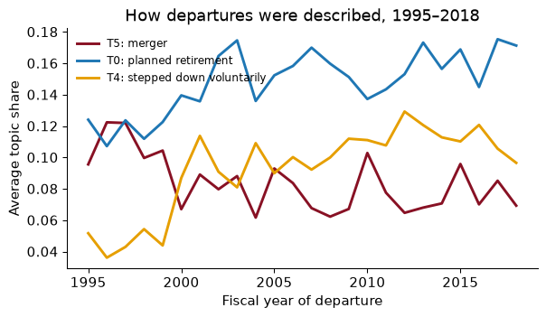

# Chapter 20 — Embeddings and topic models

> **The question:** research assistants wrote a short description of more than seven thousand CEO departures from large US firms. Without reading them all, can we find out why CEOs leave, and can a machine tell a firing from a retirement?

## No labels this time

Whether a chief executive was pushed out or left on her own terms is one of the central variables in corporate finance. Do boards fire CEOs after bad stock returns? Do they fire them more when the board is independent? Does a firing help the firm? Every one of those questions needs someone to decide, departure by departure, what happened, and the only evidence is usually a press release written to make it sound voluntary.

Gentry, Harrison, Quigley and Boivie (2021) did that work for S&P 1500 firms. Their research assistants read the press coverage of each departure, wrote a short description in a `notes` field, and coded the reason. TidyTuesday distributes the file. It has 9,423 departures; after dropping those with no notes (17% of rows) and codes that mean “missing”, we have 7,592 notes, with a median length of 51 words. The codes break down like this:

    reason
    retired                   3588
    other                     2127
    dismissed: performance    1319
    dismissed: legal           195
    new opportunity            183
    illness                     97
    death                       83

Chapter 19 was about **supervised** text methods: someone labelled documents, and the model learned which words predict the label. This chapter is about the **unsupervised** side, where we look for structure in the text itself. There are two big ideas. A **topic model** describes each document as a mixture of a few themes, each theme a list of words that tend to appear together. An **embedding** places each word, or each whole document, as a point in a space where similar meanings are close together. Both can be checked against the human codes here, which is a luxury: in real research you usually use these methods precisely because there are no codes.

### Worked example — a note that knows its own label

4.3% of the notes mention the word “code”. Here is one:

    Changed code to 4. The company claimed that his departure was routine succession. But reports suggest that he was charged with domestic violence just days before his resignation.

Why is this a problem for everything that follows, and what do we do about it?

### Solution

The coders were writing to each other about their own decision. “Changed code to 4” is the label, written in words, inside the document we want to use to predict the label. It is the text version of the leak in Chapter 19’s rental titles. It is also not random: 46% of notes with such a remark are dismissals, against 18% of the rest, because the coders argued most about the hard, contested cases. Any method that compares text-based groups with the human codes would get credit for reading the coders’ minds.

The fix, following Exercise 23, is a regex that deletes every sentence containing “code”, “coded”, “recoding” and so on:

``` python
LEAK = r"(?i)[^.]*\b(?:re)?cod(?:e|ed|es|ing)\b[^.]*\.?"
d["text"] = d["notes"].str.replace(LEAK, " ", regex=True).str.strip()
print(f"notes still mentioning 'code': {d['text'].str.contains(r'\bcode', case=False).sum()}")
```

    notes still mentioning 'code': 4

A handful survive, where the word appears in a sentence the regex did not split cleanly. Read them; for our purposes they are few enough to ignore.

## Topic models in words

**Latent Dirichlet allocation** (LDA; Blei, Ng and Jordan 2003) is the classic topic model, and it is easiest to understand as a story about how documents get written. Imagine there are $K$ topics. Each topic is a probability distribution over words: a “merger” topic puts high probability on “merger”, “acquisition” and “shareholders”, a “retirement” topic on “retire”, “successor” and “planned”. Each document has its own mix of topics, say 70% retirement and 30% board changes. To write the document, the author repeatedly picks a topic from the document’s mix, then picks a word from that topic.

We see only the words. LDA runs the story backwards and estimates two things:

- for each topic $k$, its word probabilities $\beta_k$ (what the topic is about);
- for each document $d$, its topic shares $\theta_d$, which are $K$ non-negative numbers summing to one (what the document is about).

That second object is what makes topic models useful to economists. $\theta_d$ is a short vector you can put in a regression, the way Chapter 16’s principal components summarised eight development indicators. In fact the two are close cousins. Stack the documents’ word counts into the document-term matrix $\mathbf{C}$ from Chapter 19, with $n$ rows and $p$ columns. A topic model approximates it as a product,

$$\underbrace{\mathbf{C}}_{n \times p} \approx \underbrace{\Theta}_{n \times K}\,\underbrace{B}_{K \times p},$$

just as PCA approximates a data matrix with a few components. The difference is that every number in $\Theta$ and $B$ is non-negative, so each piece can be read as “how much of this document is about topic $k$” rather than as a mix of positive and negative loadings. **Non-negative matrix factorization** (NMF) does the same factorisation without the probability story, and on a tf-idf matrix it often gives crisper topics, faster.

LDA works on raw counts. Here are the top words of eight topics fitted to the CEO notes, with English stopwords removed and words in fewer than ten or more than half of the notes dropped:

``` python
cv0 = CountVectorizer(stop_words="english", min_df=10, max_df=0.5,
                      token_pattern=r"(?u)\b[a-zA-Z]{3,}\b")    # letters only, 3+ characters
lda0 = LatentDirichletAllocation(n_components=8, learning_method="online", max_iter=10,
                                 random_state=368).fit(cv0.fit_transform(d["text"]))
print(top_words(lda0, cv0.get_feature_names_out()))
```

    T0: executive chief officer board chairman president directors ceo
    T1: strategic sold brands sec filed court assets sale
    T2: merger agreement corporation corp bank chairman announced acquisition
    T3: stock million share billion shares cash price acquire
    T4: employment leave national earlier solutions insurance terminated contract
    T5: ceo years board time year stepped position left
    T6: services business said health management day bankruptcy systems
    T7: million year quarter sales resigned resignation said executive

Some of these are recognisably about the circumstances of a departure: there is a merger topic, one about deal values and share prices, and one about quarterly results and resignations. Others are about how press releases are written: “executive chief officer board chairman president” is not a reason for leaving, it is the title of the person who left. That is the first lesson of topic modelling. **The model finds whatever structure is strongest in the words, and the strongest structure is often boilerplate.**

### Worked example — reading a document’s topic shares

Take the note with the highest share of the topic that puts the most weight on “merger” (topic T2). Its topic shares are:

    T0    0.00
    T1    0.00
    T2    0.97
    T3    0.00
    T4    0.00
    T5    0.00
    T6    0.00
    T7    0.00

    Previously, Mr. Seidenberg was Chairman and CEO of Verizon’s predecessor companies, NYNEX and Bell Atlantic. He is accredited for steering the merger of Bell Atlantic and NYNEX in 1997. April 23, 1996- Bell Atlantic Corp. and Nynex Corp. approved plans over the weekend to merge into a single company ...

What does $\theta$ tell you, and what does it not?

### Solution

It says that, by the model’s reckoning, about 97% of the words in this note were “written by” the merger topic and the rest are spread across the others. Reading the note confirms it is about a deal. What $\theta$ does not tell you is *why* the CEO left. A merger note can describe a CEO who negotiated a sale and retired happily or one who was pushed out by the acquirer. Topic shares measure what a document talks about, not the answer to your question, and the gap between the two is where interpretation, and error, comes in.

## Labelling topics, and getting rid of boilerplate

The fix is a custom stopword list. Add the job titles, month names and press-release verbs to the English list and refit, this time with NMF on tf-idf:

``` python
BOIL = ["executive", "chief", "officer", "president", "chairman", "ceo", "company", "board",
        "directors", "inc", "corp", "corporation", "served", "said", "announced", "today",
        "effective", "named", "january", "february", "march", "april", "may", "june", "july",
        "august", "september", "october", "november", "december"]
stop = list(ENGLISH_STOP_WORDS.union(BOIL))
tfv = TfidfVectorizer(stop_words=stop, min_df=10, max_df=0.5, token_pattern=r"(?u)\b[a-zA-Z]{3,}\b")
T = tfv.fit_transform(d["text"])
nmf = NMF(n_components=8, init="nndsvda", random_state=368, max_iter=400)
W = nmf.fit_transform(T)                      # n x K document weights
print(top_words(nmf, tfv.get_feature_names_out(), k=9))
```

    T0: retirement retire year end successor continue remain serve planned
    T1: retired remained age retirement continued joined positions elected energy
    T2: million stock billion share acquired cash shares based group
    T3: director resigned interim vice appointed member elected operating robert
    T4: stepped voluntarily role remained time stayed reasons took family
    T5: merger agreement following acquisition subsidiary completed wholly pursuant owned
    T6: years old service serving left worked steps age past
    T7: position held resigned following left steps relinquished financial retiring

Now the topics are mostly about departures. The model gives you numbered word lists; **you** name them, and naming is a research judgement that should be done carefully and reported. Three rules I follow:

1.  Read the top words, but also the words that are frequent in the topic *and* rare elsewhere. A word that is top in every topic tells you nothing.
2.  Read the five or ten documents with the highest share of the topic. If they do not match your label, the label is wrong.
3.  Name conservatively and always print the top words next to the label, so a reader can disagree with you.

Here, T0 (retirement retire year end successor) is plainly about planned retirement, T5 (merger agreement following acquisition subsidiary) about mergers, and T4 (stepped voluntarily role remained time) about stepping down voluntarily. The others need reading.

### Worked example — what is this topic?

Topic T3 has top words director resigned interim vice appointed member elected operating robert. Here are the first 200 characters of the three notes with the largest weight on it, with their human codes. What would you call it?

    [retired] Rossmann resigned as Chief Executive Officer of the Company in September 2000, yet reamained as a director and Chairman of the Board of the Company until June 2001. ...

    [other] MR. BOREEN became a director of the Company in December 1984 and chairman of the Board of Directors in April 1995. From August 1996 to April 1997, Mr. Boreen served as Interim Chief Executive Officer  ...

    [other] Mr. Smucker, 68, has been a Director since October 1973. He has been the Company’s Chairman of the Board since 1987 and served as Co-Chief Executive Officer from February 2001 through August 2011. ...

### Solution

Read the words alone and you might call it “resignations”, because “resigned” is near the top. Read the documents and that label is wrong. These notes are career histories copied from proxy statements: when someone became a director, when they chaired the board, when they were interim CEO. I would label the topic “career history and board roles” and keep the top words beside the label. Notice also that the human codes on those notes are mixed. That is the point: a topic is a way of writing, not a reason for leaving, and notes written the same way can describe very different events. Had you used this topic’s share as a proxy for “resigned under pressure”, you would have been measuring how much biography the research assistant pasted in.

## How many topics?

There is no true number of topics. $K$ is a choice about the level of detail, like the number of clusters in Chapter 17, and there are three kinds of evidence for making it.

The first is statistical. Hold out some documents, fit the model on the rest, and ask how surprised it is by the held-out words. The measure is **perplexity**, and lower is better. For LDA on the CEO notes:

    4     1612.0
    8     2031.0
    15    2514.0
    30    3295.0

Perplexity prefers K = 4, the smallest model I tried. That is common, and it is one reason not to let perplexity decide alone: Chang and coauthors (2009) found that models with better perplexity often had topics that humans found *less* interpretable. The second kind of evidence is **coherence**: do a topic’s top words actually appear together in documents? (gensim’s `CoherenceModel` computes it.) The third, and in the end decisive, is **substantive**: are the topics useful for your question?

There is a fourth thing to check, which people skip: **stability**. LDA and NMF search for their answer from a starting point, and different starts can end in different places. (The `init="nndsvda"` start I used is deterministic, which makes results reproducible but hides the problem.) Refit NMF from three random starts and match each new topic to the most similar of the eight topics named above, using the cosine similarity of their word weights (1 means identical):

        start 1  start 2  start 3
    T0     1.00     0.85     0.86
    T1     1.00     0.99     0.99
    T2     0.99     1.00     0.99
    T3     0.80     0.99     0.79
    T4     0.78     0.78     0.73
    T5     1.00     1.00     1.00
    T6     0.08     0.06     0.73
    T7     1.00     1.00     0.10

Only 3 of the 8 topics (T1, T2, T5) come back almost identically, with similarity above 0.9, from every start; 4 come back from at least two of the three. The rest move around. The stable ones are the ones I would be willing to name in a paper. A topic that appears with one start and not with another is not a finding.

### Worked example — should perplexity choose $K$?

You want to study how often CEOs leave in connection with mergers. Perplexity prefers K = 4. Should you use it?

### Solution

Not without looking. With four topics, merger departures may be lumped together with other financial news (stock prices, deals and earnings share vocabulary), and the topic you need may not exist. The question tells you the level of detail you need: one topic that is clearly about mergers and stable across seeds. Fit a few values of $K$ around the perplexity choice, check which ones produce such a topic, report the perplexities, and say why you chose what you did. Perplexity is evidence about fit; it is not a measure of usefulness.

## Topics over time, and against the human codes

Once each note has topic shares, aggregation is a `groupby`. Average the shares by fiscal year:



The merger topic averages 0.103 of the notes from 1996 to 2000, the years of the great late-1990s merger wave, against 0.078 after 2000. That is the kind of pattern that makes topic shares useful as descriptive evidence. It is also the kind you should not over-read: the notes were written by research assistants years later, and how they described a departure may have changed with the coder as well as with the economy.

This is exactly how Hansen, McMahon and Prat (2018) use topic models. They fit LDA to the transcripts of FOMC meetings and use each member’s topic shares as an *outcome* variable. The question was whether publishing the transcripts, which began in 1993, changed how members deliberate. Comparing new members with experienced ones, before and after, they find that transparency made rookies talk about more topics and cite more data (more discipline), and also made them conform more in the policy discussion. Topics in, difference-in-differences out: the Gentzkow, Kelly and Taddy pipeline from Chapter 19.

How well do the topics line up with the human codes? Assign each note to its **dominant** topic, the one with the largest share, and cross-tabulate. Each column shows how the notes with one human code spread across topics:

    reason          death  dismissed: legal  dismissed: performance  illness  new opportunity  other  retired
    dominant topic                                                                                           
    T0               0.05              0.05                    0.04     0.16             0.04   0.02     0.23
    T1               0.05              0.01                    0.02     0.03             0.02   0.01     0.13
    T2               0.35              0.39                    0.39     0.13             0.19   0.47     0.06
    T3               0.22              0.28                    0.24     0.26             0.44   0.18     0.21
    T4               0.07              0.08                    0.09     0.26             0.06   0.03     0.10
    T5               0.04              0.05                    0.04     0.00             0.02   0.20     0.03
    T6               0.23              0.09                    0.10     0.06             0.08   0.03     0.15
    T7               0.00              0.06                    0.08     0.09             0.15   0.05     0.10

Some of the structure lines up. The merger topic, T5, takes 20% of the “other” departures (the code used for most merger-related exits) and almost none of the deaths or illnesses. The largest share of retirements, 23%, lands in T0. Dismissals are not recovered at all: the largest share of performance dismissals, 39%, lands in T2 (million stock billion share acquired), a topic about money and share prices that also takes 47% of the “other” departures. One number summarises the agreement, the **adjusted Rand index** (ARI), which is 0 for a random assignment and 1 for perfect agreement up to relabelling. Here it is 0.07.

### Worked example — why can’t a bag of words tell a firing from a resignation?

The topic model separated mergers and planned retirements reasonably well and dismissals not at all. Why would you have predicted that before fitting anything?

### Solution

Because the press release is designed to make them look the same. “John Smith has resigned as CEO to pursue other interests, effective immediately” is the standard wording for both a voluntary exit and a forced one. The difference is in context the bag of words cannot see: a profit warning the week before, “effective immediately” rather than a planned date, the absence of thanks from the board, an interim successor. The research assistants knew to look for those cues. A topic model counts words, and the words were chosen to be uninformative. This is a case where the economics of the text (who wrote it, and what they wanted readers to think) tells you in advance which methods will fail.

## Word embeddings

A bag of words has no idea that “fired” and “ousted” mean nearly the same thing. They are two columns of the document-term matrix, as different from each other as “fired” and “wheat”. **Word embeddings** fix that by representing each word as a dense vector of, say, 100 numbers, learned so that words used in similar contexts get similar vectors. The idea goes back to a linguist’s slogan from the 1950s: you shall know a word by the company it keeps.

The most famous method is **word2vec** (Mikolov and coauthors, 2013). Its skip-gram version sets up a fake prediction problem: given a word, predict the words within a few positions of it. “The Fed **raised** interest **rates** by a quarter point”: from “interest”, predict “raised” and “rates”. A small neural network (Chapter 18) learns to do this, and then we throw the predictions away and keep the network’s internal weights, one vector per word. Words that predict the same neighbours end up with the same vectors. Similarity between two words is the **cosine** of the angle between their vectors: 1 for the same direction, 0 for unrelated.

We need a corpus with plenty of economic sentences. The CEO notes are small, so, following Lecture 23, I use the Reuters-21578 newswire that ships with NLTK: 54,716 sentences and 1,327,141 words from 1987. Training takes a few seconds:

``` python
sents = [[w.lower() for w in s if w.isalpha()] for s in reuters.sents()]
w2v = Word2Vec(sents, vector_size=100, window=5, min_count=5, workers=1, seed=368, epochs=10)
w2v.wv.most_similar("inflation", topn=6)
```

    [('growth', 0.711314857006073),
     ('trend', 0.6706644892692566),
     ('unemployment', 0.6662193536758423),
     ('gnp', 0.6609997749328613),
     ('gdp', 0.6512136459350586),
     ('economy', 0.640670120716095)]

Nobody told the model what inflation is, and its nearest neighbours are other macroeconomic aggregates. The vectors also support arithmetic. “Japan is to the yen as Germany is to what?” becomes $\mathbf{v}_{\text{yen}} - \mathbf{v}_{\text{japan}} + \mathbf{v}_{\text{germany}}$, and we look for the nearest word:

``` python
def analogy(a, b, c, k=3):
    """a is to b as c is to ?"""
    return [w for w, _ in w2v.wv.most_similar(positive=[b, c], negative=[a], topn=k)]
print("japan : yen :: germany :", analogy("japan", "yen", "germany"))
print("germany : bonn :: japan :", analogy("germany", "bonn", "japan"))
```

    japan : yen :: germany : ['mark', 'marks', 'guilder']
    germany : bonn :: japan : ['tokyo', 'miti', 'washington']

1987 Reuters knows the Deutsche mark and that Bonn was West Germany’s capital. A newswire of a million words is enough for economic vocabulary. The famous general-purpose analogies (king minus man plus woman is queen) need vectors trained on billions of words, which you would download rather than train: gensim can fetch pretrained GloVe vectors trained on Wikipedia and news.

### Worked example — opposites attract

Compute the cosine similarity of rose / fell, profit / loss, buy / sell, exports / imports, rose / wheat. Predict first: should “rose” and “fell” be close?

### Solution

    rose / fell          0.93
    profit / loss        0.75
    buy / sell           0.81
    exports / imports    0.87
    rose / wheat        -0.08

“Rose” and “fell” have a similarity of 0.93, nearly the highest in the table, while “rose” and “wheat” are unrelated. It makes perfect sense once you remember how the vectors were learned. “Profits rose 5 pct” and “profits fell 5 pct” put the two verbs in identical company, so word2vec gives them nearly the same vector. **Embeddings measure relatedness, not meaning, and certainly not direction.** If you score the tone of a sentence by its similarity to “rose”, “fell” will score almost as high.

Economists have turned this property into a tool. Kozlowski, Taddy and Evans (2019) build a *direction* in embedding space by averaging many differences between paired words (rich minus poor, affluent minus impoverished, and so on), and then project other words onto that direction to measure how a culture associates, say, sports or foods with class. The same logic measures gender and ethnic stereotypes in a century of text. It works only with large corpora, and it means embeddings carry the associations, including the prejudices, of the text they were trained on.

## Sentence embeddings

Averaging word vectors over a sentence loses word order, and word2vec gives “bank” one vector whether it is a river bank or a central bank. Modern **sentence embeddings** start from a transformer, the architecture of Chapter 21, which reads the whole sentence at once, and are then trained so that sentences with similar meanings land close together. The model we use, `all-MiniLM-L6-v2` (from the sentence-transformers library of Reimers and Gurevych 2019), is small: 22 million parameters, about 90 MB, turning any text into a vector of 384 numbers. The course environment has it cached.

Here are five sentences, compared two ways: by the cosine similarity of their tf-idf vectors from Chapter 19, and of their sentence embeddings.

    tf-idf cosine similarity
                                                          1     2     3     4     5
    1. The Committee decided to raise the target ...  1.00  0.04  0.00  0.00  0.04
    2. Policymakers voted to increase interest ra...  0.04  1.00  0.00  0.00  0.07
    3. Labor market conditions have softened and ...  0.00  0.00  1.00  0.06  0.00
    4. Hiring has cooled and unemployment has edg...  0.00  0.00  0.06  1.00  0.00
    5. Wheat exports to China rose sharply last m...  0.04  0.07  0.00  0.00  1.00

    embedding cosine similarity
                                                          1     2     3     4     5
    1. The Committee decided to raise the target ...  1.00  0.37  0.05  0.02  0.06
    2. Policymakers voted to increase interest ra...  0.37  1.00  0.20  0.18  0.08
    3. Labor market conditions have softened and ...  0.05  0.20  1.00  0.57  0.20
    4. Hiring has cooled and unemployment has edg...  0.02  0.18  0.57  1.00  0.11
    5. Wheat exports to China rose sharply last m...  0.06  0.08  0.20  0.11  1.00

Sentences 1 and 2 say the same thing in different words: “raise the target range for the federal funds rate” and “increase interest rates”. tf-idf scores them 0.04, because they share almost no words. The embedding scores them 0.37. Sentences 3 and 4, about a cooling labour market, score 0.06 and 0.57. The wheat sentence is far from all of them under both measures. This is the gain from embeddings: **similarity of meaning, not of vocabulary**.

### Semantic search

Embed all 7,592 CEO notes once (about a quarter of a minute on a laptop; I save the array to disk so it is computed only once). Then searching is one matrix multiplication: embed the query, take the dot product with every note, and sort.

``` python
def search(query, k=5):
    q = st.encode([query], normalize_embeddings=True)[0]
    sims = E @ q                                   # cosine similarity, since rows have length one
    top = np.argsort(-sims)[:k]
    return d.loc[top, ["fyear", "reason"]].assign(sim=sims[top].round(2),
                                                  note=d.loc[top, "text"].str[:70])
print(search("The board fired the CEO after an accounting scandal").to_string(index=False))
```

     fyear                 reason  sim                                                                   note
      2011 dismissed: performance 0.75 CEO was fired because the board felt his abrasive management style was
      2007 dismissed: performance 0.69 The board ousted him as the CEO after laying off 3400 employees while 
      2008 dismissed: performance 0.67 The CEO resigned and also ceased to be a board member. After he left, 
      2014                retired 0.67 The CEO stepped down but continued to be on the board as the Chairman.
      2012                  other 0.67            Was pushed out by board despite being a very successful CEO

The query never says “dismissed”, yet 3 of the top five notes are coded as dismissals, and they say it in different words: fired, ousted, pushed out. Of the other two, one is a retirement that mentions the board, a reminder that “similar” means similar in everything the note talks about; the other says the CEO “was pushed out by board” and is coded “other”, a reminder that the human codes are judgements too.

### Worked example — keywords against meaning

Embeddings should be better at finding forced departures than keyword matching, because they understand that “ousted”, “fired” and “removed by the board” mean the same thing. Test it. For four queries, take the top 20 notes by embedding similarity and by tf-idf similarity, and record the share that the research assistants coded as dismissals (20% of all notes are).

### Solution

                                                         embedding  tf-idf  notes in both lists
    query                                                                                      
    ousted                                                    0.35    0.90                    1
    the board removed him                                     0.35    0.70                    3
    forced to resign by the board after poor results          0.80    0.95                    4
    the chief executive was pushed out by the directors       0.65    0.65                    1

The prediction is wrong. Averaged over the four queries, 54% of the embedding results are coded dismissals, against 80% for tf-idf, and the two methods rarely return the same notes. Why? Every note in this corpus is about the same thing: a CEO leaving a company. That shared meaning dominates the embeddings, so the query “ousted” lands near notes about CEOs leaving in general. What separates a firing from a retirement is often one or two words, and keyword matching is precise about words: notes that contain “ousted” are dismissals 76% of the time.

The lesson is not that embeddings are bad. It is that semantic similarity measures closeness in *everything a text talks about*, and when your documents all talk about the same thing, the dimension you care about may be a small part of it. Exercise 5 shows the fix: if you have labels, a supervised model on the embeddings learns which of the 384 directions matter for dismissals.

## Clustering embeddings

Embeddings are just numbers, so everything from Part III applies to them. In particular, k-means (Chapter 17) groups notes whose embeddings are close. With eight clusters, here is how each cluster’s notes split across the human codes:

    reason   death  dismissed: legal  dismissed: performance  illness  new opportunity  other  retired
    cluster                                                                                           
    0            6                 3                      54        6               18    162      777
    1           27                10                     140       14               90    535      647
    2            1                45                     282       15               47    102      294
    3            8               107                     536       11                3    126      147
    4           26                 2                      42        9                6     25      617
    5            0                21                     159       23               11     55      300
    6           15                 6                      86       18                5    122      772
    7            0                 1                      20        1                3   1000       34

Several clusters are dominated by retirements, which is no surprise since they are 47% of the notes. Cluster 7 is 94% “other” departures; read a sample and nearly all of them are acquisitions, written up in the language of deal announcements. The most dismissal-heavy cluster, number 3, is 68% dismissals, against 20% overall. The ARI against the human codes is 0.13, compared with 0.07 for the dominant NMF topics.

### Worked example — is a low ARI bad?

The ARI is 0.13, far from 1. Has the clustering failed?

### Solution

Not necessarily. ARI measures agreement with *one* way of grouping the notes, and k-means was never told what that way was. It groups notes by whatever dimension of meaning varies most, which may be the firm’s industry, the length and style of the note, whether a successor is named, or which research assistant wrote it. Those are real structure, just not the structure the human codes capture. A low ARI says “the main structure in the text is not the reason for leaving”. Whether that is a failure depends on what you wanted. If you wanted a classifier of dismissals, use the labels: a logistic regression on the embeddings (Exercise 5) is the supervised tool for that, and clustering is not.

## In Python

The full pipeline from download to search, with the embeddings cached to disk.

``` python
import re
from pathlib import Path
import numpy as np, pandas as pd
from sklearn.feature_extraction.text import TfidfVectorizer, ENGLISH_STOP_WORDS
from sklearn.decomposition import NMF
from sklearn.cluster import KMeans
from sklearn.metrics import adjusted_rand_score
from sentence_transformers import SentenceTransformer
SEED = 368
```

Load the notes, keep real codes, and strip the coders’ remarks.

``` python
path = Path("../data/departures.csv")                 # download once, then reuse
if not path.exists():
    pd.read_csv(URL).to_csv(path, index=False)
CODES = {1: "death", 2: "illness", 3: "dismissed: performance", 4: "dismissed: legal",
         5: "retired", 6: "new opportunity", 7: "other"}
d = (pd.read_csv(path).dropna(subset=["notes"]).query("departure_code <= 7")
        .assign(reason=lambda x: x["departure_code"].map(CODES)).reset_index(drop=True))
d["text"] = d["notes"].str.replace(r"(?i)[^.]*\b(?:re)?cod(?:e|ed|es|ing)\b[^.]*\.?", " ", regex=True)
```

Topics: NMF on tf-idf with boilerplate removed, then shares by year.

``` python
stop = list(ENGLISH_STOP_WORDS.union(BOIL))
tfv = TfidfVectorizer(stop_words=stop, min_df=10, max_df=0.5, token_pattern=r"(?u)\b[a-zA-Z]{3,}\b")
nmf = NMF(n_components=8, init="nndsvda", random_state=SEED, max_iter=400)
W = nmf.fit_transform(tfv.fit_transform(d["text"]))
words = tfv.get_feature_names_out()
for k, row in enumerate(nmf.components_):
    print(f"T{k}:", " ".join(words[row.argsort()[::-1][:7]]))
by_year = (pd.DataFrame(W / W.sum(1, keepdims=True).clip(1e-12)).assign(fyear=d["fyear"])
             .query("1995 <= fyear <= 2018").groupby("fyear").mean())
```

    T0: retirement retire year end successor continue remain
    T1: retired remained age retirement continued joined positions
    T2: million stock billion share acquired cash shares
    T3: director resigned interim vice appointed member elected
    T4: stepped voluntarily role remained time stayed reasons
    T5: merger agreement following acquisition subsidiary completed wholly
    T6: years old service serving left worked steps
    T7: position held resigned following left steps relinquished

Embeddings: compute once, save as a NumPy array, reuse.

``` python
st = SentenceTransformer("all-MiniLM-L6-v2")
emb_path = Path("../data/ceo_notes_minilm.npy")
if emb_path.exists() and np.load(emb_path).shape[0] == len(d):
    E = np.load(emb_path)
else:
    E = st.encode(d["text"].tolist(), normalize_embeddings=True, batch_size=64)
    np.save(emb_path, E)
km = KMeans(n_clusters=8, n_init=10, random_state=SEED).fit(E)
print(f"ARI: embedding clusters {adjusted_rand_score(d['reason'], km.labels_):.3f}, "
      f"dominant topics {adjusted_rand_score(d['reason'], W.argmax(1)):.3f}")
print(search("stepped down to spend more time with his family", k=3).to_string(index=False))
```

    ARI: embedding clusters 0.131, dominant topics 0.070
     fyear  reason  sim                                                                   note
      2006 retired 0.66 Crowe stepped down voluntarily resulting from a family tragedy, where 
      2012   other 0.65                          Stepped down because of family health reasons
      2000 retired 0.63 Adams voluntarily stepped down from his position stating the reasons t

## What goes wrong

**Leaving the label in the text.** 4.3% of the notes contain the coders’ remarks about their own codes, and those notes are dismissals 46% of the time against 18% otherwise. Read a sample of documents before modelling, and search for words that describe the labelling process.

**Naming boilerplate as a finding.** The first LDA fit had a topic made of job titles. Topic models find the strongest co-occurrence in the text, which is often formatting. Build a custom stopword list from what you see, refit, and say in the paper what you removed.

**Reporting one seed.** Only 3 of 8 NMF topics survived three new random starts. A topic that depends on the seed is noise with a name. Refit with several seeds (and several values of $K$) and report only what is stable.

**Letting perplexity choose $K$.** Here it chose the smallest model I tried. Use it as one piece of evidence alongside coherence, stability and whether the topics answer your question.

**Reading similarity as sentiment.** In the Reuters embeddings “rose” and “fell” have a cosine similarity of 0.93. Embeddings place opposites together whenever they are used in the same contexts. Never score tone or direction by similarity to a single word.

**Forgetting the model’s limits.** `all-MiniLM-L6-v2` reads at most 256 word pieces and silently ignores the rest; 1.3% of the CEO notes are longer than that. Long documents must be split into chunks. And record the model name and version: vectors from different models are not comparable, and a paper whose measure was built with “a sentence embedding” cannot be replicated.

## Exercises

1.  A note has NMF topic shares of 0.6 on the merger topic and 0.4 on the planned-retirement topic. Which of these are justified? (a) The CEO left because of a merger. (b) Most of the note’s distinctive words are merger words. (c) The departure was voluntary. Explain.

2.  Refit the NMF with $K = 5$ and $K = 15$. Which of the eight topics in the chapter survive in some form at both values? Print the top words of each.

3.  Compute the dominant-topic ARI against the human codes for $K$ = 5, 8 and 15. Does the agreement with the human codes rise with $K$? Why might it, mechanically?

4.  Run `search` with three queries of your own, for example “died unexpectedly”, “left to become CEO of another company” and “resigned amid an investigation into accounting”. For each, report the share of the top 20 results with the human code you would expect.

5.  Use the embeddings as features: fit a logistic regression of `ceo_dismissal` on `E` with a stratified 75/25 split. Report test accuracy and AUC, and compare accuracy with the base rate of always predicting “not dismissed”.

6.  Find the five nearest neighbours of “bundesbank” and of “opec” in the Reuters word2vec model. What has the model learned about each, and what does it tell you about 1987?

7.  A researcher wants to use embedding-predicted “forced departure” as the outcome in a regression of CEO turnover on the firm’s prior stock returns. What validation would you ask for, and why does it matter that the research assistants who coded the departures read the same press coverage, including the stock price news?

### Answers

**1.** Only (b). Topic shares describe what a document’s words are about: most of its distinctive vocabulary comes from the merger topic. They do not tell you the reason for the departure (a) or whether it was voluntary (c). A merger can end a CEO’s job against her will or be her planned exit, and a retirement topic share is a share of retirement *words*, which press releases use for forced exits too.

**2.**

``` python
for k_ in [5, 15]:
    m_ = NMF(n_components=k_, init="nndsvda", random_state=SEED, max_iter=400).fit(T)
    print(f"--- K = {k_}")
    for k, row in enumerate(m_.components_):
        print(f"T{k}:", " ".join(tv[row.argsort()[::-1][:6]]))
```

    --- K = 5
    T0: retire retirement year years end successor
    T1: retired remained years age position retirement
    T2: merger stock million billion agreement share
    T3: director resigned interim vice appointed member
    T4: stepped position voluntarily years role remained
    --- K = 15
    T0: resigned pursue immediately interests personal resignation
    T1: retired age continued joined positions member
    T2: stock billion million share cash shares
    T3: director vice elected operating joined founder
    T4: stepped voluntarily stayed role family reasons
    T5: merger agreement following subsidiary wholly pursuant
    T6: years old service serving worked steps
    T7: position held following steps relinquished retiring
    T8: interim appointed member new left immediately
    T9: retire continue serve remain elected john
    T10: retirement age planned plan date succession
    T11: acquired group left firm private systems
    T12: remained role decided plan founder succession
    T13: year quarter million time performance fiscal
    T14: bank financial new bancorp national york

Read the lists. The planned-retirement topic, the “retired but remained” topic, the “stepped down voluntarily” topic and the career-history topic appear in some form at both values. The merger topic survives at $K = 15$, but at $K = 5$ it is folded into the topic about stock and money, so with five topics you could not study merger departures at all. The larger model splits off new pieces worth reading: look for a topic built around “resigned to pursue other interests, effective immediately”, which is the classic euphemism for a forced exit, one about quarterly results and performance, and one that is about an industry (banks) rather than a reason. The topics that survive across $K$ and across starting points are the ones to trust.

**3.**

``` python
ari_k = {}
for k_ in [5, 8, 15]:
    W_ = NMF(n_components=k_, init="nndsvda", random_state=SEED, max_iter=400).fit_transform(T)
    ari_k[k_] = adjusted_rand_score(d["reason"], W_.argmax(axis=1))
print(pd.Series(ari_k, name="ARI").round(3).to_string())
```

    5     0.123
    8     0.070
    15    0.080

The ARIs are 0.123, 0.070, 0.080 for $K$ = 5, 8 and 15. Agreement does not rise steadily with K. Mechanically, more topics allow finer groups, and a fine group can be purer, which can raise agreement; but the ARI also penalises splitting one human category across many groups, so there is no guarantee. Either way, the human codes are not what the topics were built to find, so modest agreement is the expected outcome, not a failure.

**4.**

``` python
def top_share(query, codes, k=20):
    q = st.encode([query], normalize_embeddings=True)[0]
    return d.loc[np.argsort(-(E @ q))[:k], "reason"].isin(codes).mean()
q4 = {"died unexpectedly": ["death"],
      "left to become CEO of another company": ["new opportunity"],
      "resigned amid an investigation into accounting": ["dismissed: legal", "dismissed: performance"]}
res4 = {q: top_share(q, c) for q, c in q4.items()}
print(pd.Series(res4).round(2).to_string())
```

    died unexpectedly                                 0.85
    left to become CEO of another company             0.00
    resigned amid an investigation into accounting    0.90

The shares are 85%, 0%, 90%. Compare each with how rare the code is: deaths are only 1.1% of notes and new opportunities 2.4%. A query about death has distinctive vocabulary, and the search finds deaths easily. The query about leaving for another company does badly: read its results and you will find notes about CEOs who *came from* another company, or who simply “left”, because “CEO”, “left” and “company” describe every note in the corpus and swamp the one idea that matters, *another* company. It is the keyword-against-meaning lesson again: when the distinguishing idea is a small part of the text, a whole-text similarity can miss it.

**5.**

``` python
from sklearn.linear_model import LogisticRegression
from sklearn.metrics import roc_auc_score
from sklearn.model_selection import train_test_split
y = d["ceo_dismissal"].astype(int)
i_tr, i_te = train_test_split(np.arange(len(d)), test_size=0.25, stratify=y, random_state=SEED)
lr = LogisticRegression(max_iter=2000).fit(E[i_tr], y[i_tr])
acc5, auc5 = lr.score(E[i_te], y[i_te]), roc_auc_score(y[i_te], lr.predict_proba(E[i_te])[:, 1])
print(round(acc5, 3), round(auc5, 3), round(1 - y.mean(), 3))
```

    0.881 0.921 0.804

Test accuracy is 88.1% against 80.4% for always saying “not dismissed”, and the AUC is 0.92. So the embeddings carry real information about dismissals, more than the unsupervised clusters revealed, because now the labels tell the model which direction in the 384-dimensional space matters. As in Chapter 12, accuracy alone flatters a model when one class dominates; the AUC is the better summary of how well it ranks.

**6.**

``` python
for w in ["bundesbank", "opec"]:
    print(w, [x for x, _ in w2v.wv.most_similar(w, topn=5)])
```

    bundesbank ['fed', 'poehl', 'monetary', 'lawson', 'sterling']
    opec ['ecuador', 'arabia', 'ceiling', 'saudis', 'saudi']

The Bundesbank’s neighbours are the Fed, Karl Otto Pöhl (the Bundesbank’s president in 1987), Nigel Lawson (Britain’s chancellor), sterling and monetary vocabulary: the cast of the exchange-rate diplomacy of that year. The model has learned what a central bank is, and who mattered, from the contexts it appears in. OPEC’s neighbours are its members and the “ceiling” on output that its quotas set. Both are snapshots of 1987: officials long out of office, and, in the analogy earlier, a currency (the mark) that no longer exists. Embeddings are trained on a period’s text, and they encode that period’s world.

**7.** First, validation against the human codes on held-out notes, reporting not only accuracy but the confusion matrix and error rates by year and by industry. Second, a check that the errors are not correlated with the regressor: if the model is more likely to call a departure “forced” when the note mentions a falling stock price, then measured dismissals will respond to returns partly *because the notes mention returns*, and the regression will find the board-discipline effect whether or not it exists. That worry applies to the human codes too. The research assistants read the same coverage, and coverage of a departure after a share-price collapse naturally reads as a firing. A careful paper would show that the result holds when stock-price language is removed from the text, or when the outcome is coded from sources that do not mention returns.

## Economics reading

**Hansen, Stephen, Michael McMahon and Andrea Prat (2018). “Transparency and Deliberation Within the FOMC: A Computational Linguistics Approach.” *Quarterly Journal of Economics* 133(2): 801–870.** [doi.org/10.1093/qje/qjx045](https://doi.org/10.1093/qje/qjx045)

In 1993 the Fed agreed to publish the transcripts of FOMC meetings, which members had believed were not being kept. The authors fit an LDA topic model to the transcripts and turn each member’s statements into topic shares, then compare members new to the committee with experienced ones before and after the change. They find that transparency made newer members more disciplined (more topics, more references to data) and also more conforming in the policy discussion.

*Think about:* this is a natural experiment in the incentives of public officials. Who is the audience a newly-appointed FOMC member is trying to impress once transcripts are public, and why might that audience make them both better prepared and less willing to dissent?

**Kelly, Bryan, Dimitris Papanikolaou, Amit Seru and Matt Taddy (2021). “Measuring Technological Innovation over the Long Run.” *American Economic Review: Insights* 3(3): 303–320.** [doi.org/10.1257/aeri.20190499](https://doi.org/10.1257/aeri.20190499)

The authors measure the importance of every US patent since 1840 from its text alone. A patent counts as important if it is unlike the patents that came before it and like the patents that came after, both measured by text similarity. The resulting index picks out the great waves of invention, from electricity to computing, and the breakthrough patents it identifies are associated with later growth in productivity, which a raw count of patents tracks much less well.

*Think about:* the measure rewards a patent for being imitated later. Is being imitated the same as creating economic value? Think of a patent that would score high on this measure but did little for productivity, and one that would score low but mattered a great deal.

**Ash, Elliott and Stephen Hansen (2023). “Text Algorithms in Economics.” *Annual Review of Economics* 15: 659–688.** [doi.org/10.1146/annurev-economics-082222-074352](https://doi.org/10.1146/annurev-economics-082222-074352)

A survey of how economists use text, organised by method: dictionaries, topic models, embeddings and transformer models, each with economic applications in political economy, finance, macroeconomics and labour. It is the best map of the territory after Gentzkow, Kelly and Taddy (2019), and it covers the methods of this chapter and the next.

*Think about:* the survey contrasts methods that describe text with methods that measure a concept the researcher has in mind. For a question you care about, which would you choose, and what would you need to show a skeptical reader to convince them that your text-based variable measures the concept?

**Reading.** Géron, ch. 14, for the neural-network side of natural language processing, including how embeddings are learned inside a network. Blei, Ng & Jordan (2003), “Latent Dirichlet Allocation”, *Journal of Machine Learning Research*, for the original model. Mikolov, Sutskever, Chen, Corrado & Dean (2013), “Distributed Representations of Words and Phrases and their Compositionality”, for word2vec. Reimers & Gurevych (2019), “Sentence-BERT”, for sentence embeddings. Kozlowski, Taddy & Evans (2019), “The Geometry of Culture”, *American Sociological Review*, for measuring meaning with embedding directions. Gentry, Harrison, Quigley & Boivie (2021), *Strategic Management Journal*, for the CEO departure data. Grimmer, Roberts & Stewart (2022), *Text as Data*, chs. 7–13.
