# Data Science for Economists

**A reading companion for Econ 368 — Bates College**

Hitanshu Pandit · Department of Economics

This is the course written down, in the order we teach it. It follows the order of Géron's *Hands-On Machine Learning with Scikit-Learn and PyTorch* for the machine-learning chapters, but the writing, the examples and the code are my own, and the questions are economists' questions.

## Contents

- [Chapter 4 — Wrangling, bigger data, and pictures](#chapter-4--wrangling-bigger-data-and-pictures)
  - What is one row?
  - The verbs
  - Merges that cannot go wrong silently
  - Long and wide
  - Missing values
  - Checking the data
  - When the file gets big
  - Pictures that inform
- [Chapter 5 — Mapping opportunity](#chapter-5--mapping-opportunity)
  - Ranks, not dollars
  - Absolute upward mobility
  - Small places are noisy
  - Maps need coordinates
  - Choropleths
  - A spatial join
  - Sorting or place?
- [Chapter 6 — Getting data from the web](#chapter-6--getting-data-from-the-web)
  - Data that nobody packaged
  - Requests and responses
  - JSON
  - An API without a key: the World Bank
  - FRED, and APIs with keys
  - Being a good citizen
  - Scraping a web page
  - Tables the easy way
  - The rules of the road
- [Chapter 7 — A/B tests](#chapter-7--ab-tests)
  - A coin flip and a counterfactual
  - Designing the experiment
  - Check the plumbing first: sample ratio mismatch
  - The difference in means and its standard error
  - Tests: proportions, $t$, and a regression
  - Sharper answers from old data: CUPED
  - Power and the minimum detectable effect
  - Peeking
  - Many metrics
  - Novelty, primacy and interference
- [Chapter 8 — Resampling: simulation and the bootstrap](#chapter-8--resampling-simulation-and-the-bootstrap)
  - A laboratory where you know the truth
  - Functions, and letting NumPy do the looping
  - Do confidence intervals really cover?
  - The bootstrap
  - A ratio: cents on the dollar
  - When the bootstrap works, and when it does not
  - A permutation test
  - Resample the way the data were collected
  - The bootstrap for machine learning
  - Reproducible seeds and parallel work
- [Chapter 9 — An end-to-end machine learning project](#chapter-9--an-end-to-end-machine-learning-project)
  - Two jobs that look the same
  - A map of the field
  - The workflow
  - Frame the problem
  - Look at the data
  - Split first, and lock the test set away
  - A baseline: predict the median
  - Leakage: the price is in the title
  - Pipelines: preprocessing is part of the model
  - A second model: nearest neighbours
  - Cross-validation
  - Tune a little
  - Test once
- [Chapter 10 — Training linear models](#chapter-10--training-linear-models)
  - OLS as a predictor
  - The normal equation, in words
  - Gradient descent
  - Logs, and getting back to dollars
  - Interactions
  - Curves: polynomials and splines
  - Learning curves
  - Confidence intervals and prediction intervals
- [Chapter 11 — Regularization and model selection](#chapter-11--regularization-and-model-selection)
  - Childcare prices, and the counties we cannot see
  - Many features, few counties
  - Ridge and LASSO, in words
  - Standardise first
  - The coefficient path
  - Choosing λ by cross-validation
  - Elastic net, and the horse race
  - The selected set is unstable
  - A LASSO coefficient is not a causal effect
  - Early stopping as regularisation
- [Chapter 12 — Classification](#chapter-12--classification)
  - A probability, then a decision
  - Why not OLS?
  - Logistic regression
  - Drop the leaks, then fit
  - The “nobody cancels” baseline
  - The confusion matrix
  - The ROC curve and AUC
  - The threshold is a business decision
  - Are the probabilities honest?
  - Other classifiers
  - Who gets walked?
- [Chapter 13 — Support vector machines](#chapter-13--support-vector-machines)
  - A boundary, not a probability
  - The widest street
  - Soft margins and the price `C`
  - Hinge loss and log loss, in words
  - Kernels: curved boundaries without the work
  - Scale first, always
  - Tuning `C` and gamma together
  - SVM against logistic regression, on the hotel
  - When the data are big: linear SVMs and SGD
  - From scores to probabilities
- [Chapter 14 — Decision trees](#chapter-14--decision-trees)
  - Twenty questions
  - Reading a tree
  - How a split is chosen
  - Classification trees and impurity
  - Grow the whole tree, and watch it overfit
  - Depth and leaf size are regularization
  - Cost-complexity pruning
  - Trees are unstable
  - Trees on a map
- [Chapter 15 — Ensembles: forests and boosting](#chapter-15--ensembles-forests-and-boosting)
  - The wisdom of crowds
  - Bagging: many trees, one average
  - Random forests: make the trees disagree
  - Out-of-bag error: a free validation set
  - Gradient boosting: learn from the mistakes
  - Early stopping
  - Tuning, briefly
  - The scoreboard
  - Which features matter? Impurity and permutation importance
  - SHAP: splitting the credit for one prediction
  - Partial dependence: one feature at a time
- [Chapter 16 — Dimensionality reduction](#chapter-16--dimensionality-reduction)
  - Too many columns
  - The curse of dimensionality
  - PCA in words, then in one equation
  - Standardize first
  - How many components? The scree plot
  - Reading the loadings
  - PC1 as a development index
  - The yield curve: level, slope and curvature
  - Principal components regression, briefly
  - Pictures: PCA versus t-SNE

---


# Chapter 4 — Wrangling, bigger data, and pictures

> **The question:** the Federal Reserve’s surveys say the median white family in America holds several times the wealth of the median Black family. Before you repeat a number like that, how do you get from the files someone published to a table you would bet on?

## What is one row?

Every empirical paper starts with files, not a regression: a CSV from a statistical agency, a spreadsheet a coauthor emailed, a scraped table. Your first job is to turn them into one table you understand completely. This is *wrangling*. It takes most of the time in most projects, and it is where most mistakes in applied economics are made, the ones nobody catches, because no referee ever sees your raw files.

Our running example is the racial wealth gap. The Urban Institute has assembled tables from the Survey of Consumer Finances (SCF), the Federal Reserve’s triennial survey of household balance sheets, and from the Census Bureau’s income tables; TidyTuesday republished them in February 2021. In the latest survey year in the file, 2016, the median white family held **\$171,000** in wealth, the median Black family **\$17,409** and the median Hispanic family **\$20,920** (all in 2016 dollars). That is a ratio of 9.8 to 1 between white and Black families. By the end of the chapter we will have checked that number, put it next to homeownership and income, and drawn it.

The single most useful question to ask of any table is: **what is one row?** A person? A person-year? A county? A county in a year? Hadley Wickham (2014) gave the answer a name. A data set is **tidy** when

1.  each variable is a column,
2.  each observation is a row, and
3.  each kind of observational unit is its own table.

The columns that together pick out exactly one row are the **key**: (state, year) in a state-by-year panel. If you cannot name the key, you cannot merge, aggregate, or even cluster your standard errors. Tidy is about *shape*, not cleanliness: a spreadsheet with one column per year is untidy however accurate it is, because “year” is a variable hiding in the column names.

> Before you write any code that touches a table, write down in words what one row is and which columns form the key. Then check it.

Checking is one line per table:

``` python
tables = {"wealth": (wealth, ["type", "race", "year"]),
          "home":   (home,   ["race", "year"]),
          "income": (income, ["race", "year", "income_bracket"]),
          "debt":   (debt,   ["race", "year"])}
for name, (df, key) in tables.items():
    print(f"{name:7s} {df.shape!s:12s} key unique: {not df.duplicated(key).any()}  "
          f"years {df['year'].min()}-{df['year'].max()}")
```

    wealth  (96, 4)      key unique: True  years 1963-2016
    home    (123, 3)     key unique: True  years 1976-2016
    income  (2916, 9)    key unique: True  years 1967-2019
    debt    (30, 4)      key unique: True  years 1989-2016

All four keys are unique, which is what we hoped. Notice also the year ranges, because they will matter when we merge: the SCF wealth tables are triennial, homeownership is annual, and income starts in 1967.

### Worked example — naming the unit

For each table, say what one row is, in words. **(a)** `wealth`. **(b)** `income`. **(c)** Why can you not merge `income` onto `wealth` by `race` and `year` as it stands?

### Solution

**(a)** One row is a *statistic* (mean or median, the `type` column) of family wealth for one racial group in one survey year. It is not a family: the microdata are not in the file.

**(b)** One row is the share of households of one racial group, in one year, whose income falls in one income bracket. There are 9 brackets, so each race-year appears 9 times.

**(c)** Because the key of `income` is (race, year, bracket), not (race, year). Merging it by race and year would attach each wealth row to 9 income rows and silently multiply the wealth table’s length. We need to **collapse** it to one row per race-year first. There is also a smaller problem: `income` labels groups “White Alone” and “Black Alone”, the wealth table says “White” and “Black”, so the labels must be harmonized too.

## The verbs

Almost everything you do in pandas is one of a handful of verbs (dplyr’s verbs, if you know R):

| Verb | pandas | Does |
|----|----|----|
| select | `df[["a", "b"]]`, `.drop(columns=...)` | pick columns |
| filter | `df[mask]`, `.query("...")` | pick rows |
| sort | `.sort_values(...)` | order rows |
| mutate | `.assign(new=...)` | make columns |
| summarize | `.groupby(...).agg(...)` | collapse groups to one row |
| group-mutate | `.groupby(...).transform(...)` | group statistic on every row |

I write them as a **method chain**: one verb per line, wrapped in parentheses, read top to bottom like a recipe.

``` python
med = (wealth
       .query("type == 'Median' and race in ['White', 'Black', 'Hispanic']")
       .dropna(subset=["wealth_family"])
       .assign(wealth_k=lambda d: d["wealth_family"] / 1_000)
       .sort_values(["race", "year"]))
med.head(3)
```

<div>
<style scoped>
    .dataframe tbody tr th:only-of-type {
        vertical-align: middle;
    }
&#10;    .dataframe tbody tr th {
        vertical-align: top;
    }
&#10;    .dataframe thead th {
        text-align: right;
    }
</style>

|     | type   | year | race  | wealth_family | wealth_k  |
|-----|--------|------|-------|---------------|-----------|
| 54  | Median | 1983 | Black | 13324.170     | 13.324170 |
| 58  | Median | 1989 | Black | 8023.198      | 8.023198  |
| 62  | Median | 1992 | Black | 16602.980     | 16.602980 |

</div>

The `lambda d:` inside `assign` refers to the DataFrame *at that point in the chain*, which is what lets you use a column you created one line earlier.

**`groupby`** is the verb that does the economics. It splits the table into groups, applies a function to each, and combines the answers. `agg` returns one row per group; `transform` returns a value for every original row, which is how you demean within a group, compute within-group ranks, or, here, growth since the previous survey:

``` python
med = med.assign(
    growth=lambda d: d.groupby("race")["wealth_family"].pct_change(),
    rank_in_year=lambda d: d.groupby("year")["wealth_family"].rank(ascending=False))
loss = (med.query("year in [2007, 2010]")
           .pivot(index="race", columns="year", values="wealth_family")
           .assign(change=lambda d: d[2010] / d[2007] - 1))
```

Always sort before a within-group `pct_change` or `shift`, and always do it inside `groupby`. Otherwise the first Hispanic year is compared with the last Black year, and pandas will not complain.

### Worked example — who lost the most in the Great Recession?

Using `loss`, which group lost the largest share of its median wealth between the 2007 and 2010 surveys?

### Solution

``` python
print(loss["change"].map("{:.0%}".format).to_string())
```

    race
    Black       -28%
    Hispanic    -25%
    White       -28%

Median wealth fell 28% for Black families, 25% for Hispanic families and 28% for white families. In percentage terms the losses were strikingly similar. In dollars they were not: the median white family lost \$55,206, the median Black family \$6,744. Which is “the” answer depends on the question: relative to where each family stood, the recession hit everyone about equally; as a cushion against the next shock, a 28% loss of a small stock leaves almost nothing. The same `groupby` gives both. Choosing which to report is economics, not code.

## Merges that cannot go wrong silently

The value in most economic data comes from *combining* tables: wealth with homeownership, a county file with its covariates, the Opportunity Atlas with a map (Chapter 5). A **merge** (a join, in database language) matches rows on a key. `how=` says which unmatched rows to keep:

| `how=`    | Keeps                       | Stata analogue |
|-----------|-----------------------------|----------------|
| `"inner"` | keys in both tables         | `keep(3)`      |
| `"left"`  | every key in the left table | `keep(1 3)`    |
| `"outer"` | every key in either         | the default    |

Merges fail in two ways, and pandas warns you about neither: rows fail to match (a key spelled differently, a missing year), or rows match *too many times* (a key you thought unique is not, and the table quietly grows). Two arguments make both failures loud:

- `indicator=True` adds a `_merge` column saying whether each row came from both tables or only one. Look at it every time.
- `validate="one_to_one"` (or `"many_to_one"`, `"one_to_many"`) makes pandas check the key’s uniqueness and raise an error if it is wrong.

``` python
race_map = {"White Alone": "White", "Black Alone": "Black", "Hispanic (Any Race)": "Hispanic"}
inc = (income
       .assign(race=lambda d: d["race"].map(race_map))
       .dropna(subset=["race"])
       [["year", "race", "income_median"]]
       .drop_duplicates())
panel = (med[["year", "race", "wealth_family"]]
         .merge(home, on=["year", "race"], how="left", validate="one_to_one", indicator="_m_home")
         .merge(inc, on=["year", "race"], how="left", validate="one_to_one", indicator="_m_inc"))
print(panel["_m_home"].value_counts().to_dict(), panel["_m_inc"].value_counts().to_dict())
```

    {'both': 33, 'left_only': 1, 'right_only': 0} {'both': 33, 'left_only': 1, 'right_only': 0}

The diagnostics tell a story. One wealth row finds no partner in either table: white wealth in 1963, the only group the 1963 survey tabulated. Homeownership starts in 1976 and the income table in 1967. Neither is a bug; both are facts about the sources you now know. Without the indicator you would have discovered them later, as mysterious missing values.

Now break it on purpose. Merge the *uncollapsed* income table, whose key is (race, year, bracket):

``` python
raw_inc = income.assign(race=lambda d: d["race"].map(race_map)).dropna(subset=["race"])
try:
    med.merge(raw_inc, on=["year", "race"], how="left", validate="one_to_one")
except pd.errors.MergeError as e:
    print("MergeError:", e)
grown = len(med.merge(raw_inc, on=["year", "race"], how="left"))
```

    MergeError: Merge keys are not unique in right dataset; not a one-to-one merge
    Duplicates in right:
      year  race
     2019 White
     2019 White
     2019 White
     2019 White
     2019 White ...

With `validate=` the mistake stops the script. Without it the merge “works” and returns 298 rows from a 34-row wealth table, every wealth number copied once per income bracket, and nothing on the screen looks wrong. A silent many-to-many merge is one of the most common bugs in applied work; `validate=` costs nine characters.

### Worked example — rows in, rows out

After a `how="left"` merge with `validate="many_to_one"`, what must be true about the number of rows? Write the `assert`.

### Solution

A left merge keeps every row of the left table, and `many_to_one` guarantees each left row matches at most one right row. So the result has **exactly** as many rows as the left table:

``` python
out = med.merge(home, on=["year", "race"], how="left", validate="many_to_one")
assert len(out) == len(med), "the merge gained or lost rows"
```

I put this assertion after every merge I write. It costs nothing and it has saved me more than once.

## Long and wide

Tidy data are long, but some calculations are easier wide. The white-to-Black wealth ratio is a comparison *across* rows of the long table (two races, same year). Pivot so that each race is a column and the ratio is a column operation:

``` python
ratio = (med.pivot(index="year", columns="race", values="wealth_family")
            .assign(white_black=lambda d: d["White"] / d["Black"],
                    white_hisp=lambda d: d["White"] / d["Hispanic"]))
ratio[["white_black", "white_hisp"]].round(1).T
```

<div>
<style scoped>
    .dataframe tbody tr th:only-of-type {
        vertical-align: middle;
    }
&#10;    .dataframe tbody tr th {
        vertical-align: top;
    }
&#10;    .dataframe thead th {
        text-align: right;
    }
</style>

| year        | 1963 | 1983 | 1989 | 1992 | 1995 | 1998 | 2001 | 2004 | 2007 | 2010 | 2013 | 2016 |
|-------------|------|------|------|------|------|------|------|------|------|------|------|------|
| race        |      |      |      |      |      |      |      |      |      |      |      |      |
| white_black | NaN  | 7.9  | 16.8 | 7.0  | 7.0  | 6.2  | 6.4  | 6.9  | 8.2  | 8.2  | 10.8 | 9.8  |
| white_hisp  | NaN  | 10.9 | 14.4 | 10.3 | 6.1  | 9.8  | 10.5 | 9.2  | 8.1  | 7.8  | 10.3 | 8.2  |

</div>

`pivot` goes long to wide; `melt` goes back. To plot one line per comparison, melt the ratios:

``` python
ratios_long = (ratio[["white_black", "white_hisp"]].reset_index()
               .melt(id_vars="year", var_name="comparison", value_name="ratio"))
```

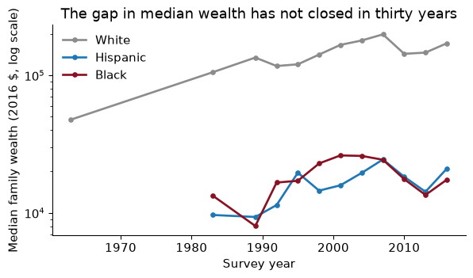

The log scale makes equal *ratios* equal vertical distances, which is what you want when the question is “how many times as much”. On a log scale the gap is the vertical distance between the lines, and it has barely moved since 1989.

### Worked example — the year of the widest gap

In which survey year was the white-to-Black ratio of median wealth largest, and what was it?

### Solution

``` python
worst = int(ratio["white_black"].idxmax())
```

It peaked in 1989, at 16.8 to 1, against 7.9 in 1983 and 7.0 in 1992. Be suspicious of a number that doubles and then halves again. The median Black family’s wealth in 1989, \$8,023, is far below the waves on either side, and the SCF samples only a few hundred Black families per wave, so the spike is very likely sampling noise. A ratio of two survey medians has a standard error, which this file does not report. The honest summary is the chart’s: in every other wave since 1983 the ratio lies between 6.2 and 10.8 to one, with no sign of closing.

## Missing values

So far missing values have been an inconvenience to `dropna`. They deserve much more than that, because how you handle them can change your answer, and the standard defaults change it in predictable directions. This section uses a data set with a lot of real missingness: the Department of Labor’s National Database of Childcare Prices (NDCP), which gives the weekly median price of full-time childcare in every US county from 2008 to 2018, alongside county characteristics from the American Community Survey (TidyTuesday, 9 May 2023).

The economic question is simple. **How much does a year of infant care cost, relative to what families earn?** The federal guideline is that childcare is “affordable” at 7% of family income. In 2018, 25% of US counties have no infant-care price at all.

### How missingness shows up

Missing data rarely arrive labelled “missing”. In real files you will meet at least five disguises:

1.  **A proper missing value**, `NaN` in pandas (or `None`, or `pd.NA`). The only one pandas understands without being told.
2.  **The string `"NA"`** (or `"N/A"`, `"."`, `"null"`). R writes missing values this way, and TidyTuesday files come from R. The raw childcare file contains the text `,NA` 88,636 times. pandas converts `"NA"` to `NaN` by default; Polars and DuckDB do not, as we will see.
3.  **Empty strings**, `""` in a text column, which look like data to every function.
4.  **Sentinel codes**: numbers that mean “no answer”. The NLSY codes refusals as −1, “don’t know” as −2 and non-interviews as −5 (you will meet these in Problem Set 1). Many surveys use 99 or 999 for “not applicable”. The Census API returns −666666666 for an estimate it cannot compute. Sentinels are the dangerous ones, because they are *numbers*, and `.mean()` will average them happily.
5.  **Structural absence.** A row that is not in the file at all. The wealth table has no Black or Hispanic median for 1963 and no “Non-White” median after 1983; the survey simply did not tabulate them.

``` python
survey = pd.DataFrame({"income": [42_000, -2, 55_000, -4, 999_999, 31_000],
                       "state": ["ME", "NH", "", "VT", "ME", "N/A"]})
print("naive mean:", survey["income"].mean())
clean = survey.assign(
    income=lambda d: d["income"].mask((d["income"] < 0) | (d["income"] == 999_999)),
    state=lambda d: d["state"].replace({"": np.nan, "N/A": np.nan}))
print("clean mean:", clean["income"].mean(), "| missing:", clean.isna().sum().to_dict())
```

    naive mean: 187998.83333333334
    clean mean: 42666.666666666664 | missing: {'income': 3, 'state': 2}

The “naive” mean is nonsense, and it is not obviously nonsense: it is a positive number in the right order of magnitude. The fix is always the same. **Read the codebook, find the codes, convert them to `NaN` with `mask` or `replace`, then count.**

### Detecting it

Counting is not enough; you want to know *where* the holes are. Three habits:

- `df.isna().mean()` gives the share missing in every column.
- `value_counts(dropna=False)` shows `NaN` as a category, so you see it next to the real values.
- **Tabulate missingness by group**: by year, by state, by whatever else you have.

The childcare data reward the third habit. Missingness falls over time, from 55% of counties in 2008 to 16% in 2016, then rises to 25% in 2018. And in 2018 it is not scattered across the map. It is concentrated in a few states, 10 of which have no county prices at all: CO, DC, FL, GA, IA, IN, LA, MT, NM, NV.

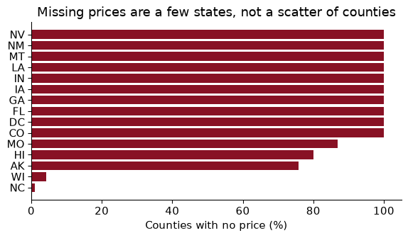

That pattern tells you the mechanism. Prices come from *state* market-rate surveys, and some states did not report in 2018. A county is missing because of where it is, not because of anything about its own childcare.

### Why is it missing? Three mechanisms

Statisticians since Rubin (1976) sort missing data by *why* the value is missing. The names are terrible; the ideas are simple.

- **Missing completely at random (MCAR).** Whether a value is missing has nothing to do with anything, observed or not. A lab spills coffee on random survey forms. The complete cases are a random sample of all cases.
- **Missing at random (MAR).** Whether a value is missing depends on things you *do* observe, but not on the missing value itself once you account for them. Childcare prices are missing by state; within a state, a county with a missing price is like a county without one. If you can condition on the right observed variables, you can fix MAR.
- **Missing not at random (MNAR).** Whether a value is missing depends on the value itself. This is the one that keeps economists awake.

The classic economic case of MNAR is **income non-response**. In household surveys a large share of people refuse to report their earnings, and refusal is not random: it is more common at the top and the very bottom of the distribution. In the Current Population Survey the Census Bureau imputes earnings for well over a quarter of respondents, and Bollinger and Hirsch (2006) show that because the imputation matches people on observed characteristics only, it biases estimates of things like the union wage premium, whenever the variable you study is not one the imputation matched on. If high earners refuse more, then *among people who look alike on paper*, the ones who answer are poorer than the ones who don’t, and no amount of conditioning on observables fixes that.

You cannot test MAR against MNAR with the data alone, because the test would need the values you do not have. It is an assumption, and you defend it with knowledge of how the data were collected.

### What deletion and imputation do to an estimate

The common responses are:

- **Listwise deletion** (complete-case analysis): drop every row with a missing value. `dropna()`.
- **Mean or median imputation**: fill each hole with the overall mean or median.
- **Group-wise imputation**: fill each hole with the mean of its group (its state, its year, its industry).
- **A missingness indicator**: fill the hole with a constant *and* add a 0/1 column saying it was missing, so a model can treat those rows differently.

To see what each does, we need a case where we know the right answer. So take the 2,360 counties that *do* have a 2018 price, pretend we have not seen 30% of them, and compare each method’s answer with the truth. I knock out values three ways:

- **MCAR**: every county has a 30% chance of being missing.
- **MAR**: the chance rises with the county’s income rank from the bottom, so the poorest counties are about twice as likely as average to be missing and the richest almost never are. Income is observed.
- **MNAR**: the same, but driven by the county’s *price* rank: expensive counties go missing.

Two quantities to estimate: the average annual price of infant care, and the slope of price on median household income (how many dollars of childcare go with each \$1,000 of local income).

The truth, from all 2,360 counties: a mean price of **\$8,444**, a standard deviation of \$3,024, and a slope of **\$147** per \$1,000 of income. The estimates:

                                 mean price    sd  slope on income
    mechanism method                                              
    MCAR      listwise                 8477  2964              142
              mean-impute              8477  2492              101
              state-mean-impute        8431  2820              124
    MAR       listwise                 8898  3206              150
              mean-impute              8898  2680              112
              state-mean-impute        8599  2952              136
    MNAR      listwise                 7724  2548              126
              mean-impute              7724  2136               78
              state-mean-impute        8218  2617              111

Read it a row at a time; each row teaches one thing.

**MCAR, listwise.** Mean \$8,477, slope 142: both close to the truth. When data are missing completely at random, throwing away incomplete rows costs you precision (a smaller sample) but not bias. That is worth remembering, because listwise deletion gets a worse reputation than it deserves.

**MCAR, mean-impute.** The mean is unchanged, by construction. But the standard deviation falls from \$3,024 to \$2,492, because 30% of the counties now sit exactly at the mean, and the slope collapses to 101, about 69% of the truth. Mean imputation invents data that have no relationship with anything else, so every relationship is diluted towards zero. Any standard error you compute afterwards is also too small, because the software thinks the invented values are real observations.

**MAR, listwise.** Now the poorer counties are missing more often, and they have cheaper childcare. The complete-case mean is \$8,898, too high. Mean imputation does not help: it fills the holes with that same too-high mean. Filling within state does better, \$8,599, because states differ in income and the state mean carries some of the information that predicts missingness. Notice that the *slope* under listwise deletion is still close to the truth (150). When missingness depends only on a regressor, a regression on complete cases remains unbiased: it is estimating price *given* income, and conditioning on income is exactly what makes the remaining cases comparable.

**MNAR.** Expensive counties hide their prices. Every method underestimates the mean (listwise \$7,724), and every slope is too flat. Nothing in the data can tell you this has happened. That is why MNAR is the economist’s nightmare: the only defence is knowledge of the process, a validation sample where the values are known, or bounds that ask how wrong you could be (Manski’s partial identification, which you may meet in econometrics).

> Listwise deletion is fine under MCAR, and fine for regressions when missingness depends only on the regressors. Mean imputation is almost never what you want for estimation: it keeps the mean and wrecks everything else.

### Never impute the outcome

In the table above, `price` was the *outcome* of the regression of price on income, and mean-imputing it diluted the slope to 69% of its true value. That is the general rule: **do not impute the variable you are trying to explain**. Filling missing outcomes with anything predicted from the regressors (a mean, a group mean, a regression prediction) manufactures observations that fit your model by construction, and then you estimate the model on them. Drop rows with a missing outcome, and report how many you dropped and how they differ from the rest.

Imputation is more defensible for *features*, the right-hand-side variables, especially in prediction. There the **missingness indicator** earns its keep, because the fact that a value is missing is often information. The Craigslist rent listings of Chapter 9 make the point:

In listings up to 2010, 98% have no square footage, because the site’s format did not ask for it; from 2012 on, 36% still leave it blank. And the blanks are not random. Among listings from 2012 on, the median two-bedroom *without* a square footage asks \$2,219, against \$2,442 for one that reports it. Landlords advertise square footage when it is a selling point. A rent model that fills in the median square footage *and* adds a `sqft_missing` dummy lets the data tell it that a missing size means a cheaper flat. Without the dummy, the filled-in value would pretend those flats are ordinary.

### Imputation and the train/test split

Chapter 9 made a rule: nothing about the test set may influence how the model is built. Imputation is part of building the model. If you compute the median square footage on the whole data set and then split, the training rows have been filled with a number that used the test rows, and your test score is (slightly) flattering. The fix is the pipeline habit: put the imputer *inside* the pipeline, so `fit` learns the median from the training data only and `transform` applies that same training median to the test data.

``` python
from sklearn.model_selection import train_test_split
from sklearn.impute import SimpleImputer
X = recent[["sqft", "beds"]]
X_train, X_test = train_test_split(X, test_size=0.2, random_state=SEED)
leaky = SimpleImputer(strategy="median", add_indicator=True).fit(X)        # wrong: saw the test rows
honest = SimpleImputer(strategy="median", add_indicator=True).fit(X_train) # right
print(leaky.statistics_, honest.statistics_)
```

    [888.   2.] [887.   2.]

`add_indicator=True` adds the missingness dummies for you. Here the two medians are 888 and 887 square feet, a difference of nothing. The principle matters more than this number. With fancier imputers (filling each hole by a regression or by nearest neighbours) the leaked information is richer, and with small data it can be large.

### Worked example — refusers in an income survey

*A hypothetical survey.* 1,000 households are asked their income. 800 answer, with a mean of \$60,000. The 200 who refuse are, unknown to you, richer, with a true mean of \$110,000. **(a)** What is the true mean income? **(b)** What do listwise deletion and mean imputation each report? **(c)** Which mechanism is this, and could imputing by education and age fix it?

### Solution

**(a)** $(800 \times 60{,}000 + 200 \times 110{,}000) / 1{,}000 = \$70{,}000$.

**(b)** Listwise deletion reports the mean of the 800 who answered: \$60,000. Mean imputation fills the 200 holes with \$60,000 and reports \$60,000 again, with a standard deviation that is now too small. Both are \$10,000 too low; imputation has made the answer look more precise without making it more accurate.

**(c)** It is MNAR if refusal depends on income itself. Imputing by education and age helps only to the extent that education and age predict both income and refusal; it fixes the part of the problem that is MAR. Whatever is left (the rich refusing *more than people with the same education and age*) no imputation from observables can touch. That is the Bollinger–Hirsch point about the CPS.

## Checking the data

Lecture 05’s checklist is the highest-return habit in this book. Before analysing a new table: **read the documentation** (universe, units, top-codes, missing codes); **look** at it (`.head()`, `.sample(10)`, `.info()`); **summarize** (`.describe()`, `.value_counts(dropna=False)`); **plot** the key variables, since a histogram finds a sentinel in seconds; **check by group**; and **check the shape** (rows, unique keys, years per unit).

Then turn what you checked into **assertions**, so the check runs every time the code does. An `assert` is silent when you are right and stops everything when you are wrong, which is exactly what you want the day a new vintage of the file arrives with a duplicated county.

``` python
def check_table(df, key, name=""):
    """Print the facts I want to know about a new table, and fail on a broken key."""
    assert not df.duplicated(key).any(), f"{name}: key {key} is not unique"
    miss = df.isna().mean()
    print(f"{name}: {len(df):,} rows, key {key} unique, "
          f"columns with missing values: {miss[miss > 0].round(2).to_dict()}")

check_table(panel.drop(columns=["_m_home", "_m_inc"]), ["year", "race"], "panel")
shares = income.groupby(["race", "year"])["income_distribution"].sum()
assert shares.between(99.5, 100.5).all(), "bracket shares do not sum to 100"
```

    panel: 34 rows, key ['year', 'race'] unique, columns with missing values: {'home_owner_pct': 0.03, 'income_median': 0.03}

The bracket shares within each race-year should sum to 100. They sum to between 99.8 and 100.2, because each share was rounded to one decimal before publication. So the assertion needs a tolerance, and choosing it forces you to think about *why* the numbers are not exact.

### Worked example — a listing with 900,000 square feet

`rent["sqft"].describe()` reports a maximum of 900,000 square feet. What do you do?

### Solution

``` python
big = (rent["sqft"] > 10_000).sum()
```

First, look: 25 listings claim more than 10,000 square feet, a mansion, not a Craigslist flat; almost certainly typos or a lot size in the wrong field. Second, decide *in code*: `rent["sqft"].mask(rent["sqft"] > 10_000)` turns them into missing values, which is honest, and keeps their perfectly good rents. Third, write the rule down with the number of rows it affects. Never fix it by deleting rows in Excel: then nobody, including you in six months, can reproduce the table.

## When the file gets big

Plenty of economic data does not fit comfortably in memory: the CPS since 1962, administrative wage records, a year of taxi trips, scanner data. pandas wants five to ten times a file’s size in RAM, reads every column of a CSV even if you need two, and uses one core. But most “big data” in economics is really **medium data**: too big for comfortable pandas, easily handled on a laptop with the right file format and engine. You almost never need a cluster.

Our example is two files from the San Francisco housing data (TidyTuesday, 5 July 2022): 200,796 Craigslist rental listings across the Bay Area, 2000–2018, collected by Kate Pennington, and 86,103 building permits filed in San Francisco. Pennington uses them to ask whether new construction raises or lowers nearby rents. They are not large, which is the point: you can see the gains on files small enough to check, and the gains grow with size.

### Parquet

CSV is text, stored row by row. To read one column you parse every byte of every row, and the file stores no types, so the reader must guess whether `02134` is a ZIP code or a number. **Parquet** stores each column together, compressed and typed, with summary statistics for each chunk, so a reader can fetch only the columns it needs and skip chunks that cannot match a filter.

|                                  | Size on disk | pandas read time |
|----------------------------------|--------------|------------------|
| `rent.csv`                       | 40 MB        | 0.38 s           |
| `rent.parquet`                   | 12 MB        | 0.02 s           |
| `rent.parquet`, two columns only |              | 0.001 s          |

The Parquet file is 3 times smaller and reads 24 times faster, two columns faster again, and it remembers every column’s type. **Anything you will read more than once should be stored as Parquet**; converting is one line, `pd.read_csv(path).to_parquet(new_path)`.

### DuckDB and Polars

Two engines go further. **DuckDB** is a database that lives inside your Python session: no server, no setup, and it runs SQL directly on files. **Polars** is a DataFrame library with an expression API much like pandas, and a **lazy** mode in which you describe the whole query first and the engine works out the cheapest way to run it. Both use every core of your machine and both can process files larger than your memory.

Here is the question from Exercise 06: how many housing units did new-construction permits propose each year, and what did a two-bedroom flat in San Francisco rent for? In DuckDB, one SQL query reads both Parquet files, aggregates each, and joins them, without loading either into pandas:

``` python
sf = duckdb.sql(f"""
WITH permits AS (
    SELECT year(CAST(filed_date AS TIMESTAMP)) AS year, sum(proposed_units) AS units
    FROM '{permits_pq}' WHERE permit_type_definition LIKE 'new construction%'
    GROUP BY ALL),
rents AS (
    SELECT year, median(price) AS med_rent, count(*) AS n_listings
    FROM '{rent_pq}' WHERE city = 'san francisco' AND beds = 2
    GROUP BY ALL)
SELECT * FROM rents JOIN permits USING (year) ORDER BY year
""").df()
sf.tail(4)
```

<div>
<style scoped>
    .dataframe tbody tr th:only-of-type {
        vertical-align: middle;
    }
&#10;    .dataframe tbody tr th {
        vertical-align: top;
    }
&#10;    .dataframe thead th {
        text-align: right;
    }
</style>

|     | year | med_rent | n_listings | units  |
|-----|------|----------|------------|--------|
| 15  | 2015 | 4250.0   | 984        | 6062.0 |
| 16  | 2016 | 4200.0   | 1306       | 9709.0 |
| 17  | 2017 | 3995.0   | 157        | 4759.0 |
| 18  | 2018 | 4095.0   | 243        | 5539.0 |

</div>

The answer is a small table you can hand to pandas and matplotlib. Look at `n_listings` before you look at the rents, though: in 4 of the years the median is based on fewer than 100 listings, so those points are noisy. (And no, this table does not tell you whether construction lowers rents. Booms raise both rents and the incentive to build; the correlation in this table runs the “wrong” way for exactly that reason.)

The same aggregation in Polars, lazily:

``` python
q = (pl.scan_parquet(rent_pq)
       .filter((pl.col("city") == "san francisco") & (pl.col("beds") == 2))
       .group_by("year")
       .agg(med_rent=pl.col("price").median(), n=pl.len())
       .sort("year"))
plan = q.explain()
res = q.collect()
```

Nothing is read when `scan_parquet` runs. `q.explain()` prints the plan the optimizer chose, and it shows two tricks: the filter is pushed into the file scan (“predicate pushdown”) and only 4 of the 17 columns are read (“projection pushdown”). `.collect()` runs it. For the years in both tables, the Polars medians match DuckDB’s exactly; the build checks that with an `assert`.

One gotcha links this section to the last. Point Polars at the raw CSV and look at the types it chooses:

``` python
naive = pl.read_csv(rent_csv)
fixed = pl.read_csv(rent_csv, null_values="NA", infer_schema_length=None)
for col in ["beds", "sqft", "lat"]:
    print(f"{col:5s} naive: {naive.schema[col]!s:7s} with null_values='NA': {fixed.schema[col]}")
```

    beds  naive: String  with null_values='NA': Int64
    sqft  naive: String  with null_values='NA': Int64
    lat   naive: String  with null_values='NA': Float64

Polars does not treat the string `"NA"` as missing, so a column of numbers with some `"NA"`s in it is read as *text*. No error, no warning; `sqft` is now a string, and the first time you try to average it you get a confusing failure far from the cause. (DuckDB’s CSV reader does the same.) Telling it `null_values="NA"` fixes it. The general lesson: **every tool has its own default idea of what missing looks like**, and you should never rely on a default you have not checked.

### Worked example — why chunking can’t give you a median

A file is too big to load, so you read it in chunks of a million rows with `pd.read_csv(..., chunksize=1_000_000)`. You want the mean rent and the median rent. Which can you compute chunk by chunk?

### Solution

The **mean**: keep a running sum and a running count across chunks, and divide at the end. Sums and counts *decompose*: the total is the sum of the chunk totals. The **median** does not: the median of the whole file is not the median of the chunk medians, or any other function of them. (Two chunks with medians 1 and 3 can have an overall median anywhere between them, depending on what else is in each.) For medians, quantiles and anything else that needs the whole distribution, use an engine that handles out-of-memory data for you: DuckDB’s `median()` or Polars’ streaming mode.

## Pictures that inform

Every problem in this chapter (the sentinel, the 900,000-square-foot flat, the states with no prices) is one a picture shows at once. Anscombe (1973) made the point with four tiny data sets that share their means, variances, correlations and regression lines and look nothing alike when plotted. **Plot before you trust.** Pictures are also how economists communicate: the most-cited results in recent applied micro are figures, like the Opportunity Atlas maps of the next chapter. A good figure is a visual estimator and deserves the same care.

### A few principles

Cleveland and McGill (1984) measured how accurately people read quantities off charts. Position along a common scale is best, then length, then angle and area, with colour last. That ranking explains most of the good advice you will hear:

- **Dot plots and bars beat pies.** Position beats angle.
- **Bars start at zero.** A bar *is* a length; truncating the axis lies about it. (Lines and dots need not start at zero.)
- **Sort categories by value**, not alphabetically.
- **Colour for categories, not for precise values**, and at most about five colours.
- **One message per chart, and the title says it.** “The gap in median wealth has not closed in thirty years” beats “wealth_family by year”.
- **Label axes in words, with units.**

### The binned scatterplot

With tens of thousands of points a scatterplot is an ink blob. The economist’s answer is the **binned scatterplot** (“binscatter”): cut $x$ into, say, 20 equal-sized bins by quantile, compute the mean of $x$ and of $y$ in each, and plot the 20 points. It is a picture of the conditional mean $E[y \mid x]$, it costs one `groupby`, and it looks the same whether you have a thousand points or a billion.

``` python
def binscatter(df, x, y, bins=20):
    """Means of x and y within quantile bins of x."""
    return (df.assign(bin=pd.qcut(df[x], bins, labels=False, duplicates="drop"))
              .groupby("bin").agg(x=(x, "mean"), y=(y, "mean"), n=(y, "size")))
```

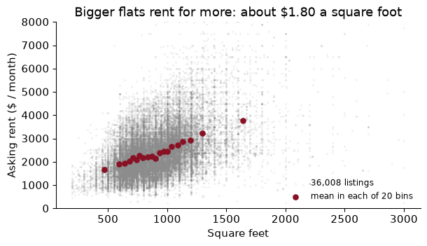

The grey cloud of 36,008 listings says “more space, more rent, lots of noise”, and it is impossible to see where the middle of the cloud is. The garnet bin means show it: rent rises with size roughly in a straight line, with a flat stretch in the middle where large one-bedrooms and small two-bedrooms overlap. A straight line through all the listings has a slope of \$1.80 a square foot.

In research you often **residualize** first, binning the residuals of $x$ and $y$ on controls, so that the slope through the bins is the multiple-regression coefficient (Frisch–Waugh–Lovell). Cattaneo, Crump, Farrell and Feng (2024) show how to choose bins and draw honest confidence bands; their `binsreg` package does it.

### Small multiples

Many groups on one panel, one colour each, is spaghetti. Tufte’s (1983) alternative is **small multiples**: one small panel per group, on shared axes.

The data are the Luxembourg Income Study’s Gini coefficients, via Our World in Data (TidyTuesday, 5 August 2025), for 45 countries. Each country-year has two Ginis: one for **market** income, before taxes and transfers, and one for **disposable** income, after them. The difference is a measure of how much inequality the tax-and-transfer system removes; call it **redistribution**. In its latest year the United States has a market Gini of 0.51 and a disposable Gini of 0.39, a reduction of 0.112.

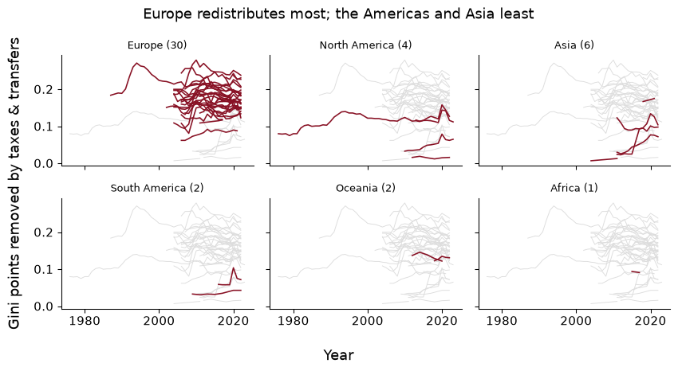

Each panel shows a region’s countries against the grey background of all the others, on shared axes; the background is what makes the comparison (does this region redistribute more than the rest?) possible. The counts in the titles matter just as much. 30 of the 45 countries are European and 1 is African. A claim about “how much countries redistribute” from this sample is a claim about rich democracies.

### Worked example — fix this chart

A classmate plots each country’s latest disposable-income Gini as a bar, in alphabetical order, each bar a different rainbow colour, the y-axis starting at 0.2, titled “GINI DATA”. List what is wrong, and say what you would draw instead to answer *“which countries redistribute the most?”*

### Solution

Alphabetical order hides the ranking; the colours encode nothing; the truncated axis makes a bar of 0.30 look twice as long as one of 0.25; the title says nothing; the countries’ “latest years” differ, unannounced. Worst, it plots the *wrong quantity*: redistribution needs both Ginis.

Draw a **dumbbell chart**: one row per country, sorted by redistribution, a dot at the market Gini and a dot at the disposable Gini joined by a line. Position on a common scale, both numbers visible, the length of the line is the answer.

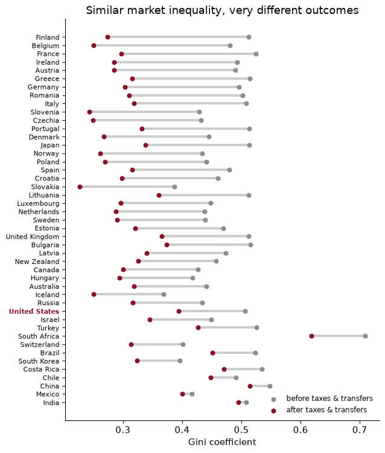

Finland removes the most, 0.238 Gini points; India the least, 0.013. And the chart shows what no bar chart could: market inequality is fairly similar across rich countries, and the big differences in what households live on come from taxes and transfers.

## In Python

The chapter’s pipeline in one place: load the wealth tables, build a checked race-by-year panel, then the childcare burden with its missing values handled explicitly.

``` python
import urllib.request
from pathlib import Path
import numpy as np, pandas as pd
DATA = Path("../data"); DATA.mkdir(exist_ok=True)
TT = "https://raw.githubusercontent.com/rfordatascience/tidytuesday/main/data/"

def fetch(name, url):                                 # download once, then reuse
    path = DATA / name
    if not path.exists():
        urllib.request.urlretrieve(url, path)
    return path

W = TT + "2021/2021-02-09/"
wealth = pd.read_csv(fetch("wealth_race_wealth.csv", W + "race_wealth.csv"))
home = pd.read_csv(fetch("wealth_home_owner.csv", W + "home_owner.csv"))
```

Median wealth for three groups, merged with homeownership, checked.

``` python
med = (wealth.query("type == 'Median' and race in ['White', 'Black', 'Hispanic']")
             .dropna(subset=["wealth_family"])[["year", "race", "wealth_family"]])
panel = med.merge(home, on=["year", "race"], how="left", validate="one_to_one", indicator=True)
assert len(panel) == len(med) and not panel.duplicated(["year", "race"]).any()
wide = panel.pivot(index="year", columns="race", values="wealth_family")
print((wide["White"] / wide["Black"]).round(1).to_dict())
```

    {1963: nan, 1983: 7.9, 1989: 16.8, 1992: 7.0, 1995: 7.0, 1998: 6.2, 2001: 6.4, 2004: 6.9, 2007: 8.2, 2010: 8.2, 2013: 10.8, 2016: 9.8}

The childcare burden in 2018, with missingness counted before anything is dropped.

``` python
CC = TT + "2023/2023-05-09/"
cc = pd.read_csv(fetch("tt_childcare_costs_raw.csv", CC + "childcare_costs.csv"))
names = pd.read_csv(fetch("tt_childcare_counties.csv", CC + "counties.csv"))
c18 = (cc.query("study_year == 2018")
         .merge(names, on="county_fips_code", how="left", validate="one_to_one")
         .assign(burden=lambda d: 100 * 52 * d["mc_infant"] / d["mhi_2018"]))
print(f"missing price: {c18['burden'].isna().mean():.1%} of {len(c18):,} counties")
ok = c18.dropna(subset=["burden"])                    # outcome-like: never impute it
w_burden = np.average(ok["burden"], weights=ok["households"])
print(f"household-weighted burden: {w_burden:.1f}% | share of counties above 7%: {(ok['burden'] > 7).mean():.2f}")
```

    missing price: 24.9% of 3,142 counties
    household-weighted burden: 19.4% | share of counties above 7%: 1.00

Among counties with a price, a year of infant center care costs on average 19.4% of the county’s median household income (weighting counties by households; 16.3% unweighted), far above the 7% guideline. Only 4 of the 2,360 counties with a price meet the guideline; the cheapest, Mercer County, MO, comes in at 3.3%. (The guideline is about a family’s own income, not the county median, so treat this as a rough comparison.) All of these numbers describe counties in states that reported; whether they describe the rest is an assumption about why the others are missing.

## What goes wrong

**Merging without `validate=`.** A key you believed unique is not, the merge multiplies rows, and every statistic afterwards is quietly reweighted. Merging the wealth table with the uncollapsed income table turned 34 rows into 298 without a word. Nine characters prevent it.

**Averaging sentinel codes.** −2 for “don’t know”, 99 for “not applicable”, 999,999 for a top-code. They are numbers, so `.mean()` uses them. Read the codebook and `mask` them before computing anything.

**Mean-imputing and carrying on.** It keeps the mean and nothing else: in our experiment it shrank the standard deviation and cut the slope of price on income to 69% of the truth, while making standard errors look smaller. If you impute a feature, add a missingness indicator; never impute the outcome.

**Assuming the complete cases are representative.** In 2018 the childcare prices are missing for whole states. A national average from the counties that remain is an average for a different country. Tabulate missingness by group before you drop anything, and say what population your answer describes.

**Imputing before the split.** Fit the imputer on the training data only, inside the pipeline (Chapter 9). Otherwise the test set has helped build the model.

**Charts that answer a different question.** Alphabetical bars of one Gini, with a truncated axis and rainbow colours, cannot show redistribution. Decide the one comparison the reader should make, then choose the form (dumbbell, small multiples, binscatter) that puts it on a common scale.

## Exercises

1.  For the `debt` table (student loan debt by race), say in words what one row is, name its key, and check it in code. Which years does it cover, and why can you not merge it with the wealth table for 1983?

2.  Explain, without code, why `df.groupby("race")["wealth_family"].pct_change()` gives wrong answers if the table is not sorted by year within race. What does the first non-missing growth rate for the second race compare?

3.  Using the 2018 childcare data, compare counties with and without a price on median household income, population and female labour-force participation. Does the comparison support MCAR? Does it tell you anything about MAR versus MNAR?

4.  In the missing-data experiment, the MAR mechanism made the complete-case *mean* price too high but left the complete-case *slope* of price on income roughly right. Explain why in two sentences. Would the same be true if missingness depended on price instead of income?

5.  Repeat the missing-data experiment for MCAR with 10%, 30% and 50% of prices removed, and report the mean-imputed slope as a share of the true slope each time. What simple formula does it follow?

6.  Write the Polars equivalent of the DuckDB permits query: new-construction permits per year and units proposed. Check that your numbers match DuckDB’s.

7.  Make a binned scatterplot of the 2018 childcare burden against female labour-force participation (`flfpr_20to64`) across counties. Then give one causal story in each direction.

8.  Draw a slope chart of redistribution for the countries observed in both 2005 and 2022: two x positions, one line per country, garnet if redistribution rose. In which countries did it rise?

### Answers

**1.** One row is the average student loan debt and the share of families with student debt, for one racial group in one survey year; the key is (race, year).

``` python
assert not debt.duplicated(["race", "year"]).any()
print(sorted(debt["year"].unique().tolist()), debt["race"].unique().tolist())
```

    [1989, 1992, 1995, 1998, 2001, 2004, 2007, 2010, 2013, 2016] ['White', 'Black', 'Hispanic']

It covers 1989–2016, every SCF wave, for White, Black, Hispanic families. A merge with the 1983 wealth rows would find no debt row: the series starts in 1989. With `indicator=True` you would see those rows as `left_only`.

**2.** `pct_change` compares each row with the row *above it in the table*, not with the group’s previous year. Within `groupby` it restarts at each group, but if the years are out of order it compares, say, 2016 with 1989. Without `groupby`, the first row of the second race is compared with the last row of the first: a “growth rate” from white wealth in 2016 to Black wealth in 1983, meaningless and indistinguishable from a real one.

**3.**

``` python
cmp = (c18.assign(has_price=c18["mc_infant"].notna())
          .groupby("has_price")[["mhi_2018", "total_pop", "flfpr_20to64"]].median())
print(cmp.round(1).to_string())
```

               mhi_2018  total_pop  flfpr_20to64
    has_price                                   
    False       48373.5    21119.0          69.8
    True        50341.5    27868.5          70.2

Counties without a price have a median household income of \$48,374 against \$50,342, and are smaller. So the missing counties are not a random draw: MCAR is out, at least strictly. But since we know prices are missing by *state*, the differences may be differences between states, which is consistent with MAR given state. The comparison can never distinguish MAR from MNAR, because that would require the missing prices themselves.

**4.** Under MAR-on-income, the complete cases at each income level are a random sample of the counties at that income level, so the regression of price on income, which only asks about price *given* income, is unbiased; the mean is biased because the sample has too few low-income (cheap) counties. If missingness depended on price itself, the complete cases at each income level would be the cheaper ones, so the slope would be biased too, as the MNAR rows of the table show.

**5.**

``` python
rng5 = np.random.default_rng(SEED)
for share in [0.1, 0.3, 0.5]:
    obs = full["price"].mask(rng5.random(len(full)) < share)
    filled = full.assign(y=obs.fillna(obs.mean()))
    b = smf.ols("y ~ inc_k", data=filled).fit().params["inc_k"]
    print(f"{share:.0%} missing: slope {b:.0f} = {b / true_slope:.2f} of the truth")
```

    10% missing: slope 133 = 0.91 of the truth
    30% missing: slope 105 = 0.71 of the truth
    50% missing: slope 73 = 0.50 of the truth

The mean-imputed slope is roughly $(1 - \text{share missing})$ times the true slope: the imputed rows contribute variation in income but none in price, so they pull the covariance down in proportion to their number while leaving the variance of income untouched.

**6.**

``` python
units = (pl.scan_parquet(permits_pq)
           .filter(pl.col("permit_type_definition").str.starts_with("new construction"))
           .with_columns(year=pl.col("filed_date").str.slice(0, 4).cast(pl.Int32))
           .group_by("year").agg(n=pl.len(), units=pl.col("proposed_units").sum())
           .sort("year").collect().to_pandas())
check = units.merge(sf[["year", "units"]], on="year", suffixes=("_pl", "_db"))
print(np.allclose(check["units_pl"], check["units_db"]))
```

    True

The two engines agree year by year. If your version does not, the usual culprit is the date: `filed_date` is stored as text like `2000-01-03T00:00:00Z`, so the year has to be extracted (here, the first four characters) or the text parsed with its time zone. DuckDB’s `CAST` did that parsing for us silently; Polars insists you say what you mean.

**7.**

``` python
bs7 = binscatter(ok, "flfpr_20to64", "burden", bins=20)
corr7 = ok[["flfpr_20to64", "burden"]].corr().iloc[0, 1]
fig, ax = plt.subplots()
ax.scatter(bs7["x"], bs7["y"], color=GARNET)
ax.set(xlabel="Female labour-force participation, ages 20-64 (%)",
       ylabel="Infant care, % of median income", title="Childcare burden and women's work, 2018")
plt.show()
```

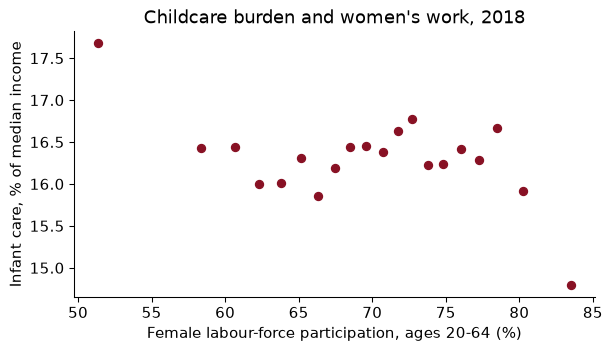

The county-level correlation is -0.08, close to zero. One story: where more mothers work, demand for centre care is higher and prices rise relative to income (participation causes cost). The other: where care is expensive relative to earnings, some mothers stay home (cost causes participation), which would push the relationship negative. The binscatter shows the net of the two, plus everything else that differs between counties. It cannot separate them.

**8.**

``` python
wide8 = gini.pivot(index="Entity", columns="Year", values="redist")[[2005, 2022]].dropna()
rose = wide8[wide8[2022] > wide8[2005]].index.tolist()
fig, ax = plt.subplots(figsize=(5, 4.5))
for c, (a, b) in wide8.iterrows():
    ax.plot([0, 1], [a, b], "o-", color=GARNET if b > a else GREY)
    ax.text(1.03, b, c, va="center", fontsize=8)
ax.set_xticks([0, 1], ["2005", "2022"])
ax.set(ylabel="Gini points removed", title="Redistribution, 2005 vs 2022"); plt.show()
```

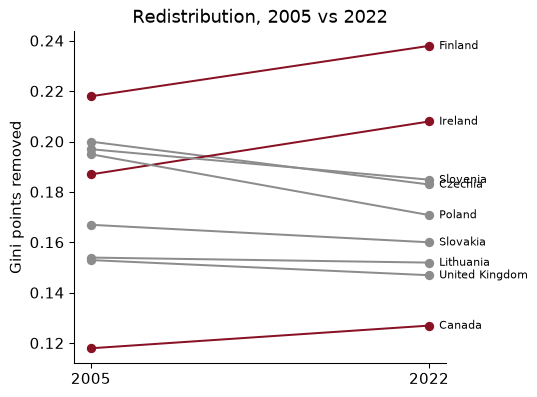

9 countries are observed in both years. Redistribution rose in 3 of them: Canada, Finland, Ireland. With so few countries, and the latest year for each set by survey timing, treat this as description, not a trend in “the world”.

**Reading.** Wickham (2014), “Tidy Data”, *Journal of Statistical Software*. McKinney, *Python for Data Analysis*, 3rd ed. (2022), chs. 5, 7, 8 and 10, free online, for the pandas verbs, missing data, merges and `groupby`. Little and Rubin, *Statistical Analysis with Missing Data* (2019), ch. 1, for the MCAR/MAR/MNAR framework; Bollinger and Hirsch (2006), “Match Bias from Earnings Imputation in the Current Population Survey”, *Journal of Labor Economics*, for what imputation does to economic estimates. Schwabish (2014), “An Economist’s Guide to Visualizing Data”, *Journal of Economic Perspectives*; Healy, *Data Visualization* (2018, free at socviz.co); Cattaneo, Crump, Farrell and Feng (2024), “On Binscatter”, *American Economic Review*.


# Chapter 5 — Mapping opportunity

> **The question:** a child grows up in a family at the 25th percentile of the national income distribution. How much does the county she grows up in change where she is likely to end up as an adult, and how much of that is the place itself rather than the families who live there?

## Ranks, not dollars

Ask a simple question: what fraction of American children grow up to earn more than their parents? Chetty, Grusky, Hell, Hendren, Manduca and Narang (2017) found that about 90% of children born in 1940 out-earned their parents, and only about half of those born in the 1980s did. Answering needs something no survey has at scale: parents’ and children’s incomes, linked, decades apart, for millions of families. Their answer came from federal tax records, linking about 20 million children born 1978–1983 to the parents who claimed them as dependents. With that many families you can measure mobility not just for the country but for every county and every Census tract.

That research programme is the template for this part of the course: acquire, wrangle, describe, map, and then ask whether what you see is causal. The public product is the **Opportunity Atlas**, a set of aggregated CSV files the Census Bureau hosts. We use those files.

The first design choice is to measure income in **ranks**. Each parent is ranked against all parents of children in the same birth cohort, from 0 to 100; each child is ranked against everyone else in *their* birth cohort, as an adult in their mid-thirties. Ranks have three virtues over dollars. They handle zeros (there is no log of zero income). They remove inflation and changes in inequality across cohorts, so the 1980 cohort can be compared with the 1940 one. And, empirically, the relationship between parent rank and child rank turns out to be almost perfectly a straight line.


Each dot is the average adult income rank of children whose parents were at that percentile, for the whole country. The line through them is the **rank-rank regression**:

$$\text{ChildRank}_i = \alpha + \beta \cdot \text{ParentRank}_i + \varepsilon_i$$

The slope $\beta$ is **relative mobility**: how much a child’s expected rank rises when her parents’ rank rises by one. If $\beta = 1$, children inherit their parents’ rank exactly; if $\beta = 0$, parents’ rank tells you nothing. In these data $\hat\beta =$ **0.366**, close to the 0.34 that Chetty, Hendren, Kline and Saez (2014) report. (The dots bend a little at the very top and bottom; fitting only percentiles 10 to 90 gives 0.349.)

### Worked example — what a slope of a third means

Using the national line, what is the expected gap in adult income rank between a child born to parents at the 10th percentile and one born at the 90th?

### Solution

The gap is 80 percentiles of parent income times the slope: $80 \times$ 0.366 $=$ 29.3 percentiles. A child from the bottom tenth expects to reach rank 35.2; one from the top tenth, 64.5. Two things are true at once: the gap is large (it is more than a quarter of the whole distribution), and most of the parental gap does *not* pass on, since the children’s expected ranks are much closer together than their parents’. Which of those you emphasize is a matter of what you are arguing, which is a good reason to report the number rather than an adjective.

## Absolute upward mobility

A national slope hides the thing the Atlas is famous for: places differ enormously. For each county, the Opportunity Atlas reports the rank-rank line for children who grew up there, summarized by its predicted value at two points. The headline statistic is the predicted rank at the 25th percentile:

$$\bar y_{25} = \hat\alpha + 25\,\hat\beta$$

This is **absolute upward mobility**: the expected adult rank of a child whose parents were at the 25th percentile, a lower-middle-income family. In the files it is `kfr_pooled_pooled_p25`, which reads as **k**ids’ **f**amily income **r**ank, all races (pooled), all genders (pooled), parents at **p25**. Ranks are stored as fractions; I multiply by 100.

Why a point on the line rather than the slope? Because the slope can fall for reasons nobody would celebrate. A place where rich children do *worse* has a flatter line, so more “relative mobility”, and poor children there are no better off. Absolute mobility asks the policy question directly: how do children from low-income families fare? The two measures are related but distinct; across counties, the correlation between $\bar y_{25}$ and the county slope (from the $p25$ and $p75$ predictions, $(\bar y_{75} - \bar y_{25})/50$) is -0.63. Places where poor children do well tend to be places where parental rank matters less.


Weighting each county by its number of children, the average child from a p25 family reaches rank 40.8. Moving from the county at the 10th percentile of that distribution to the one at the 90th raises it from 35.5 to 46.1, a gap of **10.6 percentiles**. For comparison, the national rank-rank slope says that raising *parents’* income from the 25th to the 50th percentile raises the child’s expected rank by 9.2. Where you grow up appears to matter about as much as a large change in your parents’ income. Whether it *causes* that difference is the question of the last section.

Androscoggin County, home to Bates, sits at 40.9.

### Worked example — three places

Hypothetical counties, each with a straight rank-rank line: **A** has intercept 45 and slope 0.25; **B** intercept 30, slope 0.25; **C** intercept 25, slope 0.45. Rank them by relative mobility and by absolute upward mobility.

### Solution

Relative mobility is the slope, and a *lower* slope means more mobility: A and B tie at 0.25, C is least mobile at 0.45. Absolute mobility is the line’s height at 25: A $= 45 + 25(0.25) = 51.25$, B $= 36.25$, C $= 25 + 25(0.45) = 36.25$. So A beats B for every child, despite the same slope. And C, the “least mobile” place by the slope, is exactly as good as B for a child from a p25 family; it is the children of rich parents in C who do much better. If your question is about poor children, the slope alone would have misled you.

## Small places are noisy

Every number in the Atlas is an estimate from a finite number of children, and many counties are small. The median county has 3,308 children in the sample; 171 counties have fewer than 500. Each estimate comes with a standard error (`_se` columns), and the standard errors are large exactly where the counts are small.

That has a predictable consequence. **If you sort places by a noisy estimate, the extremes are disproportionately the smallest places**, because a small place needs only a little luck to land at the top (or the bottom). It is the winner’s curse, and it is how “the ten best counties to grow up in” lists come to be full of places you have never heard of. The ten highest raw estimates of $\bar y_{25}$ have a median of 389 children each, against 3,308 for all counties.

The fix is **empirical Bayes shrinkage**: pull each estimate towards the overall mean, by more when it is noisier.

$$\hat\theta^{EB}_j = \bar\theta + \lambda_j(\hat\theta_j - \bar\theta), \qquad \lambda_j = \frac{\sigma^2_\theta}{\sigma^2_\theta + s_j^2}$$

Here $s_j$ is county $j$’s standard error and $\sigma^2_\theta$ is the variance of the *true* county values, which we estimate as the variance of the estimates minus the average squared standard error (the part of the spread that is noise). The weight $\lambda_j$ is the **reliability** of county $j$’s estimate: the share of its deviation from the mean that we believe. A big county with a tiny standard error keeps $\lambda \approx 1$; a tiny county with a big one is pulled most of the way to the mean.

``` python
signal_var = d["p25"].var() - (d["p25_se"] ** 2).mean()
d["lam"] = signal_var / (signal_var + d["p25_se"] ** 2)
d["p25_eb"] = d["p25"].mean() + d["lam"] * (d["p25"] - d["p25"].mean())
```


The true spread across counties is large relative to the noise in a typical county: the estimated standard deviation of true $\bar y_{25}$ is 6.1 percentiles, while the median standard error is 0.8. So for most counties $\lambda$ is close to one and shrinkage changes little. It matters at the bottom of the size distribution, where $\lambda$ falls to 0.30. The estimate that moves most is Irion, TX, with 219 children: its raw 60.8 becomes 52.0. 6 of the ten highest raw estimates are still in the top ten after shrinkage in the shrunk top ten. The Great Plains counties at the top really do look exceptional; some of them are just less exceptional than their raw numbers.

At the **tract** level, with a few hundred children per cell, shrinkage matters a great deal, and the Atlas’s published tract maps use it. You have seen the idea before, or will: ridge regression (Chapter 11) shrinks coefficients toward zero for the same reason, and teacher value-added models shrink teacher averages toward the mean.

### Worked example — shrinking one county by hand

*Hypothetical numbers.* The mean of $\bar y_{25}$ across counties is 43 and the true across-county variance is $\sigma^2_\theta = 36$. A small county reports 55 with a standard error of 6. What is its shrunk estimate? What if its standard error were 1?

### Solution

With $s = 6$: $\lambda = 36/(36 + 36) = 0.5$, so $\hat\theta^{EB} = 43 + 0.5(55 - 43) = 49$. Half of the county’s apparent excellence is believed. With $s = 1$: $\lambda = 36/37 \approx 0.97$, and the estimate barely moves, to about 54.7. The rule is not “distrust small places”; it is “distrust a deviation in proportion to how noisy it is”. (There is a second reason for caution in small cells: the Atlas adds a little random noise to every published estimate to protect the privacy of the families in it, Chetty and Friedman’s (2019) method, and that noise is also largest where cells are smallest.)

## Maps need coordinates

A map is a merge between a table of numbers and a table of shapes. Spatial data come in two kinds. **Vector** data are discrete objects with coordinates: points (a firm, a school, a rental listing), lines (a road, a river), polygons (a county, a tract). **Raster** data are grids of pixels, like satellite images of night lights. Counties are polygons, and in Python they live in a **`GeoDataFrame`**: a pandas DataFrame with one special column, `geometry`, holding a shape per row, plus a coordinate reference system. Everything from Chapter 4 (filter, merge, groupby) works on it.

The shapes come from the Census Bureau’s **cartographic boundary files**, generalized versions of its TIGER/Line boundaries, small enough for national maps. `cb_2019_us_county_20m.zip` is the 2019 county file at 1:20 million; `geopandas` reads the zipped shapefile directly.

``` python
shapes = gpd.read_file(DATA / "cb_2019_us_county_20m.zip")
print(type(shapes).__name__, shapes.shape, shapes.crs)
```

    GeoDataFrame (3220, 10) EPSG:4269

### Coordinate reference systems

The last item, `EPSG:4269`, is the **coordinate reference system** (CRS). It says the coordinates are longitude and latitude, in degrees, on the NAD83 model of the Earth’s shape. Coordinates are (x, y) = (**longitude, latitude**), the opposite of the order Google Maps shows you.

A geographic CRS is fine for *storing* locations and useless for *measuring* them, because a degree is not a fixed distance. A degree of latitude is always about 111 km, but a degree of longitude is about 111 km at the equator and about 80 km in Maine. So areas in “square degrees” mean nothing, and geopandas warns you if you compute them. To measure, **project** to a CRS whose units are metres. Every flat map distorts something (area, shape, distance or direction); for a choropleth of the US the standard choice is EPSG:5070, the Albers **equal-area** projection, which preserves area so that a county that looks big really is big.

              county  area in square degrees  area in km² (EPSG:5070)
    Androscoggin, ME                   0.144                     1276
       Aroostook, ME                   2.079                    17685
      Miami-Dade, FL                   0.486                     5410

A square degree is 8,507 km² in Aroostook but 11,128 km² in Miami-Dade, because lines of longitude converge towards the pole. Measured in square degrees, northern counties look bigger, relative to southern ones, than they are.

> Store in longitude and latitude. Project before you compute an area, a distance or a buffer. Use an equal-area projection for choropleths.

### Worked example — how far is Lewiston from Portland?

Bates is at about (−70.20, 44.11) and Portland, Maine, at (−70.26, 43.66). Their “distance” computed on raw coordinates is the straight line in degrees. Why is that number meaningless, and how do you get kilometres?

### Solution

``` python
from shapely.geometry import Point
pts = gpd.GeoSeries([Point(-70.2033, 44.1057), Point(-70.2568, 43.6591)], crs=4326)
deg = pts.iloc[0].distance(pts.iloc[1])
km = pts.to_crs(5070).iloc[0].distance(pts.to_crs(5070).iloc[1]) / 1000
```

In degrees the distance is 0.450, a number with no unit you can use: it mixes a degree of latitude (111 km) with a degree of longitude (about 80 km here) as if they were the same. Projected to EPSG:5070, the distance is 50 km, which is about right for the drive down the turnpike. (For distances across continents, use great-circle distance on the sphere instead; Albers is designed for the contiguous US.)

## Choropleths

A **choropleth** colours each area by a value. Building one is an attribute merge, and the merge key is where most spatial bugs live. County FIPS codes are five-character *strings* with leading zeros: Autauga County, Alabama, is `"01001"`, not `1001`. The Atlas stores `state` and `county` as integers, so we rebuild the string, and then merge with the diagnostics from Chapter 4.

Try first with the newer 2023 boundary file:

``` python
conus23 = shp23[~shp23["STATEFP"].isin(["02", "15", "72"])]
m23 = conus23.merge(cty[["GEOID", "p25"]], on="GEOID", how="left", indicator=True)
print(m23["_merge"].value_counts().to_dict())
print(m23.loc[m23["_merge"] == "left_only", "NAME"].tolist()[:4], "...")
```

    {'both': 3100, 'left_only': 9, 'right_only': 0}
    ['Naugatuck Valley', 'Lower Connecticut River Valley', 'Southeastern Connecticut', 'Western Connecticut'] ...

9 shapes find no data, and all are in Connecticut. In 2022 Connecticut replaced its eight counties with nine “planning regions” for statistical purposes, so the 2023 file has GEOIDs the Atlas, built on the old counties, has never heard of. The lesson is general: **match the vintage of your shapes to the vintage of your data.** The 2019 file matches every county:

``` python
g = (shapes[~shapes["STATEFP"].isin(["02", "15", "72"])]
     .to_crs(5070)
     .merge(cty[["GEOID", "label", "p25", "p25_se", "n_kids", "cz", "czname"]],
            on="GEOID", how="left", validate="one_to_one", indicator=True))
print(g["_merge"].value_counts().to_dict(), "| counties with no estimate:", g["p25"].isna().sum())
```

    {'both': 3108, 'left_only': 0, 'right_only': 0} | counties with no estimate: 4


The map *is* the finding, which is why Chetty and coauthors lead with it. Children from low-income families do best across the Great Plains, from the Dakotas down through Nebraska and Iowa, and in parts of the Northeast and the Mountain West. They do worst across the old cotton belt of the Southeast, on many Native American reservations, and in the industrial Midwest.

A few choices went into that picture, and each one is a choice, not a default:

- **A diverging palette** (red to blue) because the value has a meaningful middle, roughly the national average. For a quantity with no natural midpoint, use a sequential palette (light to dark).
- **Continuous versus classed.** The continuous map shows every difference; the quintile map is easier to read but the break points are arbitrary, and a county just over a break looks very different from one just under.
- **Grey for missing, and say so.** A county with no estimate must not look like a county with a low one.
- **Area is not population.** A choropleth gives a near-empty Nevada county as much ink as Los Angeles. Read the colours as “what places look like”, and use a child-weighted histogram, as in the previous section, for “what children experience”.

### Worked example — a misleading national average

A reporter takes the simple average of $\bar y_{25}$ over all counties on the map and reports it as “how poor children do in America”. What is wrong, and what should she report?

### Solution

``` python
unweighted = g["p25"].mean()
has = g.dropna(subset=["p25", "n_kids"])
weighted = np.average(has["p25"], weights=has["n_kids"])
```

Each county counts once, whether it has two hundred children or two hundred thousand. The simple average is 43.1; weighting by the number of children gives 40.8. The unweighted number describes the typical *county*, which is small and rural; the weighted one describes the typical *child*. The unweighted mean is 2.3 points higher, because the many small rural counties of the Plains have high mobility while big cities, where most children live, are closer to the middle or below it. But the question was about children, so weight by children.

## A spatial join

An attribute merge matches rows by a key. A **spatial join** matches them by *where they are*: which polygon is each point in? That is how you attach a county (or tract, or school district) to anything with coordinates: geocoded firms, schools, crime reports, GPS pings, rental listings.

The Craigslist listings from Chapters 4 and 9 include a latitude and longitude for 4,311 of them. Which county is each in, and what is that county’s upward mobility?

``` python
listings = gpd.GeoDataFrame(geo, geometry=gpd.points_from_xy(geo["lon"], geo["lat"]), crs=4326)
listings = listings.to_crs(shapes.crs)                  # same CRS as the polygons, always
j = gpd.sjoin(listings, shapes[["GEOID", "NAME", "geometry"]], how="left", predicate="within")
agree = (j["NAME"].str.lower() == j["county"]).mean()
outside = j["NAME"].isna().mean()
```

`predicate="within"` asks which polygon each point lies inside. Two checks before trusting it. First, the listings carry their own county label, so we can validate: the spatial join agrees with it for 94.6% of listings. Second, 1.2% of the points fall in no county at all. They are not lost in the ocean: the median one is 195 metres from the nearest county, at the water’s edge in San Francisco and San Mateo. These are cartographic boundaries, simplified to 1:20 million, and a simplified coastline cuts off the edge of the waterfront. For point-in-polygon work near coasts, use the detailed TIGER/Line files or the `500k` cartographic files.

Now attach the Atlas and compare counties:

``` python
bay = (j.query("beds == 2")
        .merge(cty[["GEOID", "p25"]], on="GEOID", validate="many_to_one")
        .groupby("NAME").agg(listings=("price", "size"), median_rent=("price", "median"), p25=("p25", "first"))
        .query("listings >= 20").sort_values("p25"))
print(bay.round(1).to_string())
```

                   listings  median_rent   p25
    NAME                                      
    Santa Cruz           29       1945.0  41.6
    Solano               39       1345.0  42.5
    Contra Costa         88       1850.0  43.9
    Sonoma               88       1757.5  44.5
    Alameda             163       2269.0  44.5
    Santa Clara         418       2595.0  47.5
    San Mateo           145       3000.0  47.5
    Marin                56       2672.5  47.9
    San Francisco       426       3844.0  50.4

Across these 9 Bay Area counties, the correlation between the median two-bedroom rent and upward mobility is 0.91. San Francisco has both the highest rent and the highest mobility. That is the **price of opportunity**: if places matter for children and families know it, the advantage should be capitalized into housing costs, and part of what keeps low-income families out of high-mobility places is the rent. (Nine counties and a handful of listings each is a sketch, not an estimate. Chetty and coauthors find the same pattern nationally, along with “opportunity bargains”: tracts with high mobility and moderate rents.)

### Worked example — what can go wrong in a spatial join

A classmate joins 10,000 school locations to county polygons and gets zero matches. Name two likely causes.

### Solution

The most common: **the two layers are in different CRSs**. Her schools are in longitude and latitude, the polygons in metres (EPSG:5070), so every school sits a few dozen “metres” from the origin, somewhere off the coast of nowhere. `gpd.sjoin` warns about a CRS mismatch; the fix is `points.to_crs(polygons.crs)`. The second: **longitude and latitude swapped** in `points_from_xy`, which puts American schools in Antarctica. Plot both layers on one map before joining and both bugs are obvious in a second.

## Sorting or place?

Why do places differ? The Atlas comes with county covariates, and correlating them with $\bar y_{25}$ (counties with more than 1,000 children) gives a familiar list:

    Single-parent share     -0.60
    Share Black             -0.59
    Poverty rate            -0.50
    Mean commute time       -0.24
    Job growth 2004–13       0.19
    College share            0.19
    3rd-grade math scores    0.38

The strongest correlates are family structure (-0.60 for the single-parent share), the share of Black residents (-0.59), and poverty. Job growth is only weakly related (0.19), which surprises most people: booming local labour markets are not, on their own, where poor children get ahead. Chetty, Hendren, Kline and Saez (2014) found the same five broad factors at the commuting-zone level: segregation, income inequality, school quality, social capital and family structure.


None of this says what would happen to a particular child who moved. There are two very different stories that produce the same map.

- **Sorting.** Families differ in ways the data do not record (wealth, information, persistence, health), and families with advantages choose, or can afford, some places over others. Then high-mobility places are places where advantaged families live, and moving a child there would do little.
- **Place effects.** The place itself, through its schools, its peers, its safety, its networks, changes children’s outcomes. Then moving a child, or improving the place, would raise mobility.

A correlation with the single-parent share does not tell them apart. It is also true of children in two-parent families in those counties (Chetty et al. 2014 show this), which points to something about the *place* rather than only the family, but not decisively.

Separating them needs variation in *exposure* to a place that is unrelated to family traits, the same logic as an experiment (Chapter 7). Two designs have been persuasive.

**Movers.** Chetty and Hendren (2018) compare children in families that move between the same two places but at different ages, often siblings in the same family. If places have causal effects, a child who moves at age 5 should end up closer to the destination’s outcomes than her brother who moved at 15. They find exactly that: outcomes converge to the destination’s by about 4% for each additional year of childhood spent there, a linear “dose–response” in exposure, with no such pattern in the years after age 23, when exposure should no longer matter.

**Experiments.** The Moving to Opportunity experiment of the 1990s randomly offered housing vouchers to families in public housing. Chetty, Hendren and Katz (2016) find that children who moved to lower-poverty neighbourhoods *before age 13* earned substantially more as adults and were more likely to attend college; children who moved as teenagers did not benefit. More recently, Bergman, Chetty, DeLuca, Hendren, Katz and Palmer (2024) ran Creating Moves to Opportunity in Seattle: help with the search and outreach to landlords raised the share of voucher families moving to high-opportunity areas from about 15% to 53%. The barriers to moving were partly informational and logistical, not only preferences.

So the honest summary is: a large part of what the map shows is causal, it works through childhood exposure, and it is not the whole story.

### Worked example — reading a correlation as a policy

A state legislator sees the binscatter and proposes paying couples to marry, “to raise upward mobility”. What would you tell her?

### Solution

That the binscatter is a correlation across counties, and it is consistent with several stories in which her policy does nothing. Single-parent shares are high in places with high poverty, segregation and a history of discrimination, and any of those could be what lowers mobility. Even at the family level, couples who marry differ from those who do not in ways that matter for children; a payment changes who marries, not those underlying differences. Notice too that mobility is lower in high single-parent places *even for children of two-parent families*, which suggests that whatever the single-parent share measures is a feature of the community. If she wants to raise mobility, the causal evidence points at exposure to places, which is what voucher-and-search programmes like CMTO change.

## In Python

The full pipeline: download and cache, build string FIPS codes, merge with checks, shrink, map, and spatially join.

``` python
import urllib.request
from pathlib import Path
import numpy as np, pandas as pd, geopandas as gpd
import matplotlib.pyplot as plt
DATA = Path("../data"); DATA.mkdir(exist_ok=True)
OI = "https://www2.census.gov/ces/opportunity/"
GEO = "https://www2.census.gov/geo/tiger/GENZ2019/shp/cb_2019_us_county_20m.zip"

def fetch(name, url):                                  # download once, then reuse
    path = DATA / name
    if not path.exists():
        urllib.request.urlretrieve(url, path)
    return path

atlas = pd.read_csv(fetch("county_outcomes_simple.csv", OI + "county_outcomes_simple.csv"))
shapes = gpd.read_file(fetch("cb_2019_us_county_20m.zip", GEO))
```

String keys, percentile units, shrinkage.

``` python
atlas = atlas.assign(GEOID=(atlas["state"] * 1000 + atlas["county"]).astype(str).str.zfill(5),
                     p25=100 * atlas["kfr_pooled_pooled_p25"],
                     se=100 * atlas["kfr_pooled_pooled_p25_se"])
est = atlas.dropna(subset=["p25", "se"]).copy()
sig2 = est["p25"].var() - (est["se"] ** 2).mean()
est["p25_eb"] = est["p25"].mean() + sig2 / (sig2 + est["se"] ** 2) * (est["p25"] - est["p25"].mean())
```

Project, merge with diagnostics, map.

``` python
conus = shapes[~shapes["STATEFP"].isin(["02", "15", "72"])].to_crs(5070)
gm = conus.merge(est[["GEOID", "p25", "p25_eb"]], on="GEOID", how="left",
                 validate="one_to_one", indicator=True)
assert (gm["_merge"] == "both").mean() > 0.99, gm["_merge"].value_counts()
ax = gm.plot(column="p25_eb", cmap="RdYlBu", linewidth=0, legend=True, figsize=(7, 4),
             legend_kwds={"shrink": 0.6, "label": "Mean child rank, p25 (shrunk)"},
             missing_kwds={"color": "lightgrey"})
ax.set_axis_off(); ax.set_title("Upward mobility by county, empirical Bayes estimates"); plt.show()
```


## What goes wrong

**Integer FIPS codes.** `1001` is not `"01001"`. A merge on mismatched key types either fails outright or, worse, matches nothing in the states whose codes start with zero (Alabama to Connecticut) and you notice only when the Southeast is grey. Build five-character strings with `str.zfill(5)` and check `_merge`.

**Shapes from the wrong year.** The 2023 county file has Connecticut’s planning regions; data built on the old counties leave 9 holes. Match the vintage of the boundaries to the vintage of the data.

**Measuring in degrees.** Area, distance and buffers in a geographic CRS are meaningless and distorted by latitude. Project first (EPSG:5070 for the contiguous US).

**Ranking noisy small places.** The extremes of a list of noisy estimates are the smallest places. Look at standard errors and counts, and shrink before you rank.

**Treating a map as a population statistic.** Each county gets the same ink regardless of how many children it has, and an unweighted mean over counties describes counties, not children.

**Reading correlates as causes.** Mobility correlates with single-parent share, race and poverty, and all three correlate with each other and with history. The causal evidence comes from movers and from experiments, not from the map.

## Exercises

1.  Using `nat`, estimate the rank-rank slope separately for parent percentiles 1–50 and 51–100. Is the line straighter than you expected? What does a slightly steeper slope at the top mean in words?

2.  Compute the child-weighted mean of $\bar y_{25}$ for each state, and list the five highest and five lowest. How does Maine compare with the national child-weighted mean?

3.  A county has an estimated $\bar y_{25}$ of 60 and a standard error of 4. Using the `signal_var` and mean estimated in the chapter, compute its reliability and its shrunk estimate.

4.  Dissolve counties into commuting zones with `g.dissolve(by="cz", aggfunc=...)`, computing a child-weighted mean of $\bar y_{25}$ for each commuting zone. How many commuting zones are there in the contiguous US? Map them.

5.  Using the counties within 100 km of Bates (a buffer around the projected point, then a spatial join with `predicate="intersects"`), report each county’s $\bar y_{25}$. Is Androscoggin above or below its neighbours?

6.  The Atlas reports $\bar y_{25}$ separately for Black and white children (`kfr_black_pooled_p25`, `kfr_white_pooled_p25`). For counties with more than 500 children in each group, compute the average white–Black gap. What does it mean that the gap exists *within* the same county?

7.  Explain in three or four sentences why the movers design compares children who move at *different ages* rather than movers with non-movers.

### Answers

**1.**

``` python
lo = smf.ols("kid_rank ~ par_pctile", data=nat.query("par_pctile <= 50")).fit().params["par_pctile"]
hi = smf.ols("kid_rank ~ par_pctile", data=nat.query("par_pctile > 50")).fit().params["par_pctile"]
```

The slope is 0.360 over the bottom half and 0.408 over the top half. The line is close to straight, which is why a single slope is a fair summary. A steeper slope at the top means that parents’ rank matters more among richer families: moving up a percentile near the top of the distribution buys a child more than moving up a percentile near the bottom.

**2.**

``` python
st = (ok.assign(st=ok["STATEFP"].map(abbr), w=ok["p25"] * ok["n_kids"])
        .groupby("st")[["w", "n_kids"]].sum()
        .assign(p25=lambda d: d["w"] / d["n_kids"])["p25"].sort_values())
print(st.head(5).round(1).to_dict(), st.tail(5).round(1).to_dict())
```

    {'DC': 34.9, 'SC': 35.6, 'GA': 35.7, 'NC': 35.9, 'MS': 36.1} {'MN': 47.5, 'IA': 47.6, 'SD': 48.6, 'WY': 48.8, 'ND': 53.1}

Maine’s child-weighted mean is 41.9, against 40.8 nationally, so it is above average. The lowest states are in the Southeast and the highest in the northern Plains, the pattern on the map.

**3.**

``` python
lam3 = signal_var / (signal_var + 4 ** 2)
eb3 = d["p25"].mean() + lam3 * (60 - d["p25"].mean())
```

The reliability is 36.8 / (36.8 + 16) = 0.70, and the shrunk estimate is 43.0 + 0.70 × (60 − 43.0) = 54.9. A standard error of 4 is large compared with the typical county’s, so the estimate gives up about 30% of its distance from the mean.

**4.**

``` python
gz = g.dropna(subset=["p25", "cz"]).assign(w=lambda x: x["p25"] * x["n_kids"])
czs = gz.dissolve(by="cz", aggfunc={"w": "sum", "n_kids": "sum"})
czs["p25"] = czs["w"] / czs["n_kids"]
ax = czs.plot(column="p25", cmap="RdYlBu", linewidth=0.1, edgecolor="white", figsize=(7, 4))
ax.set_axis_off(); ax.set_title("Upward mobility by commuting zone"); plt.show()
```


There are 722 commuting zones. `dissolve` is `groupby` plus a geometric union: the counties in each zone are merged into one polygon, and the aggregation adds up the weighted sums. The map is smoother than the county map, as averages over bigger areas always are, but the same regions stand out.

**5.**

``` python
bates = gpd.GeoSeries([Point(-70.2033, 44.1057)], crs=4326).to_crs(5070)
ring = gpd.GeoDataFrame(geometry=bates.buffer(100_000))
near = gpd.sjoin(g, ring, predicate="intersects")[["label", "p25"]].sort_values("p25")
print(near.round(1).to_string(index=False))
```

               label  p25
       Sagadahoc, ME 39.7
           Waldo, ME 40.4
    Androscoggin, ME 40.9
          Oxford, ME 41.3
        Somerset, ME 41.4
            Knox, ME 41.7
         Belknap, NH 41.7
        Kennebec, ME 41.8
            Coos, NH 42.1
       Strafford, NH 42.2
         Lincoln, ME 42.4
      Cumberland, ME 42.5
         Carroll, NH 43.6
         Grafton, NH 43.6
            York, ME 43.7
        Franklin, ME 43.9

16 counties touch the 100 km circle. Androscoggin, at 40.9, is below the median of the group (42.0). The projection matters: `buffer(100_000)` means 100 km only because EPSG:5070 is in metres.

**6.**

``` python
r6 = cty[(cty["black_pooled_count"] > 500) & (cty["white_pooled_count"] > 500)].dropna(
    subset=["kfr_black_pooled_p25", "kfr_white_pooled_p25"])
gap6 = (r6["kfr_white_pooled_p25"] - r6["kfr_black_pooled_p25"]).mean()
```

Across the 1,007 counties with enough children in both groups, white children from p25 families reach an adult rank 11.2 percentiles higher, on average, than Black children from p25 families *in the same county*. Because the comparison holds both the county and the parents’ income rank fixed, the gap cannot be explained by Black families living in worse places or being poorer. Chetty, Hendren, Jones and Porter (2020) show that it is driven largely by the outcomes of Black men, and that it is smallest in low-poverty areas with low measures of racial bias and many Black fathers present.

**7.** Comparing movers with non-movers confounds the effect of the place with whatever made the family move: a new job, a divorce, ambition. All movers share those reasons for moving. Comparing children who move to the same destination at different ages, ideally siblings in the same family, holds the family and the move fixed and varies only *how long* the child is exposed to the new place. If outcomes improve with every extra year of exposure, and the improvement stops at the age when exposure should stop mattering, sorting cannot easily explain the pattern.

**Reading.** Chetty, Hendren, Kline and Saez (2014), “Where is the Land of Opportunity?”, *QJE*. Chetty, Friedman, Hendren, Jones and Porter (2018), “The Opportunity Atlas”, NBER WP 25147. Chetty and Hendren (2018), “The Impacts of Neighborhoods on Intergenerational Mobility I and II”, *QJE*. Chetty, Hendren and Katz (2016), “The Effects of Exposure to Better Neighborhoods on Children”, *AER*. Rey, Arribas-Bel and Wolf, *Geographic Data Science with Python* (2023, free online), chs. 1–4, for geopandas, projections and spatial joins.


# Chapter 6 — Getting data from the web

> **The question:** official price statistics arrive once a month, weeks after the fact, and many economic quantities are never published as a file at all. How does an economist collect data that live on web servers and web pages, reliably, and within the rules?

## Data that nobody packaged

In 2007 the government of Argentina began publishing inflation figures that few people believed. Alberto Cavallo, then a PhD student, wrote programs that visited the websites of large Argentine supermarkets every day and recorded the price of every product. His online price index rose more than twice as fast as the official one. That work grew into the Billion Prices Project with Roberto Rigobon at MIT, which collected daily prices from hundreds of retailers in dozens of countries, and into a company whose indices central banks now watch. The obvious objection, that online prices are not the prices people pay, Cavallo (2017) answered with more data: at large retailers that sell both online and in stores, the online and in-store price of the same product were identical about 72% of the time.

That is the pattern of a lot of modern empirical economics. Find a website that records economic behaviour nobody has organized into a data set: prices, job postings, rental listings, newspaper text. Collect it carefully. Validate it against official data. Hershbein and Kahn (2018) used millions of online job postings to show that the Great Recession accelerated employers’ demands for skills. Baker, Bloom and Davis (2016) counted newspaper articles to build an index of economic policy uncertainty. The Craigslist rents of Chapters 4, 5 and 9 were scraped by Kate Pennington.

There are three ways to get data off the web, and you should try them in this order:

1.  **Download a file.** The Opportunity Atlas CSVs, the Census shapefiles. Easy, but manual.
2.  **Use an API.** The server *offers* structured data at documented addresses, meant for programs. Clean, stable, and the provider has said yes.
3.  **Scrape a web page.** Parse HTML that was written for human eyes. Flexible, brittle, and ethically trickier.

This chapter does the second and third. Everything here is a live request to a real server, so every response is saved to `../data/web/` the first time and read from disk afterwards; I explain why in the section on being a good citizen.

## Requests and responses

The web is a conversation between a **client** (your Python session, or a browser) and a **server**. The client sends a **request**: a method (`GET` to read, `POST` to send a body), a URL, and some headers. The server sends back a **response**: a three-digit **status code**, its own headers (including the type of content), and a body, which may be HTML, JSON, CSV or anything else.

A URL for an API has three parts:

    https://api.worldbank.org/v2/country/USA/indicator/SP.DYN.LE00.IN?format=json&date=2019
    └────────── base ────────┘└───────────── endpoint (path) ─────────┘└─── query string ──┘

The **query string**, after the `?`, is a list of `key=value` parameters joined by `&`. In Python you never build it by hand; you pass a dictionary to `requests` and it encodes the parameters for you.

The status code is the first thing to read:

| Code | Meaning | What to do |
|----|----|----|
| 200 | OK | parse the body (and still check it) |
| 301, 302 | redirect | `requests` follows it for you |
| 400 | bad request | check your parameters |
| 401, 403 | not authorized, forbidden | a missing or wrong API key, or you are blocked |
| 404 | not found | a typo in the address |
| 429 | too many requests | slow down; respect the `Retry-After` header |
| 500, 503 | server error | not your fault; retry later, with a pause |

Here are three real requests:

``` python
probes = {"books catalogue":      "https://books.toscrape.com/",
          "a page that is not there": "https://books.toscrape.com/catalogue/page-999.html",
          "a made-up World Bank indicator": "https://api.worldbank.org/v2/country/USA/indicator/NOT.REAL"}
for label, url in probes.items():
    r = cached_get(url, params={"format": "json"} if "worldbank" in url else None, keep_errors=True)
    print(f"{label:32s} {r['status']}  {r['type'][:24]:24s} {r['text'][:60].strip()!r}")
```

    books catalogue                  200  text/html                '<!DOCTYPE html>\n<!--[if lt IE 7]>      <html lang="en-us" cl'
    a page that is not there         404  text/html                '<html>\r\n<head><title>404 Not Found</title></head>\r\n<body>\r\n<'
    a made-up World Bank indicator   200  application/json;charset '[{"message":[{"id":"120","key":"Invalid value","value":"The'

The first two are what you expect. The third is the lesson: the World Bank answers a request for an indicator that does not exist with status **200**, “OK”, and a body that is an error message. **A 200 means the server answered, not that you got data.** Always look at what came back.

### Worked example — reading a failure

You run a script that downloads twenty World Bank indicators overnight. In the morning, three of the twenty DataFrames are empty and nothing crashed. Give two possible causes and say how you would make the script fail loudly instead.

### Solution

First, a mistyped or retired indicator code: the server returns 200 with a message instead of data, as above, and an empty DataFrame follows. Second, a temporary outage that returned an error status your code never checked. (On the day I wrote this chapter, the World Bank’s data endpoints returned 400 for well over an hour for every economic indicator, then recovered.) To fail loudly: call `r.raise_for_status()`, which raises an exception on any 4xx or 5xx code; then check the *content*, with an `assert` that the parsed result has rows and that the expected keys are present. A script that downloads data should be pessimistic: every step checks that it got what it asked for.

## JSON

Most APIs answer in **JSON** (JavaScript Object Notation), which is nested dictionaries `{}` and lists `[]` of strings, numbers, `true`/`false` and `null`. It maps directly onto Python dictionaries and lists. Here is one record from the World Bank:

``` python
r = cached_get("https://api.worldbank.org/v2/country/USA/indicator/SP.DYN.LE00.IN",
               params={"format": "json", "date": "2019"})
meta, records = json.loads(r["text"])
print(meta)
print(records[0])
```

    {'page': 1, 'pages': 1, 'per_page': 50, 'total': 1, 'sourceid': '2', 'lastupdated': '2026-10-08'}
    {'indicator': {'id': 'SP.DYN.LE00.IN', 'value': 'Life expectancy at birth, total (years)'}, 'country': {'id': 'US', 'value': 'United States'}, 'countryiso3code': 'USA', 'date': '2019', 'value': 78.7878048780488, 'unit': '', 'obs_status': '', 'decimal': 0}

The response is a list of two things: metadata (how many pages, how many records) and a list of records. Each record is nested: `country` is itself a dictionary with an `id` and a `value`. `pd.json_normalize` flattens nested records into columns, naming them with dots:

``` python
pd.json_normalize(records)[["country.value", "countryiso3code", "date", "value"]]
```

<div>
<style scoped>
    .dataframe tbody tr th:only-of-type {
        vertical-align: middle;
    }
&#10;    .dataframe tbody tr th {
        vertical-align: top;
    }
&#10;    .dataframe thead th {
        text-align: right;
    }
</style>

|     | country.value | countryiso3code | date | value     |
|-----|---------------|-----------------|------|-----------|
| 0   | United States | USA             | 2019 | 78.787805 |

</div>

### Worked example — flattening by hand

Without `json_normalize`, how would you extract the country name and the value from `records`? Why is the library function better?

### Solution

A list comprehension that walks the nesting: `[{"country": x["country"]["value"], "value": x["value"]} for x in records]`, then `pd.DataFrame(...)`. It works, but it breaks with a `KeyError` the first time a record lacks a field, and you must write a new one for every API. `json_normalize` handles missing fields (they become `NaN`), flattens any depth, and with `record_path=` and `meta=` it can pull a list out of a deeper level while repeating fields from the level above. Write the comprehension once to understand what is happening, then use the library.

## An API without a key: the World Bank

The World Bank’s API serves the World Development Indicators, well over a thousand series on everything from GDP to school enrolment, for every country and decades of years, and it needs no key. An indicator has a code: `NY.GDP.PCAP.KD` is GDP per capita in constant 2015 dollars, `SP.DYN.LE00.IN` is life expectancy at birth.

APIs rarely send everything at once. They split a long answer into **pages** and tell you in the metadata how many there are; you ask for page 1, then page 2, until you have them all. That is **pagination**. Asking for GDP per capita in 2019 for “all” countries, 100 records a page, the metadata says there are 3 pages and 266 records. A loop collects them:

``` python
def wb_get(indicator, countries="all", per_page=100, **params):
    """Download every page of a World Bank indicator into a DataFrame."""
    url = f"https://api.worldbank.org/v2/country/{countries}/indicator/{indicator}"
    rows, page = [], 1
    while True:
        r = cached_get(url, params={"format": "json", "per_page": per_page, "page": page, **params})
        meta, data = json.loads(r["text"])
        rows += data or []                    # a page can be empty: `None`
        if page >= meta["pages"]:
            return pd.json_normalize(rows), meta
        page += 1
        time.sleep(0.2)                       # be polite between pages
```

Now three calls and a merge give a cross-country panel, and with it one of the most famous pictures in development economics, the **Preston curve** (Preston 1975): life expectancy against income per head.

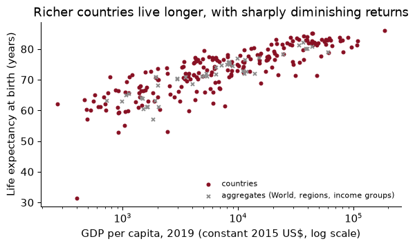

Across 208 countries, each doubling of income per head goes with about 3.2 more years of life expectancy (the slope of life expectancy on log income, times log 2). The curve is concave in levels, which is why the x-axis is on a log scale: an extra \$1,000 matters enormously in a poor country and barely at all in a rich one. Preston’s own point was that the curve *shifts up* over time, so that a country at a given income lives longer today than it would have decades ago, which says that health depends on more than income.

Notice the grey crosses. The “all countries” endpoint also returns 48 **aggregates**: “World”, “Euro area”, “Low income”, “Sub-Saharan Africa”. If you regress on them along with the countries you have counted China, East Asia and the world all as separate observations. The API’s `/country` endpoint labels each code with its region, and aggregates have the region “Aggregates”; we keep only real countries.

### Worked example — how many requests?

You want every country’s GDP per capita for every year from 1960 to 2023 (64 years, about 266 country codes including aggregates). How many requests does that take at 100 records per page? At 1,000? Why does the difference matter?

### Solution

There are about $266 \times 64 \approx 17{,}000$ records. At 100 per page that is about 170 requests; at 1,000 per page, about 17. Fewer, larger requests are faster (each request has a fixed cost of a round trip to the server), kinder to the server, and less likely to run into a **rate limit**, the cap most APIs put on requests per second or per day. Ask for as much as the API allows per call.

## FRED, and APIs with keys

The Federal Reserve Bank of St. Louis’s FRED database has more than 800,000 US and international time series. For quick work it offers any series as a CSV at a stable address, no key needed:

``` python
r = cached_get("https://fred.stlouisfed.org/graph/fredgraph.csv", params={"id": "UNRATE,CPIAUCSL"})
fred = pd.read_csv(io.StringIO(r["text"]), parse_dates=["observation_date"], index_col="observation_date")
fred["inflation"] = 100 * fred["CPIAUCSL"].pct_change(12)
fred = fred.loc["1960":].dropna()
```

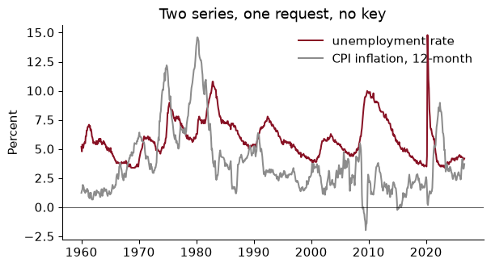

The file runs through September 2026, when unemployment was 4.2% and inflation over the previous twelve months 3.7%. (This copy was downloaded on 2026-10-23; FRED updates as new data are released, which is exactly why you record the date.)

The CSV route gives you the latest numbers. The full **FRED API** gives you much more: search, metadata, release calendars, and **vintages**, the data as they were first published before revisions. If you are evaluating a forecast made in 2008, you need GDP as forecasters saw it in 2008, not as it has since been revised. The API needs a free **key**, and so do the Census, BLS and BEA APIs.

### Keys are passwords

An API key identifies you to the provider so it can enforce limits and, for paid services, bill you. Treat it as a password: anyone who has it can use your quota or run up your bill. Programs scan public GitHub repositories for leaked keys, and find them within minutes.

**A key never goes in your code, your notebook or your repository.** It goes in an **environment variable**, set outside the code, which your code reads:

``` python
import os
key = os.environ.get("FRED_API_KEY")          # None if it is not set
r = session.get("https://api.stlouisfed.org/fred/series/observations",
                params={"series_id": "GDPC1", "api_key": key, "file_type": "json",
                        "observation_start": "2000-01-01"}, timeout=30)
obs = pd.DataFrame(r.json()["observations"])
obs["value"] = pd.to_numeric(obs["value"], errors="coerce")   # FRED writes missing as "."
```

(That block is shown but not run when the book is built, because it needs my key.) You set the variable in the terminal, `export FRED_API_KEY="..."`, or, more conveniently, in a file called `.env` in the project folder, which the `python-dotenv` package reads with `load_dotenv()`. The `.env` file goes in `.gitignore` **before** you create it, and you commit a `.env.example` with fake values so that a collaborator knows which keys to get. Notice the last line, too: FRED’s API marks a missing observation with the string `"."`, another disguise for missingness from Chapter 4.

### Worked example — I pushed my key

You notice that last week you committed a notebook containing your Census API key, and pushed it to GitHub. You delete the cell and push again. Are you safe?

### Solution

No. Git keeps history: the key is still in last week’s commit, visible to anyone who looks (Chapter 3). And bots may have copied it within minutes of the push. The only fix is to **revoke the key** on the provider’s website and generate a new one, then put the new one in `.env`. Rewriting the repository’s history is a good second step, but it cannot un-leak a key that has already been copied. Revoke first.

## Being a good citizen

A server is someone else’s computer. Three habits keep you welcome on it and keep your project reproducible.

**Rate limits.** Most APIs cap requests: FRED’s API allows 120 a minute; the Census API allows 500 a day without a key. Exceed the limit and you get a 429, or a silent block. Sleep between requests (`time.sleep(0.2)` in `wb_get`), and ask for more per request.

**Retries with backoff.** Servers fail temporarily. Rather than crash, retry, waiting longer each time: 1 second, then 2, then 4. This is **exponential backoff**, and `requests` can do it for you when you mount a retry policy on a session:

``` python
session = requests.Session()
session.headers.update({"User-Agent": "ECON368-course-book (educational use)"})
session.mount("https://", HTTPAdapter(max_retries=Retry(
    total=4, backoff_factor=1, status_forcelist=[429, 500, 502, 503, 504])))
```

The session also sends a `User-Agent` header saying who you are. Some servers require one (Wikipedia and the SEC’s EDGAR do), and it is simply polite.

**Caching.** Never download the same thing twice. Every request in this chapter has gone through this function, defined when the chapter starts:

``` python
def cached_get(url, params=None, keep_errors=False):
    """GET url once and save status, date and body in ../data/web; reuse the file afterwards."""
    key = hashlib.md5((url + json.dumps(params, sort_keys=True)).encode()).hexdigest()[:16]
    f = CACHE / f"{key}.json"
    if f.exists():
        return json.loads(f.read_text())
    r = session.get(url, params=params, timeout=30)
    if "charset" not in r.headers.get("Content-Type", ""):
        r.encoding = "utf-8"                     # e.g. so that "£" decodes correctly
    out = {"url": r.url, "status": r.status_code, "type": r.headers.get("Content-Type", ""),
           "fetched": str(dt.date.today()), "text": r.text}
    if r.ok or keep_errors:                      # never cache a failure by accident
        f.write_text(json.dumps(out))
    time.sleep(0.5)                              # a pause after every real request
    return out
```

It turns the URL and parameters into a file name, and if that file exists it returns the saved response without touching the network. After a real request it pauses half a second, so that a loop over fifty pages does not hammer the server. It records the date of download, because a web source is not a fixed object: the same request next month can return different numbers. And it refuses to save a failure, so that an outage does not get frozen into your data. After building this chapter once, the cache holds 83 responses, and rebuilding makes no requests at all. That is the reproducibility rule of Chapter 3 applied to the web: **raw data are saved, dated and never edited**, and the analysis runs from the saved copy whether or not the server is up. (The `requests-cache` package does the same thing with less code.)

### Worked example — the `timeout`

Every request in this chapter passes `timeout=30`. What happens without it?

### Solution

`requests` waits forever. If a server accepts the connection and then never answers, which happens more than you would think, your script hangs with no error and no output, and you find it still “running” the next morning. A timeout turns a hang into an exception that your retry policy, or you, can deal with. (While I was writing this chapter, FRED’s CSV endpoint sometimes took more than a minute to respond and sometimes answered in under a second. The timeout and the retries are what make that survivable; the cache is what makes it irrelevant.)

## Scraping a web page

When there is no API, there is the page itself. A web page is **HTML**, a tree of nested elements, each written as a tag with attributes and content:

``` python
html = """
<div class="product" data-sku="101">
  <h2 class="name">Milk, 1 gal</h2> <span class="price">$4.29</span>
</div>
<div class="product sale" data-sku="102">
  <h2 class="name">Eggs, dozen</h2> <span class="price">$3.49</span>
</div>"""
soup = BeautifulSoup(html, "html.parser")
```

The browser turns this text into a tree called the DOM. Each element has a tag name (`div`, `h2`, `span`), and most have **attributes**: `class` (shared by elements styled the same way), `id` (unique on the page), `href` for links, and `data-*` for anything the site wants to store.

To pick elements out of the tree we use **CSS selectors**, the language web designers use to say which elements get which style. Scrapers borrow it to say which elements to extract:

| Selector             | Matches                                        |
|----------------------|------------------------------------------------|
| `span`               | every `<span>`                                 |
| `.price`             | every element with class `price`               |
| `#title`             | the element with `id="title"`                  |
| `div.product`        | `<div>` elements with class `product`          |
| `div.product .price` | a `.price` anywhere inside a `div.product`     |
| `li.next > a`        | an `<a>` that is a *direct* child of `li.next` |
| `.product.sale`      | elements with both classes                     |

BeautifulSoup’s `select` returns every match and `select_one` the first. The pattern that works on almost every page: **select the repeating container** (one per record), then select each field *inside* it, so the fields of one record stay together even when one is missing.

``` python
items = pd.DataFrame([{"sku": p["data-sku"],
                       "name": p.select_one(".name").get_text(strip=True),
                       "price": float(p.select_one(".price").get_text().lstrip("$")),
                       "on_sale": "sale" in p["class"]}
                      for p in soup.select("div.product")])
items
```

<div>
<style scoped>
    .dataframe tbody tr th:only-of-type {
        vertical-align: middle;
    }
&#10;    .dataframe tbody tr th {
        vertical-align: top;
    }
&#10;    .dataframe thead th {
        text-align: right;
    }
</style>

|     | sku | name        | price | on_sale |
|-----|-----|-------------|-------|---------|
| 0   | 101 | Milk, 1 gal | 4.29  | False   |
| 1   | 102 | Eggs, dozen | 3.49  | True    |

</div>

To find the right selectors on a real page, right-click the thing you want in your browser and choose **Inspect**. The developer tools show its HTML; look for a stable class or id near it. Prefer meaningful selectors (`article.product_pod`) to positional ones (`body > div:nth-child(3) > span`), which break the first time the site moves a box.

### A mini price index

`books.toscrape.com` is a fake bookshop built for practising exactly this. Each catalogue page lists 20 books inside `article.product_pod` containers, and a “next” button (`li.next > a`) links to the following page. A scraper follows that link until there is none:

``` python
def scrape_books(start="page-1.html", max_pages=60):
    rows, url = [], BOOKS + start
    for _ in range(max_pages):                              # a hard cap, in case "next" loops
        soup = BeautifulSoup(cached_get(url)["text"], "html.parser")
        for b in soup.select("article.product_pod"):
            rows.append({"title": b.select_one("h3 > a")["title"],
                         "price": b.select_one("p.price_color").get_text(),
                         "rating": b.select_one("p.star-rating")["class"][1],
                         "stock": b.select_one("p.availability").get_text(strip=True)})
        nxt = soup.select_one("li.next > a")
        if nxt is None:                                     # the last page
            break
        url = requests.compat.urljoin(url, nxt["href"])     # relative link -> full URL
    return pd.DataFrame(rows)
```

It visits 50 pages and returns 1,000 books. Every field is a **string**: prices look like ‘£51.77’, the star rating is hidden in a class name (`star-rating Three`), and availability is a sentence. Cleaning them is Chapter 4 again, plus a regular expression:

``` python
stars = {"One": 1, "Two": 2, "Three": 3, "Four": 4, "Five": 5}
books = books.assign(price=books["price"].str.extract(r"(\d+\.\d+)")[0].astype(float),
                     stars=books["rating"].map(stars),
                     in_stock=books["stock"].str.contains("In stock"))
by_star = books.groupby("stars")["price"].agg(["mean", "median", "size"]).round(2)
```

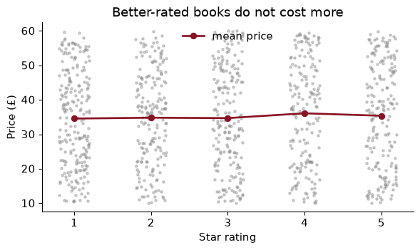

The mean price is £34.56 for one-star books and £35.37 for five-star ones, and the correlation between rating and price is 0.03. On a real retailer you would expect quality and price to be related; on a practice site whose prices were generated at random, they are not. Either way the point stands: a scraped number is only as good as your understanding of how the site produced it. Before treating a scraped price as a price, a researcher does what Cavallo did and validates it against an independent source.

### Worked example — the record that has no price

Suppose one book on a page had no `p.price_color` element (out of print, say). What happens to the scraper above, and what would have happened if you had scraped all the titles with one `select` and all the prices with another, then put the two lists side by side?

### Solution

In the container-first scraper, `b.select_one("p.price_color")` returns `None` and `.get_text()` raises an `AttributeError`, so the scrape stops on that book: loud, and easy to fix by checking for `None` and recording a missing price. In the two-lists version, the price list is one shorter than the title list, and every price after the missing one is attached to the wrong book. If the lengths happened to match up again (another book with a missing title), nothing would complain at all. This is why you select the container first: a missing field becomes a missing value in the right row, not a silent shift of every row below it.

## Tables the easy way

Much of what economists want from a web page is already a table. `pandas.read_html` finds every `<table>` element in a page and returns each one as a DataFrame. Wikipedia’s list of state minimum wages is a good example: `read_html` with `match="State"` returns the 6 tables on the page that contain the word “State”.

``` python
wiki = cached_get("https://en.wikipedia.org/wiki/List_of_US_states_by_minimum_wage")
tables = pd.read_html(io.StringIO(wiki["text"]), match="State")
```

Fetch the page yourself rather than passing the URL to `read_html`. Wikipedia refuses requests without a `User-Agent`, and fetching it yourself lets you set headers, a timeout and a cache. Wikipedia pages also change whenever someone edits them, which is the strongest reason to save the raw HTML with its date: this copy was fetched on 2026-10-23.

The tables arrive messy, in a way that is typical of scraped tables. Each table has states down the side and two or three years across the top, so it is wide; the year headers carry footnote markers such as `2024[1][4]`; state names carry asterisks; and the cells are strings like ‘\$14.00 (effective July 1, 2026)’. A `tidy` function melts each table to long form and uses regular expressions to pull out the four-digit year and the dollar amount:

``` python
def tidy(t):
    t = t.rename(columns={t.columns[0]: "state"})
    long = t.melt(id_vars="state", var_name="year", value_name="raw")
    long["year"] = long["year"].astype(str).str.extract(r"(\d{4})")[0].astype(int)
    long["min_wage"] = long["raw"].astype(str).str.extract(r"\$(\d+\.\d+)")[0].astype(float)
    long["state"] = long["state"].str.replace(r"[^A-Za-z .]", "", regex=True).str.strip()
    return long[["state", "year", "min_wage", "raw"]]
```

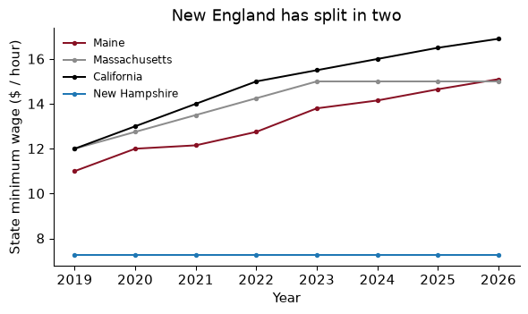

The result is a state-by-year panel from 2019 to 2026. Maine’s minimum wage rose from \$11.00 to \$15.10, while next door New Hampshire stayed at the federal \$7.25, as do 20 states in 2026. Variation like this, across neighbouring states and over time, is the raw material of the large empirical literature on the employment effects of minimum wages.

### Worked example — what the regex threw away

7 cells in the scraped panel contained parentheses, like the Alaska cell above. What information did the `tidy` function discard, and does it matter?

### Solution

``` python
print(mw.loc[mw["raw"].str.contains(r"\(", regex=True), "raw"].drop_duplicates().head(4).tolist())
```

    ['$14.00 (effective July 1, 2026)', '$16.90 (Wage by city in California)', '$15.00 (effective Sept. 30, 2026)', '$17.00 (New York City, Long Island and Westchester) $16.00 (Rest of the state)']

The regex keeps the first dollar amount and drops everything else: effective dates (“effective July 1”), notes that cities set higher wages, and sometimes a second rate for part of the state (New York City and its suburbs against the rest of New York). For a picture of the trend, that is fine. For research it is not: a wage that takes effect on July 1 is in force for half the year, and a study of teenage employment in California that uses the state rate ignores the higher city rates where many teenagers work. The scrape is a good way to check an authoritative source (the Department of Labor’s tables, or Vaghul and Zipperer’s research data set of state and local minimum wages). It is not a substitute for one.

## The rules of the road

Being able to download a page does not mean you may. There are three layers of rules, and a researcher has to respect all of them.

**What the site asks.** Most sites publish a file called `robots.txt` at their root, listing the paths that automated programs should not visit and sometimes how long to wait between requests. Python’s `urllib.robotparser` reads it:

``` python
rp = RobotFileParser()
rp.parse(cached_get("https://en.wikipedia.org/robots.txt")["text"].splitlines())
rp.can_fetch(ua, "https://en.wikipedia.org/wiki/Minimum_wage")
```

For Wikipedia, `/wiki/Minimum_wage` is allowed, `/wiki/Special:Random` is not allowed, and the search page is not allowed. `books.toscrape.com` has no `robots.txt` at all (the request returns 404), which means it states no restrictions; the site exists to be scraped. `robots.txt` is not a law, but ignoring it is bad practice and, if a dispute ever arises, evidence of bad faith. Read the site’s **terms of service** too: many prohibit scraping outright.

**What the law says.** I am not a lawyer and this is not legal advice, but the broad US picture is this. The Computer Fraud and Abuse Act makes it a crime to access a computer “without authorization”; *Van Buren v. United States* (2021) read that narrowly, and in *hiQ Labs v. LinkedIn* the Ninth Circuit suggested that scraping pages anyone can see without logging in is unlikely to violate it, though hiQ ultimately lost on breach of LinkedIn’s terms. Facts are not copyrightable, but text, photos and the creative selection of a database can be, so republishing what you scrape is riskier than analysing it. Logins, paywalls and CAPTCHAs are the site saying no, and getting around them is where scraping turns from research into trespass.

**What ethics requires.** Data about people raise questions that data about books do not. Names, profiles, photos and posts may be public and still be personal; privacy law (Europe’s GDPR, California’s CCPA) may apply; and a research project that collects them will usually need review by your college’s institutional review board. Collect only what the question needs, and think about who could be hurt if the data leaked.

> Look for an API or a bulk download first. Read `robots.txt` and the terms. Identify yourself, go slowly, cache everything, collect only what you need, and never get around a login.

### Worked example — should you scrape it?

For each, say whether you would scrape, and why. **(a)** Daily prices of 500 grocery products from a supermarket’s public website, to build a local price index. **(b)** Every public post by Maine state legislators on a social network, which requires logging in to view. **(c)** Rental listings from a site whose terms forbid automated access, when the site also sells the same data to researchers.

### Solution

**(a)** Probably yes, carefully: public pages, prices are facts, no personal data, and it is the Billion Prices recipe. Check `robots.txt` and the terms, scrape once a day at a slow rate, cache, and validate your index against the official CPI for the region.

**(b)** Not by scraping. Content behind a login is the clearest “no”, and the posts are personal data even though their authors are public figures. Look for the platform’s research API or an archive that has permission, and talk to your IRB.

**(c)** No. The terms forbid it, and the owner offers a legitimate route. Ask for the data, or for an academic licence; many firms will say yes to a student who asks politely.

## In Python

The chapter’s pipeline end to end: a cached, retrying session; a paginated API call; a keyless CSV; a scrape that follows “next” links; and a table read from a web page.

``` python
import io, json, time, hashlib, datetime as dt
from pathlib import Path
import pandas as pd, requests
from bs4 import BeautifulSoup

CACHE = Path("../data/web"); CACHE.mkdir(parents=True, exist_ok=True)
# `session` (User-Agent, retries) and `cached_get` are as defined in "Being a good citizen".
```

A World Bank indicator for every country, every page, aggregates removed.

``` python
school, meta = wb_get("SE.SEC.ENRR", date="2019")          # secondary school enrolment, gross %
school = school[school["countryiso3code"].isin(real)].dropna(subset=["value"])
print(f"{meta['pages']} pages, {len(school)} countries with data")
```

    3 pages, 141 countries with data

FRED without a key, and a scrape of the whole catalogue.

``` python
fred = pd.read_csv(io.StringIO(cached_get("https://fred.stlouisfed.org/graph/fredgraph.csv",
                                          params={"id": "UNRATE,CPIAUCSL"})["text"]),
                   parse_dates=["observation_date"], index_col="observation_date")
books = scrape_books().assign(price=lambda d: d["price"].str.extract(r"(\d+\.\d+)")[0].astype(float))
assert len(books) == 1000 and books["price"].notna().all(), "the scrape did not get every book"
print(f"FRED to {fred.index.max():%Y-%m}; {len(books):,} books, median price £{books['price'].median():.2f}")
```

    FRED to 2026-09; 1,000 books, median price £35.98

## What goes wrong

**Trusting a 200.** The World Bank returns “OK” with an error message for an indicator that does not exist. Check the status *and* the content: `raise_for_status()`, then an `assert` that you got rows.

**Forgetting pagination.** You get the first page, 50 or 100 records, and a perfectly plausible DataFrame. Read the metadata, loop until `page >= pages`, and check the row count against `total`.

**Keeping aggregates.** “All countries” includes “World”, regions and income groups. Filter them out before you count, average or regress.

**Committing an API key.** It is in your Git history forever. Use environment variables or `.env`, put `.env` in `.gitignore` first, and if a key leaks, revoke it.

**Re-downloading on every run.** It is slow, it is rude to the server, and it makes your results depend on whether a website is up today and what it says today. Cache raw responses with the date, and run the analysis from the cache.

**Scraping fields separately, or positionally.** Lists of titles and prices built by separate selects drift out of alignment the moment one record lacks a field; positional selectors break at the first redesign. Select the container, then the fields within it, with meaningful class names.

## Exercises

1.  Explain the difference between a 403 and a 429 status code, and what your code should do on receiving each.

2.  Use `wb_get` to download GDP per capita for the United States, China and India (`countries="USA;CHN;IND"`) for 1990–2023 and plot the three series on a log scale. Which grew fastest?

3.  Request the World Bank indicator for life expectancy with `per_page=50` instead of 100. How many pages does the metadata report? Check that `wb_get` returns the same number of rows either way.

4.  Re-draw the Preston curve, adding a fitted line of life expectancy on log GDP per capita. Which three countries lie furthest *below* the line, living shortest for their income?

5.  From the scraped books, compute the share in stock and the mean price by star rating. Then explain why “the site’s prices are uncorrelated with ratings” is a statement about the site, not about books.

6.  Using the scraped minimum-wage panel, list the states whose minimum wage rose by more than \$3 an hour between the first and last year in the table. Which region are they in?

7.  Write a function `polite_get(url, last={})` that ensures at least one second passes between any two calls it makes, no matter where in your code they come from. (Hint: store the time of the last call.)

8.  In two or three sentences: what is the representativeness problem with online prices as a measure of inflation, and how did Cavallo address it?

### Answers

**1.** A **403** means “forbidden”: the server understood you and refuses, perhaps because your key is wrong, you lack permission, or you have been blocked. Retrying will not help; fix the key or stop. A **429** means “too many requests”: you are allowed, just not this fast. Wait (respect the `Retry-After` header if there is one) and retry with backoff, and slow your requests down. That is why `status_forcelist` in our retry policy includes 429 but not 403.

**2.**

``` python
three, _ = wb_get("NY.GDP.PCAP.KD", countries="USA;CHN;IND", date="1990:2023")
three = three.assign(year=lambda d: d["date"].astype(int)).dropna(subset=["value"])
growth = (three.sort_values("year").groupby("country.value")["value"]
               .agg(lambda s: (s.iloc[-1] / s.iloc[0]) ** (1 / (len(s) - 1)) - 1))
fig, ax = plt.subplots()
for (c, d), col in zip(three.groupby("country.value"), [GARNET, GREY, BLUE]):
    ax.plot(d["year"], d["value"], color=col, label=c)
ax.set_yscale("log"); ax.set(xlabel="Year", ylabel="GDP per capita (2015 US$, log)")
ax.legend(frameon=False); plt.show()
```

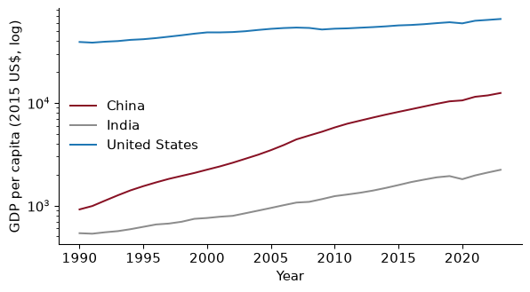

Average annual growth of GDP per capita over the period: China 8.2%, India 4.4%, United States 1.6%. China’s line is the steepest, which on a log scale means the fastest growth rate, even though the United States remains far richer in levels.

**3.**

``` python
life50, meta50 = wb_get("SP.DYN.LE00.IN", date="2019", per_page=50)
```

With 50 records a page the metadata reports 6 pages; with 100, 3. Both return 266 rows, as they must: the page size changes the number of requests, not the data. If they had differed, the loop would have a bug at the last page.

**4.**

``` python
b1, b0 = np.polyfit(np.log(pc_real["value_gdp"]), pc_real["value_le"], 1)
pc4 = pc_real.assign(resid=lambda d: d["value_le"] - (b0 + b1 * np.log(d["value_gdp"])))
worst = pc4.nsmallest(3, "resid")[["country.value", "value_gdp", "value_le", "resid"]]
print(worst.round(1).to_string(index=False))
```

               country.value  value_gdp  value_le  resid
    Central African Republic      401.8      31.5  -28.3
                     Nigeria     2431.5      53.0  -15.1
                      Naoero     7687.2      61.4  -11.9

The three countries furthest below the line are Central African Republic, Nigeria, Naoero (the last is the World Bank’s spelling of Nauru), living between 12 and 28 years less than the curve predicts for their income. Each has a story that income does not capture: decades of conflict in the Central African Republic; in Nigeria, oil revenue that raises national income far more than it raises what most households live on, and high child mortality; in Nauru, a phosphate-mining fortune and some of the world’s highest rates of obesity and diabetes. The Preston curve is a description of the typical relationship; the residuals are where the interesting economics is.

**5.**

``` python
b5 = scrape_books().assign(stars=lambda d: d["rating"].map(stars),
                           price=lambda d: d["price"].str.extract(r"(\d+\.\d+)")[0].astype(float),
                           in_stock=lambda d: d["stock"].str.contains("In stock"))
print(b5.groupby("stars").agg(in_stock=("in_stock", "mean"), mean_price=("price", "mean")).round(2).to_string())
```

           in_stock  mean_price
    stars                      
    1           1.0       34.56
    2           1.0       34.81
    3           1.0       34.69
    4           1.0       36.09
    5           1.0       35.37

All 1,000 books on the catalogue pages are listed as in stock (100%), and mean prices barely vary with the rating. Both facts describe how a practice site was built (prices and ratings assigned without any market behind them), not how books are priced. Scraped data inherit the process that produced the page, which is why you validate before you interpret.

**6.**

``` python
rise = (mw.pivot(index="state", columns="year", values="min_wage")
          .assign(change=lambda d: d[latest_year] - d[first_year])
          .query("change > 3").sort_values("change", ascending=False))
print(rise["change"].round(2).to_dict())
```

    {'Florida': 6.54, 'Missouri': 6.4, 'Delaware': 6.25, 'Nebraska': 6.0, 'Connecticut': 5.94, 'New Jersey': 5.92, 'Hawaii': 5.9, 'New York': 5.9, 'Illinois': 5.75, 'Virginia': 5.52, 'Rhode Island': 5.5, 'Washington': 5.13, 'Oregon': 5.05, 'Maryland': 4.9, 'California': 4.9, 'New Mexico': 4.5, 'Michigan': 4.28, 'Arizona': 4.15, 'Alaska': 4.11, 'Maine': 4.1, 'Colorado': 4.06, 'Washington D.C.': 3.95, 'Nevada': 3.75, 'Vermont': 3.64}

24 jurisdictions (D.C. is in the table) raised their minimum wage by more than \$3 between 2019 and 2026. The four largest increases were in Florida, Missouri, Delaware, Nebraska. That is not the list most people would guess, and the explanation is political: Florida, Missouri and Nebraska raised their wages by ballot measure, voted on directly, rather than through the legislature. The rest are mostly in the Northeast and the West. The states that stayed at \$7.25 are mostly in the South and the Plains.

**7.**

``` python
def polite_get(url, last={"t": 0.0}, gap=1.0, **kwargs):
    """requests.get, but never more than once per `gap` seconds."""
    wait = last["t"] + gap - time.monotonic()
    if wait > 0:
        time.sleep(wait)
    last["t"] = time.monotonic()
    return session.get(url, timeout=30, **kwargs)
```

The default argument `last` is a single dictionary shared by every call (a Python quirk that is usually a bug, and here is exactly what we want), so it remembers when the previous request was made. `time.monotonic()` is used rather than the wall clock because it never jumps backwards when the computer’s clock is adjusted.

**8.** Online prices cover only products and retailers that sell online, which in the 2000s skewed towards some categories (electronics, groceries at big chains) and away from others (services, housing, small shops), so an online index could track a different basket from the CPI. Cavallo addressed it by validating: scraping retailers that sell both online and offline, collecting in-store prices for the same products at the same time, and showing that they were identical about 72% of the time. Housing and services are still largely missing, so online price indices are best seen as a fast, high-frequency complement to the official CPI, not a replacement.

**Reading.** McKinney, *Python for Data Analysis*, 3rd ed. (2022), ch. 6, for JSON, HTML tables and web APIs. Mitchell, *Web Scraping with Python*, 3rd ed. (2024), for scraping in depth, including JavaScript pages. Cavallo and Rigobon (2016), “The Billion Prices Project”, *Journal of Economic Perspectives*; Cavallo (2017), “Are Online and Offline Prices Similar?”, *American Economic Review*; Edelman (2012), “Using Internet Data for Economic Research”, *Journal of Economic Perspectives*.


# Chapter 7 — A/B tests

> **The question:** a mobile game makes new players stop and wait (or pay) when they reach level 30. Would moving that gate to level 40 keep more of them playing a week later?

## A coin flip and a counterfactual

*Cookie Cats* is a puzzle game for phones. Like many free games, it has **gates**: at certain levels the player must either wait a while or pay to continue. A gate is a small piece of economic design. It slows down players who are burning through the content, it nudges some of them to spend money, and it may annoy others into deleting the game. The developer’s question is where to put the first one.

Suppose you looked at existing data and found that players who got past level 40 were much more likely to still be playing a week later. Would that tell you anything about where to put the gate? Almost nothing. Players who get far are the keen ones, and keen players come back. The comparison mixes the effect of the game’s design with the effect of who chose to keep playing.

The clean way to say this uses **potential outcomes**. Each player $i$ has two outcomes we could in principle see: $Y_i(1)$, whether she is still playing after a week if her gate is at level 40, and $Y_i(0)$, the same if it is at level 30. The effect of the gate on her is $Y_i(1) - Y_i(0)$. We only ever see one of the two, which is why causal inference is hard. Compare people who happened to get one version with people who happened to get the other, and

$$\text{observed gap} = \text{average effect} + \underbrace{\text{how different the two groups were anyway}}_{\text{selection bias}}$$

A **randomized experiment** kills the second term. If a coin flip decides which version each player gets, the two groups are alike, on average, in everything: keenness, phone, country, mood. Then the simple difference in average outcomes estimates the **average treatment effect** (ATE), the average of $Y_i(1) - Y_i(0)$ across players. No control variables are needed, and none could do as well, because a coin flip balances the things you cannot measure too.

This is the only chapter in the book that is mainly about causation. Everything from Chapter 9 on is about prediction. But firms run experiments on a scale that would make any development economist envious. Microsoft, Amazon, Booking and Netflix run thousands a year, and their name for a randomized experiment is an **A/B test**: version A is the control, version B the treatment. Economists use the same design to study Medicaid (the Oregon lottery), job-search assistance, and the prices firms charge. The logic is identical; only the vocabulary differs.

> A coin flip does not make the groups identical. It makes them *different only by chance*, and chance is something we know how to measure.

### Worked example — the keen player fallacy

Among players with the gate at level 30, those who played at least 40 rounds in their first two weeks came back on day 7 at a rate of 50%; those who played fewer came back at 5%. A product manager concludes that “getting players to 40 rounds” would raise day-7 retention by about 45 percentage points. What is wrong?

### Solution

Two things. First, selection: players who play 40 rounds are the ones who like the game, and they would have come back on day 7 whatever we did. The gap is almost entirely the second term of the equation above. Second, rounds played is *itself* an outcome, measured over the same two weeks as the return visit. Playing a lot and coming back are two symptoms of the same enthusiasm, not cause and effect. If you want to know what moving the gate does, you randomize the gate. Which is exactly what the developer did.

## Designing the experiment

Before anyone flips a coin, three decisions have to be written down.

**The unit of randomization** is the thing that gets the coin flip. In Cookie Cats it is the player: each new install was assigned to `gate_30` (control) or `gate_40` (treatment) and kept that version. Other choices are common:

| Unit | Example | Watch out for |
|----|----|----|
| User (logged-in ID) | a new recommendation algorithm | the default; consistent experience across visits |
| Cookie or device | logged-out visitors | one person on two devices gets both versions |
| Page view | search ranking | users see both versions, so effects leak between them |
| Cluster (city, store) | delivery fees, driver pay | few units, so much less precision |
| Time period (switchback) | a surge-pricing algorithm | carry-over from one period to the next |

The rule of thumb: **randomize at the level where spillovers stop, and analyse at the level you randomized.** If you randomize cities, your sample size is the number of cities, not the number of riders.

Platforms do not flip coins live. They pass the user ID, combined with the experiment’s name, through a **hash function**, a scrambler that turns any text into a random-looking but repeatable number. The same player always gets the same version, and adding the experiment’s name keeps two experiments running at once independent of each other.

``` python
import hashlib

def assign(user_id, experiment, p_treat=0.5):
    h = hashlib.md5(f"{experiment}:{user_id}".encode()).hexdigest()
    return int(int(h[:8], 16) / 16**8 < p_treat)       # first 8 hex digits -> [0, 1)

print([assign(u, "gate_test") for u in [116, 337, 377, 483, 488]])
```

    [0, 1, 1, 0, 0]

**The metric.** Experienced teams pick one **overall evaluation criterion** (OEC), the metric the launch decision rests on, and they pick it before they see any data. It should track long-run value. For a free game that earns money from engaged players, `retention_7` (did the player open the game seven days after installing?) is a sensible OEC: it is closer to “will this player stick around” than anything measured on day one.

**Guardrails** are metrics that must not get worse even if the OEC improves: crash rates, page load time, refunds, complaints. A new checkout page that raises revenue by crashing on old phones is not a win. The data we have for Cookie Cats contain three outcomes, `retention_1`, `retention_7` and `sum_gamerounds` (rounds played in the first 14 days), so here the guardrail role falls on engagement: moving the gate later should not make people play less.

### Worked example — choosing the unit

For each experiment, choose the unit of randomization. **(a)** A news site tests a new headline font. **(b)** A ride-hailing firm tests a higher pay rate for drivers. **(c)** A supermarket chain tests a new shelf layout.

### Solution

**(a)** The user (or the cookie, for logged-out readers). A font affects only the person reading it, and you want each reader to see one version consistently.

**(b)** Not the driver. Drivers paid more will work more hours and take rides that control drivers would have taken, so the control group is hurt by the treatment and the comparison overstates the effect. Randomize whole cities, or alternate the pay rate over time within a city (a switchback).

**(c)** The store. You cannot show one shopper a different shelf from the one beside her. With, say, 40 stores you have 40 units, and the power calculation later in the chapter will be sobering.

## Check the plumbing first: sample ratio mismatch

Before looking at any outcome, check that the experiment ran as designed. The Cookie Cats split was meant to be 50/50. Here is what we got:

``` python
print(cc["version"].value_counts())
```

    version
    gate_40    45489
    gate_30    44700
    Name: count, dtype: int64

That is 45,489 players at level 40 and 44,700 at level 30, a gap of 789 players, or 50.44% in the treatment group. It looks like a rounding error. Is it?

A fair coin tossed 90,189 times does not give exactly half heads, but it gets very close. A **chi-squared test** compares observed counts with the counts the design implies:

``` python
stats.chisquare([n40, n30], [n_all / 2, n_all / 2])
```

    Power_divergenceResult(statistic=np.float64(6.9024049496058275), pvalue=np.float64(0.008607987810836243))

The $p$-value is 0.0086. If assignment really were a fair coin, a split this lopsided would happen less than once in a hundred experiments. This is a **sample ratio mismatch** (SRM), and it is a real one, in a famous teaching data set that most tutorials analyse without mentioning it.

Why does a small imbalance in *counts* matter so much? Because a coin cannot produce it, something else did, and that something may also be correlated with the outcome. Common causes in practice:

- **Logging.** A player is counted only when the game reports back. If one version’s reporting code fails on some phones or app versions, those players vanish from one arm only.
- **When a player enters the data.** If a player is recorded when she reaches some point in the game, and the versions differ before that point, the two arms contain different kinds of players.
- **Filtering.** Bots, test accounts or duplicates removed by a rule that treats the arms differently.
- **Redirects and crashes.** The treatment crashes on launch for some users, who are never logged as having played.

Each of these breaks the guarantee that made the experiment worth running: the two groups may no longer be comparable. The standard advice, from teams that run thousands of experiments, is blunt. **An SRM means stop and debug before you trust any result.** We do not have the developer’s logging code, so we cannot find the bug. What we can do is carry the warning into every conclusion below, and you will see that I do.

### Worked example — slicing on the outcome

Hunting for the SRM’s source, a colleague counts players in each arm by the number of rounds they played:

    version         gate_30  gate_40  share at 40
    sum_gamerounds                               
    0                  1937     2057        0.515
    1–5               10119    10604        0.512
    6–20              12428    12657        0.505
    21–30              3858     3902        0.503
    31–40              3070     2669        0.465
    41–100             7193     7310        0.504
    100+               6095     6290        0.508

She points out that among players with 31–40 rounds only 46.5% are in the level-40 group, and says she has found the bug. Has she?

### Solution

No. Rounds played is an outcome of the experiment. Players whose gate is at level 30 hit it around then and many stop, so they pile up in the 31–40 bin; players with the gate at 40 keep going past it. That table shows the *treatment working*, not a logging fault. Slicing an SRM by a post-treatment variable mixes the two up. The places to look are things fixed before assignment: install date, app version, device, country. Our data contain none of those, which is precisely why we cannot diagnose this SRM, only report it.

## The difference in means and its standard error

With randomization doing the hard work, the estimate is the obvious one: the average outcome in the treatment group minus the average in the control group. The question that takes some thought is how much that gap would bounce around if we reran the experiment with a fresh coin. That is its **standard error**:

$$\hat\tau = \bar Y_{1} - \bar Y_{0}, \qquad SE(\hat\tau) = \sqrt{\frac{s_1^2}{n_1} + \frac{s_0^2}{n_0}}$$

where $s_1^2$ and $s_0^2$ are the sample variances of the outcome in each group. Each group mean has its own sampling noise, $s^2/n$; the two groups are independent, so the variances add. You met this formula in intro statistics. Here is the whole of it as a function:

``` python
def diff_in_means(y, d):
    y1, y0 = y[d == 1], y[d == 0]
    est = y1.mean() - y0.mean()
    se = np.sqrt(y1.var(ddof=1) / len(y1) + y0.var(ddof=1) / len(y0))
    return est, se
```

For day-7 retention, 19.02% of control players came back, against 18.20% of treated players. The estimate is **-0.82 percentage points**, with a standard error of 0.26 points. A 95% confidence interval is the estimate plus or minus about two standard errors: from -1.33 to -0.31 points. The whole interval is below zero. Moving the gate *later* made players *less* likely to come back.

That surprises most people, so it is worth an economic story. A gate is a forced break. A player who is made to stop at level 30 may come back to it the next day; a player allowed to binge to level 40 may get bored sooner. Whatever the mechanism, the experiment answers the question it was designed to answer, and the answer is “keep the gate at 30”, with the SRM caveat attached.

Report the relative change too. A drop of 0.82 points on a base of 19.0% is a 4.3% fall in the number of players still around after a week. For a game with millions of installs, that is a lot of players.

### Worked example — the standard error by hand

For a 0/1 outcome the variance has a simple form, $s^2 = \hat p(1-\hat p)$ (to a very close approximation). Using only the two retention rates and the two group sizes, compute the standard error of the day-7 difference.

### Solution

- treatment: $\hat p(1-\hat p) =$ 0.1820 × 0.8180 = 0.1489, divided by 45,489
- control: 0.1902 × 0.8098 = 0.1540, divided by 44,700
- add the two and take the square root: 0.00259, or 0.26 percentage points

Exactly what the function gave. The lesson is the shape of the formula: the standard error shrinks with the square root of the sample size. Ninety thousand players sounds like a lot, and it pins the effect down to within about a percentage point either way. That is fine for a change of this size and hopeless for a change ten times smaller, which is where we will go in the section on power.

## Tests: proportions, $t$, and a regression

A $p$-value answers one narrow question: *if the gate’s position made no difference at all, how often would random assignment alone produce a gap at least this big?* For a 0/1 outcome the standard tool is the **two-proportion $z$-test**:

``` python
from statsmodels.stats.proportion import proportions_ztest
s7 = cc.groupby("treat")["retention_7"].agg(["sum", "count"]).loc[[1, 0]]   # treatment first
proportions_ztest(s7["sum"], s7["count"])
```

    (np.float64(-3.164358912748191), np.float64(0.0015542499756143289))

The $z$-statistic is -3.16 and $p$ = 0.0016. For day-1 retention the gap is smaller, -0.59 points, with $p$ = 0.074: not significant at 5%. We return to why the day-1 and day-7 answers differ.

The same estimate comes out of a regression. Regress the outcome on a 0/1 treatment dummy and the coefficient on the dummy *is* the difference in means. Ask for **robust** (heteroskedasticity-consistent) standard errors, `cov_type="HC1"`, and the standard error matches the formula above, because robust errors do not assume both groups have the same spread:

``` python
ols7 = smf.ols("retention_7 ~ treat", data=cc).fit(cov_type="HC1")
print(f"coefficient {ols7.params['treat']:.5f}, SE {ols7.bse['treat']:.5f}")
```

    coefficient -0.00820, SE 0.00259

A $t$-test, a proportions test and OLS on a dummy are three doors into the same room. I reach for the regression because it is the one that lets you add covariates, which is the next section.

### Worked example — one player who played 50,000 rounds

Estimate the effect on `sum_gamerounds`, rounds played in the first two weeks, with a regression on `treat`. Then look at the largest value in the data, drop it, and estimate again.

### Solution

With everyone, the estimated effect is -1.16 rounds (SE 1.31, $p$ = 0.38). The largest value is **49,854 rounds** in two weeks, by a player in gate_30. The next largest is 2,961. That is about 3,561 rounds a day, which is either a bot or a logging error, not a person.

Drop that one player out of 90,189 and the estimate becomes -0.04 rounds (SE 0.68), and the standard error falls by 48%. One row moved the mean of the control group by about 1.0 rounds. Means of very skewed outcomes are fragile, which is why the median (17 rounds in control, 16 in treatment) or a winsorized mean is often reported alongside. Decide your rule for outliers before you look at the results, and report both versions if they differ.

## Sharper answers from old data: CUPED

Randomization removes bias. It does not remove noise. Some players would have come back on day 7 and some would not, whatever version they got, and that player-to-player variation is what makes the standard error as large as it is. If we could predict part of it from information we had *before* the experiment, we could subtract the predictable part and be left with a less noisy outcome.

Cookie Cats players are new installs, so there is no “before”. Most experiments are not like that: a retailer testing a checkout page knows what each customer spent last month, and last month’s spending predicts this month’s very well. So for this section we simulate, using the setup from Exercise 12. A subscription service shows half of 20,000 users a 10% discount. We know each user’s spending last month, `pre`, and the true effect of the discount on spending this month is \$1.50.

The adjustment, known in industry as **CUPED** (Controlled-experiment Using Pre-Experiment Data; Deng, Xu, Kohavi and Walker 2013), replaces each user’s outcome with

$$Y_i^{\text{adj}} = Y_i - \theta\,(X_i - \bar X)$$

where $X_i$ is last month’s spend and $\theta$ is the slope from regressing $Y$ on $X$. Then compute the difference in means on $Y^{\text{adj}}$ instead of $Y$.

``` python
theta = np.cov(spend, pre)[0, 1] / np.var(pre, ddof=1)     # slope of Y on X
spend_cuped = spend - theta * (pre - pre.mean())
print(diff_in_means(spend, treat_s), diff_in_means(spend_cuped, treat_s))
```

    (np.float64(1.9583406721881254), np.float64(0.29615082492681133)) (np.float64(1.7575749822325122), np.float64(0.1709027419737525))

|                                     | Estimate | Standard error |
|-------------------------------------|----------|----------------|
| Raw difference in means             | \$1.96   | 0.296          |
| CUPED                               | \$1.76   | 0.171          |
| OLS with centred `pre` as a control | \$1.76   | 0.171          |

Both estimates are within two standard errors of the true \$1.50 (the raw one misses by more, which is what a noisier estimate does), and the CUPED standard error is much smaller: the variance of the estimate falls by 67%. The last row is the version an econometrician would write. Adding a pre-treatment covariate to the regression *is* CUPED, up to tiny differences in how $\theta$ is estimated. You were taught in econometrics that adding controls in an experiment is about precision, not bias; this is that lesson with a price tag attached.

Why is it safe? Because $X$ was measured before the coin was flipped, the treatment cannot have changed it, and its average is the same in both arms (randomization again). Subtracting $\theta(X - \bar X)$ therefore takes noise out of both groups without moving the gap between them. How much noise it removes depends only on how well $X$ predicts $Y$: the variance falls by a factor of $1 - \rho^2$, where $\rho$ is their correlation. Here $\rho$ = 0.82, so theory says a reduction of 67%, which is what we got.

> Controls in an experiment buy precision, not unbiasedness. Use only controls the treatment cannot have touched.

**Going further.** The variance of $Y - \theta X$ is $\text{Var}(Y) - 2\theta\,\text{Cov}(Y,X) + \theta^2\text{Var}(X)$. Minimise over $\theta$ and you get $\theta = \text{Cov}(Y,X)/\text{Var}(X)$, the OLS slope, and a minimised variance of $(1-\rho^2)\text{Var}(Y)$. Freedman (2008) showed that plain regression adjustment can occasionally *hurt* precision in experiments with unequal group sizes; Lin (2013) showed that interacting the treatment with the centred covariate (`spend ~ treat * pre_c`) fixes this, and is never worse in large samples.

### Worked example — what the variance reduction is worth

The CUPED-adjusted analysis has 67% less variance than the raw one. How many users would the raw analysis need to be as precise as CUPED on 20,000?

### Solution

Variance of a mean is proportional to $1/n$. Cutting the variance by a share $v$ is the same as multiplying the sample by $1/(1-v)$: here $1/(1 -$ 0.67$)$ ≈ 3.0. The raw analysis would need about 60,056 users. CUPED gets you those extra users free, from data you already had. That is why every large experimentation platform does it, and why the most valuable thing a firm can log about its customers is often their behaviour *before* the test.

## Power and the minimum detectable effect

Every experiment should be sized before it starts. Three numbers set the size:

- the **significance level** $\alpha$, usually 5%: how often you are willing to declare an effect when there is none (a **false positive**);
- the **power**, usually 80%: the chance of a significant result when there really is an effect of a given size;
- the **minimum detectable effect** (MDE): the smallest true effect the experiment would catch with that power.

For a two-arm test with $n$ users per arm, $\alpha = 0.05$ and 80% power, a good approximation is

$$\text{MDE} \approx 2.8 \times \sigma \times \sqrt{2/n}$$

where $\sigma$ is the standard deviation of the outcome. (The 2.8 is 1.96 for the test plus 0.84 for the power.) For a 0/1 outcome, $\sigma = \sqrt{p(1-p)}$.

Two things follow from the square root, and they explain most of what you will hear about experiments in industry. **Halving the MDE takes four times the users.** And **anything that cuts $\sigma$ cuts the MDE directly**, which is CUPED’s real value: a variance reduction of half is worth the same as doubling the experiment.

For Cookie Cats, the baseline day-7 retention is 19.0%. With about 45,000 players per arm the formula gives an MDE of 0.73 percentage points (the exact calculation in `statsmodels` gives 0.73). The effect we found, 0.82 points, is just above it, so the experiment was big enough, but not by much.

``` python
from statsmodels.stats.power import NormalIndPower
from statsmodels.stats.proportion import proportion_effectsize
h_half = proportion_effectsize(0.19, 0.185)            # 19% -> 18.5%
NormalIndPower().solve_power(effect_size=h_half, alpha=0.05, power=0.8)
```

    95654.16347346478

To detect a drop of half a point, from 19% to 18.5%, needs 95,654 players per arm. To detect a 1% *relative* change, from 19% to 18.81%, needs 666,650 per arm, over 1 million players. This is why Google can test the shade of blue in a link and a small firm cannot: small firms should test bold changes, because only bold changes are detectable with the traffic they have.

### Worked example — the underpowered test and the winner’s curse

A small studio has 3,000 new players a week and runs a gate experiment for one week. The true effect is the one we estimated, about 0.8 points. What is the power of their test, and what does a “significant” result from it look like?

### Solution

With 1,500 per arm, simulating 20,000 such experiments, only 9% come out significant. That is the power: the studio will usually conclude “no effect”. Worse, the experiments that *do* reach significance are the ones where noise happened to push the estimate far from zero. Among them, the average estimated effect is 4.1 times the true effect. An underpowered experiment that “works” exaggerates. This is the **winner’s curse**, and it is one reason published effects in economics and psychology shrink when someone replicates them.

## Peeking

Dashboards update every morning. The product manager looks at the $p$-value each day and stops the experiment the first time it drops below 0.05. What could be wrong with that?

Simulate it. Run 1,000 **A/A tests**, experiments in which both arms get the *same* game, so that every “significant” result is a false positive. Each runs for 30 days, with 300 new players per arm per day and a true retention rate of 19% in both. After each day, compute the $z$-statistic on all the data so far.

``` python
rng = np.random.default_rng(368)
sims, days, per_day, p0 = 1_000, 30, 300, 0.19
x1 = rng.binomial(per_day, p0, (sims, days)).cumsum(axis=1)   # retained so far, arm 1
x0 = rng.binomial(per_day, p0, (sims, days)).cumsum(axis=1)
n_cum = per_day * np.arange(1, days + 1)
p_pool = (x1 + x0) / (2 * n_cum)
z = (x1 / n_cum - x0 / n_cum) / np.sqrt(p_pool * (1 - p_pool) * 2 / n_cum)
sig = np.abs(z) > 1.96
print(sig[:, -1].mean(), sig.any(axis=1).mean())
```

    0.053 0.301

Look only on day 30 and 5.3% of the A/A tests are significant, close to the promised 5%. Look every day and stop at the first significant result, and **30%** are. The test’s 5% guarantee holds for one look. Thirty looks give the noise thirty chances.

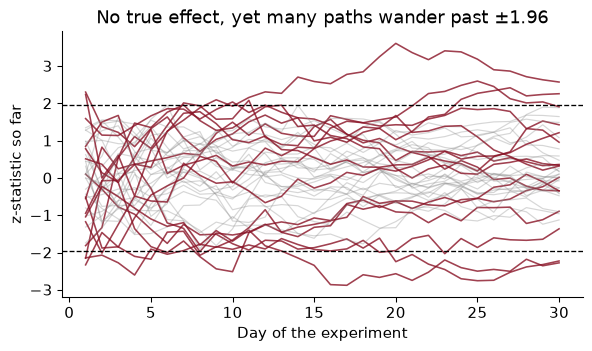

The $z$-statistic is a random walk that has been scaled to stay put on average. Wait long enough and it wanders across any fixed line. The fixes:

- **Decide the sample size in advance** from a power calculation, and make the launch decision only at the end. Watch the dashboard, by all means, but for bugs and harm, not for significance.
- **Stop early for harm.** If a guardrail metric collapses, stopping is fine; it is stopping because you got the answer you wanted that is not.
- If you must look repeatedly, use a **sequential test** designed for it: group-sequential designs with stricter early thresholds, or the “always-valid” $p$-values that some platforms now use (Johari and co-authors, 2017).

### Worked example — “it was significant on day 4”

The manager stopped an experiment on day 4 with $p$ = 0.03, and the estimated lift was large. You ran the same A/A simulation. How would you explain to her why you do not believe the result?

### Solution

The $p$-value of 0.03 is computed as if day 4 had been chosen in advance. It was not: she would have stopped on any day the $p$-value happened to dip, so the real false positive rate of her procedure is the 30% in the simulation, not 5%. And the effect estimate is biased upwards too: an experiment stopped at the first lucky dip is stopped precisely when noise is flattering the treatment. The fix is not to argue; it is to rerun the test, pre-registering a sample size, and look once.

## Many metrics

A real experimentation dashboard reports dozens of metrics. Suppose a change does nothing at all, and you test 20 independent metrics at the 5% level. Simulating 5,000 such experiments, at least one metric is “significant” in 65% of them. (The arithmetic: $1 - 0.95^{20} \approx 0.64$.) Every dashboard has a green number on it somewhere.

There are two standard corrections:

- **Bonferroni.** With $m$ tests, require $p < 0.05/m$. That guarantees a 5% chance of *any* false positive, at the cost of being strict. In the simulation it brings the rate to 5.1%.
- **Benjamini–Hochberg** (BH) controls the **false discovery rate**: the expected share of your “discoveries” that are false. It is less strict, and the right tool when you are screening many metrics for things worth following up.

Here are five Cookie Cats metrics, with raw and adjusted $p$-values:

                                p  Bonferroni     BH
    retention_1            0.0744      0.3720 0.1860
    retention_7            0.0016      0.0078 0.0078
    mean rounds            0.3759      1.0000 0.4699
    share with 0 rounds    0.1686      0.8429 0.2810
    share with 100+ rounds 0.4971      1.0000 0.4971

Day-7 retention survives both corrections (Bonferroni 0.008, BH 0.008). The others do not reach 5% after correction. But the best defence against multiple testing is not a formula, it is the discipline from the start of the chapter: name **one** OEC before the experiment, and treat every other metric as a diagnostic that helps you understand the result rather than as a second chance to find one.

The same applies to **segments**. “The treatment did nothing overall but it worked for Android users in Brazil on weekends” is a multiple-testing result until a new experiment confirms it.

### Worked example — Bonferroni by hand

With the five metrics above, what threshold does Bonferroni set, and which raw $p$-values clear it?

### Solution

The threshold is 0.05 / 5 = 0.01. Only `retention_7`, with raw $p$ = 0.0016, is below it. Equivalently, multiply each $p$-value by 5 (capping at 1) and compare with 0.05, which is what the “Bonferroni” column shows. `retention_1`, with $p$ = 0.074, was not significant even before the correction.

## Novelty, primacy and interference

Two last problems have nothing to do with statistics and everything to do with people.

**People react to change itself.** A new button gets clicked because it is new, and the clicks fade over a few weeks (**novelty**). A new layout annoys experienced users until they learn it, and the effect *improves* over time (**primacy**). A two-week experiment can measure either and call it the long-run effect. The fix is to plot the estimated effect by day since exposure and run long enough to see where it settles, or to look separately at new users, who have no old habits to break.

Cookie Cats gives a related warning. On day 1 the difference between the arms is -0.59 points and not significant; by day 7 it is -0.82 and clearly significant. That makes sense: most players do not reach level 30 on their first day, so on day 1 the two versions of the game are nearly identical. A team that judged the experiment on day-1 retention might well have called the change harmless and shipped it. **The metric’s time horizon has to match when the treatment can bite.**

**My treatment can affect your outcome.** The analysis assumes each player’s outcome depends only on her own version. Econometricians call this **SUTVA**, the stable unit treatment value assumption, or more plainly “no spillovers”. A single-player puzzle game comes close to satisfying it. Many settings do not:

- **Marketplaces.** If treated Airbnb guests get a better search ranking, they book listings that control guests would have booked. The treatment group gains partly *at the control group’s expense*, and the experiment overstates what launching to everyone would do (Blake and Coey 2014).
- **Networks.** A new messaging feature changes how my friends behave, whatever version they have.
- **Shared inventory.** Lower prices in the treatment group use up stock that control customers would have bought.

The design fix is the one from the unit-of-randomization table: randomize whole clusters (cities, network communities) or alternate over time. Both buy less bias with less precision, which is a trade worth making when the bias is large.

### Worked example — a delivery fee experiment

A food-delivery app randomly gives half its customers in a city a \$2 lower delivery fee. Orders from treated customers rise 15% relative to control. The app has a fixed number of couriers in each city. Is 15% what a city-wide fee cut would deliver?

### Solution

Probably not. Treated customers’ extra orders occupy couriers, so control customers face longer waits and order less. Part of the 15% gap is control customers being *pushed down*, not treated customers being lifted up. A city-wide cut would lift everyone’s demand while couriers stay fixed, so waits would rise for all and the real effect would be smaller. The fix is to randomize cities, or hours of the day within a city, so that treated and control customers do not compete for the same couriers. Expect far fewer units and much wider confidence intervals, and say so in the power calculation.

## In Python

The full analysis of the Cookie Cats experiment, runnable top to bottom.

``` python
from pathlib import Path
import numpy as np, pandas as pd
from scipy import stats
import statsmodels.formula.api as smf
from statsmodels.stats.proportion import proportions_ztest, confint_proportions_2indep
from statsmodels.stats.multitest import multipletests

path = Path("../data/cookie_cats.csv")              # download once, then reuse
if not path.exists():
    path.parent.mkdir(exist_ok=True)
    pd.read_csv(URL).to_csv(path, index=False)
cc = pd.read_csv(path)
cc["treat"] = (cc["version"] == "gate_40").astype(int)
cc[["retention_1", "retention_7"]] = cc[["retention_1", "retention_7"]].astype(int)
```

Step 1, before any outcome: the sample ratio check.

``` python
counts = cc["treat"].value_counts()
srm_p = stats.chisquare(counts, [len(cc) / 2] * 2).pvalue
print(f"treatment {counts[1]:,}, control {counts[0]:,}, SRM p = {srm_p:.4f}")
```

    treatment 45,489, control 44,700, SRM p = 0.0086

Step 2: the effect on each retention metric, with a confidence interval and a $z$-test.

``` python
rows = {}
for col in ["retention_1", "retention_7"]:
    s = cc.groupby("treat")[col].agg(["sum", "count"]).loc[[1, 0]]
    z, p = proportions_ztest(s["sum"], s["count"])
    lo, hi = confint_proportions_2indep(*s.loc[1], *s.loc[0])
    rate = s["sum"] / s["count"]
    rows[col] = {"control": rate[0], "treatment": rate[1], "diff (pp)": 100 * (rate[1] - rate[0]),
                 "CI low": 100 * lo, "CI high": 100 * hi, "p": p}
print(pd.DataFrame(rows).T.round(4))
```

                 control  treatment  diff (pp)  CI low  CI high       p
    retention_1   0.4482     0.4423    -0.5905 -1.2392   0.0582  0.0744
    retention_7   0.1902     0.1820    -0.8201 -1.3282  -0.3121  0.0016

Step 3: the same day-7 effect as a regression with robust standard errors, and the engagement guardrail with and without the 50,000-round player.

``` python
for name, data in [("all", cc), ("drop max", cc[cc.sum_gamerounds < cc.sum_gamerounds.max()])]:
    f7 = smf.ols("retention_7 ~ treat", data=data).fit(cov_type="HC1")
    fr = smf.ols("sum_gamerounds ~ treat", data=data).fit(cov_type="HC1")
    print(f"{name:8s} retention_7 {f7.params['treat']:+.4f} ({f7.bse['treat']:.4f}) | "
          f"rounds {fr.params['treat']:+.2f} ({fr.bse['treat']:.2f})")
```

    all      retention_7 -0.0082 (0.0026) | rounds -1.16 (1.31)
    drop max retention_7 -0.0082 (0.0026) | rounds -0.04 (0.68)

Step 4: correct the family of five metrics.

``` python
def prop_p(col):
    s = cc.groupby("treat")[col].agg(["sum", "count"]).loc[[1, 0]]
    return proportions_ztest(s["sum"], s["count"])[1]
cc["zero_rounds"] = (cc["sum_gamerounds"] == 0).astype(int)
cc["rounds_100"] = (cc["sum_gamerounds"] >= 100).astype(int)
g1, g0 = cc.loc[cc.treat == 1, "sum_gamerounds"], cc.loc[cc.treat == 0, "sum_gamerounds"]
pv = pd.Series({c: prop_p(c) for c in ["retention_1", "retention_7", "zero_rounds", "rounds_100"]})
pv["mean rounds"] = stats.ttest_ind(g1, g0, equal_var=False).pvalue
print(pd.DataFrame({"p": pv, "BH": multipletests(pv, method="fdr_bh")[1]}).round(4))
```

                      p      BH
    retention_1  0.0744  0.1860
    retention_7  0.0016  0.0078
    zero_rounds  0.1686  0.2810
    rounds_100   0.4971  0.4971
    mean rounds  0.3759  0.4699

The recommendation I would write to the developer: *keep the gate at level 30. Moving it to 40 lowered day-7 retention by about 0.8 percentage points, from 19.0% to 18.2% (95% CI -1.3 to -0.3), and did not raise engagement. But the two arms are not the 50/50 split the design promised (p = 0.009), so before relying on this I would want the assignment and logging code checked, and ideally a rerun.*

## What goes wrong

**Skipping the SRM check.** It takes one line, and it is the most common reason an experiment’s result is wrong. The Cookie Cats split is off by less than one percentage point, which is invisible to the eye and very visible to a chi-squared test. Run it before you look at any outcome, and if it fails, find the cause before you report anything.

**Peeking and stopping on significance.** Looking every day and stopping at the first $p < 0.05$ turned a 5% false positive rate into 30% in our simulation. Fix the sample size in advance, or use a sequential method built for repeated looks.

**Controlling for something the treatment affected.** CUPED works because `pre` was measured before assignment. Add `sum_gamerounds` as a “control” in the retention regression and you are comparing players who played the same amount, which the gate itself changed; the estimate stops meaning anything (Exercise 3). Only pre-treatment covariates go on the right-hand side.

**Fishing across metrics and segments.** Twenty metrics give a 65% chance of at least one false win. Name one OEC in advance, correct the rest, and confirm surprising segment results with a new experiment.

**Running an underpowered test.** A small experiment usually finds nothing, and when it does find something the estimate is exaggerated. Do the power calculation first; if the MDE is larger than any plausible effect, do not run the test, or make the change bolder.

**Judging on a metric that cannot see the effect yet.** Day-1 retention could not show a gate that most players had not yet reached. Choose a metric, and a duration, that match when the treatment can act, and watch for effects that fade (novelty) or grow (primacy).

## Exercises

1.  The Cookie Cats SRM test gives $p \approx$ 0.009. Which of these is right? (a) The treatment caused 789 extra players to install. (b) There is a 0.9% chance the randomization worked. (c) If assignment were a fair 50/50 coin, a split this uneven would occur in under 1% of experiments. (d) The retention results are wrong. Explain what is wrong with each of the others.

2.  Using `diff_in_means`, compute the day-1 retention effect, its standard error and a 95% confidence interval. Check the interval against `confint_proportions_2indep`.

3.  A colleague estimates `retention_7 ~ treat + sum_gamerounds` “to control for engagement”. Run it. What happens to the treatment coefficient, and why is this regression the wrong one?

4.  In the CUPED simulation, make last month’s spend a much weaker predictor: generate `spend = 0.2 * pre + 1.5 * treat + rng.normal(0, 12, n)`. Predict the variance reduction from $\rho^2$ before computing it, then check.

5.  Rerun the peeking simulation, but let the manager look only three times, on days 10, 20 and 30. What is the false positive rate now? What does this suggest about a compromise between looking once and looking every day?

6.  The developer wants to plan an experiment on **day-1** retention (baseline 44.8%). How many players per arm does it need to detect a 1 percentage point drop with 80% power at $\alpha = 0.05$? Why does it need fewer than an experiment on a 0.5-point drop in day-7 retention?

7.  Winsorize `sum_gamerounds` at its 99th percentile and re-estimate the effect on rounds. Compare with the estimates with and without the top player. Which would you report?

### Answers

**1.** (c). A $p$-value is a statement about how surprising the data would be *if* the null hypothesis held, here a fair 50/50 assignment. (a) confuses the count of players with an outcome: the gate cannot make people install the game, since installation happens before anyone sees a gate. (b) inverts the $p$-value: it is not the probability that the null is true. (d) goes too far: an SRM means the results *might* be biased and cannot be trusted until the cause is found, not that they are known to be wrong.

**2.**

``` python
y1d = cc["retention_1"].to_numpy()
e1, se1 = diff_in_means(y1d, cc["treat"].to_numpy())
s = cc.groupby("treat")["retention_1"].agg(["sum", "count"]).loc[[1, 0]]
lo_c, hi_c = confint_proportions_2indep(*s.loc[1], *s.loc[0])
print(f"{e1:.5f}  SE {se1:.5f}  CI [{e1 - 1.96 * se1:.5f}, {e1 + 1.96 * se1:.5f}]  "
      f"statsmodels [{lo_c:.5f}, {hi_c:.5f}]")
```

    -0.00591  SE 0.00331  CI [-0.01239, 0.00058]  statsmodels [-0.01239, 0.00058]

The day-1 effect is -0.59 percentage points with a standard error of 0.33, so the 95% interval runs from -1.24 to 0.06 points. It includes zero. The `statsmodels` interval, -1.24 to 0.06, agrees to the fifth decimal place: for a 0/1 outcome the two calculations are the same formula.

**3.**

``` python
bad = smf.ols("retention_7 ~ treat + sum_gamerounds", data=cc).fit(cov_type="HC1")
print(bad.params["treat"], bad.bse["treat"])
```

    -0.007556379047811762 0.0024209187030171573

The treatment coefficient becomes -0.76 points, against -0.82 without the control. It happens not to move much here, but that is luck, not a reason to trust it. Rounds played is an *outcome* of the experiment: the gate changes how much people play. Conditioning on it compares a treated player and a control player who played the same number of rounds, but those are different kinds of player in the two arms, because the gate put them there by different routes. The coefficient is no longer the effect of anything. Randomization protects the simple comparison; adding a post-treatment control throws that protection away.

**4.**

``` python
rng = np.random.default_rng(SEED)
pre4 = rng.gamma(2, 15, n_sim)
t4 = rng.binomial(1, 0.5, n_sim)
spend4 = 0.2 * pre4 + 1.5 * t4 + rng.normal(0, 12, n_sim)
th4 = np.cov(spend4, pre4)[0, 1] / np.var(pre4, ddof=1)
_, se_a = diff_in_means(spend4, t4)
_, se_b = diff_in_means(spend4 - th4 * (pre4 - pre4.mean()), t4)
rho4 = np.corrcoef(spend4, pre4)[0, 1]
print(f"rho^2 = {rho4**2:.3f}, variance reduction = {1 - (se_b / se_a)**2:.3f}")
```

    rho^2 = 0.117, variance reduction = 0.117

Now $\rho$ = 0.34, so $\rho^2$ predicts a variance reduction of 12%, and the simulation gives 12%. CUPED is never harmful in a large sample, but it is only as good as the covariate. A weak predictor buys little.

**5.**

``` python
looks = [9, 19, 29]                                   # columns for days 10, 20, 30
fp3 = sig[:, looks].any(axis=1).mean()
print(f"three looks: {fp3:.3f}  vs one look {fp_end:.3f}  vs daily {fp_peek:.3f}")
```

    three looks: 0.113  vs one look 0.053  vs daily 0.301

With three looks the false positive rate is 11.3%: worse than one look (5.3%), much better than thirty (30.1%). A few pre-planned looks cost something, and the cost can be paid by using a stricter threshold at each look. That is exactly what group-sequential designs do: they spend the 5% across a few scheduled interim analyses.

**6.**

``` python
b1 = r1[0]
n_r1 = NormalIndPower().solve_power(effect_size=proportion_effectsize(b1, b1 - 0.01),
                                    alpha=0.05, power=0.8)
print(f"{n_r1:,.0f} per arm, vs {n_half:,.0f} per arm for 0.5 pp on day 7")
```

    38,736 per arm, vs 95,654 per arm for 0.5 pp on day 7

About 38,736 players per arm. That is fewer than the 95,654 needed for a half-point drop in day-7 retention because the target effect is twice as large (and sample size scales with one over the effect squared, so that alone divides it by four), even though the outcome is noisier: a 0/1 variable with a mean near 45% has a larger standard deviation, $\sqrt{0.45 \times 0.55} \approx 0.50$, than one near 19%, $\sqrt{0.19 \times 0.81} \approx 0.39$.

**7.**

``` python
cap = cc["sum_gamerounds"].quantile(0.99)
win = smf.ols("rounds_w ~ treat", data=cc.assign(rounds_w=cc["sum_gamerounds"].clip(upper=cap))
              ).fit(cov_type="HC1")
print(cap, win.params["treat"], win.bse["treat"])
```

    493.0 -0.28191819808638735 0.5608352812894053

Capping at the 99th percentile (493 rounds) gives an effect of -0.28 rounds (SE 0.56), against -1.16 with everyone and -0.04 without the top player. The winsorized estimate is the one I would report, with the others in a footnote: it does not hinge on one implausible row, and it uses a rule I could have written down before seeing the data, which dropping “the player who looks odd” is not. None of the three suggests that a later gate raised engagement.

**Reading.** Kohavi, Tang & Xu (2020), *Trustworthy Online Controlled Experiments*, chs. 1–3 for the practice of online experiments and ch. 21 on sample ratio mismatch. Deng, Xu, Kohavi & Walker (2013) for CUPED. Angrist & Pischke (2009), *Mostly Harmless Econometrics*, ch. 2, for potential outcomes and why randomization works. Athey & Imbens (2017), “The Econometrics of Randomized Experiments”, for regression adjustment and design. Problem Set 3 applies all of this to a real email experiment (Hillstrom’s MineThatData data).


# Chapter 8 — Resampling: simulation and the bootstrap

> **The question:** in a survey of 20,522 American professionals, men’s median salary is \$29,000 higher than women’s. How much of that could be the luck of who answered, when no textbook formula gives the standard error of a median?

## A laboratory where you know the truth

Every estimate you have ever computed came with a standard error, and almost all of those standard errors came from a formula. For a mean it is $s/\sqrt{n}$; for an OLS coefficient the software prints it. The formulas are wonderful when they exist. They run out surprisingly quickly.

Here is a gap they do not cover. The 2021 *Ask a Manager* salary survey, distributed by TidyTuesday, asked readers of a workplace-advice blog what they earn. Keeping annual salaries in US dollars between \$15,000 and \$1 million from people who answered “Man” or “Woman”, we have 20,522 respondents. The median man reports \$104,000, the median woman \$75,000. Salaries are skewed, so the median is the honest summary of a typical salary. But what is the standard error of a *difference in medians*? Of a *ratio* of medians? Of the gap in prediction error between two models? Nobody taught you a formula, because for most of these there is no simple one.

This chapter is about two ways round the problem, and they share an idea: **let the computer do the repeated sampling that the formula was imagining.**

- **Simulation** (also called **Monte Carlo**) makes fake data from a world you design, where you know the truth, and checks whether your method recovers it.
- **The bootstrap** treats your one real sample as a stand-in for the population, resamples from it, and watches how much your estimate moves.

The recipe for a simulation has four steps, and I would like you to know it by heart:

1.  Write a function that **generates data** from a world where you chose the truth.
2.  Write a function that **estimates** something from those data.
3.  **Repeat** many times and store every result.
4.  **Summarise**: the average error (bias), the spread (the standard error), how often the confidence interval covers the truth, how often the test rejects.

Before we go further, a warning about the data. Ask a Manager readers are a self-selected group: 82% of our respondents are women, and they are heavily concentrated in office jobs. Everything in this chapter describes *these respondents*, not the US labour force. Resampling measures sampling noise. It cannot fix a sample that was never representative.

### Worked example — a simulation has a standard error too

You simulate 1,000 experiments and find that your 95% confidence interval covers the truth in 93.1% of them. Is the interval broken, or is that just luck?

### Solution

The coverage rate is itself an estimate: a proportion from $R$ = 1,000 trials. Its standard error is $\sqrt{\hat p(1-\hat p)/R} = \sqrt{0.931 \times 0.069 / 1000} \approx 0.008$. The gap from 95% is 1.9 points, more than two standard errors, so it is probably not luck, but it is not overwhelming either. Run 10,000 replications and the Monte Carlo standard error drops to about 0.0025, enough to tell 93% from 95% firmly. Always report it: “coverage 0.931 (Monte Carlo s.e. 0.008)”.

## Functions, and letting NumPy do the looping

A simulation is code you will run thousands of times, change, and rerun. Two habits make that painless.

**Write small functions with the random number generator passed in.** One function makes data, another estimates; neither knows about the other.

``` python
def simulate_rct(n, effect, sd=1.0, rng=None):
    """Two-arm experiment with a constant effect. Returns outcome y and treatment d."""
    rng = rng if rng is not None else np.random.default_rng()
    d = rng.binomial(1, 0.5, n)
    return effect * d + rng.normal(0, sd, n), d

def diff_in_means(y, d):
    """Difference in means and its unequal-variance standard error (Chapter 7)."""
    y1, y0 = y[d == 1], y[d == 0]
    return y1.mean() - y0.mean(), np.sqrt(y1.var(ddof=1) / len(y1) + y0.var(ddof=1) / len(y0))

diff_in_means(*simulate_rct(500, effect=0.2, rng=np.random.default_rng(SEED)))
```

    (np.float64(0.10395727830629962), np.float64(0.08850217438134314))

Passing `rng` in means the *caller* controls reproducibility: the same generator gives the same answer, and two different ones give independent answers. We will need that when we go parallel.

**Vectorize.** A Python loop handles one number at a time; a NumPy operation on a whole array runs in compiled code.

``` python
x = np.random.default_rng(SEED).normal(size=1_000_000)
t0 = time.perf_counter(); total = 0.0
for v in x:
    total += v ** 2
t_loop = time.perf_counter() - t0
t0 = time.perf_counter(); total_vec = np.sum(x ** 2); t_vec = time.perf_counter() - t0
print(f"loop {t_loop:.3f}s, vectorized {t_vec:.4f}s")
```

    loop 0.112s, vectorized 0.0010s

The vectorized sum ran about 109 times faster on this machine. The same trick applies to whole simulations: instead of looping over 5,000 experiments, draw a 5,000-row matrix, one experiment per row, and compute every row’s estimate at once with `axis=1`. That is how the coverage study in the next section runs in under a second.

### Worked example — what vectorizing costs in memory

To bootstrap the median salary of the 16,904 women without a loop, you would draw a matrix of row indices with $B$ = 2,000 rows and one column per woman. How big is it?

### Solution

It holds 2,000 × 16,904 = 33,808,000 integers at 8 bytes each: about 270 MB, before you even look up the salaries, which doubles it. That fits on a laptop, but only just, and a bigger sample would not. The fully vectorized version wins when each sample is small and $B$ is large; for large samples a loop over $B$, with each step vectorized inside (one `rng.choice` and one `np.median` on a whole array), is fast and uses almost no memory. Vectorize the inner work, not necessarily everything.

## Do confidence intervals really cover?

The promise of a 95% confidence interval is about repeated sampling: if you drew sample after sample and built an interval from each, 95% of the intervals would contain the true value. You never get to check that with real data, because you never know the true value. In a simulation you do.

So let us make one where the “population” is real. Treat the 16,904 women in the survey as the entire population; their mean salary, \$86,891, is now the known truth. Draw a sample of $n$ women, build the usual $t$ interval for the mean, $\bar x \pm t_{0.975, n-1} \cdot s/\sqrt n$, and check whether it covers \$86,891. Do that 5,000 times for each sample size:

``` python
rng = np.random.default_rng(368)
xs = women[rng.integers(0, len(women), (5_000, 30))]       # 5,000 samples of 30, one per row
m, se = xs.mean(axis=1), xs.std(axis=1, ddof=1) / np.sqrt(30)
tc = stats.t.ppf(0.975, 29)
print(((m - tc * se <= women.mean()) & (women.mean() <= m + tc * se)).mean())
```

    0.9332

         coverage  MC s.e.  missed low  missed high
    n                                              
    10      0.917    0.004       0.080        0.003
    30      0.922    0.004       0.073        0.005
    100     0.932    0.004       0.060        0.008
    500     0.950    0.003       0.037        0.013

With samples of 10, the “95%” interval covers only 91.7% of the time; with 30, 92.2%. Only by 500 is it close to 95%. And look at *how* it fails: almost all the misses are on the low side. Salaries have a long right tail, so a small sample usually contains none of the big earners; its mean is too low *and* its standard deviation too small, and the interval sits entirely below the truth. The $t$ interval assumes the sample mean is roughly normal, and with skewed data that takes more observations than the “$n \geq 30$” rule of thumb suggests.

That is the whole point of Monte Carlo. Not proving theorems, but checking whether a method you are about to rely on works *for data that look like yours*.

### Worked example — reading a coverage table

A colleague says: “Our intervals cover 92.2% of the time instead of 95%. That’s close enough.” When is she right, and when is she wrong?

### Solution

She is right that 92.2% is not a disaster, and the Monte Carlo standard error (0.004) confirms the shortfall is real rather than simulation noise. She is wrong to ignore which way the misses go. A one-sided failure is worse than a symmetric one: with salaries, a small survey will understate average pay much more often than it overstates it. If the number feeds a decision (setting a pay band, say), the bias in the misses matters more than the headline coverage.

## The bootstrap

Back to the real question. We have one sample, not 5,000. Ideally we would draw many new samples from the population and see how much the median gap moves, but we cannot. Efron’s (1979) idea was to **treat the sample as if it were the population**, and draw from that:

1.  From each group, draw as many observations as it has, **with replacement**. Some people appear twice, some not at all.
2.  Recompute the statistic, here the median for men minus the median for women.
3.  Repeat $B$ times, say 2,000.

The standard deviation of the $B$ bootstrap estimates is the **bootstrap standard error**. The middle 95% of them, from the 2.5th to the 97.5th percentile, is the **percentile confidence interval**.

``` python
def boot_median_gap(y1, y0, B, rng):
    """B bootstrap draws of median(y1) - median(y0), resampling within each group."""
    draws = np.empty(B)
    for b in range(B):
        draws[b] = (np.median(rng.choice(y1, size=len(y1), replace=True))
                    - np.median(rng.choice(y0, size=len(y0), replace=True)))
    return draws

boot = boot_median_gap(men, women, B=2_000, rng=np.random.default_rng(368))
print(boot.std(), np.percentile(boot, [2.5, 97.5]))
```

    1302.9026584859478 [25588.625 30180.   ]

We resample *within* each group because that mimics how the data arose: a sample of men and a sample of women, each of a given size. The median gap is \$29,000, with a bootstrap standard error of \$1,303 and a 95% percentile interval from \$25,589 to \$30,180. Sampling noise cannot plausibly explain a gap of this size among these respondents. (What *causes* it, whether industry, job title, hours or discrimination, is a different question that no amount of resampling answers.)


Notice the spikes. People report round salaries (\$75,000, \$100,000), so a resampled median keeps landing on the same few values. The interval is not centred on the estimate either: the estimate sits near its upper end. The bootstrap reports that honestly, where a formula of the form “estimate ± 1.96 SE” would force symmetry.

> The bootstrap does not create information. It measures how much the information you have would wobble if the sample had come out differently.

### Worked example — one bootstrap draw by hand

Eight salaries, in thousands of dollars (hypothetical): 28, 35, 41, 47, 52, 60, 75, 120. A random draw of eight positions with replacement gives positions 2, 2, 3, 5, 6, 6, 7, 8. What is the bootstrap sample and its median, and how does it compare with the original median?

### Solution

The bootstrap sample is 35, 35, 41, 52, 60, 60, 75, 120 (the second and sixth values appear twice; the first and fourth not at all). With eight values the median is the average of the fourth and fifth: (52 + 60)/2 = 56. The original median is (47 + 52)/2 = 49.5. Repeat this a few thousand times and the spread of those medians is the standard error. With only eight observations, though, each resample can only rearrange the same eight numbers, which is a warning we come back to.

## A ratio: cents on the dollar

Pay gaps are usually quoted as a ratio: women earn so many cents for every dollar men earn. Among our respondents the median woman earns **72 cents** for each dollar earned by the median man. A ratio of two medians is a statistic with no textbook standard error at all, and the bootstrap does not care:

``` python
rng = np.random.default_rng(368)
ratio_boot = np.array([np.median(rng.choice(women, len(women))) / np.median(rng.choice(men, len(men)))
                       for _ in range(2_000)])
np.percentile(ratio_boot, [2.5, 97.5])
```

    array([0.71428571, 0.74774897])

The 95% interval runs from 71.4 to 74.8 cents. The same few lines would work for a Gini coefficient, a 90/10 percentile ratio, a correlation, or an elasticity computed in two steps. That is the bootstrap’s great virtue: one method for nearly every statistic, with no new algebra each time.

### Worked example — formula or bootstrap?

For which of these could you write down a standard error from intro statistics, and which need the bootstrap? **(a)** The difference in *mean* salary between men and women. **(b)** The difference in median salary. **(c)** The ratio of median salaries. **(d)** The 90th percentile of women’s salaries divided by the 10th.

### Solution

Only **(a)**: it is the Chapter 7 formula, $\sqrt{s_1^2/n_1 + s_0^2/n_0}$. The other three need either the bootstrap or a fair amount of asymptotic theory (there are formulas for the standard error of a median, but they need an estimate of the density of salaries at the median, which is its own headache). A good habit is to bootstrap (a) as a check: the formula gives \$1,162 and the bootstrap \$1,176. When the two agree where both apply, you can trust the bootstrap where only it does.

## When the bootstrap works, and when it does not

Is the bootstrap interval itself any good? We can check it exactly as we checked the $t$ interval. Treat all 20,522 respondents as the population, so the true median gap is the \$29,000 we computed. Draw a sample, bootstrap a 95% interval with $B$ = 500, record whether it covers the truth, and repeat 500 times. That is a simulation wrapped around a bootstrap, half a million medians in all, and it takes a few seconds.

- Samples of 300 respondents (about 53 men): coverage 95.0%.
- Samples of 60 (about 11 men): coverage 92.2%.

(The Monte Carlo standard error with 500 replications is about one percentage point.) For a median, the bootstrap holds up well with a few dozen men in each sample, and starts to slip when there are only a handful. Now try statistics further out in the tail, from samples of 50 women:

| Statistic                | Coverage of the “95%” bootstrap interval |
|--------------------------|------------------------------------------|
| Median (50th percentile) | 96.0%                                    |
| 90th percentile          | 91.2%                                    |
| Maximum                  | 0.0%                                     |

The maximum is a catastrophe. A bootstrap sample can never contain a salary larger than the largest one in the original sample, so the bootstrap distribution of the maximum is piled up at, and below, the sample maximum, which is almost always below the true one. The rule: **the bootstrap struggles at the edges of the data** (maxima, minima, extreme percentiles), **in very small samples** (it can only reshuffle what it has), and **with dependent data resampled as if independent**, which is the next section but one.

### Worked example — how often is the maximum resampled?

In a bootstrap sample of size $n$, what is the chance that the largest original observation appears at least once? Use $n$ = 50.

### Solution

Each draw misses it with probability $1 - 1/n$, so all $n$ draws miss it with probability $(1 - 1/n)^n$, which for $n$ = 50 is 0.364 (close to $e^{-1} \approx 0.368$). So about 64% of bootstrap samples have exactly the original maximum as *their* maximum, and the rest have something smaller. The bootstrap distribution has a big spike at the sample maximum and nothing above it. The same $e^{-1}$ appears again in Chapter 15: about 37% of observations are left out of each bootstrap sample, and random forests use them as a free test set.

## A permutation test

The bootstrap gives an interval. A **permutation test** answers a different question: *if gender had nothing to do with salary, how often would we see a gap this large just from how the labels happened to fall?* If the labels do not matter, shuffling them should not matter either. So shuffle them, recompute the gap, and repeat.

Take the 881 respondents who work in law, 91 of them men. The observed median gap is \$30,950.

``` python
y, is_man = law["annual_salary"].to_numpy(), (law["gender"] == "Man").to_numpy()
rng = np.random.default_rng(368)
perm = np.empty(5_000)
for r in range(5_000):
    shuffled = rng.permutation(is_man)                     # same number of "men", random people
    perm[r] = np.median(y[shuffled]) - np.median(y[~shuffled])
np.mean(np.abs(perm) >= abs(obs_law))
```

    np.float64(0.0)

None of the 5,000 shuffled gaps is as large as the real one, in absolute value. That share is the permutation $p$-value; here all we can say is that it is below 1/5,000 = 0.0002. It assumes almost nothing: not normality, not a large sample, not a formula for the standard error of a median. Its one assumption is that, under the null, the labels are exchangeable, which is exactly true in a randomized experiment and a reasonable description of “no association” in a survey.

Keep the two methods straight:

- The **bootstrap** resamples *observations* to measure how much an estimate would vary. It answers “how precise is my estimate?”
- The **permutation test** reshuffles *labels* to build a world where the null is true. It answers “could this be chance?”

### Worked example — a small industry

In sales there are 209 respondents, only 46 of them men, and the median gap is \$12,050. Run the permutation test on the median and a Welch $t$-test on log salary. Do they agree?

### Solution

The permutation $p$-value is 0.065 and the Welch $p$-value is 0.050. They are close, and both sit right at the conventional line, which is the honest answer: with 46 men, a gap of \$12,050 is suggestive but not conclusive. They test slightly different things (medians against mean logs), so they need not match exactly. And remember the multiple-testing lesson from Chapter 7: if you test every one of the survey’s industries, a couple will cross 0.05 by chance.

## Resample the way the data were collected

The bootstrap’s rule is to **mimic the sampling process**. So far that meant resampling individuals within each gender. But many data sets are not collected one independent person at a time.

Think of a survey that sampled schools and then interviewed every teacher in each school, or a data set of workers grouped in firms, or customers grouped in cities. People in the same cluster resemble each other: teachers in one school share a principal, a budget, a local labour market. Twenty teachers from one school carry less independent information than twenty teachers from twenty schools. Resample individuals as if they were independent and you will understate the noise, sometimes by a factor of several.

The fix is the **cluster bootstrap**: resample whole clusters with replacement, keeping everyone in a drawn cluster together. If there are 50 schools, draw 50 school IDs with replacement, stack all the teachers from the drawn schools, and recompute the statistic. The unit of resampling is the unit of sampling (or, in an experiment, the unit of randomization, as in Chapter 7). In code it is a few lines:

``` python
def cluster_bootstrap(groups, stat, B, rng):
    """groups: dict of cluster id -> array of outcomes. Resample whole clusters."""
    keys = list(groups)
    return np.array([stat(np.concatenate([groups[k] for k in rng.choice(keys, len(keys))]))
                     for _ in range(B)])
```

The Ask a Manager respondents were not sampled by state, so here the clusters are a stretch. Still, the mechanics are instructive. Treat the 118 values of the `state` column as clusters and bootstrap mean log salary: resampling states gives a standard error of 0.0328, resampling individuals 0.0036. Salaries in California resemble other salaries in California, so a sample that happened to draw more Californians would have a different mean, and the cluster bootstrap knows it. When the number of clusters is small (fewer than 30 or so), even this is unreliable, and the **wild cluster bootstrap** is the tool to reach for (Cameron, Gelbach and Miller 2008).

### Worked example — choosing what to resample

What should you resample in each case? **(a)** A wage regression on 10,000 workers from a random household survey. **(b)** Test scores from a programme that was randomized across 40 schools. **(c)** Daily sales at one store over three years.

### Solution

**(a)** Rows (workers), the **pairs bootstrap**: resample whole rows, $(y_i, x_i)$ together. It gives standard errors that match the robust (HC) ones from your econometrics course.

**(b)** Schools. The treatment was assigned by school, so the 40 schools are the independent units, and you resample them with all their students.

**(c)** Not individual days: today’s sales predict tomorrow’s, and shuffling days destroys that dependence. Resample **blocks** of consecutive days (a block bootstrap), long enough to capture the autocorrelation.

## The bootstrap for machine learning

Part III of this book is about prediction, and every prediction model is judged by its error on a test set (Chapter 9). But a test set is a sample too, so a test error is an estimate with its own noise. When a new model beats an old one by a little, is it really better, or did the test set happen to suit it?

The bootstrap answers that. Here is a small example, using only the linear regression you already know. Predict log salary for our respondents with two models:

- a **small** model: dummies for years of experience, education and gender;
- a **big** model: the same plus industry and state.

Fit both on a random 80% of respondents and compute each model’s prediction errors on the other 20%, 4,083 people. The test RMSE (root mean squared error, in log points) is 0.453 for the small model and 0.383 for the big one. To put an interval on the difference, resample the test rows and recompute both RMSEs on *the same* resampled rows:

``` python
rmse = lambda e: np.sqrt(np.mean(e ** 2, axis=-1))      # works row by row on a matrix
idx = np.random.default_rng(368).integers(0, len(te), (2_000, len(te)))   # resampled test rows
diff = rmse(err_small[idx]) - rmse(err_big[idx])          # paired: same rows for both models
np.percentile(diff, [2.5, 97.5])
```

    array([0.06293118, 0.07702318])

The big model’s advantage is 0.070 log points, with a 95% interval from 0.063 to 0.077. The interval is far from zero, so industry and state really do help predict salary, and the gain is not an accident of the split.

Note that we bootstrapped only the *test set*, holding the fitted models fixed. That measures how much the test score would vary with a different test set. It does not capture the variation from refitting on a different training set; for that you would refit inside each bootstrap draw, which is slower and is the idea behind bagging (Chapter 15).

### Worked example — why pair the draws?

Suppose instead you resampled the test rows separately for each model, with two independent index matrices. What happens to the standard error of the difference?

### Solution

It grows a lot: from 0.0036 (paired) to 0.0091 (unpaired), about 2.6 times as large. Some people are hard to predict for *both* models (an unusual job, a salary typed wrongly). When the same rows are drawn for both, those people raise both RMSEs together and cancel out of the difference. Drawn separately, their luck lands on one model and not the other, adding noise that has nothing to do with which model is better. It is the same logic as a paired $t$-test, or as comparing two treatments on the same patients.

## Reproducible seeds and parallel work

Bootstrap draws and simulation replications are independent of one another, so they can run on several processor cores at once; computer scientists call such problems **embarrassingly parallel**. In Python, `joblib` does it in one line. The only subtlety is randomness: each task needs its own independent stream of random numbers, and you want the whole run to give the same answer every time.

NumPy’s `SeedSequence` solves both. Spawn one child seed per task from a single master seed:

``` python
from joblib import Parallel, delayed

def industry_gap(name, seed):
    rng = np.random.default_rng(seed)
    d = sal[sal["industry"] == name]
    m = d.loc[d["gender"] == "Man", "annual_salary"].to_numpy()
    w = d.loc[d["gender"] == "Woman", "annual_salary"].to_numpy()
    b = boot_median_gap(m, w, 1_000, rng)
    return {"industry": name, "gap": np.median(m) - np.median(w), "se": b.std(), "n": len(d)}

inds = sal["industry"].value_counts().index[:12]
seeds = np.random.SeedSequence(368).spawn(len(inds))       # 12 independent streams
```

``` python
t0 = time.perf_counter(); serial = [industry_gap(n, s) for n, s in zip(inds, seeds)]
t_ser = time.perf_counter() - t0
t0 = time.perf_counter()
parallel = Parallel(n_jobs=-1)(delayed(industry_gap)(n, s) for n, s in zip(inds, seeds))
t_par = time.perf_counter() - t0
print(f"serial {t_ser:.1f}s, parallel {t_par:.1f}s, identical: {serial == parallel}")
```

    serial 0.4s, parallel 0.6s, identical: True

The two runs give **identical** results (True), because each industry’s task has its own seed no matter which core runs it, or in what order. On this machine the serial run took 0.4 seconds and the parallel one 0.6. Starting worker processes has a fixed cost, so parallelism pays off for chunky tasks (a bootstrap that takes minutes) and can lose on tiny ones. Vectorize first; parallelize when you still have to wait.

Three rules for seeds, which I enforce in every project:

- **Create one generator at the top** (`rng = np.random.default_rng(368)`) and pass it around. Avoid `np.random.seed()`, which sets a hidden global state that any function can disturb.
- **For parallel work, spawn child seeds** from one `SeedSequence`, never the same seed in every task.
- **Save simulation output to disk** (a Parquet file in `output/`), so that a long run never has to be repeated just to change a figure.

### Worked example — the same seed in every worker

A student parallelizes 1,000 bootstrap draws as 10 tasks of 100, giving each task `np.random.default_rng(368)`. What goes wrong, and what does the resulting standard error look like?

### Solution

Every task draws exactly the same 100 bootstrap samples, so the 1,000 “draws” are 100 draws, each repeated ten times. The standard error computed from them is no better than one from 100 draws, while the student believes it came from 1,000, and if the tasks were Monte Carlo replications, the reported Monte Carlo error would be too small by a factor of about $\sqrt{10}$. Nothing crashes and nothing looks wrong, which is what makes it dangerous. The fix is `np.random.SeedSequence(368).spawn(10)`.

## In Python

The whole analysis, from download to an industry-by-industry chart, runnable top to bottom.

``` python
from pathlib import Path
import numpy as np, pandas as pd, matplotlib.pyplot as plt
from joblib import Parallel, delayed

path = Path("../data/ask_a_manager.csv")              # download once, then reuse
if not path.exists():
    path.parent.mkdir(exist_ok=True)
    pd.read_csv(URL).to_csv(path, index=False)
raw = pd.read_csv(path)
US = {"united states", "usa", "us", "u.s.", "united states of america", "u.s.a.", "u.s", "america"}
sal = raw[(raw["currency"] == "USD") & raw["country"].str.strip().str.lower().isin(US)
          & raw["annual_salary"].between(15_000, 1_000_000)
          & raw["gender"].isin(["Man", "Woman"])].copy()
sal["log_salary"] = np.log(sal["annual_salary"])
```

The bootstrap and the permutation test, as two functions that take a generator.

``` python
def boot_median_gap(y1, y0, B, rng):
    return np.array([np.median(rng.choice(y1, len(y1))) - np.median(rng.choice(y0, len(y0)))
                     for _ in range(B)])

def perm_median_gap(y, is_1, R, rng):
    obs = np.median(y[is_1]) - np.median(y[~is_1])
    null = np.array([(lambda s: np.median(y[s]) - np.median(y[~s]))(rng.permutation(is_1))
                     for _ in range(R)])
    return obs, np.mean(np.abs(null) >= abs(obs))
```

The overall gap, with a percentile interval.

``` python
rng = np.random.default_rng(368)
men = sal.loc[sal["gender"] == "Man", "annual_salary"].to_numpy()
women = sal.loc[sal["gender"] == "Woman", "annual_salary"].to_numpy()
b = boot_median_gap(men, women, 2_000, rng)
print(f"gap ${np.median(men) - np.median(women):,.0f}, SE ${b.std():,.0f}, "
      f"95% CI {np.percentile(b, [2.5, 97.5]).round(0)}")
```

    gap $29,000, SE $1,303, 95% CI [25589. 30180.]

By industry, in parallel with one seed per task, plus a permutation $p$-value for each.

``` python
def one_industry(name, seed):
    rng = np.random.default_rng(seed)
    d = sal[sal["industry"] == name]
    y, is_man = d["annual_salary"].to_numpy(), (d["gender"] == "Man").to_numpy()
    b = boot_median_gap(y[is_man], y[~is_man], 1_000, rng)
    obs, p = perm_median_gap(y, is_man, 1_000, rng)
    return {"industry": name, "gap": obs, "se": b.std(), "p_perm": p, "men": is_man.sum()}

inds = sal["industry"].value_counts().index[:12]
seeds = np.random.SeedSequence(368).spawn(len(inds))
res = pd.DataFrame(Parallel(n_jobs=-1)(delayed(one_industry)(n, s) for n, s in zip(inds, seeds)))
print(res.sort_values("gap").round(3).to_string(index=False))
```

                                industry     gap        se  p_perm  men
           Education (Primary/Secondary) -4150.0  3541.660   0.268   54
                              Nonprofits  6550.0  2732.988   0.010  164
            Education (Higher Education)  8270.0  2608.689   0.000  216
                             Health care  9500.0  5853.674   0.040  124
            Engineering or Manufacturing 10000.0  2264.685   0.000  308
                  Business or Consulting 11000.0  5797.636   0.095   88
             Marketing, Advertising & PR 12500.0  6891.317   0.040   95
    Government and Public Administration 14675.0  3806.975   0.000  167
                         Media & Digital 15000.0  6296.046   0.002  103
           Accounting, Banking & Finance 20000.0  4542.280   0.000  203
                       Computing or Tech 29250.0  2347.238   0.000 1373
                                     Law 30950.0 12335.646   0.000   91

``` python
res = res.sort_values("gap")
fig, ax = plt.subplots(figsize=(7, 4.2))
ax.errorbar(res["gap"], res["industry"], xerr=1.96 * res["se"], fmt="o", color=GARNET, capsize=3)
ax.axvline(0, color=GREY, lw=1)
ax.set(xlabel="Median salary, men minus women ($)", title="The gap is positive in most industries")
plt.tight_layout(); plt.show()
```


In 8 of the 12 largest industries the 95% interval lies entirely above zero, and in none does it lie entirely below. The intervals are much wider in industries with few men, which is the bootstrap telling you how little a few dozen respondents can say.

## What goes wrong

**Resampling the wrong unit.** The bootstrap is only as good as its imitation of how the data were collected. Resample individuals when the data come in clusters (schools, firms, cities) or in time order, and the standard error is too small. Resample clusters, or blocks of time, instead.

**Trusting the bootstrap at the edges.** For the maximum of a sample, the “95%” bootstrap interval covered the truth 0% of the time in our check. Extreme percentiles, maxima, minima, and very small samples are where it breaks. If in doubt, check coverage by simulation, as we did.

**Forgetting that the simulation has noise too.** A coverage rate from 500 replications has a Monte Carlo standard error of about one percentage point. Report it, and use enough replications that it is small compared with the differences you care about.

**Bootstrapping only half the procedure.** If you impute missing values, choose a model, or estimate a first stage, redo all of it inside each bootstrap draw. Bootstrapping only the last step treats the earlier choices as if they were known with certainty.

**The same seed in every parallel task.** It silently turns 1,000 draws into 100 repeated ten times. Spawn independent seeds from one `SeedSequence`.

**Comparing models with unpaired resamples.** When two models are scored on the same test set, resample the same rows for both. Unpaired resampling made the standard error of the difference 2.6 times too large here, enough to hide a real improvement.

## Exercises

1.  A student reports: “The bootstrap 95% interval for the median gender gap is \$25,589 to \$30,180.” Which of these is a correct reading? (a) 95% of men earn between those amounts more than women. (b) If we repeated the survey many times, intervals built this way would contain the true median gap about 95% of the time. (c) There is a 95% chance that the median gap in the US labour force is in this range. Explain what is wrong with the others.

2.  Bootstrap a 95% percentile interval for the difference in *mean* salary between men and women ($B$ = 2,000), and compare it with the formula interval, estimate ± 1.96 × $\sqrt{s_1^2/n_1 + s_0^2/n_0}$.

3.  Bootstrap a 95% interval for the median salary gap between respondents with a PhD and those with a college degree (column `highest_level_of_education_completed`). Is the gap clearly positive?

4.  How many Monte Carlo replications do you need for the standard error of a simulated coverage rate near 95% to be at most 0.002?

5.  Run a permutation test on the difference in *mean log salary* between men and women in the insurance industry, and compare its $p$-value with a Welch $t$-test on the same variable.

6.  Repeat the coverage check for the bootstrap interval of the 90th percentile of women’s salary, but with samples of 400 instead of 50. Does coverage improve?

7.  Change the big model in the machine-learning section by dropping `state`, so it adds only industry to the small model. Bootstrap the paired difference in test RMSE again. How much of the big model’s advantage came from industry?

### Answers

**1.** (b). A confidence interval is a statement about the procedure over repeated samples. (a) confuses an interval for a *median* gap with the spread of individual salary differences; many men earn less than many women. (c) has two problems: it treats the true gap as random (in the frequentist view it is fixed and the interval is random), and, more importantly, it is about the wrong population. These are Ask a Manager readers, not the US labour force, and no interval corrects for who chose to answer.

**2.**

``` python
rng = np.random.default_rng(368)
bm = np.array([rng.choice(men, len(men)).mean() - rng.choice(women, len(women)).mean()
               for _ in range(2_000)])
est_m = men.mean() - women.mean()
se_f = np.sqrt(men.var(ddof=1) / len(men) + women.var(ddof=1) / len(women))
print(np.percentile(bm, [2.5, 97.5]).round(0), (est_m - 1.96 * se_f).round(0), (est_m + 1.96 * se_f).round(0))
```

    [27273. 31789.] 27266.0 31823.0

The mean gap is \$29,544. The bootstrap interval runs from \$27,273 to \$31,789, the formula interval from \$27,266 to \$31,823. They agree closely, as they should with thousands of observations in each group, which is the reassurance we wanted: where a formula exists, the bootstrap reproduces it.

**3.**

``` python
edu = sal["highest_level_of_education_completed"]
phd = sal.loc[edu == "PhD", "annual_salary"].to_numpy()
col = sal.loc[edu == "College degree", "annual_salary"].to_numpy()
b3 = boot_median_gap(phd, col, 2_000, np.random.default_rng(368))
print(np.median(phd) - np.median(col), np.percentile(b3, [2.5, 97.5]))
```

    23000.0 [19337.75 27010.  ]

The median PhD earns \$23,000 more than the median college graduate, with a 95% interval from \$19,338 to \$27,010. Yes, the interval is entirely above zero. As always, this is a description, not the causal return to a PhD: people who do PhDs differ in many ways from those who stop at a degree.

**4.** The Monte Carlo standard error is $\sqrt{p(1-p)/R}$. Setting $\sqrt{0.95 \times 0.05 / R} = 0.002$ gives $R = 0.95 \times 0.05 / 0.002^2$ = 11,875 replications. Precision is expensive: halving the Monte Carlo error takes four times the replications, the same square-root law as in every sample-size calculation.

**5.**

``` python
ins = sal[sal["industry"] == "Insurance"]
y5, m5 = ins["log_salary"].to_numpy(), (ins["gender"] == "Man").to_numpy()
obs5 = y5[m5].mean() - y5[~m5].mean()
rng = np.random.default_rng(368)
null5 = np.array([(lambda s: y5[s].mean() - y5[~s].mean())(rng.permutation(m5)) for _ in range(5_000)])
p5 = np.mean(np.abs(null5) >= abs(obs5))
print(obs5, p5, stats.ttest_ind(y5[m5], y5[~m5], equal_var=False).pvalue)
```

    0.23746942958221418 0.0 0.00023311932607896556

Among 409 insurance respondents (63 men), men’s mean log salary is 0.237 higher, roughly 27%. The permutation $p$-value is below 0.0002 (no shuffle out of 5,000 produced a gap that large) and the Welch $p$-value is 0.00023. Both say the gap is very unlikely to be chance. When the sample is moderate and the outcome is in logs, the $t$-test and the permutation test usually agree; the permutation test earns its keep when samples are small or the statistic has no formula.

**6.**

``` python
rng = np.random.default_rng(368)
cov_q400 = np.mean([covers_quantile(90, 400, rng) for _ in range(500)])
print(cov_q[90], cov_q400)
```

    0.912 0.968

With samples of 50 the interval for the 90th percentile covered 91.2% of the time; with samples of 400 it covers 96.8%. Coverage improves: with more data, the 90th percentile is no longer “at the edge” of the sample, since there are now about 40 observations above it rather than 5. The maximum would not improve this way, because it is always at the edge.

**7.**

``` python
err_ind = test_errors(SMALL + ["industry"])
d7 = rmse(err_small[idx]) - rmse(err_ind[idx])
print(rmse(err_ind), np.percentile(d7, [2.5, 97.5]))
```

    0.4021648614574597 [0.04434709 0.05655391]

With industry but no state, the test RMSE is 0.402, an improvement over the small model of 0.051 log points (95% interval 0.044 to 0.057). That is 72% of the big model’s total gain over the small one; state adds the rest. Industry does most of the work, which makes sense in a survey spanning tech workers and non-profit staff, and state adds the geography of pay.

**Reading.** ISLP (James, Witten, Hastie, Tibshirani & Taylor 2023), ch. 5, §5.2, for the bootstrap in the statistical-learning setting. Efron & Tibshirani (1993), *An Introduction to the Bootstrap*, for everything else about it, including better intervals than the percentile one. Cameron & Miller (2015), “A Practitioner’s Guide to Cluster-Robust Inference”, *Journal of Human Resources*, for clusters, and Cameron, Gelbach & Miller (2008) for the wild cluster bootstrap. Huntington-Klein (2022), *The Effect*, ch. 15, for simulation as a habit of mind.


# Chapter 9 — An end-to-end machine learning project

> **The question:** a two-bedroom flat in the Bay Area comes on the market. Before anyone posts an ad, what will it rent for, and how far off is that guess likely to be?

## Two jobs that look the same

You have spent several econometrics courses learning to estimate a coefficient. Does a year of schooling raise wages, and by how much? Does a minimum wage cost jobs? The thing you want is $\hat\beta$, and everything you were taught (unbiasedness, standard errors, identification, the omitted variable you lie awake about) is in service of getting $\hat\beta$ right.

Machine learning is for a different job. It wants $\hat y$: given what I know about this case, what is my best guess of the outcome? Nobody cares whether the coefficient on square footage is “causal”. They care whether the predicted rent is close to the rent.

Mullainathan and Spiess (2017) put this better than anyone, and their paper is the one piece of reading I would make compulsory if I could. Their point is that these are not two flavours of the same activity. Many very different models predict almost equally well. One uses bedrooms, another uses square feet, a third uses both with a wiggle; the predictions agree and the coefficients do not. So if you fit a flexible model and then read its coefficients as if they told you how the world works, you are reading tea leaves. **Prediction models are judged on predictions, and only on predictions.**

Why should an economist care about $\hat y$ at all? Because a surprising number of decisions need nothing else. Kleinberg, Ludwig, Mullainathan and Obermeyer (2015) call them *prediction policy problems*. Their example is the umbrella. Whether to take one depends on the chance of rain; it does not depend on the causal effect of umbrellas on rain, and no rain dance enters into it. A judge deciding bail needs the risk that a defendant reoffends if released. A doctor deciding on a hip replacement for an elderly patient needs to know whether the patient will live long enough to benefit. A welfare programme that wants to target the poor needs household consumption, predicted from the handful of things a survey can cheaply measure.

None of these is a causal question. All of them are economics, because each one is a decision with costs and benefits, and the prediction is only the input.

> If the decision changes when $\hat\beta$ changes, you need econometrics. If the decision changes only when $\hat y$ changes, you need a good predictor, and this part of the book.

### Worked example — which job is it?

For each question, say whether it is a $\hat\beta$ problem or a $\hat y$ problem.

**(a)** A city wants to know whether rent control in 1994 reduced the supply of rental housing.

**(b)** A housing office must estimate the market rent of 3,000 units for a voucher programme, none of which has been listed.

**(c)** A landlord asks what an extra bedroom adds to rent, so she can decide whether to convert a study.

**(d)** A platform wants to flag ads whose asking rent is suspiciously far below what similar units rent for, because those are often scams.

### Solution

**(a)** $\hat\beta$. It asks what *would have happened* without the policy. That is a counterfactual, and it needs a research design, not a better predictor.

**(b)** $\hat y$. The office does not care why a unit rents for what it does. It needs a number close to the truth for each unit.

**(c)** $\hat\beta$, even though it sounds like a prediction. “What does a bedroom add” is the effect of changing one thing while holding the unit otherwise fixed. A prediction model trained on listings tells you that units with more bedrooms rent for more, but those units are also bigger, newer and in different places. Converting a study changes the bedroom count without changing any of that.

**(d)** $\hat y$. The flag compares the asking rent with a prediction, and a large gap is the signal. Nothing causal is needed.

The trap is (c). The words “what does X add” are a causal question in disguise, and a prediction model will happily give you a confident, wrong answer to it.

## A map of the field

Machine learning is a big tent, and it helps to know which part of it you are standing in. I sort methods along three lines.

**Supervised or not.** In *supervised* learning you have past cases where you observed the outcome, the **label** $y$, along with the **features** $x$, and you learn a rule from features to label. If the label is a number (rent, a wage, GDP next quarter) it is **regression**. If it is a category (default or repay, cancel or show up) it is **classification**, which is Chapter 12. In *unsupervised* learning there is no label: you look for structure in $x$ alone, such as groups of similar counties (clustering, Chapter 17) or a few indices that summarise many variables (Chapter 16). There is a third family, reinforcement learning, where an agent learns by acting and being rewarded; it matters for pricing algorithms and robots, and we will barely touch it.

**Batch or online.** A *batch* learner is trained once on a fixed data set and then used. An *online* learner updates as each new observation arrives. Everything in this course is batch. Online learning matters when the world drifts faster than you can retrain, as with fraud or ad auctions.

**Model-based or instance-based.** A *model-based* learner compresses the training data into a few parameters (a regression line is the obvious case) and then throws the data away. An *instance-based* learner keeps the training data and predicts a new case by comparing it with stored ones. The nearest-neighbour method later in this chapter is the cleanest example: to price a flat, find the most similar flats you have seen and average their rents.

### Worked example — placing three tasks on the map

Place each task on all three lines.

**(a)** Predict whether a loan applicant will default, from a bank’s file of past loans, retrained every quarter.

**(b)** Group 3,000 US counties into “types” using 40 economic indicators.

**(c)** Predict tomorrow’s electricity demand, updating the model every hour as new meter readings arrive, by averaging demand on the ten most similar past days.

### Solution

**(a)** Supervised (past defaults are observed), classification (the label is yes/no), batch (retrained on a schedule, not continuously). Model-based or instance-based depends on the method; a logistic regression would be model-based.

**(b)** Unsupervised: there is no label, only features. Batch. Clustering methods such as k-means are model-based in the sense that they summarise the data by a few centres.

**(c)** Supervised regression, online (it updates every hour), and instance-based: it predicts by finding similar stored days.

## The workflow

Every project in Part III of this book follows the same eight steps. I will name them now and spend the rest of the chapter on one project that walks through all of them.

1.  **Frame** the problem: who uses the prediction, for what decision, and what does a mistake cost?
2.  **Look** at the data before modelling it.
3.  **Split** off a test set and lock it away.
4.  **Baseline**: the dumbest reasonable prediction, so you know what “good” means.
5.  **Pipeline**: put every data-dependent step (filling gaps, scaling, encoding) inside the model.
6.  **Cross-validate** candidate models on the training data.
7.  **Tune a little**: a few hyperparameter values, chosen by cross-validation.
8.  **Test once**, and report the error in units a reader understands.

Steps 3 and 8 are the ones people skip, and they are the ones that make the difference between a result and a hope.

## Frame the problem

Our data are 200,796 Craigslist rental ads from the San Francisco Bay Area, 2000 to 2018, collected by Kate Pennington (2018) and distributed by TidyTuesday. Each ad has a monthly asking rent, the number of bedrooms and bathrooms, square footage, a neighbourhood, a city, a county, a date, and the free-text title of the ad.

Who would want a rent prediction, and for what?

- A **housing office** paying vouchers needs a market rent for units that have never been advertised. This is the user I have in mind for the chapter, and it is why the question says *before anyone posts an ad*.
- A **platform** wants to flag ads priced far below the prediction, which is a classic sign of a scam.
- A **researcher** wants a quality-adjusted rent index: what a fixed kind of unit rents for, year by year.

All three want a number close to the truth, and all three are hurt more by a big miss than by a small one. That points to the loss we will use, the **root mean squared error**:

$$\text{RMSE} = \sqrt{\frac{1}{n}\sum_{i=1}^n (y_i - \hat y_i)^2}$$

Square each miss, average, take the square root. The square root puts it back in dollars, so an RMSE of \$700 reads as “a typical miss is about \$700 a month”. Squaring makes one miss of \$2,000 count as much as four misses of \$1,000, which is what a housing office budgeting for vouchers should want. If every dollar of error were equally bad, whatever the size of the miss, you would use the **mean absolute error** instead, the average of $|y_i - \hat y_i|$.

### Worked example — RMSE by hand

A model predicts three flats at \$2,000, \$3,000 and \$2,500. They actually rent for \$2,200, \$2,600 and \$2,500. Compute the RMSE and the MAE.

### Solution

The misses are $+200$, $-400$ and $0$. Squared: 40,000, 160,000 and 0, which average to 66,667. The square root is \$258.

The MAE is $(200 + 400 + 0)/3 =$ \$200.

The RMSE is larger because the \$400 miss was squared before it was averaged. RMSE is never smaller than MAE, and the gap between them grows when a few misses are much larger than the rest.

## Look at the data

Before fitting anything, I look. The first thing to notice is that square footage is missing from 68% of ads. A rent model without size is not worth much, so I follow the cleaning from Exercises 13 and 18: keep whole units (not a room in a shared flat) with bedrooms, square footage and county recorded, and drop the implausible (more than five bedrooms, under 200 or over 5,000 square feet, rent under \$500 or over \$15,000).

That leaves 62,129 listings across 10 counties and 154 neighbourhoods. The most common county is Santa Clara, with 17,987 ads. Bathrooms are still missing for 77% of them, which we will have to deal with.

The median rent is \$2,300 and the mean is \$2,592. Mean above median: a right skew, a long tail of very expensive places. That tail will dominate a squared-error loss, because the biggest misses happen there.

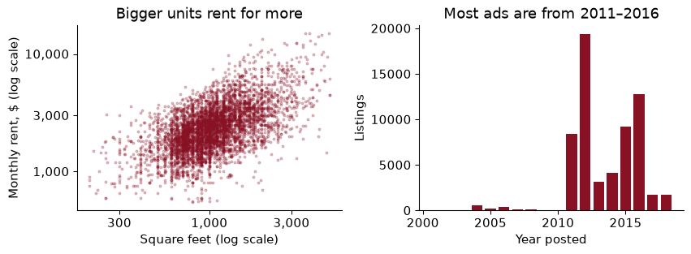

Two things in that picture will matter later. The left panel is a cloud around a rising line, so size alone gets us a long way but leaves a lot unexplained; location and time will have to do the rest. The right panel says that 92% of the ads are from 2011 to 2016. A model trained here will know a great deal about 2012 and very little about 2005 or 2018, and no amount of cleverness changes that.

### Worked example — what the skew means for the loss

The housing office says: “Just predict the typical rent for everyone.” Which typical rent, the mean or the median, gives the lower RMSE? Which gives the lower MAE?

### Solution

The mean minimises squared error and the median minimises absolute error; that is a fact about the two statistics, not about rents. On these data:

| Predict everyone at | RMSE    | MAE   |
|---------------------|---------|-------|
| the mean, \$2,592   | \$1,372 | \$949 |
| the median, \$2,300 | \$1,403 | \$915 |

Each wins on its own loss. The difference is small here, but the lesson is not: **the loss you choose quietly chooses the “right” answer for you**, so choose it from the decision, not from habit.

## Split first, and lock the test set away

The next step is the one that protects you from yourself. Before fitting anything, put a fifth of the listings aside as a **test set**: 12,426 ads, leaving 49,703 for training. Then do not look at it again until the very end.

``` python
from sklearn.model_selection import train_test_split
num, cat = ["sqft", "beds", "baths", "year"], ["county", "nhood"]
X, y = d[num + cat], d["price"]
X_train, X_test, y_train, y_test = train_test_split(X, y, test_size=0.2, random_state=368)
```

Why so strict? Because the test set is your only estimate of how the model will do on listings it has never seen, and that estimate is honest only if nothing about the model was chosen by looking at it. Every time you check the test score, try a change, and check again, a little of the test set leaks into your choices. Do it twenty times and you have fitted the test set, by hand, slowly. The score you then report is the score of the best of twenty tries, and the best of twenty is lucky by construction.

Kleinberg et al. (2018), in their study of bail decisions in New York, kept a “lock box”: a sample nobody on the team touched until the analysis was written. That is the attitude. In this course the rule is simpler: **the test set is touched once**, at step 8, for the one model you have already chosen.

So how do we compare models in the meantime? On the training data alone, by cross-validation, which is coming shortly.

### Worked example — the best of twenty

Suppose you have twenty models that are, in truth, *equally good*: each would have an RMSE of exactly \$750 on the whole population of future listings. You score all twenty on the same test set and report the best. Roughly what do you report?

### Solution

Each test score is the truth plus some noise, because the test set is one sample. How noisy? Score even the dumbest model on five different fifths of our training data and its RMSE moves around with a standard deviation of about \$13. Simulate twenty such scores, keep the smallest, and repeat ten thousand times: the reported “best” averages \$726, about \$24 better than any model really is.

None of the twenty is better than the others. You would be reporting luck, and calling it a finding. That is the whole case for touching the test set once.

## A baseline: predict the median

Before any real model, I want a number to beat. The dumbest reasonable rule is to ignore the features and predict the training median, \$2,300, for every flat. scikit-learn calls this a `DummyRegressor`, and it has the same `fit` and `predict` as any other model.

``` python
from sklearn.dummy import DummyRegressor
from sklearn.model_selection import KFold, cross_val_score
cv = KFold(5, shuffle=True, random_state=368)
base = -cross_val_score(DummyRegressor(strategy="median"), X_train, y_train,
                        cv=cv, scoring="neg_root_mean_squared_error")
```

Its cross-validated RMSE is \$1,403. Every model that follows has to come in below that, by a margin that matters, or it is not worth the trouble.

A baseline does two jobs. It tells you whether the features carry any information at all. And it gives your reader a scale: “\$700” means nothing in isolation, but “half the error of guessing the median” means a lot. Write the baseline into every table you report.

### Worked example — reading the baseline

The housing office has a budget for 3,000 vouchers and sets each one at the predicted rent. If it used the median for every unit, what is a typical miss per unit, and what is that as a share of the median rent?

### Solution

The typical miss is the RMSE, \$1,403 a month. As a share of the median rent of \$2,300 that is 61%. A voucher set that badly would be far too generous for a studio in Vallejo and hopeless for a family flat in San Francisco. We can do better than that, and the next sections will.

## Leakage: the price is in the title

Here is a column I have not mentioned: the title of each ad. A few of them, cut to sixty characters:

    $1425 / 1br - 735ft² - BEST LOCATION SOUTHSHORE GARDENS APAR
    $3900 / 5br - 2581ft² - Gorgeous Restored Victorian - Spacio
    Nov  2 Newly remodeled 4br/3ba (2 mastersuites) in quiet Fre

Craigslist puts the asking rent at the front of the title. Pull out the number after the dollar sign and you find a price in 67% of our listings, and where there is one it equals the rent in 99.95% of cases.

Feed that number to a model and it looks like a genius. On the training listings whose title carries a price, a regression on the title price alone has a cross-validated RMSE of \$74. An honest regression on size, bedrooms and year, on the same rows, manages \$1,003. Nothing else in this chapter will come close to the leaky number, and it is worthless.

It is worthless because of the question. We are predicting the rent of a unit *before anyone posts an ad*. At that moment there is no title. The title is written by someone who already knows the rent, so a model that reads it is not predicting; it is copying. This is **leakage**: information that would not be available at the moment of prediction gets into the training data, and the model learns to use it.

Leakage is dangerous because the test set does not catch it. The title is in the test listings too, so the test score looks wonderful. You find out only when you deploy the model and the feature is not there, or, in this data, when the custom changes: the share of titles that carry a price is 100% in 2012, 1% in 2014, 75% in 2016 and 1% in 2017, as the format of the scraped titles came and went. A model leaning on it would fall apart the year the format changed, and nothing in its test score would have warned you.

The test I use is a single question for every feature: **would I know this at the moment I have to predict?** It catches the title. It also catches subtler things, like a free-text description that says “just reduced to \$2,400!”.

### Worked example — which features would leak?

The housing office will predict rents for units that have not been listed. Which of these could go in the model: square footage, the ad’s posting date, the ad’s description text, the neighbourhood, the number of days the ad stayed up?

### Solution

- **Square footage, neighbourhood**: yes. Both are facts about the unit, known before it is listed.
- **Posting date**: the *year* is fine as a stand-in for “when are we predicting”, and we will use it. The exact posting date of an ad that does not exist yet is not.
- **Description text**: no. Like the title, it is written by someone who knows the price, and it often states it.
- **Days the ad stayed up**: no, and this one is sneaky. It is measured *after* the rent is set, and over-priced units sit longer, so it is a consequence of the outcome. Using it is the prediction version of controlling for a post-treatment variable.

## Pipelines: preprocessing is part of the model

Our features are a mix. Square feet, bedrooms, bathrooms and year are numbers; county and neighbourhood are categories. Bathrooms are missing for most listings. A model needs every column filled, numeric, and (for some methods) on a common scale. So before modelling there are three chores:

- **Impute**: fill missing bathrooms, here with the median.
- **Scale**: rescale each number to mean 0 and standard deviation 1, so that square feet (in the hundreds or thousands) does not swamp bedrooms (one to five).
- **Encode**: turn each category into 0/1 dummy columns (**one-hot encoding**), lumping neighbourhoods with fewer than 50 training listings into one “infrequent” column.

You could do these by hand on the whole data set and then split. Do not. The median used to fill the gaps, the means and standard deviations used for scaling, and the list of neighbourhoods common enough to keep are all *computed from data*. Compute them on everything and the test set has helped shape the training inputs. That is leakage again, quieter than the title, but leakage.

The fix is to make the chores part of the model. A **Pipeline** chains steps so that `fit` learns every step from the training data only, and `predict` applies the same fitted steps to new data. A **ColumnTransformer** sends different columns to different steps.

``` python
from sklearn.compose import ColumnTransformer
from sklearn.pipeline import make_pipeline
from sklearn.impute import SimpleImputer
from sklearn.preprocessing import StandardScaler, OneHotEncoder

def make_prep():
    return ColumnTransformer([
        ("num", make_pipeline(SimpleImputer(strategy="median"), StandardScaler()), num),
        ("cat", OneHotEncoder(handle_unknown="infrequent_if_exist", min_frequency=50), cat)])

ols = make_pipeline(make_prep(), LinearRegression())
```

Inside cross-validation this matters a great deal. Each time a fold is held out, the pipeline is refitted on the other four, so the imputation median and the scaling are learned without the held-out fold. The held-out fold is treated exactly as a brand-new listing would be.

Linear regression on these features has a cross-validated RMSE of \$747, against \$1,403 for the median. That is 47% lower. Size, place and year do carry a lot of information.

### Worked example — counting the columns

The pipeline turns six raw columns into how many model inputs? Why use `min_frequency=50` and `handle_unknown="infrequent_if_exist"`?

### Solution

After preprocessing, the model sees 135 columns: four scaled numbers, plus one dummy for each county and for each neighbourhood with at least 50 training listings, plus a catch-all for the rest.

`min_frequency=50` stops the model from estimating a separate rent level for a neighbourhood it has seen three times; those estimates would be mostly noise. `handle_unknown="infrequent_if_exist"` handles a neighbourhood that appears in new data but never appeared in training: instead of crashing, the model puts it in the catch-all. For a housing office pricing units across the whole region, that second option is not a nicety. Without it, the first unit from an unseen neighbourhood would stop the programme.

## A second model: nearest neighbours

Linear regression forces every effect to be a straight line and every neighbourhood to shift rents by a fixed amount. Real rents are lumpier than that. An extra bedroom may matter more in Palo Alto than in Vallejo, and square footage may matter less once a flat is already large.

**K-nearest neighbours** (KNN) makes no such assumptions. To price a flat, it finds the $k$ training listings most similar to it, measured by distance in the scaled feature space, and predicts the average of their rents. That is all. It is instance-based in exactly the sense of the map earlier: there are no coefficients, only stored listings and a rule for finding the close ones.

Two features of KNN matter in practice. First, distance depends on units, so scaling is not optional. Without it, a difference of 100 square feet would count a hundred times more than a difference of one bedroom. Second, $k$ is a **hyperparameter**: a setting you choose, not something the fitting estimates. Small $k$ follows the data closely, noise included; large $k$ averages over many listings and smooths the noise away, along with some of the signal.

Swapping it in changes one line:

``` python
knn = make_pipeline(make_prep(), KNeighborsRegressor(n_neighbors=10))
```

With $k = 10$ the cross-validated RMSE is \$671, better than the linear model’s \$747.

### Worked example — a prediction by hand

What does KNN with $k = 5$ predict for a 900 square foot, two-bedroom, one-bath flat in the Mission District in 2016? Show the five neighbours.

### Solution

The pipeline scales the new flat with the training means and standard deviations, then finds the five closest training listings:

             sqft  beds  baths  year             nhood  rent
    74682   900.0   2.0    1.0  2016  mission district  3600
    74793   860.0   2.0    1.0  2016  mission district  4100
    74357  1000.0   2.0    1.0  2016  mission district  2595
    74502  1100.0   2.0    1.0  2016  mission district  4280
    74470   878.0   2.0    1.0  2017  mission district  4439

They are all Mission District flats of about the right size, and the prediction is their average, \$3,803.

Notice what the model did *not* do. It did not estimate what a square foot is worth. It found similar flats and looked up what they rented for, which is exactly what a sensible person would do with a stack of old ads, only faster.

## Cross-validation

I have been quoting “cross-validated RMSE” without explaining it. Here it is.

We need to compare models without touching the test set. One way is to split the training data again, into a smaller training part and a **validation** part. That works, but it wastes data, and the answer depends on which listings happened to land in validation.

**$k$-fold cross-validation** fixes both problems. Cut the training data into $k$ equal folds (five here). Fit the model on four folds and compute the RMSE on the fifth. Rotate, so every fold is held out once. Average the five RMSEs. Every training listing is used for fitting four times and for checking once, and the average is far more stable than any single split. (Do not confuse this $k$, the number of folds, with the $k$ in nearest neighbours. Statisticians ran out of letters long ago.)

``` python
ols_cv = -cross_val_score(ols, X_train, y_train, cv=cv, scoring="neg_root_mean_squared_error")
knn_cv = -cross_val_score(knn, X_train, y_train, cv=cv, scoring="neg_root_mean_squared_error")
```

scikit-learn maximises scores, so it hands back losses with a minus sign; the leading minus undoes it.

The five fold scores are worth looking at, not just their average:

| RMSE by fold, \$ | 1     | 2     | 3     | 4     | 5     | mean      |
|------------------|-------|-------|-------|-------|-------|-----------|
| Median           | 1,426 | 1,400 | 1,387 | 1,401 | 1,403 | **1,403** |
| Linear           | 765   | 739   | 735   | 759   | 739   | **747**   |
| KNN, $k = 10$    | 684   | 666   | 664   | 689   | 651   | **671**   |

The spread across folds tells you how noisy each estimate is. Here the linear model’s fold scores have a standard deviation of \$12.

### Worked example — is the difference real?

KNN beats the linear model by \$76 on average. Is that more than fold-to-fold noise?

### Solution

The right comparison is fold by fold, because both models were scored on the *same* five folds. A hard fold is hard for both, so compare them pairwise. The differences (linear minus KNN) run from \$70 to \$89.

KNN wins on 5 of 5 folds. The fold scores themselves move around by about \$12, but the *difference* between the two models is far steadier than either score. That is a real advantage, not luck.

I would still not call it a large one. KNN cuts the typical miss by about 10%. Whether that is worth giving up a model you can explain in a sentence is a judgment, not a statistic.

## Tune a little

I picked $k = 10$ out of the air. Cross-validation can pick it for us: compute the CV RMSE for a handful of values and take the smallest.

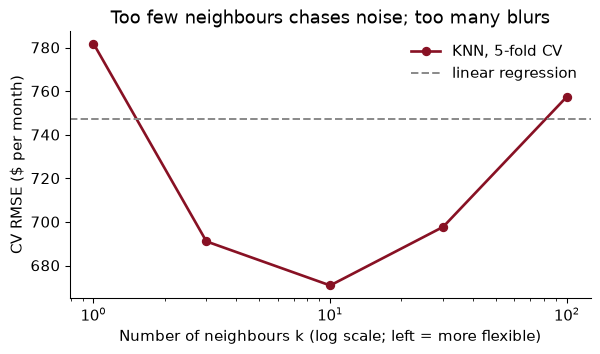

The curve is a U, and it is the bias–variance trade-off you can see. At the left, $k = 1$ copies the rent of the single closest listing, noise and all: low bias, high variance. At the right, $k = 100$ averages over so many listings that real differences are washed out: low variance, high bias. The best value on our grid is $k =$ 10, with a CV RMSE of \$671.

Why only “a little”? Each value you try is another chance to fit noise in the cross-validation folds. Five values of one hyperparameter is fine. Five hundred combinations of six hyperparameters, chosen to the last dollar, starts to repeat the best-of-twenty problem one level down. Tune the few settings that matter, on a coarse grid, and stop.

### Worked example — why not $k = 1$?

At $k = 1$, the training RMSE (predicting the training listings from the model fitted to them) is \$242. The cross-validated RMSE is \$782. Explain the gap. Why is the training RMSE not exactly zero?

### Solution

When a training listing is predicted by a 1-nearest-neighbour model fitted on the training data, its nearest neighbour is usually *itself*, so the prediction is its own rent and the error is zero. The training RMSE measures memory, not prediction. The CV RMSE asks the honest question, how well it does on listings it has not stored, and the answer is: worse than the linear model.

It is not exactly zero because some listings are identical in every feature but have different rents, two 800 square foot one-bedrooms in the same neighbourhood in the same year at different prices. The model can store only one rent per point in feature space, so it gets one of them wrong. That leftover is a small glimpse of the *irreducible* error: variation in rent that our features cannot explain, however flexible the model.

## Test once

Everything is now chosen: the features, the preprocessing, the model, and $k =$ 10. Refit that one model on the whole training set and score it, once, on the 12,426 listings we locked away.

``` python
final = make_pipeline(make_prep(), KNeighborsRegressor(n_neighbors=best_k)).fit(X_train, y_train)
test_rmse = root_mean_squared_error(y_test, final.predict(X_test))
```

**The test RMSE is \$668 a month**, close to the cross-validated \$671. That agreement is the point of the exercise: cross-validation promised roughly this, and the untouched data delivered it. For a sense of scale, predicting the training median for every test listing would have missed by \$1,400. (That number was not used to choose anything; it is there so a reader knows what \$668 means.)

Now the hard part: you do not go back. If the test RMSE disappoints, you may learn something and start a *new* project with a *new* test set, but you do not tweak this model and test again. The moment you do, the test set is just another validation set, and you no longer have an honest number.

### Worked example — saying it in words

Write one sentence for the housing office that reports the result. Then say what the sentence should not claim.

### Solution

“For a typical whole unit in the Bay Area, our model’s rent estimate misses the asking rent by about \$668 a month (root mean squared error on 12,426 held-out listings); half the time the miss is smaller than \$217, and the average absolute miss is \$379.”

It should not claim that the model knows what a bedroom is worth, or that it will be this accurate for units unlike the ones in the data. Most listings are from 2011 to 2016, and they are asking rents on Craigslist, not signed leases. A model is as good as its data on the cases its data cover, and no better.

## In Python

The whole project, from download to the test score, in one place. It runs top to bottom in the course environment.

``` python
from pathlib import Path
import numpy as np, pandas as pd
from sklearn.model_selection import train_test_split, KFold, GridSearchCV
from sklearn.compose import ColumnTransformer
from sklearn.pipeline import Pipeline, make_pipeline
from sklearn.impute import SimpleImputer
from sklearn.preprocessing import StandardScaler, OneHotEncoder
from sklearn.neighbors import KNeighborsRegressor
from sklearn.metrics import root_mean_squared_error
SEED = 368

path = Path("../data/rent.csv")                      # download once, then reuse
if not path.exists():
    path.parent.mkdir(exist_ok=True)
    pd.read_csv(URL).to_csv(path, index=False)
rent = pd.read_csv(path)
```

Clean, choose features, split. The title is deliberately not among the features.

``` python
d = (rent.dropna(subset=["beds", "sqft", "county"])
         .query("room_in_apt == 0 and beds <= 5 and 200 <= sqft <= 5000 and 500 <= price <= 15000"))
num, cat = ["sqft", "beds", "baths", "year"], ["county", "nhood"]
X, y = d[num + cat], d["price"]
X_train, X_test, y_train, y_test = train_test_split(X, y, test_size=0.2, random_state=SEED)
```

The pipeline, and a small grid search: cross-validation over three values of $k$, on the training data only.

``` python
prep = ColumnTransformer([
    ("num", make_pipeline(SimpleImputer(strategy="median"), StandardScaler()), num),
    ("cat", OneHotEncoder(handle_unknown="infrequent_if_exist", min_frequency=50), cat)])
pipe = Pipeline([("prep", prep), ("knn", KNeighborsRegressor())])

search = GridSearchCV(pipe, {"knn__n_neighbors": [5, 10, 20]},
                      cv=KFold(5, shuffle=True, random_state=SEED),
                      scoring="neg_root_mean_squared_error", n_jobs=-1)
search.fit(X_train, y_train)
print(search.best_params_, f"CV RMSE ${-search.best_score_:,.0f}")
```

    {'knn__n_neighbors': 10} CV RMSE $671

`GridSearchCV` refits the best pipeline on all of the training data when it finishes. That refitted model is the one we score, once.

``` python
final_rmse = root_mean_squared_error(y_test, search.predict(X_test))
print(f"Test RMSE: ${final_rmse:,.0f} a month on {len(y_test):,} held-out listings")
```

    Test RMSE: $668 a month on 12,426 held-out listings

## What goes wrong

**Tuning on the test set.** Checking the test score, changing something, and checking again. Each look spends a little of its honesty, and you cannot get it back. Choose on cross-validation; test once.

**Preprocessing before splitting.** Filling missing bathrooms with the median of *all* the data, scaling with the overall mean, or deciding which neighbourhoods are “common” from the full sample. Each lets the test set shape the training inputs. Put every data-dependent step inside the pipeline.

**Features you would not have in time.** The rent printed in the ad title is the vivid case. Ask of every column: would I know this at the moment I have to predict? A test set cannot rescue you, because the leak is in the test set too.

**Reposts on both sides of the split.** Landlords repost the same ad. In our data, 19% of test listings have an exact twin (same rent, size, bedrooms, neighbourhood and year) in the training set. A nearest-neighbour model can look such a listing up rather than predict it, which flatters the score. When the same unit, person or firm can appear more than once, split by group (`GroupKFold`), or remove duplicates first.

**A random split when the future is what you predict.** A random split lets the model learn from 2016 ads to predict 2012 ones. If the housing office will use the model on next year’s units, train on earlier years and test on later ones, and expect the error to be larger.

**Reading the model as an economist reads a regression.** “KNN says an extra bedroom in the Mission adds so many dollars” is not something KNN says. It predicts; it does not explain. If you want what a bedroom is worth, you have a $\hat\beta$ problem.

## Exercises

1.  For each, say whether it is a $\hat\beta$ problem or a $\hat y$ problem, and why. (a) Estimating whether a new BART station raised nearby rents. (b) Deciding which restaurants a city’s three health inspectors visit this week. (c) Imputing missing household income in a survey so that a poverty rate can be computed.

2.  A classmate reports a cross-validated $R^2$ of 0.99 for rents using square feet, county and a column called `descr_rent`, which she extracted from the description text. What has happened, and what would you tell her to do?

3.  Compute the cross-validated **mean absolute error** of the median baseline, the linear model and KNN with $k = 10$. Do the three models rank in the same order as under RMSE? (Use `scoring="neg_mean_absolute_error"`.)

4.  Remove reposts before splitting: drop rows that duplicate an earlier row on `price`, `sqft`, `beds`, `nhood` and `year`. How many listings remain? Re-run the cross-validation for the linear model and KNN with $k = 10$. How much of KNN’s advantage survives?

5.  Make a **time split**: train on listings from 2015 and earlier and test on 2016 and later, using the linear model. Compare its RMSE on the later years with the cross-validated RMSE from the random split. Why are they different, and which would you show the housing office?

6.  Take the `StandardScaler` out of the numeric branch of the pipeline and re-run the cross-validation for KNN with $k = 10$. What happens, and why? Does the linear model care?

7.  A landlord reads that your KNN model predicts \$3,803 for her 900 square foot two-bedroom in the Mission and asks how much more she would get if she added a bathroom. What do you tell her?

### Answers

**1.** (a) $\hat\beta$: it asks what rents would have been without the station, a counterfactual that needs a design such as difference-in-differences. (b) $\hat y$: the city needs the probability that each restaurant has a violation, and sends inspectors to the highest; this is one of Kleinberg et al.’s examples. (c) $\hat y$: the imputed incomes only need to be close to the truth (and unbiased on average, so the poverty rate is right); nobody will read the imputation model’s coefficients.

**2.** Leakage. A rent that is *extracted from the ad’s own text* is the rent, written down by the person who set it, exactly like the price in the title. An $R^2$ of 0.99 on a messy economic outcome is itself a warning sign. Drop the column, ask of every remaining feature whether it would exist before the ad is posted, and re-run.

**3.**

``` python
mae = {name: -cross_val_score(m, X_train, y_train, cv=cv, n_jobs=-1,
                              scoring="neg_mean_absolute_error").mean()
       for name, m in {"median": DummyRegressor(strategy="median"), "linear": ols,
                       "KNN k=10": knn10}.items()}
print({k: round(v) for k, v in mae.items()})
```

    {'median': 916, 'linear': 462, 'KNN k=10': 388}

The MAEs are \$916, \$462 and \$388. The ranking is the same as under RMSE: KNN, then linear, then the median. Each MAE is well below the matching RMSE, because the RMSE is pulled up by the big misses on expensive units.

**4.**

``` python
dd = d.drop_duplicates(subset=["price", "sqft", "beds", "nhood", "year"])
Xd_tr, _, yd_tr, _ = train_test_split(dd[num + cat], dd["price"], test_size=0.2, random_state=SEED)
dedup = {name: cv_rmse(m, Xd_tr, yd_tr).mean() for name, m in {"linear": ols, "KNN k=10": knn10}.items()}
print(len(dd), {k: round(v) for k, v in dedup.items()})
```

    54176 {'linear': 767, 'KNN k=10': 706}

54,176 listings remain (7,953 were reposts). The linear model’s CV RMSE moves to \$767 and KNN’s to \$706. KNN’s advantage shrinks from \$76 to \$61: part of it was looking up reposts, but most of it is real.

**5.**

``` python
early, late = d[d["year"] <= 2015], d[d["year"] >= 2016]
ols_time = make_pipeline(make_prep(), LinearRegression()).fit(early[num + cat], early["price"])
rmse_late = root_mean_squared_error(late["price"], ols_time.predict(late[num + cat]))
print(len(early), len(late), round(rmse_late))
```

    45932 16197 802

Trained on 45,932 listings up to 2015, the linear model misses the 16,197 listings from 2016 on by \$802, against \$747 under the random split. The time split is harder for two reasons: Bay Area rents rose quickly, and `year` enters linearly, so the model must extrapolate a trend to years it has never seen; and the mix of listings changes over time. Show the housing office the time-split number. It is the honest estimate of how the model will do on the units it will actually be asked about, which are always in the future.

**6.**

``` python
prep_raw = ColumnTransformer([
    ("num", SimpleImputer(strategy="median"), num),
    ("cat", OneHotEncoder(handle_unknown="infrequent_if_exist", min_frequency=50), cat)])
knn_raw = cv_rmse(make_pipeline(prep_raw, KNeighborsRegressor(n_neighbors=10))).mean()
ols_raw = cv_rmse(make_pipeline(prep_raw, LinearRegression())).mean()
print(round(knn_raw), round(ols_raw))
```

    909 748

Without scaling, KNN’s CV RMSE rises from \$671 to \$909. Distances are now dominated by square feet, which varies by hundreds, and by year, which varies by up to 17. A one-bedroom and a three-bedroom of the same size look like neighbours, and so do two flats in different counties, since a neighbourhood dummy can only differ by 1. The linear model barely notices (\$748 against \$747): rescaling a feature just rescales its coefficient and leaves the predictions where they were.

**7.** That the model cannot tell her. It predicts rents for flats like hers by finding similar listings; it was never built to say what *changing* her flat would do. Flats with two bathrooms differ from flats with one in many ways besides the bathroom (they are bigger, newer, in different buildings). If you force an answer, by changing `baths` to 2 and predicting again, you will get a number, and it will mix the bathroom with everything that comes with bathrooms. Her question is a $\hat\beta$ problem.

**Reading.** Géron, ch. 1–2, for the landscape of machine learning and a longer project built step by step. ISLP (James, Witten, Hastie, Tibshirani & Taylor 2023), ch. 2 and 5, for the statistics of the bias–variance trade-off and cross-validation. Mullainathan & Spiess (2017), “Machine Learning: An Applied Econometric Approach”, *Journal of Economic Perspectives* 31(2), for why $\hat y$ is not $\hat\beta$.


# Chapter 10 — Training linear models

> **The question:** a housing office has to set a voucher for a flat nobody has advertised yet. What rent should it expect, in dollars, and how wide a range should it be ready for?

## OLS as a predictor

You have met ordinary least squares as an **estimator**. In econometrics the point of a regression is the coefficient, and the questions you ask of it are about the coefficient: is it unbiased, is it consistent, what is its standard error, have I left out a variable that is correlated with both $x$ and $y$?

In this chapter the same machine does a different job. OLS is a **predictor**: a rule that takes the features of a flat and returns a guess of its rent. The questions change. Nobody asks whether the coefficient on square footage is causal. We ask how far off the guesses are on flats the model has never seen, and we answer with the test RMSE from Chapter 9.

Here is the model I will build on for most of the chapter. It is a regression of **log** rent on log square footage, with dummies for the number of bedrooms, the county and the year, fitted to the 49,703 training listings from Chapter 9 (the same cleaning, the same split):

``` python
fit = smf.ols("log_price ~ np.log(sqft) + C(beds) + C(county) + C(year)", data=train).fit()
```

Its test RMSE is 0.252 log points, so a typical miss is roughly 25% of the rent. The training RMSE is 0.250. The two are almost identical, which is what you expect from a model with 33 coefficients and tens of thousands of rows: there is not enough flexibility to memorise anything. Why logs, and how to get back to dollars, is a section of its own below.

The coefficient on log square footage is 0.59. Read as an elasticity, a flat that is 10% bigger rents for about 6% more. As a predictor, that is all it needs to be: a weight that, combined with the others, makes good guesses.

Why is OLS a sensible predictor even when the “true” model is surely not a straight line in these variables? Because of what OLS does: it picks the coefficients that make the squared errors in the training data as small as possible. If the world is not linear, OLS still gives the best *linear* approximation to it, in the sense of the smallest average squared error. That is exactly the loss we chose in Chapter 9. You do not need to believe the model to use it; you need it to predict well, and you check that on test data.

> An estimator is judged by whether $\hat\beta$ is close to $\beta$. A predictor is judged by whether $\hat y$ is close to $y$, on data it has not seen. Same arithmetic, different exam.

### Worked example — the omitted variable that does not matter

A colleague points out that the rent model leaves out the age of the building, the view, and whether there is parking. “Your coefficient on size is biased,” she says. “Bigger flats are in newer buildings.” Is she right, and should the housing office care?

### Solution

She is right about the coefficient. Bigger flats differ from smaller ones in many ways that also raise rent, so 0.59 mixes the value of space with the value of everything that comes with space. As an estimate of what an extra square foot is *worth*, holding the flat otherwise fixed, it is biased.

For the housing office it barely matters. The office wants a good guess of the rent of a flat drawn from the same market. If bigger flats tend to come with parking, the size coefficient quietly absorbs some of the value of parking, and the prediction for a big flat is better for it, not worse. Omitted variables make predictions *noisier* (the variation they would explain ends up in the error), but they do not bias them, as long as the relationship between what is in the model and what is left out stays the same.

That last clause is the catch. If the city starts building large flats without parking, the relationship changes and the predictions go wrong, and nothing in the test RMSE, computed on old listings, would have warned you. Prediction models assume that tomorrow looks like the training data.

## The normal equation, in words

How does the computer find the OLS coefficients? For linear regression there is a formula, the **normal equation**:

$$\hat\beta = (X'X)^{-1}X'y$$

where $X$ is the table of features, one row per flat and one column per feature (plus a column of ones for the intercept), and $y$ is the column of log rents.

I do not want you to memorise the matrix algebra. I want you to be able to say what it does, in words:

- $X'y$ measures how much each feature moves with rent. Size moves with rent a lot; the year dummies a bit.
- $X'X$ measures how much the features move with *each other*. Size moves with bedrooms; San Francisco moves with small flats.
- Multiplying by the inverse of $X'X$ **untangles** the two. It credits each feature with the part of its co-movement with rent that the other features cannot account for. That is the “holding the others constant” you learned in econometrics, done in one step.

In numpy it is two lines. `patsy` turns the formula into the matrix $X$, exactly as `statsmodels` does behind the scenes:

``` python
yv, Xd = patsy.dmatrices("log_price ~ np.log(sqft) + C(beds) + C(county) + C(year)", train)
beta_hat = np.linalg.solve(Xd.T @ Xd, Xd.T @ yv)
```

The 33 coefficients agree with `statsmodels` to within 6e-11, which is rounding error.

The normal equation is exact and, for a problem this size, instant. Its weakness is cost as the number of features grows. Computing it means working with $X'X$, a square table with one row and one column per feature, and the work of solving it grows roughly with the *cube* of the number of features. Double the rows and the job takes about twice as long. Double the features and it takes about eight times as long. With 33 columns nobody notices. With the hundred thousand word counts of a text regression (Chapter 19), or data too big to fit in memory at once, you need another way. That way is gradient descent.

### Worked example — the normal equation with one feature

Three hypothetical flats have (centred) log sizes $x = -1, 0, 1$ and log rents $y = 7.0, 7.5, 8.2$. With one feature and an intercept, and $x$ centred at zero, the normal equation reduces to two familiar formulas. What are they, and what are the coefficients?

### Solution

When $x$ has mean zero, the intercept and the slope untangle completely, and the normal equation becomes

$$\hat\beta_0 = \bar y, \qquad \hat\beta_1 = \frac{\sum_i x_i y_i}{\sum_i x_i^2}.$$

The intercept is the mean log rent, $(7.0 + 7.5 + 8.2)/3 = 7.567$. The slope is $(-7.0 + 0 + 8.2)/(1 + 0 + 1) = 1.2/2 = 0.6$. The top of the slope formula is the “how much does $x$ move with $y$” part; the bottom is the “how much does $x$ move with itself” part. With more features, the bottom becomes the whole table $X'X$, but the idea is the same.

## Gradient descent

Gradient descent is how almost every model after this chapter is trained, from LASSO in Chapter 11 to the neural networks of Chapter 18. It is worth seeing it once on a problem where we know the right answer.

The idea is to forget the formula and walk downhill. The training MSE is a function of the coefficients: pick some $\beta$, and you get some average squared error. Picture that function as a landscape. For linear regression it is a bowl with a single lowest point, which is the OLS solution. Gradient descent starts somewhere (all zeros will do), works out which direction is downhill, takes a step that way, and repeats.

“Which direction is downhill” is the **gradient**, the vector of slopes of the MSE with respect to each coefficient. For the MSE of a linear model it is

$$\nabla \text{MSE}(\beta) = \frac{2}{n}X'(X\beta - y).$$

Read it from the inside out. $X\beta - y$ is the column of current errors. $X'$ times the errors asks, for each feature, whether the errors are large where that feature is large. If they are, that coefficient is too big and the gradient says so. Each step moves $\beta$ a little against the gradient:

$$\beta \leftarrow \beta - \eta\, \nabla \text{MSE}(\beta),$$

where $\eta$ (eta) is the **learning rate**, the size of the step. It is a hyperparameter, like $k$ in nearest neighbours.

Here it is in numpy, on a small version of the rent model with three standardised features (log size, bedrooms, year) so the numbers are easy to look at:

``` python
cols = ["sqft", "beds", "year"]
Z = train[cols].assign(sqft=np.log(train["sqft"]))
Z = ((Z - Z.mean()) / Z.std()).to_numpy()
X3 = np.column_stack([np.ones(len(Z)), Z])          # intercept + 3 standardised features
y3 = train["log_price"].to_numpy()

def batch_gd(eta, steps=200):
    b, path = np.zeros(X3.shape[1]), []
    for _ in range(steps):
        err = X3 @ b - y3
        b = b - eta * 2 / len(y3) * X3.T @ err         # one step downhill
        path.append(np.mean(err ** 2))
    return b, path
```

After 200 steps with $\eta = 0.3$, the coefficients agree with the normal equation to within 7e-10. With $\eta = 0.01$ they are still off by up to 0.14. With $\eta =$ 0.56 they never arrive at all:

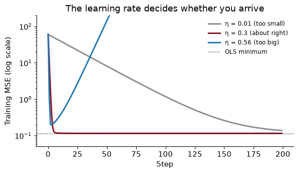

That picture is the **learning-rate trade-off**. Too small, and every step is safe but you need thousands of them. Too big, and each step overshoots the bottom of the bowl, lands higher up the other side, and the next step overshoots further: the error explodes. The best learning rate is as large as possible without overshooting.

Standardising the features matters here, as it did for nearest neighbours. If square footage were left in raw units (hundreds to thousands) next to bedrooms (one to five), the bowl would be a long narrow valley: steep across the square-footage direction and nearly flat along the bedrooms direction. Any step size small enough not to overshoot in the steep direction would crawl in the flat one.

### Stochastic and mini-batch gradient descent

**Batch** gradient descent, the version above, uses every training row to compute each step. With 49,703 rows that is fine; with a billion it is not. Two cheaper versions look at fewer rows per step.

- **Stochastic gradient descent** (SGD) computes the gradient from *one* randomly chosen row and steps. Each step is noisy (one flat is a poor guide to the whole market), but steps are so cheap that you can take millions of them. The path to the bottom staggers rather than glides, and it never quite settles: near the minimum it keeps bouncing around. The usual fix is to shrink the learning rate over time.
- **Mini-batch** gradient descent is the compromise everyone actually uses: a random batch of, say, 64 rows per step. Much less noisy than one row, much cheaper than all of them, and it suits the way computer hardware likes to do arithmetic.

One full pass through the training data is called an **epoch**. Five epochs of mini-batches of 64 rows is 3,880 small steps, and it lands within 0.011 of the exact coefficients. scikit-learn’s `SGDRegressor` does the same with more care about the learning rate.

For linear regression on data that fit in memory, none of this beats the normal equation, and `LinearRegression` does not use it. The point is that gradient descent works for *any* loss you can take slopes of, with or without a formula, which is why you will see it again in Chapter 11 (as a form of regularisation) and in Chapter 18 (as the only way to train a neural network).

### Worked example — how big a step?

For a linear model, there is a largest learning rate beyond which batch gradient descent explodes. It depends on how steep the bowl is in its steepest direction. For our three-feature model that limit is 0.538. Our “too big” rate was 0.56, only 5% over the limit. Why does such a small excess make the error explode rather than merely slow things down?

### Solution

Because overshooting compounds. In the steepest direction, a step at the limit lands exactly as far past the bottom as it started, on the other side; it bounces forever without getting closer. A step slightly over the limit lands slightly *further* away than it started, every time. After one step you are 5% further from the bottom along that direction, after two steps about 10%, and after 200 steps about $1.05^{200} \approx$ 17,293 times as far. That is why the blue line in the figure first drops, as the gentler directions still improve, and then climbs steadily once the one runaway direction takes over. Learning rates fail fast and visibly, which is a mercy: if your training loss is rising, halve $\eta$ before you suspect anything else.

## Logs, and getting back to dollars

Chapter 9 predicted rent in dollars. This chapter has been predicting **log** rent. There are three reasons to prefer logs for prices, wages and incomes, and you have met them all in econometrics.

- **Effects are proportional.** A bigger flat rents for a certain *percentage* more, not a fixed number of dollars more, whether it is in Vallejo or in Pacific Heights.
- **The skew goes away.** Rents have a long right tail; log rents are close to symmetric. A squared-error loss in dollars lets the few very expensive flats dominate the fit.
- **The errors are more even.** In dollars, a model misses expensive flats by much more than cheap ones (the residual plot fans out). In logs the misses are similar in size across the range.

But the housing office pays vouchers in dollars, so at some point we must turn a predicted log rent back into rent. The obvious move is to take the exponential, $e^{\widehat{\log y}}$. It is wrong in a predictable direction.

The reason is that the exponential of an average is not the average of the exponential. The regression predicts the *mean of log rent* for flats like this one. Exponentiating gives (roughly) the *median* rent of those flats, and with a right skew the mean rent is above the median. So naive predictions come in too low on average. On the test set the average actual rent is \$2,590; the average naive prediction is \$2,494.

The fix is due to Duan (1983) and is called the **smearing** estimator. Multiply every naive prediction by one number, the average of $e^{\text{residual}}$ over the training data:

$$\hat y_{\text{dollars}} = e^{\widehat{\log y}} \times \frac{1}{n}\sum_{i=1}^n e^{\hat\varepsilon_i}$$

``` python
smear = np.mean(np.exp(fit.resid))
pred_dollars = smear * np.exp(fit.predict(test))
```

Here the factor is 1.0303, which lifts the average test prediction to \$2,569, close to the actual average. Now we can compare the log model with a model fitted directly in dollars, both scored in dollars on the test set:

| Model | Test RMSE, \$ a month |
|----|----|
| Rent in dollars on square feet, bedrooms, county, year | \$837 |
| Log rent, naive $e^{\hat y}$ | \$818 |
| Log rent, with smearing | \$809 |

The log model wins even when judged in dollars, and smearing helps a little more. The bigger gain from smearing is not in the RMSE but in the *total*: a voucher budget built from naive predictions would come up 3.7% short.

### Worked example — reading a log RMSE and a smearing factor

**(a)** The test RMSE of the log model is 0.252. Explain to the housing office what that means in plain words. **(b)** If the errors were normally distributed with variance $\sigma^2$, the right correction factor would be $e^{\sigma^2/2}$. Compute it from the regression and compare it with the smearing factor.

### Solution

**(a)** A miss of 0.25 in log rent is a miss of about 25% of the rent (more exactly, $e^{0.25} - 1 \approx 28\%$ too high, or $1 - e^{-0.25} \approx 22\%$ too low). So “a typical estimate is off by about a quarter of the rent, in one direction or the other”. A percentage is a more honest summary than a dollar figure here, because the size of the miss scales with the rent.

**(b)** The regression’s residual variance is 0.0624, so $e^{\sigma^2/2} =$ 1.0317, against a smearing factor of 1.0303. They are close but not equal. Smearing does not assume normal errors; it uses the actual residuals, whatever their shape. That is why I use it by default.

## Interactions

The model so far says that a 10% bigger flat rents for about 6% more everywhere in the Bay Area. Is that plausible? Space might be worth more where land is scarce, or less where every flat is already big.

An **interaction** lets one feature’s slope depend on another. In a formula, `np.log(sqft) * C(county)` means: the log-size slope, the county dummies, *and* a separate log-size slope for each county.

``` python
fit_int = smf.ols("log_price ~ np.log(sqft) * C(county) + C(beds) + C(year)", data=train).fit()
```

The implied elasticity of rent with respect to size, county by county:

    alameda          0.52
    contra costa     0.53
    santa cruz       0.56
    solano           0.57
    sonoma           0.58
    santa clara      0.60
    san francisco    0.60
    san mateo        0.65
    marin            0.69
    napa             0.70

They range from 0.52 in Alameda to 0.70 in Napa. Those are not small differences in an elasticity. Did they help the prediction? The test RMSE moves from 0.2522 to 0.2514. Barely.

That is a common and useful result. Interactions can be real, and worth knowing about, without mattering much for prediction, because most of the listings are in the counties near the middle of the range and the differences in slope only bite for unusually small or large flats. As in Chapter 9: whether a refinement is worth it is a question about the test error, not about whether the coefficients are significant.

### Worked example — what the interaction changes for one flat

Using the interacted model, how much more does a 1,500 square foot two-bedroom rent than a 1,000 square foot two-bedroom, in 2016, in Alameda and in Napa? Answer in per cent.

### Solution

The flat is 50% bigger, so the log size rises by $\log 1.5 = 0.405$. Multiply by each county’s elasticity and exponentiate: in Alameda the bigger flat rents for 23% more, in Napa for 33% more. (The bedrooms, year and county intercepts cancel, because they are the same for both flats within a county.) In the additive model the answer would be 27% everywhere.

The economist’s caution again: these are differences between flats that exist, not the effect of building an extension. Large flats in Napa may be large *houses* with gardens, and the elasticity is carrying the garden.

## Curves: polynomials and splines

Size enters the rent model as a log, which is already a curve. For some variables no simple transformation will do, and the classic economic example is age. Wages rise steeply in the first decade of a career and then flatten. A straight line in age misses that shape at both ends.

To see what different methods do, it helps to know the truth, so I simulate it, exactly as in the Lecture 13 notebook: 3,000 CPS-style workers whose log wage depends on schooling, sex and a known age profile, plus noise. Because the data are made up, we know the best possible prediction for every worker, and we know that even that prediction would miss by an RMSE of 0.360 log points, the **irreducible error**.

The trick that bends a linear regression is to replace `age` with a few new columns built from age, and run ordinary OLS on those. The model is still linear in its coefficients; only the columns are curved. Two ways to build the columns:

- A **polynomial** adds $\text{age}^2, \text{age}^3, \dots$. Simple, but every term affects the fit at every age, so a few points at one end can swing the whole curve.
- A **spline** cuts the range of age at a few **knots** and fits a separate smooth cubic piece between each pair, glued together so that there are no kinks. Each piece answers mainly to the data near it. A **natural** spline is also forced to be a straight line beyond the outer knots, so it does not fly off at the edges.

In `statsmodels` formulas, `cr(age, df=6)` is a natural spline that uses six columns, and `bs(age, df=6)` is an ordinary cubic **B-spline**. The `df` (degrees of freedom) is the number of columns: more df, more wiggle.

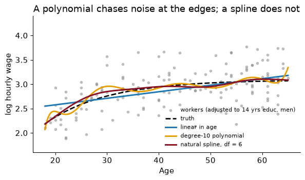

With only 150 workers the differences are stark. The straight line misses the steep early rise. The degree-10 polynomial follows the noise near 18 and 65, where there are few workers to hold it down. The natural spline tracks the truth closely with six columns. Scored on 20,000 fresh simulated workers:

                           coefficients  train RMSE  test RMSE
    linear in age                     4       0.392      0.376
    quadratic                         5       0.385      0.364
    degree-10 polynomial             13       0.374      0.373
    natural spline, df = 6            9       0.379      0.365

The degree-10 polynomial has the lowest *training* RMSE of the four and a worse *test* RMSE than the spline. You have seen that pattern before, with $k = 1$ in Chapter 9: flexibility that buys a better fit to the training data and pays for it on new data. The spline gets the benefit of bending for little of the cost. Here the humble quadratic does as well, because over ages 18 to 65 the true profile happens to be close to a parabola; the spline did not need to be told that, which is the point of it. Every test RMSE is above the floor of 0.360, as it must be.

scikit-learn has the same tool as a pipeline step, `SplineTransformer`, which we will use in the In Python section:

``` python
from sklearn.preprocessing import SplineTransformer
spline_age = SplineTransformer(n_knots=5, degree=3, extrapolation="linear")
```

`extrapolation="linear"` gives the natural-spline behaviour beyond the outer knots.

### Worked example — predicting outside the data

The simulated workers are aged 18 to 65. A pension office asks for a predicted wage at age 70. What do the degree-10 polynomial and the natural spline (both fitted to the 150 workers) predict, compared with the truth, for a man with 14 years of schooling?

### Solution

In log points, the truth is 3.08, the natural spline predicts 3.05 and the polynomial 7.81. In dollars an hour (ignoring smearing), that is \$22, \$21 and \$2,471.

The spline continues in a straight line from its last knot, which is a modest and sensible guess. The polynomial’s tenth-power term, which was held in check inside the data, takes over the moment you leave it. Neither model has *seen* a 70-year-old, and the honest answer to the pension office is that no model fitted to these data can tell them much. But if you must extrapolate, a curve that is linear at the edges is the less dangerous one. (A B-spline from `bs()` cannot extrapolate at all: it is simply undefined outside the range it was built on, unless you set its bounds by hand.)

## Learning curves

How do you know whether a model needs more flexibility, less flexibility, or more data? A **learning curve** answers that. Train the model on a small sample, then a larger one, then larger still, and at each size record two numbers: the error on the rows it was trained on, and the error on held-out validation rows. Plot both against the size of the training set.

Here are learning curves for two models of the simulated wages. The **stiff** model is a plain linear regression on age, schooling and sex: three slopes. The **bendy** model puts a 12-knot spline on age and then adds every square and pairwise product of the resulting columns, 152 columns in all. Each point is the median over 20 random splits, each with 1,000 validation workers.

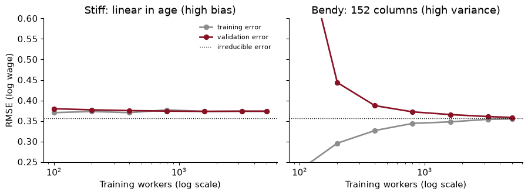

Read the two shapes.

**The stiff model (left) has high bias.** Training and validation error are close together even at 100 workers, and from then on they sit side by side on a plateau at about 0.374, above the irreducible error of 0.357 (the RMSE that the true average wage itself scores on the same validation workers). More data does nothing: the model has learned all a straight line can learn. The gap between the plateau and the floor is the price of the wrong shape. The cure is a more flexible model, not a bigger sample.

**The bendy model (right) has high variance.** With 100 workers its training error is far below the floor (off the bottom of the chart) and its validation error is enormous (0.82, off the top): it is memorising. As the sample grows the gap closes, and by 5,000 workers its validation error is 0.358, *below* the stiff model’s and close to the floor. More data is exactly what this model needed. If you cannot get more data, the cure is to restrain the model: fewer columns, or the penalties of Chapter 11.

> A big gap between training and validation error means variance: get more data or simplify. Two curves that have met at a level you are unhappy with means bias: get a better model or better features.

### Worked example — diagnosing the rent model

Draw the learning curve for the log rent model of this chapter, using 5-fold cross-validation on the training listings at sizes from 500 to the full training set. What does it say the housing office should do next: collect more listings, or improve the model?

### Solution

``` python
from sklearn.compose import ColumnTransformer
from sklearn.preprocessing import OneHotEncoder, FunctionTransformer
from sklearn.model_selection import KFold
rent_model = make_pipeline(ColumnTransformer([
    ("size", FunctionTransformer(np.log), ["sqft"]),
    ("cat", OneHotEncoder(handle_unknown="ignore"), ["beds", "county", "year"])]),
    LinearRegression())
n_r, tr_r, va_r = learning_curve(rent_model, train, train["log_price"], cv=KFold(5, shuffle=True, random_state=SEED),
                                 train_sizes=[500, 2_000, 8_000, 20_000, int(0.8 * len(train))],
                                 scoring="neg_root_mean_squared_error")
lc_rent = pd.DataFrame({"train": -tr_r.mean(1), "valid": -va_r.mean(1)}, index=n_r).round(3)
```

           train  valid
    500    0.247  0.257
    2000   0.242  0.252
    8000   0.251  0.250
    20000  0.249  0.250
    39762  0.250  0.250

This is the stiff shape. By about 2,000 listings, training and validation error have met at about 0.25, and the next 37,762 listings move the validation error by 0.002. The model is bias-limited. Another 50,000 ads would not help; better features would. Neighbourhood instead of county is the obvious first step (Exercise 4), and the more flexible models of Chapters 14 and 15 are the next. That is a useful thing to know before anyone spends money on data.

## Confidence intervals and prediction intervals

A prediction without a range is half an answer. But there are two different ranges, answering two different questions, and mixing them up is one of the most common mistakes in applied work.

Take a 1,000 square foot two-bedroom in San Francisco in 2016. The model’s central prediction is \$4,067 a month (in this section I exponentiate without smearing, to keep the two intervals on the same footing).

- The **confidence interval** answers: *what is the average rent of all flats like this one?* We do not know the coefficients exactly, so we do not know the average exactly. With 49,703 listings we know it rather well: the 95% interval is \$4,036 to \$4,098.
- The **prediction interval** answers: *what will this particular flat rent for?* That adds the flat’s own luck, everything about it the model does not see. The 95% interval is \$2,493 to \$6,636.

`statsmodels` gives both; the confidence interval is `mean_ci_lower` and `mean_ci_upper`, the prediction interval `obs_ci_lower` and `obs_ci_upper`:

``` python
fit.get_prediction(x0).summary_frame(alpha=0.05)
```

The difference in width is not a detail. The confidence interval shrinks towards zero as the sample grows: with a million listings we would know the average rent of such flats almost exactly. The prediction interval does not shrink below the noise. No amount of data tells you whether *this* flat has a view.

Are the prediction intervals honest? Check them the way Chapter 8 checked confidence intervals, by **coverage**: the share of test listings whose actual log rent falls inside their own 95% interval. Overall it is 95.1%, almost exactly right. By county it runs from 90.4% in San Francisco to 98.6% in Solano. The interval uses one noise level for every flat, and rents in San Francisco are harder to predict than elsewhere, so the interval is too narrow there and too wide where rents are steadier.

### Worked example — which interval for whom?

Two people ask the housing office about 1,000 square foot two-bedrooms in San Francisco. A tenant wants to know what she should expect to pay for one. The office’s budget officer wants to know what 3,000 such vouchers will cost in total. Which interval does each need?

### Solution

The tenant needs the **prediction interval**, \$2,493 to \$6,636. She will rent one flat, with its own luck. Telling her \$4,036 to \$4,098 would badly overstate how sure anyone can be.

The budget officer is closer to the **confidence interval**. Over 3,000 flats the individual lucks largely average out (some flats are dearer than predicted, some cheaper), and what remains is uncertainty about the average. Even so, I would give her the average in *dollars*, which means smearing, since a sum of exponentiated log predictions is too low for exactly the reason the earlier section described. And the confidence interval assumes that these 3,000 flats are like the listings in the data, which is the assumption to check first.

## In Python

The whole chapter’s model in one runnable place: a log rent model with splines in size and year, neighbourhood dummies, smearing back to dollars, and a test score in dollars.

``` python
from pathlib import Path
import numpy as np, pandas as pd
from sklearn.model_selection import train_test_split, KFold, cross_val_score
from sklearn.compose import ColumnTransformer
from sklearn.pipeline import make_pipeline
from sklearn.preprocessing import SplineTransformer, OneHotEncoder, FunctionTransformer
from sklearn.linear_model import LinearRegression
from sklearn.metrics import root_mean_squared_error
SEED = 368

path = Path("../data/rent.csv")                       # download once, then reuse
if not path.exists():
    path.parent.mkdir(exist_ok=True)
    pd.read_csv(URL).to_csv(path, index=False)
rent = pd.read_csv(path)
d = (rent.dropna(subset=["beds", "sqft", "county"])
         .query("room_in_apt == 0 and beds <= 5 and 200 <= sqft <= 5000 and 500 <= price <= 15000"))
X, y = d[["sqft", "beds", "year", "county", "nhood"]], np.log(d["price"])
X_train, X_test, y_train, y_test = train_test_split(X, y, test_size=0.2, random_state=SEED)
```

Size gets a log and then a spline; year gets a spline; the categories are one-hot encoded, with rare neighbourhoods lumped together as in Chapter 9.

``` python
log_spline = make_pipeline(FunctionTransformer(np.log), SplineTransformer(n_knots=6, extrapolation="linear"))
prep = ColumnTransformer([
    ("size", log_spline, ["sqft"]),
    ("year", SplineTransformer(n_knots=5, extrapolation="linear"), ["year"]),
    ("cat", OneHotEncoder(handle_unknown="infrequent_if_exist", min_frequency=50), ["beds", "county", "nhood"])])
model = make_pipeline(prep, LinearRegression())

cv = KFold(5, shuffle=True, random_state=SEED)
cv_log = -cross_val_score(model, X_train, y_train, cv=cv, scoring="neg_root_mean_squared_error")
print(f"CV RMSE: {cv_log.mean():.3f} log points")
```

    CV RMSE: 0.216 log points

Fit once on all the training data, smear, and score once on the test set, in dollars.

``` python
model.fit(X_train, y_train)
smear = np.mean(np.exp(y_train - model.predict(X_train)))
pred = smear * np.exp(model.predict(X_test))
print(f"smearing factor {smear:.4f}")
print(f"Test RMSE: ${root_mean_squared_error(np.exp(y_test), pred):,.0f} a month; "
      f"{root_mean_squared_error(y_test, model.predict(X_test)):.3f} log points")
```

    smearing factor 1.0217
    Test RMSE: $677 a month; 0.217 log points

The test RMSE in dollars, \$677, compares with \$809 for the county model earlier in the chapter. For a benchmark, Chapter 9’s nearest-neighbours model with $k = 10$, fitted to the same training listings, misses the same test listings by \$668. The linear model is close behind it, and unlike nearest neighbours it can be written down on a page.

## What goes wrong

**Exponentiating log predictions and calling them dollars.** $e^{\hat y}$ estimates something close to the median, not the mean, so naive predictions are too low on average: here by 3.7%. For a budget that is real money. Multiply by the smearing factor.

**Raw features in gradient descent.** Unscaled features turn the bowl into a narrow valley and force a tiny learning rate. Standardise first. And if the training loss goes *up* as you train, the learning rate is too big; halve it.

**Trusting a polynomial at the edges.** High-degree polynomials are worst exactly where the data are thinnest, and they are catastrophic outside the data: our degree-10 fit predicts a 70-year-old earns \$2,471 an hour. Use a natural spline, and be suspicious of any prediction outside the range of the training data.

**Collecting more data for a bias-limited model.** If training and validation error have already met, more rows will not move either. Draw the learning curve before you buy data.

**Reporting a confidence interval when someone needs a prediction interval.** A tenant, a borrower or a benefit claimant is one case, with one case’s luck. The confidence interval for the mean is far too narrow for them.

**Reading the predictor as an estimator.** The size elasticity of 0.59 is a good predictive weight. It is not the value of an extension, and the county-by-county elasticities are not the value of space in each county. If the decision depends on $\hat\beta$, Chapter 9’s warning applies.

## Exercises

1.  A model of log wages has a test RMSE of 0.40. A model of wages in dollars has a test RMSE of \$9.50. Can you tell which is better from these two numbers? What would you compute to compare them?

2.  Write mini-batch gradient descent for the three-feature rent model (log size, bedrooms, year, standardised). Try batch sizes of 1, 64 and 4,096 with a learning rate of 0.01 for two epochs. How far is each from the normal-equation coefficients, and how many updates did each take?

3.  Smearing uses one factor for every flat. Compute the smearing factor separately for each county from the training residuals of the log model, and compare the average predicted rent (naive, single-factor smearing, county smearing) with the average actual rent in each county on the test set. Where does a single factor do worst?

4.  Replace `C(county)` with neighbourhood dummies in the log model (lumping neighbourhoods with fewer than 50 training listings into “other”, using training counts only). How much does the test RMSE fall? Redraw the learning curve: is the model still bias-limited?

5.  Without computing anything: if the training set were ten times as large, what would happen to the width of the confidence interval and of the prediction interval for the San Francisco flat? Why?

6.  Refit the log model with heteroskedasticity-robust standard errors (`cov_type="HC1"`) and recompute the coverage of the 95% prediction intervals by county. Did it fix the problem in San Francisco? Explain why or why not.

7.  A landlord in Napa reads that the size elasticity there is 0.70 and concludes that a 20% extension will raise her rent by about 14%. What would you tell her?

### Answers

**1.** No. The first is in log points, the second in dollars, so they are not in the same units. Put them on the same scale: convert the log model’s predictions to dollars (with smearing) and compute its RMSE in dollars on the same test set, or take logs of the dollar model’s predictions (where positive) and compute its RMSE in log points. Then decide which scale matches the decision. This chapter compared the rent models in dollars because the vouchers are paid in dollars.

**2.**

``` python
def minibatch(batch, eta=0.01, epochs=2, seed=SEED):
    rng, b, steps = np.random.default_rng(seed), np.zeros(X3.shape[1]), 0
    for _ in range(epochs):
        for idx in np.array_split(rng.permutation(len(y3)), max(len(y3) // batch, 1)):
            b = b - eta * 2 / len(idx) * X3[idx].T @ (X3[idx] @ b - y3[idx])
            steps += 1
    return np.abs(b - b_exact).max(), steps
mb = pd.DataFrame({bs: minibatch(bs) for bs in [1, 64, 4096]}, index=["max gap", "updates"]).T
print(mb.to_string(formatters={"max gap": "{:.4f}".format, "updates": "{:,.0f}".format}))
```

         max gap updates
    1     0.0516  99,406
    64    0.0059   1,552
    4096  4.7727      24

With batches of one row (pure SGD), 99,406 updates get within 0.052: close, but each step is noisy, so it never settles exactly. Batches of 64 take 1,552 updates and land within 0.0059. Batches of 4,096 take only 24 updates, which at this learning rate is not enough to reach the bottom (4.773 off). Larger batches give better steps, but fewer of them per epoch; with large batches you can afford a larger learning rate.

**3.**

``` python
res = train.assign(e=np.exp(fit.resid))
smear_cty = res.groupby("county")["e"].mean()
chk = test.assign(naive=pred_naive, single=pred_smear,
                  by_county=pred_naive * test["county"].map(smear_cty).to_numpy())
gap = chk.groupby("county")[["price", "naive", "single", "by_county"]].mean()
gap_pct = gap[["naive", "single", "by_county"]].div(gap["price"], axis=0) - 1
print(gap_pct.round(3).to_string())
```

                   naive  single  by_county
    county                                 
    alameda       -0.037  -0.008     -0.008
    contra costa  -0.022   0.008      0.009
    marin         -0.045  -0.016     -0.009
    napa          -0.109  -0.082     -0.077
    san francisco -0.051  -0.022     -0.004
    san mateo     -0.036  -0.007     -0.015
    santa clara   -0.038  -0.009     -0.012
    santa cruz     0.000   0.031      0.024
    solano        -0.002   0.028      0.014
    sonoma        -0.022   0.008     -0.006

Naive predictions are too low, or at best about right, in every county. A single smearing factor fixes most of that. The worst county after smearing is Napa (-8.2%), and a county-specific factor barely helps there (-7.7%). That is not a smearing problem: Napa has only 183 test listings, and a few expensive houses among them can move the average by several per cent. Where county smearing clearly helps is San Francisco, from -2.2% to -0.4%. San Francisco is where the residuals are most spread out, the same heteroskedasticity that made the prediction intervals too narrow there. When the noise differs across groups, smearing by group is a cheap improvement; just check that the groups are big enough for their averages to mean something.

**4.**

``` python
keep = train["nhood"].value_counts().loc[lambda s: s >= 50].index
tr4, te4 = (df_.assign(nh=df_["nhood"].where(df_["nhood"].isin(keep), "other")) for df_ in (train, test))
fit_nh = smf.ols("log_price ~ np.log(sqft) + C(beds) + C(nh) + C(year)", data=tr4).fit()
rmse_nh = rmse(te4["log_price"], fit_nh.predict(te4))
rent_nh = make_pipeline(ColumnTransformer([
    ("size", FunctionTransformer(np.log), ["sqft"]),
    ("cat", OneHotEncoder(handle_unknown="infrequent_if_exist", min_frequency=50), ["beds", "nhood", "year"])]),
    LinearRegression())
n4, tr_4, va_4 = learning_curve(rent_nh, train, train["log_price"], cv=KFold(5, shuffle=True, random_state=SEED),
                                train_sizes=[2_000, 8_000, int(0.8 * len(train))], scoring="neg_root_mean_squared_error")
print(round(rmse_nh, 4), (-tr_4.mean(1)).round(3), (-va_4.mean(1)).round(3))
```

    0.2183 [0.313 0.258 0.216] [0.315 0.254 0.216]

Neighbourhoods cut the test RMSE from 0.252 to 0.218 log points: location within a county matters a great deal. The learning curve is more interesting than before. Training and validation error still meet at every size, so there is no sign of variance. But the validation error now keeps falling as the data grow, from 0.315 at 2,000 listings to 0.216 at full size. The reason is `min_frequency=50`: in a small sample most neighbourhoods are too rare to get their own dummy and are lumped into “other”; in a large one they earn their own. More data helps this model, through the features it lets the model use. A learning curve tells you about a model *and* its features together.

**5.** The confidence interval would shrink, roughly by a factor of $\sqrt{10} \approx 3.2$, because it measures uncertainty about the coefficients, and that falls with the sample size. The prediction interval would hardly change. Most of its width is the noise in individual rents, which does not depend on how many flats we have seen; only the small part that comes from uncertainty about the coefficients would shrink.

**6.**

``` python
fit_hc = smf.ols(FORMULA, data=train).fit(cov_type="HC1")
pi_hc = fit_hc.get_prediction(test).summary_frame(alpha=0.05)
cov_hc = ((test["log_price"].to_numpy() >= pi_hc["obs_ci_lower"].to_numpy())
          & (test["log_price"].to_numpy() <= pi_hc["obs_ci_upper"].to_numpy()))
cov_hc_cty = pd.Series(cov_hc, index=test.index).groupby(test["county"]).mean()
print(pd.DataFrame({"classical": cov_cty, "HC1": cov_hc_cty}).round(3).to_string())
```

                   classical    HC1
    county                         
    alameda            0.943  0.943
    contra costa       0.969  0.969
    marin              0.943  0.943
    napa               0.951  0.951
    san francisco      0.904  0.904
    san mateo          0.969  0.969
    santa clara        0.954  0.954
    santa cruz         0.974  0.974
    solano             0.986  0.986
    sonoma             0.979  0.979

It did not. Not a single listing changed sides: coverage in San Francisco is 90.4% either way. Robust standard errors fix the *coefficients’* uncertainty when the noise varies. But the prediction interval is mostly the noise itself, and it still uses one noise level for every flat. To fix it you have to model the noise: estimate how the spread of residuals varies by county (or with the features), or use quantile regression or conformal prediction, which build the interval from held-out errors directly.

**7.** That the number cannot carry that weight. 0.70 describes how rents differ between bigger and smaller flats that exist in Napa, and bigger flats there differ in many ways besides size: more of them are houses, with gardens and parking. An extension adds square feet and nothing else. The prediction model is useful for pricing a flat like the ones in the data; it is not an estimate of what *changing* a flat would do. That is a $\hat\beta$ question, and it needs a research design, such as comparing the same units before and after renovations.

**Reading.** Géron, ch. 4, for the normal equation, the three flavours of gradient descent, polynomial regression and learning curves. ISLP (James, Witten, Hastie, Tibshirani & Taylor 2023), ch. 3 and ch. 7, for linear regression as prediction and for polynomials, splines and generalised additive models. Duan (1983), “Smearing Estimate: A Nonparametric Retransformation Method”, *Journal of the American Statistical Association* 78(383), for smearing.


# Chapter 11 — Regularization and model selection

> **The question:** a state agency wants to know what centre-based infant care costs in every county, including the ones nobody surveyed. It has fifty-one facts about each county and a few hundred counties to learn from. Which facts should the prediction use, and how much should it trust each one?

## Childcare prices, and the counties we cannot see

Childcare is one of the largest bills a young family pays, and its price is one of the things that decide whether a mother with an infant goes back to work. That makes county childcare prices a real policy input: for subsidy schedules, for judging whether a state’s market is “affordable”, for studies of maternal labour supply.

Our data are the US Women’s Bureau’s National Database of Childcare Prices, as cleaned by TidyTuesday (2023-05-09): a county-by-year panel from 2008 to 2018. The outcome is `mc_infant`, the median weekly price of **centre-based care for an infant**. In 2018 the median county charges \$154 a week; the 10th percentile is \$108 and the 90th \$236. Alongside the prices are 51 county covariates from the American Community Survey: unemployment and labour-force participation by sex and age, poverty rates, median household income and earnings, population and households, race and ethnicity shares, how many households with children have both parents working, and employment shares by occupation.

As in Exercise 16, I keep 2018 and model the **log** price, for the reasons Chapter 10 gave.

Before modelling, look at what is missing, as Chapter 4 taught. The covariates are almost complete: the worst column is missing for 0.006% of county-years, and the pipeline’s median imputer can handle that. The outcome is another matter. In 2018 the infant price is missing for 25% of counties, and the missingness is not scattered. In 10 states it is missing for *every* county:

    Colorado, District of Columbia, Florida, Georgia, Indiana, Iowa, Louisiana, Montana, Nevada, New Mexico

That is 652 counties. In another 5 states some counties are missing. And the pattern moves around over time: in Florida, the share of counties with a 2018 price is 0%, after 97% in 2017. Prices are missing because a state did not submit its market-rate survey that year, not because some kind of county is hard to price.

What do we do about it?

- **Drop the rows with no outcome.** We cannot learn from a county whose price we do not know, and filling in the outcome would be making up data and then fitting to it. That leaves 2,360 counties in 2018.
- **Impute the covariates inside the pipeline**, from the training data only, exactly as in Chapter 9.
- **Be honest about what the test set measures.** I split the 2,360 counties at random: 600 for training, as in Exercise 16, and the remaining 1,760 as a test set. A random test county usually has neighbours from its own state in the training data. A county in one of the missing states never does. So the test RMSE describes predicting a missing county in a state we have data for; for the dark states it is optimistic (Exercise 3 measures by how much).

### Worked example — fill the gap from last year?

A colleague suggests filling each missing 2018 price with the same county’s price from 2017 and keeping those rows in the training data. Is that a good idea?

### Solution

It helps the counties that have a 2017 price, and it is a sensible *prediction* for them: prices move slowly, so last year’s price is a strong guess. But it does three things you should notice. It cannot help the states that are missing in both years. It makes some training “outcomes” into guesses, which the model then fits as if they were measured, with no noise added for the guessing. And it quietly changes the question, from “what do county characteristics predict?” to “what did this county charge last year?”. If last year’s price is available at prediction time, the clean way to use it is as a **feature**, in a model whose outcome is always a measured price. Imputing an *outcome* is almost never the right move; imputing a feature, inside the pipeline, often is.

## Many features, few counties

With 51 covariates and 600 training counties, OLS is on reasonably safe ground. But the agency will not always have 600 counties. A state agency working from its own survey might have 60 or 100. And an analyst who wants the model to bend (Chapter 10) quickly multiplies the columns: all squares and pairwise products of 51 covariates are $51 + 51 \times 52 / 2 =$ 1,377 columns.

Here is what happens to OLS as the number of training counties shrinks, with all 51 covariates, scored on the same 1,760 test counties:

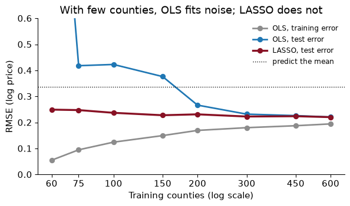

With 60 counties, OLS fits its training data with an RMSE of 0.055, and misses the test counties by 1.681, worse than predicting the mean for everyone (0.336). With 51 coefficients and 60 counties, it can nearly thread a line through every point, and most of what it learns is noise. The red line is the LASSO, the subject of this chapter: with the same 60 counties it misses by 0.249.

The gap closes as the sample grows. At 600 counties, OLS and LASSO are within 0.001 of each other. But give OLS the 1,377-column wide matrix with the same 600 counties and it fits the training data almost perfectly (RMSE 0.000) and misses the test counties by 1.91 log points, 6 times worse than predicting the mean. With more columns than rows there is no unique least-squares solution at all; the software picks one, and it is garbage.

This is the problem of **wide data**: many features $p$ relative to rows $n$. It is everywhere in economics: county and tract covariates, survey modules with hundreds of questions, the word counts of Chapter 19, the hundreds of monthly indicators used to nowcast GDP. Chapter 10’s learning curves gave two cures for a model with high variance: more data, or a restrained model. Data are often not for sale. This chapter is about restraint.

### Worked example — counting columns

**(a)** Why does the wide matrix have $p + p(p+1)/2$ columns? **(b)** A colleague adds all *cubic* terms too (every product of three covariates, including repeats). Roughly how many columns would that be, and what would OLS make of it with 600 counties?

### Solution

**(a)** The $p$ original covariates; then every product of two of them, which is $p(p-1)/2$ distinct pairs, plus $p$ squares, for $p(p+1)/2$ in all. With $p = 51$, that is $51 + 1{,}326 = 1{,}377$.

**(b)** The number of products of three covariates with repeats allowed is $\binom{p+2}{3}$, which for 51 is 23,426. On top of the 1,377, that is over 24,000 columns for 600 counties. OLS would fit the training data exactly, in infinitely many ways, and predict nothing. Flexibility grows much faster than data. That is the whole reason this chapter exists.

## Ridge and LASSO, in words

OLS chooses the coefficients that make the squared errors as small as possible, and that is all it cares about. If a coefficient of 3.7 on “share of households where both parents work” lowers the training error by a hair, OLS takes it. When there are few rows, many such hairs are noise.

**Regularisation** (or **penalised regression**) adds a second goal: keep the coefficients small. Each coefficient now has to *earn its keep*. It gets to be large only if it improves the fit by more than its size costs. One equation covers both methods we will use:

$$\text{choose } \beta \text{ to minimise} \quad \sum_{i=1}^n (y_i - \hat y_i)^2 \;+\; \lambda \times \text{penalty}(\beta)$$

- **Ridge** regression measures the size of the coefficients as the sum of their *squares*, $\sum_j \beta_j^2$. It pulls every coefficient towards zero, the big ones hardest, but it never sets one exactly to zero.
- The **LASSO** (Tibshirani 1996) measures size as the sum of *absolute values*, $\sum_j |\beta_j|$. That small change has a large consequence: many coefficients become **exactly zero**. The LASSO shrinks *and* selects.

$\lambda$ (lambda) sets the price of size. At $\lambda = 0$ we are back to OLS. As $\lambda$ grows, coefficients shrink; at a large enough $\lambda$, every coefficient is zero and the model predicts the mean for everyone. $\lambda$ is a hyperparameter, so we will choose it by cross-validation. (scikit-learn calls it `alpha`, and scales the fit term for the LASSO by $1/(2n)$, so a ridge `alpha` and a LASSO `alpha` are not on the same scale. Do not compare them.)

The trade is the bias–variance trade of Chapter 9 in a new form. Shrinking a coefficient towards zero **biases** it: the true effect of income on prices is not zero, and we are pulling it there. In return, the coefficients wobble much less from sample to sample, so the predictions have lower **variance**. When the data are few and the features many, the reduction in variance is far larger than the bias, and test error falls.

Why does the absolute value give exact zeros when the square does not? Think about the last little bit of a small coefficient. Under ridge, the penalty on $\beta_j = 0.01$ is $0.0001$, almost nothing, so there is no reason to push it the rest of the way to zero. Under the LASSO the penalty is $0.01$, and it falls by the same amount for every unit of shrinkage, all the way down. If the coefficient is not buying at least that much fit, the LASSO takes it to zero.

### Worked example — shrinking two coefficients

Take the simplest case: standardised features that are uncorrelated with each other. Then (with suitable scaling of $\lambda$) the penalised coefficients have simple formulas. If OLS gives $b$, ridge gives $b/(1 + \lambda)$, and the LASSO gives $b - \lambda$ if $b > \lambda$, $b + \lambda$ if $b < -\lambda$, and zero otherwise. Suppose OLS gives hypothetical coefficients of 0.30 on income and 0.04 on the share of service jobs. What do ridge and the LASSO give with $\lambda = 0.05$?

### Solution

Ridge divides both by 1.05: income becomes $0.30/1.05 = 0.286$ and service jobs $0.04/1.05 = 0.038$. Both shrink by the same *proportion*, about 5%, and both stay in the model.

The LASSO subtracts 0.05 from each in absolute value. Income becomes $0.30 - 0.05 = 0.25$. Service jobs has $|0.04| < 0.05$, so it becomes exactly **zero**: it is out of the model. The LASSO shrinks every coefficient by the same *amount*, which is a large share of a small coefficient and a small share of a large one, and it drops the ones that cannot pay the toll.

## Standardise first

The penalty adds up the coefficients across features, so it treats a coefficient of 0.1 the same whatever the feature is measured in. But a coefficient’s size depends on its units. Median household income in dollars has a tiny coefficient (a dollar of income is worth almost nothing); the same income in hundreds of thousands of dollars has a coefficient 100,000 times bigger. The penalty would barely notice the first and punish the second hard.

Here is that effect on our data. I standardise every covariate except median household income, leave income in raw units, and fit a LASSO with the same $\lambda$ twice:

| Income measured in               | Coefficient on income | Covariates kept |
|----------------------------------|-----------------------|-----------------|
| dollars                          | 1.31e-05              | 17              |
| hundreds of thousands of dollars | 0.000                 | 21              |

Same data, same $\lambda$, and income, which is the single most useful predictor in these data (we will see that shortly), is in the model or out of it depending on a choice of units. Measured in dollars, its coefficient is so small that the penalty is nearly free; measured in units of \$100,000, it is too expensive to keep.

The fix is the one from Chapter 9: **standardise** every feature (subtract its mean, divide by its standard deviation) so that every coefficient is “the change in log price for a one standard deviation change in this covariate”. Then the penalty compares like with like. And the standardisation must be learned from the training data only, which means it goes **inside the pipeline**: `make_pipeline(SimpleImputer(...), StandardScaler(), LassoCV(...))`. Each cross-validation fold then standardises using its own training part, and nothing about the held-out fold leaks in.

### Worked example — reading a standardised coefficient

In the standardised LASSO chosen by cross-validation (coming shortly), the coefficient on median household income is 0.153. The standard deviation of income across the training counties is \$14,325. Translate the coefficient into a statement about a \$10,000 difference in income.

### Solution

A one-standard-deviation difference, \$14,325, goes with 0.153 higher log price, so \$10,000 goes with about 0.153 × 10,000 / 14,325 = 0.107 log points, or roughly 11% higher prices, *holding the other selected covariates fixed*. To report a coefficient in natural units, divide it by the feature’s standard deviation; to compare the importance of features measured in different units, leave it standardised. And remember that “holding the others fixed” is doing a lot of work in a model whose covariates include four different measures of earnings.

## The coefficient path

The penalty $\lambda$ is a dial. A **coefficient path** shows every coefficient at every setting of the dial. Read these from right (huge penalty, everything zero) to left (tiny penalty, close to OLS):

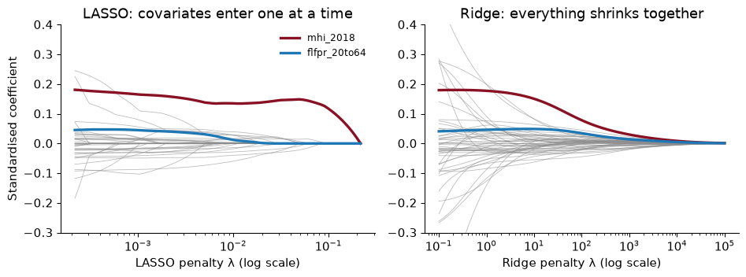

The two pictures tell the difference between the methods better than any formula.

On the **LASSO** path (left), at the far right every coefficient is zero. Lower the penalty and covariates enter one at a time, each at the point where it becomes worth its price. Median household income (garnet) enters first. Then come one_race_a, memp_n, households, one_race. Female labour-force participation (blue) enters later and stays small. At the far left, with almost no penalty, dozens of covariates are in and some of the paths cross zero and flip sign as their correlated neighbours enter.

On the **ridge** path (right), every coefficient is nonzero at every penalty; they all shrink smoothly towards zero together as the penalty rises.

Which you want depends on the problem. If you believe a few features carry most of the signal, or you need a short model (a survey that can only ask ten questions), the LASSO’s selection is useful. If you believe many features each matter a little, or the features come in correlated bundles, ridge’s even-handed shrinkage tends to predict better. When in doubt, cross-validate both.

### Worked example — what entering first means

Income is the first covariate the LASSO lets in. Does that make it the most important determinant of childcare prices?

### Solution

It makes it the single most useful *predictor* of log price, on its own, among these covariates: when the model can afford only one nonzero coefficient, that is the one that buys the most fit. That is a statement about prediction. It is not a statement that income *determines* prices. Income is high where wages are high, so it also stands for the wages of childcare workers, the cost of rent for a centre, and the parents’ willingness to pay. Any of those could be doing the work, and the LASSO has no way to tell them apart. It also does not mean the covariates that enter late are unimportant: a covariate that is closely correlated with income has little to add once income is in, however much it matters in the world.

## Choosing λ by cross-validation

The path shows every possible model; cross-validation picks one. For each $\lambda$ on a grid, run 5-fold cross-validation on the training counties and record the average error; choose the $\lambda$ with the smallest. `LassoCV` does the whole loop:

``` python
lasso_cv = make_pipeline(SimpleImputer(strategy="median"), StandardScaler(),
                         LassoCV(cv=KFold(5, shuffle=True, random_state=368), alphas=60, max_iter=10_000))
lasso_cv.fit(train[covs], train["log_price"])
```

`alphas=60` asks for a grid of 60 values of $\lambda$, spaced evenly on a log scale from the smallest penalty that zeros everything downwards. `RidgeCV` does the same for ridge, from a grid you supply, using a fast shortcut for leave-one-out cross-validation.

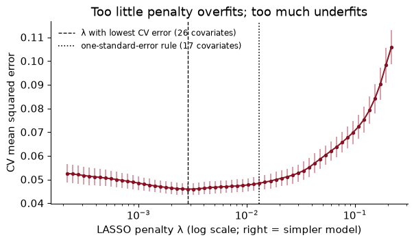

The curve is the U-shape you saw for $k$ in Chapter 9, mirrored. On the right, the penalty is so high that the model is nearly the mean, and error is high (bias). Moving left, useful covariates come in and error falls. Further left, the curve flattens: the extra covariates add little, and with only 600 counties they would eventually add noise. The minimum is at $\lambda =$ 0.0028, which keeps **26 of 51** covariates. Ridge, by the same procedure, picks a penalty of 22.7 and, being ridge, keeps all of them.

Notice how *flat* the bottom of the curve is. Many values of $\lambda$, and so many different sets of covariates, predict almost equally well. Keep that in mind for the section on instability.

### Worked example — the one-standard-error rule

The error bars show that the CV error is itself an estimate, with noise. A popular rule takes the *largest* $\lambda$ whose CV error is within one standard error of the minimum. What does it choose here, and why would anyone prefer it?

### Solution

The one-standard-error rule picks $\lambda =$ 0.0131, which keeps 17 covariates instead of 26. Its cross-validated MSE is 0.0485 against 0.0460 at the minimum, a difference smaller than the noise in the estimate itself (one standard error is 0.0025).

Why prefer it? Because the minimum is partly luck: with different folds, it would land somewhere else on the flat bottom. Given two models we cannot tell apart, the simpler one is cheaper to explain, cheaper to collect data for, and less likely to have fitted noise. If the agency must gather every covariate it uses from a separate source, a model with 17 inputs instead of 26 is a real saving for no measurable loss.

## Elastic net, and the horse race

The LASSO has a known weakness with **correlated** features. If two covariates carry nearly the same information (the unemployment rate for everyone aged 16 and over, and for those aged 20 to 64, are correlated at 0.98 across counties), the LASSO tends to keep one and drop the other, and *which* one is close to arbitrary. Ridge keeps both and splits the weight between them.

The **elastic net** mixes the two penalties: part sum of absolute values, part sum of squares. scikit-learn’s `l1_ratio` sets the mix, with 1 meaning pure LASSO and 0 pure ridge. It can still set coefficients to zero, but it tends to keep or drop correlated groups together. Now there are two hyperparameters, $\lambda$ and the mix, and `ElasticNetCV` cross-validates over both. Here it chooses `l1_ratio` = 0.9, which is mostly LASSO.

Now every model, chosen on the training counties only, scored once on the 1,760 test counties:

                                    test RMSE nonzero coefficients
    Predict the training mean           0.336                    0
    OLS, 51 covariates                  0.221                   51
    Ridge (CV), 51 covariates           0.220                   51
    LASSO (CV), 51 covariates           0.220                   26
    Elastic net (CV), 51 covariates     0.221                   26
    OLS, 1,377 wide columns             1.913                1,377
    Ridge (CV), 1,377 wide columns      0.238                1,377
    LASSO (CV), 1,377 wide columns      0.220                   84

Four things to read off.

- **Every model beats the mean** except OLS on the wide matrix, which is a disaster.
- **With 600 counties and 51 covariates, regularisation buys little.** OLS, ridge, LASSO and elastic net are within 0.001 of each other. With this many rows per covariate, OLS was not overfitting much, and there was little variance to remove. The earlier figure showed where regularisation pays: small samples.
- **On the wide matrix, regularisation is the difference between garbage and a good model.** The LASSO keeps 84 of the 1,377 columns and gets back to the level of the simple models; ridge, which must keep every column, does a little worse.
- **The squares and interactions add nothing here.** The best wide model is no better than the best 51-covariate model. That is a finding, not a failure: on these data, childcare prices are close to additive in the covariates, and flexibility buys nothing. Trees and boosting (Chapters 14 and 15) will check that conclusion with models that find interactions on their own.

### Worked example — what elastic net does with a family of covariates

The data have six unemployment rates: overall, female and male, each for ages 16 and over and for ages 20 to 64. Which does the LASSO keep, and which does the elastic net keep?

### Solution

                 LASSO  elastic net
    unr_16       0.000        0.000
    funr_16      0.011        0.010
    munr_16     -0.000       -0.000
    unr_20to64   0.000        0.000
    funr_20to64  0.000        0.000
    munr_20to64  0.043        0.043

The six are correlated with each other at between 0.65 and 0.98. The LASSO keeps 2 of them, and the elastic net keeps 2, with nearly the same weights. With a mix that is 90% LASSO, the elastic net behaves almost exactly like the LASSO here. If you wanted the whole family kept together, you would push `l1_ratio` towards ridge, and accept the cross-validation’s verdict on whether that predicts better. Note also that the LASSO kept the *male* 20-to-64 rate and the *female* 16-plus rate rather than the overall rates. Nobody should read anything into that; see the next section.

## The selected set is unstable

The LASSO hands you a list: these 26 covariates matter, the others do not. It is tempting to read that list as a finding. Do not.

To see why, refit the LASSO, with the same $\lambda$, on 30 **bootstrap** samples of the training counties (600 counties drawn with replacement, as in Chapter 8), and record which covariates are selected each time.

``` python
rng = np.random.default_rng(368)
selected = []
for b in range(30):
    idx = rng.choice(len(Xm), len(Xm), replace=True)
    selected.append(Lasso(alpha=lcv.alpha_, max_iter=10_000).fit(Xm[idx], y[idx]).coef_ != 0)
freq = pd.Series(np.mean(selected, axis=0), index=covs)
```

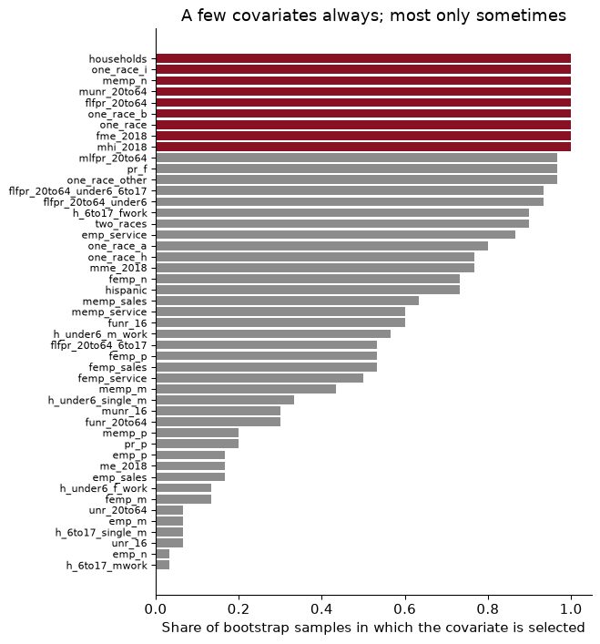

Only 9 covariates are selected in every resample. 38 are selected in some resamples and not others, and only 4 are never selected. The data barely changed (each bootstrap sample is the same 600 counties, reshuffled), and the story about “which variables matter” changed a lot.

The predictions, by contrast, hardly move, because when one covariate drops out, a correlated one picks up its weight. That is the point Mullainathan and Spiess (2017) make about prediction models in general: many different sets of variables predict almost equally well, and the procedure that picks among them is choosing between near-ties. The model is stable where it matters (the $\hat y$) and unstable where people like to look (the list of $\hat\beta$s).

### Worked example — identical twins

Some of the covariates are nearly the same variable. `total_pop` and `households` are correlated at 0.998; `one_race` and `two_races` are shares that add up to 100%, so they are correlated at exactly -1. How often does the LASSO pick each of the population twins across the bootstrap samples, and what should you conclude?

### Solution

Here the LASSO is consistent: `households` is selected in 100% of the bootstrap samples and `total_pop` in 0%. That looks like a verdict, households in, population out. It is not. Delete `households` from the covariates and refit: `total_pop` steps straight in, with a coefficient of 0.050 (households had 0.078), and the cross-validated RMSE moves from 0.2144 to 0.2160. The two are interchangeable; households happens to edge out population by a sliver of fit, sample after sample. You should conclude nothing about population versus households. If the question “does county size predict childcare prices?” matters, ask it of the *group*: refit with one twin removed, as here, or use ridge or the elastic net, which share weight across the group.

## A LASSO coefficient is not a causal effect

Here is a sentence a journalist might write after reading our model: “Counties where more women work have more expensive childcare, so policies that raise female employment will push childcare prices up.”

The coefficient behind it is real. Female labour-force participation (ages 20 to 64) is selected, with a standardised coefficient of 0.038: a one-standard-deviation higher participation rate (7.8 percentage points) goes with roughly 4% higher prices, holding the other selected covariates fixed. And still the sentence is wrong, for three reasons.

**Causation could run the other way.** Where childcare is cheap, more mothers of young children can afford to work, which would make participation *higher* where prices are *lower*. Where childcare is expensive, some mothers stay home. The coefficient mixes those effects with any effect of participation on prices, and nothing in the data separates them.

**The coefficient carries whatever the covariate stands for.** High-participation counties differ in many ways: they are richer (the correlation with median income is 0.54), more urban, with different industries. Drop the four income and earnings covariates from the model and the coefficient on participation rises from 0.038 to 0.067. Its size depends on what else is in the model, because it is partly standing in for income. A LASSO is *designed* to load weight onto whichever proxy predicts best.

**The LASSO biases the coefficient on purpose.** Shrinkage pulls every coefficient towards zero; the number is chosen to predict well, not to be close to any true effect.

> A LASSO coefficient is a predictive weight, given the other selected covariates. It is not the effect of changing that covariate, and a covariate that was dropped is not one that “doesn’t matter”.

What would you need to answer the journalist’s question? A source of variation in female employment that does not come from childcare prices or from the things that drive both. A randomised experiment is the clean case (Chapter 7); in practice economists use policy changes, such as the introduction of universal pre-kindergarten or expansions of parental leave, in a difference-in-differences design.

### Worked example — LASSO in a causal study

A researcher wants the causal effect of a state childcare subsidy on mothers’ employment, and has 51 county covariates to control for. She runs a LASSO of employment on the subsidy dummy and all the covariates, and reports the subsidy coefficient. What is wrong, and is there a right way to use the LASSO here?

### Solution

Two things are wrong. The penalty shrinks the subsidy coefficient towards zero, so it is biased towards finding no effect, and it might even drop the subsidy from the model entirely. And the LASSO chooses controls that predict *employment*. A covariate that strongly predicts *who got the subsidy* but only weakly predicts employment may be dropped, and that is exactly the kind of confounder whose omission biases the estimate.

There is a right way, and it is one of the most useful ideas in modern econometrics: **post-double-selection** (Belloni, Chernozhukov and Hansen 2014). Run one LASSO of the outcome on the covariates, and a second LASSO of the *treatment* on the covariates. Take the union of the covariates selected by either, and run ordinary OLS of the outcome on the treatment and that union. The LASSO is used only to *choose controls*, never to estimate the effect, and the second selection step protects against dropping a confounder. It still needs the usual assumption that, given the controls, the subsidy is as good as random. Machine learning picks the controls; it does not supply the identification.

## Early stopping as regularisation

There is a way to regularise without writing down a penalty at all. Chapter 10 trained a linear model by gradient descent, starting from all coefficients at zero and walking downhill. On a wide matrix, the bottom of the hill is the over-fitted OLS solution. But we do not have to walk all the way there.

Run gradient descent on the 1,377-column wide matrix, using 480 of the training counties to fit and the other 120 as a validation set, and track both errors at every step:

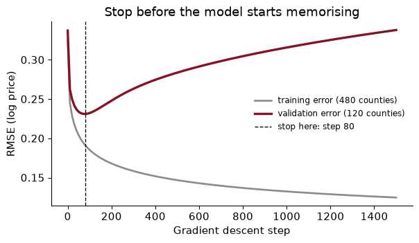

The training error falls at every step, as it must. The validation error falls at first, as the model picks up the main patterns, reaches its minimum at step 80, and then climbs as the model starts fitting the quirks of the 480 counties. **Early stopping** keeps the coefficients from the best validation step. On the test counties, the early-stopped model scores 0.247; the one that kept going to step 1,500 scores 0.324. Early stopping is not as good here as the LASSO on the same matrix (0.220), but it turns a model that was heading for disaster into a reasonable one with a single decision: when to stop.

Why is this regularisation? Because gradient descent started at zero, and each step lets the coefficients grow a little. Stopping early keeps them small, in much the same way a ridge penalty does: the directions in the data that are strongly supported get learned first, and the weakly supported ones, which is where the noise lives, never get the chance. The number of steps plays the role of $1/\lambda$. It is a hyperparameter, chosen on validation data, never on the test set.

For linear models you would normally just use ridge or the LASSO, which give the same kind of answer more cleanly. Early stopping matters because it works for any model trained by gradient descent, including the boosted trees of Chapter 15 and the neural networks of Chapter 18, where writing down the right penalty is hard and stopping at the right time is easy.

### Worked example — why not stop on the test set?

A classmate tracks the *test* error during gradient descent instead of a validation error, and stops at its minimum. Her test RMSE is a little better than the early-stopped model’s. What has she done wrong?

### Solution

She has tuned a hyperparameter, the number of steps, on the test set. That is Chapter 9’s cardinal sin in a new costume. The step that minimises test error is the luckiest step *for those particular counties*, and the test RMSE she reports is the best of many looks, so it is biased downwards. The validation set exists precisely so that the stopping point can be chosen without touching the test set. Then the test set is used once, at the stopping point already chosen.

## In Python

The whole pipeline, from download to a predicted weekly price in dollars for every county, runnable top to bottom.

``` python
from pathlib import Path
import numpy as np, pandas as pd
from sklearn.pipeline import make_pipeline
from sklearn.impute import SimpleImputer
from sklearn.preprocessing import StandardScaler
from sklearn.linear_model import LassoCV
from sklearn.model_selection import KFold
from sklearn.metrics import root_mean_squared_error
SEED = 368
BASE = "https://raw.githubusercontent.com/rfordatascience/tidytuesday/main/data/2023/2023-05-09/"

def load(name):                                        # download once, then reuse
    path = Path(f"../data/{name}.csv")
    if not path.exists():
        path.parent.mkdir(exist_ok=True)
        pd.read_csv(BASE + f"{name}.csv").to_csv(path, index=False)
    return pd.read_csv(path)
cc = load("childcare_costs")
df = cc.merge(load("counties"), on="county_fips_code")
```

Choose the covariates (never the other price columns), keep 2018, and set aside the counties with no measured price: they are what we want to predict, not what we learn from.

``` python
prices = ["mcsa", "mfccsa", "mc_infant", "mc_toddler", "mc_preschool",
          "mfcc_infant", "mfcc_toddler", "mfcc_preschool"]
covs = [c for c in cc.columns if c not in prices + ["county_fips_code", "study_year"]]
d18 = df[df["study_year"] == 2018]
known = d18.dropna(subset=["mc_infant"]).assign(log_price=lambda x: np.log(x["mc_infant"]))
unknown = d18[d18["mc_infant"].isna()]
train = known.sample(600, random_state=SEED)
test = known.drop(train.index)
```

Impute, standardise and choose $\lambda$, all inside one pipeline fitted on the training counties.

``` python
model = make_pipeline(SimpleImputer(strategy="median"), StandardScaler(),
                      LassoCV(cv=KFold(5, shuffle=True, random_state=SEED), alphas=60, max_iter=10_000))
model.fit(train[covs], train["log_price"])
coef = pd.Series(model[-1].coef_, index=covs)
print(f"lambda {model[-1].alpha_:.4f}; {(coef != 0).sum()} of {len(covs)} covariates kept")
print(coef[coef != 0].sort_values(key=abs, ascending=False).head(5).round(3).to_string())
```

    lambda 0.0028; 26 of 51 covariates kept
    mhi_2018         0.153
    one_race_b      -0.081
    households       0.078
    h_6to17_fwork   -0.055
    fme_2018         0.049

Score once on the test counties, in log points and, with Chapter 10’s smearing, in dollars a week. Then predict the counties with no price.

``` python
smear = np.mean(np.exp(train["log_price"] - model.predict(train[covs])))
pred_test = smear * np.exp(model.predict(test[covs]))
print(f"test RMSE {root_mean_squared_error(test['log_price'], model.predict(test[covs])):.3f} log points, "
      f"${root_mean_squared_error(test['mc_infant'], pred_test):.0f} a week")
pred_unknown = smear * np.exp(model.predict(unknown[covs]))
print(f"{len(unknown):,} unsurveyed counties; median predicted price ${np.median(pred_unknown):.0f} a week")
```

    test RMSE 0.220 log points, $36 a week
    782 unsurveyed counties; median predicted price $147 a week

Remember what the test RMSE does and does not cover: it is honest for a missing county in a surveyed state, and optimistic for the states with no data at all.

## What goes wrong

**Forgetting to standardise, or standardising outside the pipeline.** Without standardisation, the penalty depends on units, and income was in or out of the model depending on whether it was measured in dollars. Standardising the whole data set before splitting leaks the test set’s means into training. Put `StandardScaler` inside the pipeline.

**Leaving the answer in the features.** The toddler price, the preschool price and the family-care prices for the same county are all in the data set, and all would predict the infant price superbly. At prediction time, for a county nobody surveyed, none of them exists. Ask of every column, as in Chapter 9: would I have this when I predict?

**Reading the selected set as the truth.** Only 9 covariates survived every bootstrap resample. The LASSO’s list is one of many near-ties. Never write “the LASSO found that X does not matter”.

**Reading a LASSO coefficient as an effect.** It is shrunk on purpose, it depends on which correlated neighbours are in the model, and it carries whatever its covariate is a proxy for. For causal questions, use the LASSO to choose controls (double selection), not to estimate.

**Choosing λ, or the stopping step, on the test set.** Every hyperparameter is chosen by cross-validation or on a validation set. The test set is touched once.

**A random split when the real task is a new place.** Counties in the same state share regulation, wages and markets, so a random test county has close relatives in training. If the model will be used for states with no data, cross-validate by state (`GroupKFold`), and expect a larger error.

## Exercises

1.  Explain, without equations, what the LASSO does at $\lambda = 0$ and as $\lambda$ becomes very large. At which end is the bias high, and at which end is the variance high?

2.  Add `mc_toddler` to the covariates and refit the LASSO pipeline. What happens to the test RMSE, how many covariates does the LASSO keep, and which one has the largest coefficient? Why is this model useless for the agency?

3.  Cross-validate the LASSO pipeline on *all* 2,360 counties with a measured price in 2018, first with `KFold(5, shuffle=True)` and then with `GroupKFold(5)` grouped by state. Compare the two CV RMSEs. Which would you report to an agency that wants prices for the states with no data?

4.  **Post-LASSO.** Take the covariates selected by `LassoCV` on the training counties and refit plain OLS on just those. Compare its test RMSE with the LASSO’s. Why might refitting help or hurt?

5.  Add **state fixed effects**: one-hot encode `state_name` alongside the scaled covariates (a `ColumnTransformer`) and refit `LassoCV`. How much does the test RMSE fall? What does that tell you about where the variation in childcare prices lives, and why is this model of no help for the missing states?

6.  A colleague reports: “The LASSO dropped the poverty rate, so poverty does not affect childcare prices.” Give two reasons this does not follow.

7.  Is the elastic net’s selection more stable than the LASSO’s? Repeat the 30-sample bootstrap with `ElasticNet(alpha=..., l1_ratio=0.5)` at the elastic net’s cross-validated $\lambda$ for that mix, and compare the number of covariates selected in every resample.

### Answers

**1.** At $\lambda = 0$ there is no penalty, so the LASSO is OLS: every covariate is in, and with few counties the coefficients chase noise. That is the high-**variance** end. As $\lambda$ grows, coefficients shrink and drop out one by one, until at a large enough $\lambda$ all are zero and the model predicts the training mean for every county. That is the high-**bias** end: the model ignores real information. Cross-validation looks for the setting in between where the sum of the two kinds of error is smallest.

**2.**

``` python
covs_leak = covs + ["mc_toddler"]
leak = make_pipeline(SimpleImputer(strategy="median"), StandardScaler(),
                     LassoCV(cv=KFold(5, shuffle=True, random_state=SEED), alphas=60, max_iter=10_000))
leak.fit(train[covs_leak], train["log_price"])
coef_leak = pd.Series(leak[-1].coef_, index=covs_leak)
leak_rmse = root_mean_squared_error(test["log_price"], leak.predict(test[covs_leak]))
print(round(leak_rmse, 3), (coef_leak != 0).sum(), coef_leak.abs().idxmax())
```

    0.117 24 mc_toddler

The test RMSE collapses from 0.220 to 0.117, the LASSO keeps 24 covariates, and the largest coefficient by far is on mc_toddler. Centres that charge more for infants charge more for toddlers, so the toddler price is nearly the answer. But both prices come from the same market-rate survey: a county with no infant price has no toddler price either. The model answers a question nobody is asking.

**3.**

``` python
from sklearn.model_selection import GroupKFold, cross_val_score
pipe = make_pipeline(SimpleImputer(strategy="median"), StandardScaler(),
                     LassoCV(cv=5, alphas=30, max_iter=10_000))
cv_rand = -cross_val_score(pipe, known[covs], known["log_price"], scoring="neg_root_mean_squared_error",
                           cv=KFold(5, shuffle=True, random_state=SEED)).mean()
cv_state = -cross_val_score(pipe, known[covs], known["log_price"], scoring="neg_root_mean_squared_error",
                            cv=GroupKFold(5), groups=known["state_name"]).mean()
print(round(cv_rand, 3), round(cv_state, 3))
```

    0.217 0.245

With random folds the CV RMSE is 0.217; with folds that hold out whole states it is 0.245, about 13% higher. Holding out a whole state means predicting counties whose regulations, wages and markets the model has never seen, which is exactly the agency’s situation for the dark states. Report the grouped number. (The inner `LassoCV(cv=5)` still chooses $\lambda$ with random folds; for a fully consistent design you would group those too.)

**4.**

``` python
from sklearn.linear_model import LinearRegression
kept = coef[coef != 0].index.tolist()
post = make_pipeline(SimpleImputer(strategy="median"), StandardScaler(), LinearRegression())
post.fit(train[kept], train["log_price"])
post_rmse = root_mean_squared_error(test["log_price"], post.predict(test[kept]))
lasso_rmse = root_mean_squared_error(test["log_price"], model.predict(test[covs]))
print(len(kept), round(post_rmse, 4), round(lasso_rmse, 4))
```

    26 0.2205 0.2204

Post-LASSO OLS on the 26 selected covariates has a test RMSE of 0.2205, against 0.2204 for the LASSO itself. Refitting removes the shrinkage, which helps when the selected covariates are the real signal and the LASSO had shrunk them too much. It hurts when some selected covariates are noise, because the shrinkage was protecting against them. Here the two are within a hair of each other. Do not report the refitted OLS standard errors as if the covariates had been chosen in advance: they ignore the selection step and are too small.

**5.**

``` python
from sklearn.compose import ColumnTransformer
from sklearn.preprocessing import OneHotEncoder
prep_fe = ColumnTransformer([
    ("num", make_pipeline(SimpleImputer(strategy="median"), StandardScaler()), covs),
    ("state", OneHotEncoder(handle_unknown="ignore", sparse_output=False), ["state_name"])])
fe = make_pipeline(prep_fe, LassoCV(cv=KFold(5, shuffle=True, random_state=SEED), alphas=60, max_iter=10_000))
fe.fit(train[covs + ["state_name"]], train["log_price"])
fe_rmse = root_mean_squared_error(test["log_price"], fe.predict(test[covs + ["state_name"]]))
print(round(fe_rmse, 3), round(lasso_rmse, 3))
```

    0.137 0.22

State dummies cut the test RMSE from 0.220 to 0.137. A large share of the variation in childcare prices is *between states*: licensing rules, staff-to-child ratios, subsidy rates and wage levels are set or shaped at the state level. For a missing county in a surveyed state, this is the better model. For a state with no data at all there is no dummy to estimate (`handle_unknown="ignore"` sets them all to zero, which means “an average state”), so it falls back on the covariates alone, and Exercise 3’s grouped CV error is the honest guide.

**6.** First, the LASSO dropped poverty *for prediction, given the other covariates*: poverty is strongly correlated with income, unemployment and race shares, which were selected, so it had little extra to offer. That says nothing about its own effect. Second, the selection is unstable: in our bootstrap, `pr_f` (family poverty) was selected in 97% of resamples and `pr_p` (individual poverty) in 20%. Whether a poverty measure is “in” depends on which counties happened to be drawn, and on which of two near-identical measures you look at. With slightly different data, the colleague could have written the opposite sentence. And no prediction model, selected or not, estimates what *changing* poverty would do.

**7.**

``` python
from sklearn.linear_model import ElasticNet, ElasticNetCV
en5 = ElasticNetCV(l1_ratio=0.5, cv=KFold(5, shuffle=True, random_state=SEED), alphas=40, max_iter=10_000).fit(Xm, y)
rng = np.random.default_rng(SEED)
sel_en = []
for b in range(30):
    idx = rng.choice(len(Xm), len(Xm), replace=True)
    sel_en.append(ElasticNet(alpha=en5.alpha_, l1_ratio=0.5, max_iter=10_000).fit(Xm[idx], y[idx]).coef_ != 0)
freq_en = pd.Series(np.mean(sel_en, axis=0), index=covs)
print((freq_en == 1).sum(), ((freq_en > 0) & (freq_en < 1)).sum(), (freq_en == 0).sum())
```

    10 38 3

With a 50/50 mix, 10 covariates are selected in every resample, 38 only sometimes and 3 never, against 9, 38 and 4 for the LASSO. The elastic net is more stable: the ridge part of its penalty keeps correlated covariates in together rather than flipping between them. Either way, the remedy for instability is not a cleverer penalty but a humbler interpretation.

**Reading.** Géron, ch. 4, the section on regularised linear models (ridge, LASSO, elastic net, early stopping). ISLP (James, Witten, Hastie, Tibshirani & Taylor 2023), ch. 6.2, for shrinkage methods and the geometry of why the LASSO gives zeros. Mullainathan & Spiess (2017), “Machine Learning: An Applied Econometric Approach”, *Journal of Economic Perspectives* 31(2), for why selected variables are not “the” model. Belloni, Chernozhukov & Hansen (2014), “High-Dimensional Methods and Inference on Structural and Treatment Effects”, *Journal of Economic Perspectives* 28(2), for double selection.


# Chapter 12 — Classification

> **The question:** you run a hotel where more than a third of bookings cancel. Should you resell rooms that are already booked, and if so, which ones?

## A probability, then a decision

Picture a 200-room hotel, fully booked for tonight. In the data we will use, 119,390 real bookings at two hotels in Portugal between 2015 and 2017, **37% of bookings were cancelled**. If tonight is typical, about 74 of your rooms will be empty, and an empty room is a night’s revenue gone.

So you are tempted to resell some rooms. The catch is that a guest who does turn up to a full hotel has to be **walked**: you pay for a room at a hotel down the road, a taxi, and an apology, and you may lose the customer. Overbook too little and rooms sit empty; overbook too much and you are paying to send guests elsewhere.

Airlines, hotels and car-rental firms all do this, and the field is called revenue management. At its heart is a classification problem. For each booking you want two things, in this order:

1.  **A probability.** What is the chance this booking cancels? Call it $\hat p$.
2.  **A decision.** Given $\hat p$ and what each kind of mistake costs, do you resell the room?

They are separate steps, and you can get either one wrong. Most of this chapter is about getting the first right and then not ruining it in the second.

Classification is everywhere in applied economics. A bank deciding on a loan needs the probability of default. A tax authority choosing whom to audit needs the probability of under-reporting. A job-training programme deciding whom to enrol needs the probability of long-term unemployment. Each is a prediction policy problem of the kind we met in Chapter 9, with a label that is yes or no rather than a number.

## Why not OLS?

You know how to regress a 0/1 outcome on features: that is the **linear probability model** (LPM), and for estimating an average effect near the middle of the data it is often perfectly good. Econometricians use it all the time, and they are right to.

For prediction it has a flaw you can see immediately. A straight line does not know that probabilities stop at 0 and 1. Fit an LPM to the hotel bookings, with all the features we will use later, and 7.1% of the test bookings get a predicted “probability” below zero, while 5.8% get one above one.

That matters more than it sounds, because decisions get made in the tails. The bookings you are thinking of reselling are exactly the ones the model thinks most likely to cancel, and that is where the line overshoots. You cannot multiply a cost by a probability of 1.3.

### Worked example — reading an impossible prediction

The LPM predicts $\hat p = -0.08$ for a booking. What does it mean, and what would you do with it?

### Solution

Taken literally it means nothing: no event has a probability of minus eight per cent. What the model is saying is “this booking looks even less likely to cancel than the bookings that defined the bottom of my line”, and the straight line then runs past zero. You could clip it to 0, and people do. But clipping a prediction after the fact is a sign that the model is the wrong shape. We would rather use one that is built to stay between 0 and 1.

## Logistic regression

**Logistic regression** keeps the linear score you know from OLS, $\beta_0 + \beta_1 x_1 + \dots + \beta_k x_k$, and squashes it through an S-shaped curve so that the output is always between 0 and 1:

$$\hat p(x) = \frac{1}{1 + e^{-(\beta_0 + \beta_1 x_1 + \dots + \beta_k x_k)}}$$

A very negative score gives $\hat p$ near 0, a very positive score gives $\hat p$ near 1, and a score of zero gives exactly one half. The S-curve is called the **sigmoid**.

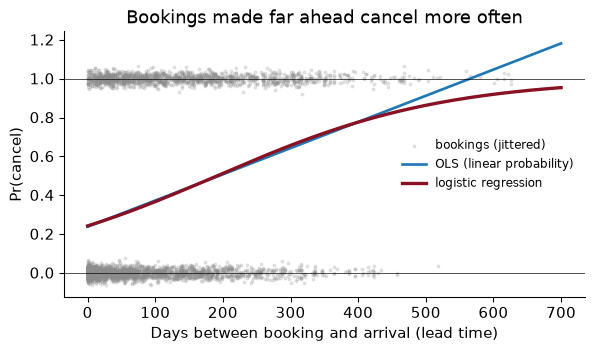

With one feature, lead time, the difference is visible. The line runs above 1 for bookings made far in advance; the S-curve bends to stay below it.

How are the $\beta$s chosen? Not by least squares. Logistic regression uses **maximum likelihood**: pick the coefficients that make the outcomes we actually saw as probable as possible. A booking that cancelled rewards the model for having given it a high $\hat p$; a booking that showed up rewards a low one. The quantity being minimised has a name you will see in software output, **log loss**: the average of $-\log(\text{the probability the model gave to what actually happened})$. Its key property is that it punishes *confident* mistakes brutally. Saying 0.99 for a booking that shows up costs far more than saying 0.6. There is no formula for the answer, as there is for OLS; the computer searches, and because the problem has a single peak, it always finds the same one.

### Odds, lightly

Logistic regression is linear in the **log-odds**. The odds are $p/(1-p)$: a probability of 0.2 is odds of 1 to 4, or 0.25. Each coefficient says how a one-unit change in $x$ shifts the log-odds, so $e^{\beta}$ is the factor by which the odds are multiplied, the **odds ratio**.

I say “lightly” because odds ratios are easy to misread. An odds ratio of 2 does not mean “twice as likely”. When the event is rare, odds and probabilities are nearly the same and the shortcut is harmless. When the base rate is 37%, as here, it is not.

### Worked example — what a special request does to the odds

Fit a logistic regression of cancellation on the number of special requests a guest made (a cot, a high floor, a late check-in) using the training bookings. The coefficient is -0.722. **(a)** What is the odds ratio? **(b)** The model says a booking with no requests cancels with probability 0.458. What does it say for a booking with one request?

### Solution

**(a)** The odds ratio is $e$ raised to the coefficient: 0.486. Each extra request multiplies the odds of cancelling by about 0.49, that is, it cuts them by 51%.

**(b)** Convert to odds, multiply, convert back:

- odds with no requests: 0.458 / (1 − 0.458) = 0.844
- odds with one request: 0.844 × 0.486 = 0.410
- probability: 0.410 / (1 + 0.410) = 0.291

So the probability falls from 46% to 29%. Notice the odds fell by 51% but the probability fell by 36%: odds and probabilities move by different proportions whenever the event is common.

And the economist’s caution: this is a $\hat y$ model, not a $\hat\beta$ one. Guests who ask for a cot are guests who have planned the trip. Nobody believes that the hotel could cut cancellations by encouraging requests.

## Drop the leaks, then fit

Before modelling, the question from Chapter 9: **would I know this at the moment I have to decide?** The hotel decides whether to resell a room before the arrival date. Three columns in the data are recorded later:

- `reservation_status` is “Canceled”, “No-Show” or “Check-Out”, which is the outcome itself, written in words.
- `reservation_status_date` is when that status was set.
- `assigned_room_type` is the room the guest was actually given at check-in.

The first one is not subtle:

    is_canceled             0      1
    reservation_status              
    Canceled                0  43017
    Check-Out           75166      0
    No-Show                 0   1207

Every status lines up with exactly one value of `is_canceled`. A logistic regression with `reservation_status` and three innocent features scores 100.0% accuracy on the test set. It is useless, because at decision time the column does not exist yet.

We drop those three, plus `agent` and `company` (ID numbers, not quantities) and `country`, which has more than 170 values; in its place I keep a single dummy, `domestic`, for guests from Portugal. Then the usual Chapter 9 machinery: a **stratified** 80/20 split, so that both halves keep the 37% cancellation rate, and a pipeline that fills and scales the numbers and one-hot encodes the categories.

``` python
X_train, X_test, y_train, y_test = train_test_split(X, y, test_size=0.2, stratify=y, random_state=368)
logit = make_pipeline(make_prep(), LogisticRegression(max_iter=1000)).fit(X_train, y_train)
p_test = logit.predict_proba(X_test)[:, 1]
```

`predict_proba` returns two columns, the probability of each class; column 1 is $\hat p$, the probability of cancelling. The 18 numeric and 8 categorical features become 67 model inputs.

One quick sanity check. The average $\hat p$ on the test set is 0.370, and the actual cancellation rate there is 0.370. A logistic regression with an intercept matches the base rate on average by construction. If yours does not, something is broken.

### Worked example — the 100% model

A classmate shows you a cancellation model with 100.0% test accuracy. She swears she used a proper train/test split. What do you ask her?

### Solution

What features she used, and when each one becomes known. A test split protects against overfitting; it does nothing against leakage, because the leaked column is in the test set too. An accuracy that high on a messy human outcome (people cancel holidays for all sorts of reasons) is a warning in itself. Here the culprit is `reservation_status`. In econometric language she controlled for the outcome.

## The “nobody cancels” baseline

To turn $\hat p$ into a yes/no prediction, the default is to say “cancels” when $\hat p > 0.5$. With that rule, the logistic regression’s **accuracy**, the share of test bookings it classifies correctly, is 80.8%.

Is that good? Chapter 9’s lesson was to compare everything to a baseline. The laziest classifier predicts **“shows up”** for every booking. It is right for every booking that did not cancel, so its accuracy is one minus the cancellation rate: 63.0%. The logistic regression is 18 percentage points better. A real gain, but a much less impressive one than “81% accurate” sounds on its own.

### Worked example — accuracy when events are rare

A bank’s fraud model is 99.8% accurate. 0.1% of transactions are fraudulent. Is the model any good?

### Solution

You cannot tell, and there is reason to worry. The rule “nothing is ever fraud” is 99.9% accurate, which beats the model. A fraud model is valuable only if it catches fraud, and accuracy barely registers whether it does: catching every fraud would raise accuracy by at most 0.1 percentage points. With rare events, accuracy is dominated by the easy majority. We need measures that look at the two kinds of mistake separately, which is the next section.

## The confusion matrix

Lay out the four possible outcomes on the 23,878 test bookings, with the 0.5 rule:

|                       | **Predict: shows up** | **Predict: cancels**  |
|-----------------------|-----------------------|-----------------------|
| **Actually shows up** | 13,743 true negatives | 1,290 false positives |
| **Actually cancels**  | 3,286 false negatives | 5,559 true positives  |

“Positive” means the model says the event (a cancellation) happens. The diagonal is where the model is right. The two off-diagonal cells are different mistakes, and for the hotel they are *very* different:

- A **false positive** is a booking we expected to cancel that shows up. If we resold that room, we walk a guest.
- A **false negative** is a cancellation we did not see coming. The room sits empty.

Accuracy adds those two together as if they cost the same. Two measures pull them apart, and they are worth learning as sentences rather than formulas.

**Precision**: of the bookings we flag as cancellations, what share really cancel? *When we resell a room, how often are we right?* Here, 5,559 out of 6,849, or 81%.

**Recall**: of the bookings that really cancel, what share do we flag? *Of all the rooms that will sit empty, how many do we catch?* Here, 5,559 out of 8,845, or 63%. Recall is also called the **true positive rate**.

The two pull against each other. Flag more bookings and you catch more cancellations (recall rises) but you also flag more guests who were going to show up (precision usually falls). The threshold is the lever.

### Worked example — buying recall with precision

Lower the threshold from 0.5 to 0.3. Predict, before computing, what happens to the share of bookings flagged, to recall, and to precision.

### Solution

| Threshold | Bookings flagged | Recall | Precision |
|-----------|------------------|--------|-----------|
| 0.5       | 29%              | 63%    | 81%       |
| 0.3       | 47%              | 84%    | 67%       |

A lower bar flags more bookings. Recall goes up, and it *must*: every booking flagged at 0.5 is still flagged at 0.3, so we cannot catch fewer cancellations. Precision goes down, because the extra bookings we now flag are the less certain ones, and more of them show up. Precision is not guaranteed to fall, but it usually does.

Which threshold is right depends entirely on what each mistake costs. We will get there; first, a way to see all thresholds at once.

## The ROC curve and AUC

Every threshold gives one confusion matrix, and from each we can read two rates: the **true positive rate** (recall: the share of cancellations flagged) and the **false positive rate** (the share of guests who show up that we flag anyway). Plot one against the other for every possible threshold and you have the **ROC curve**. (The name comes from radar engineers in the Second World War, which is why it is unhelpful.)

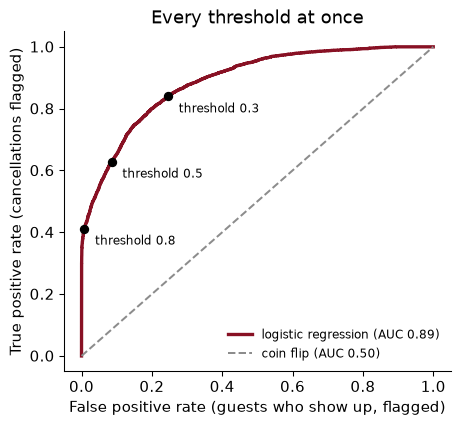

The bottom-left corner is “flag nobody”; the top-right is “flag everybody”. A model that knows nothing traces the diagonal. A perfect model goes straight up the left edge to the top. The black dots are three thresholds; moving the threshold slides you along the curve, it does not move the curve.

The **AUC**, the area under the curve, summarises it in one number: here 0.889. It has a lovely interpretation. Pick one booking that cancelled and one that did not, at random. The AUC is the probability that the model gives the cancelled one the higher $\hat p$. An AUC of 0.5 is a coin flip; 1 is a perfect ranking.

AUC ignores the threshold. That makes it the right number for comparing how well two models *rank* bookings, and the wrong number for deciding what to do: no hotel resells a room “at an AUC”.

### Worked example — checking the AUC by drawing pairs

Verify the interpretation of the AUC by brute force: draw 100,000 random pairs of one cancelled and one kept test booking, and count how often the cancelled one has the higher $\hat p$.

### Solution

``` python
rng = np.random.default_rng(SEED)
p_cancel, p_kept = p_test[y_test.values == 1], p_test[y_test.values == 0]
a, b = rng.choice(p_cancel, 100_000), rng.choice(p_kept, 100_000)
share = (a > b).mean() + 0.5 * (a == b).mean()     # ties count half
```

The cancelled booking has the higher $\hat p$ in 0.890 of pairs; the AUC is 0.889. Same number, up to the noise from sampling pairs. If you remember one thing about AUC, remember this: **it is a statement about ranking pairs**, not about any particular decision.

## The threshold is a business decision

Now the money. Here is what each outcome costs the hotel for one booking:

|  | **Don’t resell** | **Resell the room** |
|----|----|----|
| **Guest shows up** | \$0 | **\$300**: walk the guest to another hotel |
| **Guest cancels** | **\$100**: an empty room | \$0 |

Walking a guest costs three times as much as an empty room. For a booking with cancellation probability $\hat p$, the expected cost of reselling is $300(1 - \hat p)$, and the expected cost of not reselling is $100\hat p$. Resell when the first is smaller:

$$300\,(1-\hat p) < 100\,\hat p \quad\Longleftrightarrow\quad \hat p > \frac{300}{300 + 100} = 0.75$$

In general, act when $\hat p$ exceeds $c_{FP}/(c_{FP} + c_{FN})$, the cost of a false positive over the sum of the two costs. The default 0.5 is what you get if the two mistakes cost the same. Here they do not, so the hotel should resell only when it is quite sure.

The 0.75 assumes $\hat p$ is honest, which we check in the next section. We can also find the threshold directly from data. The rule from Chapter 9 applies: we must not pick it on the test set. So carve a **validation** set out of the training data, refit on the rest, compute the average cost at every threshold on the validation bookings, and take the cheapest.

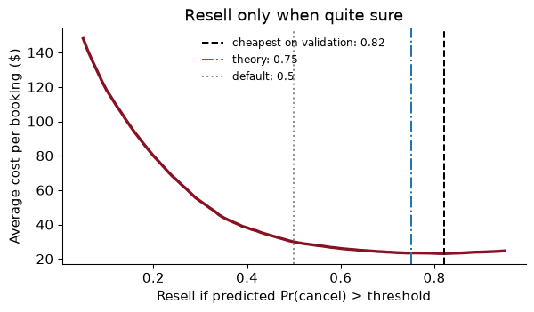

The cheapest threshold on the validation bookings is **0.82**, close to the theory’s 0.75. Now, and only now, score it on the test set:

| Rule                                   | Average cost per booking (test) |
|----------------------------------------|---------------------------------|
| Never resell                           | \$37.04                         |
| Resell if $\hat p > 0.5$               | \$29.91                         |
| Resell if $\hat p > 0.75$ (theory)     | \$23.77                         |
| Resell if $\hat p >$ 0.82 (validation) | \$23.31                         |

So, **should the hotel overbook? Yes, but selectively.** Reselling the rooms of bookings with $\hat p >$ 0.82 costs \$23.31 a booking, against \$37.04 for never reselling and \$29.91 for the default threshold. For a full 200-room hotel, moving from 0.5 to the cost-based threshold saves about \$1,320 a night. Of the rooms it resells, only 2.5% end up with a guest who has to be walked.

The theory and the data agree to within \$0.46 a booking, which is reassuring: it says the probabilities are close to honest. If they had disagreed badly, that would have been the first sign of a calibration problem.

### Worked example — a cheaper walk

The hotel negotiates a deal with the hotel next door, and walking a guest now costs \$150 rather than \$300. What is the new theoretical threshold, and what does the validation set say?

### Solution

The theory gives $150/(150 + 100) = 0.6$. Recomputing the cost curve on the validation bookings with a \$150 walk, the cheapest threshold is 0.61. When the expensive mistake gets cheaper, the hotel can afford to be less sure before reselling, so the threshold falls and more rooms are resold. The model did not change at all. **The model supplies $\hat p$; the business supplies the threshold.**

## Are the probabilities honest?

A cost-based threshold is only as good as the probabilities going into it. A model is **calibrated** if, among bookings it gives $\hat p \approx 0.3$, about 30% actually cancel. To check, sort the test bookings by $\hat p$, cut them into ten equal groups, and plot the average $\hat p$ in each group against the share that actually cancelled. That is a **reliability curve**, and an honest model sits on the diagonal.

For our logistic regression, the group whose average $\hat p$ is 0.32 has an actual cancellation rate of 0.33. The full curve is drawn in the next section, next to a model that does much worse.

Calibration matters whenever $\hat p$ is used as a number rather than as a ranking: to set a threshold from costs, to price a non-refundable rate, or to forecast how many rooms will be empty tonight by adding up the $\hat p$s. A model can rank bookings well (high AUC) and still be badly calibrated. Its probabilities can be systematically too extreme, or shifted up or down. One summary is the **Brier score**, the average of $(\hat p - y)^2$: the mean squared error of the probabilities, lower is better. Here it is 0.127. For scale, always predicting the base rate would score $0.37 \times 0.63 \approx$ 0.233.

If a model is badly calibrated, the fix is to **recalibrate** it on held-out data: scikit-learn’s `CalibratedClassifierCV` learns a mapping from the raw scores to honest probabilities. Logistic regression rarely needs it.

### Worked example — forecasting empty rooms

Tonight, 200 rooms are booked and the model’s $\hat p$s for those bookings add up to 70.4. How many cancellations do you expect, and why does calibration matter for the answer?

### Solution

The expected number of cancellations is the sum of the probabilities: about 70. (Each booking contributes its own chance of cancelling, and expectations add.) That is the number a revenue manager uses to decide roughly how many rooms are “spare”. It is right only if the probabilities are calibrated. If the model’s $\hat p$s were all ten points too high, the sum would be twenty rooms too high, the hotel would overbook by twenty, and twenty guests would be walked.

## Other classifiers

Logistic regression is not the only way to get $\hat p$. Every classifier is trying to approximate the same ideal: if we knew the true probability of cancelling for each kind of booking, we would just predict the likelier class (or apply the cost threshold). That ideal is called the **Bayes classifier**, and the methods differ in how they approximate it.

There are two broad strategies. **Discriminative** methods model $\Pr(\text{cancel} \mid x)$ directly. Logistic regression is one. **K-nearest neighbours**, from Chapter 9, is another: $\hat p$ is the share of cancellations among the $k$ most similar training bookings. **Generative** methods instead model what each class *looks like* (what do cancelling bookings look like, and what do kept ones look like?) and then use Bayes’ rule to ask which profile a new booking resembles more, given that 37% of bookings cancel.

- **Linear discriminant analysis (LDA)** assumes that within each class the features follow a bell curve, with the same spread in both classes. Its boundary is a straight line, like logistic regression’s. Altman’s (1968) Z-score for predicting corporate bankruptcy is an LDA, so this one has a long history in finance.
- **Naive Bayes** assumes the features are independent of one another within each class, so it can multiply the evidence from each feature separately. That is almost never true, but it makes the method fast and easy to scale to thousands of features. It is the classic spam filter, and it works well on word counts.

Which is best? There is no general answer: each assumption is right in some worlds and wrong in others, which is why you cross-validate rather than argue. Here they are on the hotel data, each trained on the same 20,000-booking subsample (KNN is slow to predict on large data) and scored on the full test set:

                  accuracy  precision  recall    AUC  Brier  flagged
    model                                                           
    Logistic         0.809      0.813   0.628  0.888  0.127    0.286
    Naive Bayes      0.758      0.947   0.366  0.792  0.239    0.143
    LDA              0.796      0.833   0.562  0.879  0.135    0.250
    KNN (k = 25)     0.824      0.808   0.687  0.900  0.122    0.315

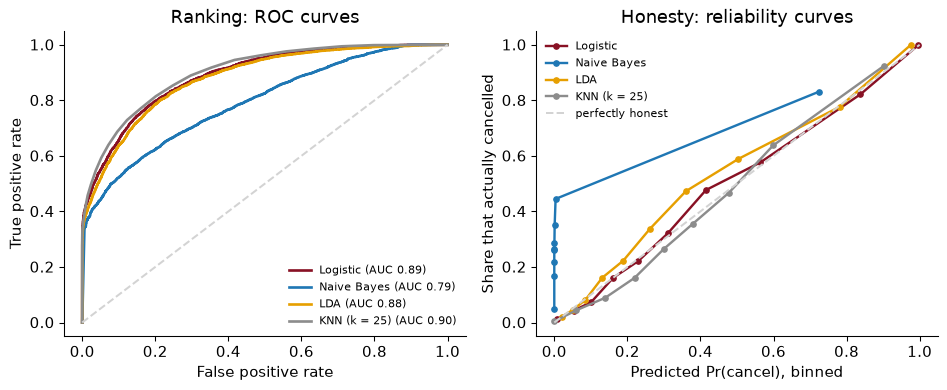

Three things to read off.

**KNN ranks best.** KNN (k = 25) has the highest AUC, 0.900, a little ahead of logistic regression at 0.888. With tens of thousands of bookings, a flexible method that makes no assumption about the shape of the boundary can afford to follow the data.

**LDA and logistic regression are close.** Both draw straight boundaries; they differ only in how they estimate them. LDA’s AUC is 0.879.

**Naive Bayes ranks worst and lies about its probabilities.** Its Brier score, 0.239, is worse than predicting the base rate for everyone. Look at its reliability curve: it hugs the edges. Because it treats correlated features (weekend nights and week nights, adults and children) as independent pieces of evidence, it counts the same evidence twice and becomes far too sure of itself, pushing its $\hat p$s towards 0 and 1.

A reasonable conclusion for the hotel: start with logistic regression, which ranks nearly as well as the best, gives honest probabilities without fuss, fits in a second on the full data, and can be explained to a manager. Try a flexible model as a check. Chapters 13 to 15 add support vector machines, trees and boosting, which are often stronger still on data like these.

### Worked example — the cautious classifier

At the 0.5 threshold, Naive Bayes has the *highest* precision in the table, 95%, and by far the lowest recall, 37%. Is it the best model for a hotel that cares most about precision?

### Solution

No. Look at the share of bookings each model flags: Naive Bayes flags 14%, logistic regression 29%. Naive Bayes is simply flagging fewer bookings, only the most obvious ones, so of course a larger share of its flags are right. High precision at one threshold says as much about where the threshold sits as about the model.

The fair comparison is at the *same* operating point, which is exactly what the ROC curve shows. Logistic regression’s curve lies above Naive Bayes’s everywhere, so if you raised logistic regression’s threshold until it flagged as few bookings as Naive Bayes, it would be at least as precise. Compare models by AUC or by cost at their own best thresholds, never by precision at a single shared threshold.

## Who gets walked?

The model does not use anyone’s name, but it does use where they come from. So ask the question any regulator, journalist or guest would: **who bears the cost of the mistakes?** Here are the error rates at the cost-based threshold, for guests from Portugal and from abroad:

                        bookings  cancel rate  share resold  walked (of those who show up)  missed (of those who cancel)
    guests                                                                                                              
    international         14,177        0.235         0.009                          0.001                         0.965
    domestic (Portugal)    9,701        0.568         0.362                          0.019                         0.377

The difference is stark. Domestic bookings cancel far more often in these data, 57% against 24%, so the model gives them higher $\hat p$s and resells their rooms far more often. The result is that a Portuguese guest who *does* turn up is walked 1.9% of the time, against 0.08% for an international guest: about 23 times as often. Meanwhile almost every international cancellation goes unnoticed (97% missed).

Is the model “unfair”? It is calibrated and it applies the same threshold to everyone. Dropping the `domestic` column narrows the gap but does not close it (Exercise 6), because deposit type, lead time and market segment carry some of the same information. (81% of the bookings it resells are on non-refundable rates, which cancel at a startling rate in these data; 97% of non-refundable bookings are by guests from Portugal.) It is doing exactly what we asked. And still, the burden of its mistakes falls almost entirely on one group.

That is not a bug that better engineering will remove. When two groups have different base rates, no model short of a perfect one can be calibrated within each group *and* give the groups equal false positive rates *and* equal false negative rates. Kleinberg, Mullainathan and Raghavan (2017) prove it, and Chouldechova (2017) shows the same thing for criminal risk scores. You have to choose which kind of equality you care about, and the choice is about values, not statistics. Fuster, Goldsmith-Pinkham, Ramadorai and Walther (2022) find the same pattern in US mortgage lending, where more flexible machine-learning credit models help some groups of borrowers more than others without ever using group membership directly.

For a hotel the stakes are a ruined evening. For a bank turning down a loan, a court setting bail or a programme choosing whom to train, they are much larger. Whatever the setting, the habit is the same: **report error rates by group** alongside the overall numbers.

### Worked example — whose cost is in the matrix?

The \$300 cost of walking a guest was the hotel’s cost: the other room, the taxi. An international guest who is walked may lose more than a local one (no car, an unfamiliar city, a missed connection). Should the hotel use a different threshold for international guests?

### Solution

There is a case either way, and writing it down is the point.

*For*: if walking an international guest really costs the hotel more (worse reviews, lost repeat business), then the cost-based threshold for that group is higher, by the same formula. Here that would mean reselling international rooms even less often, which barely changes anything, since the model hardly ever resells them now.

*Against*: a group-specific threshold treats guests differently because of where they come from, which is uncomfortable and in some markets unlawful. And the cost matrix only counts the hotel’s own costs. The guest’s lost evening is not in it. If the hotel, or a regulator, decided that a walked guest’s cost counts too, *every* threshold would rise.

The general lesson: a cost matrix is a statement about whose costs count. Writing it down makes that choice visible, which is better than hiding it inside “we used 0.5”.

## In Python

The whole analysis in one place, from download to a decision rule, runnable top to bottom.

``` python
from pathlib import Path
import numpy as np, pandas as pd
from sklearn.compose import ColumnTransformer
from sklearn.pipeline import make_pipeline
from sklearn.impute import SimpleImputer
from sklearn.preprocessing import StandardScaler, OneHotEncoder
from sklearn.model_selection import train_test_split
from sklearn.linear_model import LogisticRegression
from sklearn.metrics import accuracy_score, precision_score, recall_score, roc_auc_score
SEED = 368

path = Path("../data/hotels.csv")                    # download once, then reuse
if not path.exists():
    path.parent.mkdir(exist_ok=True)
    pd.read_csv(URL).to_csv(path, index=False)
hotels = pd.read_csv(path)
```

Drop the leaks and the ID-like columns, keep a domestic dummy, split with stratification.

``` python
LEAKS = ["reservation_status", "reservation_status_date", "assigned_room_type"]
hotels["domestic"] = (hotels["country"] == "PRT").astype(int)
X = hotels.drop(columns=["is_canceled"] + LEAKS + ["agent", "company", "country"])
y = hotels["is_canceled"]
X_train, X_test, y_train, y_test = train_test_split(X, y, test_size=0.2, stratify=y, random_state=SEED)
num = X.select_dtypes("number").columns.tolist()
cat = X.select_dtypes(exclude="number").columns.tolist()
prep = ColumnTransformer([
    ("num", make_pipeline(SimpleImputer(strategy="median"), StandardScaler()), num),
    ("cat", OneHotEncoder(handle_unknown="ignore", sparse_output=False), cat)])
```

Choose the threshold on a validation set carved from the training data.

``` python
X_fit, X_val, y_fit, y_val = train_test_split(X_train, y_train, test_size=0.25,
                                              stratify=y_train, random_state=SEED)
model = make_pipeline(prep, LogisticRegression(max_iter=1000)).fit(X_fit, y_fit)

def avg_cost(t, p, y_true, walk=300, empty=100):
    resell, y_true = p > t, np.asarray(y_true)
    return (walk * (resell & (y_true == 0)) + empty * (~resell & (y_true == 1))).mean()

grid = np.linspace(0.05, 0.95, 91)
p_val = model.predict_proba(X_val)[:, 1]
t_star = grid[np.argmin([avg_cost(t, p_val, y_val) for t in grid])]
```

Then score once on the test set.

``` python
p = model.predict_proba(X_test)[:, 1]
print(f"AUC {roc_auc_score(y_test, p):.3f} | threshold {t_star:.2f}")
print(f"precision {precision_score(y_test, p > t_star):.3f} | recall {recall_score(y_test, p > t_star):.3f}")
print(f"cost per booking: ${avg_cost(t_star, p, y_test):.2f} vs ${avg_cost(0.5, p, y_test):.2f} at 0.5")
```

    AUC 0.889 | threshold 0.82
    precision 0.975 | recall 0.401
    cost per booking: $23.31 vs $29.91 at 0.5

## What goes wrong

**Judging by accuracy alone.** With a 37% base rate, “nobody cancels” is already 63% accurate; with fraud it is 99.9%. Always put the base rate next to the accuracy, and look at the confusion matrix.

**Leaving in a feature recorded after the outcome.** `reservation_status` gives 100% accuracy and is useless. A held-out test set does not catch leakage, because the leak is in the test set too. Ask of every column: would I know this when I decide?

**Using 0.5 because it is the default.** 0.5 is the right threshold only when both mistakes cost the same, which is almost never. Write down the cost matrix, compute $c_{FP}/(c_{FP} + c_{FN})$, and check it on validation data.

**Choosing the threshold on the test set.** The threshold is a hyperparameter like any other. Pick it on validation data or by cross-validation, then test once.

**Trusting probabilities that have not been checked.** A model can rank well and still be miscalibrated, and Naive Bayes on these data is the example. If $\hat p$ feeds a cost calculation, a price or a forecast, draw the reliability curve first.

**Reading the coefficients as causal.** Non-refundable bookings cancel at 99% in these data, and the model leans on that heavily. That does not mean non-refundable rates *cause* cancellations; it almost certainly reflects who books them: 97% of non-refundable bookings come through group sales or offline travel agents and tour operators, who block rooms and release the ones they cannot sell. Abolish the rate and those bookings would not turn into reliable guests.

## Exercises

1.  A model gives a booking $\hat p = 0.8$. Which of these is right? (a) This guest will cancel. (b) Among many bookings like this one, about 80% cancel. (c) The model is 80% accurate. (d) The odds of cancelling are 0.8. Explain what is wrong with each of the others.

2.  A credit-card company says a missed fraud costs it \$500 and a false alarm (a blocked legitimate purchase and an annoyed customer) costs \$10. What threshold on $\hat p$ should it use to block transactions? Is it above or below 0.5, and why does that make sense?

3.  Compute the confusion matrix, precision and recall of the logistic regression at the cost-based threshold, on the test set. Compare them with the 0.5 threshold. Which moved, and in which direction?

4.  Compare the City Hotel and the Resort Hotel: fit the logistic regression on the full training data and report the test AUC separately for each hotel. Is the model better at ranking bookings at one than the other?

5.  Recalibrate Naive Bayes: wrap `GaussianNB()` in `CalibratedClassifierCV(..., method="isotonic", cv=5)`, fit it on the 20,000-booking subsample, and compare its Brier score and AUC on the test set with plain Naive Bayes. Which number changed, and why did the other barely move?

6.  The fairness table showed that domestic guests who show up are walked far more often. Suppose the hotel drops the `domestic` column from the model. Predict what happens to the gap, then check it.

7.  Make a **time split**: train on arrivals in 2015 and 2016 and test on 2017 (column `arrival_date_year`), dropping `arrival_date_year` from the features. How does the AUC compare with the random split? What does that tell you about deploying the model?

### Answers

**1.** (b). A probability is a statement about many similar cases, not a promise about one. (a) confuses a probability with a decision; the decision comes only after a threshold is chosen. (c) confuses one prediction with the model’s overall accuracy. (d) confuses odds with probability: the odds are $0.8/0.2 = 4$.

**2.** Block when $\hat p > 10/(10 + 500) \approx 0.02$. That is far *below* 0.5: a missed fraud is fifty times as costly as a false alarm, so the company should block even when fraud is unlikely. It is the hotel’s logic run the other way. There the expensive mistake was acting (walking a guest), so the bar for acting was high; here the expensive mistake is not acting, so the bar is low.

**3.**

These use `p`, from the model fitted in the In Python section on the slightly smaller `X_fit`, so the 0.5 numbers differ a little from those earlier in the chapter.

``` python
from sklearn.metrics import confusion_matrix
for t in [0.5, t_star]:
    print(f"threshold {t:.2f}: precision {precision_score(y_test, p > t):.3f}, "
          f"recall {recall_score(y_test, p > t):.3f}")
    print(confusion_matrix(y_test, p > t))
```

    threshold 0.50: precision 0.812, recall 0.627
    [[13752  1281]
     [ 3300  5545]]
    threshold 0.82: precision 0.975, recall 0.401
    [[14943    90]
     [ 5297  3548]]

Raising the threshold from 0.5 to 0.82 pushes precision up from 81.2% to 97.5% and recall down from 63% to 40%. The hotel resells far fewer rooms, catches fewer cancellations, and almost never walks a guest. That is the right trade when walking is the expensive mistake.

**4.**

``` python
auc_by_hotel = {h: roc_auc_score(y_test[X_test["hotel"] == h], p[(X_test["hotel"] == h).values])
                for h in X_test["hotel"].unique()}
print({h: round(a, 3) for h, a in auc_by_hotel.items()})
```

    {'City Hotel': 0.883, 'Resort Hotel': 0.893}

The test AUC is 0.883 at the City Hotel and 0.893 at the Resort Hotel. The model ranks bookings worse at the City Hotel. Neither number is the AUC of the whole test set, which also gets credit for knowing that city bookings cancel more often than resort ones (42% against 28%).

**5.**

``` python
from sklearn.calibration import CalibratedClassifierCV
from sklearn.naive_bayes import GaussianNB
from sklearn.metrics import brier_score_loss
from sklearn.base import clone
nb_cal = make_pipeline(clone(prep), CalibratedClassifierCV(GaussianNB(), method="isotonic", cv=5))
p_cal = nb_cal.fit(X_small, y_small).predict_proba(X_test)[:, 1]
print(round(brier_score_loss(y_test, p_cal), 3), round(roc_auc_score(y_test, p_cal), 3))
```

    0.162 0.795

The Brier score improves from 0.239 to 0.162. The AUC moves only from 0.792 to 0.795. Recalibration is a monotone relabelling of the scores: it changes what each score *means* as a probability but (apart from ties and the averaging across folds) not the order of the bookings, and AUC depends only on the order.

**6.**

``` python
X_tr_nd, X_te_nd = X_fit.drop(columns="domestic"), X_test.drop(columns="domestic")   # same data as `model`
prep_nd = ColumnTransformer([
    ("num", make_pipeline(SimpleImputer(strategy="median"), StandardScaler()),
     [c for c in num if c != "domestic"]),
    ("cat", OneHotEncoder(handle_unknown="ignore", sparse_output=False), cat)])
p_nd = make_pipeline(prep_nd, LogisticRegression(max_iter=1000)).fit(X_tr_nd, y_fit).predict_proba(X_te_nd)[:, 1]
walked = pd.Series(p_nd > t_star)[y_test.values == 0].groupby(X_test["domestic"].values[y_test.values == 0]).mean()
cost_nd = avg_cost(t_star, p_nd, y_test)
```

Without the column, a domestic guest who shows up is walked 0.3% of the time and an international guest 0.11%. The ratio falls from about 23 to about 3: the column was doing a lot of the work, but not all of it. Deposit type, market segment, lead time and the other features are partial **proxies** for where a guest comes from, so a gap remains.

It is not free. The average cost per booking at the same threshold rises from \$23.31 to \$23.77, because the model has lost real information. That is the trade-off stated in dollars: the hotel can buy a smaller gap in who gets walked for about \$90 a night on 200 rooms. Whether that is worth it is the hotel’s call (or a regulator’s), but now it is a call made with the number in front of you.

**7.**

``` python
tr, te_ = X["arrival_date_year"] <= 2016, X["arrival_date_year"] == 2017
Xt = X.drop(columns="arrival_date_year")
prep_t = ColumnTransformer([
    ("num", make_pipeline(SimpleImputer(strategy="median"), StandardScaler()),
     [c for c in num if c != "arrival_date_year"]),
    ("cat", OneHotEncoder(handle_unknown="ignore", sparse_output=False), cat)])
m_t = make_pipeline(prep_t, LogisticRegression(max_iter=1000)).fit(Xt[tr], y[tr])
auc_time = roc_auc_score(y[te_], m_t.predict_proba(Xt[te_])[:, 1])
```

Trained on 78,703 bookings from 2015–2016 and tested on 40,687 from 2017, the AUC is 0.851, against 0.889 for the random split. It is lower: a random split lets the model learn from bookings made in the same weeks as the ones it is tested on, which is a luxury a hotel deploying the model never has. The time split is the honest estimate of how the model will do next season.

**Reading.** Géron, ch. 3, for more on precision–recall trade-offs, multiclass classification and error analysis, and ch. 4 for the logistic regression section. ISLP (James, Witten, Hastie, Tibshirani & Taylor 2023), ch. 4, for logistic regression, LDA, QDA and Naive Bayes side by side. Kleinberg, Mullainathan & Raghavan (2017), “Inherent Trade-Offs in the Fair Determination of Risk Scores”, for the fairness result.


# Chapter 13 — Support vector machines

> **The question:** the hotel from Chapter 12 has to decide, booking by booking, whether a room is safe to resell. Does it need a probability for that, or would a well-drawn line between “cancels” and “shows up” do as well or better?

## A boundary, not a probability

In Chapter 12 we built the hotel’s resale rule in two steps: first a probability $\hat p$ that each booking cancels, then a threshold chosen from what each mistake costs. Logistic regression did the first step well. It ranked bookings well, and its probabilities were honest.

A **support vector machine** (SVM) takes a different view of the job. It never asks “how likely is this booking to cancel?” It asks a geometric question: **where should the line between the two groups go?** Every booking is a point in feature space (lead time, daily rate, deposit type, and so on). Cancelled bookings sit mostly in one region, kept bookings mostly in another, and the SVM’s job is to draw the boundary between them as well as it can.

Like logistic regression, a linear SVM gives each booking a **score**: a weighted sum of its features plus a constant, $f(x) = \beta_0 + \beta_1 x_1 + \dots + \beta_k x_k$. A positive score means “cancels”, a negative one “shows up”, and the **decision boundary** is where the score is exactly zero. With two features the boundary is a line; with three, a plane; in general it is called a **hyperplane**, which just means a flat boundary in however many dimensions you have.

The difference from logistic regression lies in how the $\beta$s are chosen, and that difference has consequences. An SVM’s score is not a probability, and nothing pushes it to be one. For many classification problems you never need a probability: a spam filter only needs to know which side of the line an email is on. The hotel is not one of those problems, as we will see at the end of the chapter. But first, the idea.

SVMs were invented by Cortes and Vapnik (1995), and for about fifteen years they were the best off-the-shelf classifier for many tasks, text above all. Deep learning and boosted trees have since overtaken them on most benchmarks. I teach them anyway, for three reasons: the geometry is beautiful and easy to see, the **kernel trick** is one of the most useful ideas in machine learning, and on medium-sized problems they are still a strong baseline that costs one line of code.

### Worked example — reading a score

A linear SVM fitted to bookings gives one booking a score of $+2.4$ and another a score of $-0.3$. A colleague says the first is “eight times as likely to cancel”. What can you actually say?

### Solution

Only two things. The first booking is on the “cancels” side of the boundary and the second is on the “shows up” side, just barely. And the first is further from the boundary, so the model is more confident about it. The ratio of the scores means nothing. A score is a distance-like quantity, measured in units the model chose for its own convenience; it is not a probability and not odds. If you need a probability, you have to build one from the score, which is the last section of this chapter.

## The widest street

Start with the easiest possible case: two groups that can be separated perfectly by a straight line. The data below are made up, sixty points in two features, so that the geometry is clean. Real bookings come in the next section.

When two groups can be separated, infinitely many lines separate them. You could nudge any separating line a little, or tilt it, and it would still separate. Which one should we pick?

The SVM’s answer: **pick the line that leaves the widest street between the two groups.** Draw the boundary, then draw two parallel lines on either side of it, as far out as they can go before touching a point. The gap between those two lines is the **margin**, and the SVM chooses the boundary that makes the margin as wide as possible. This is the **maximal margin classifier**.

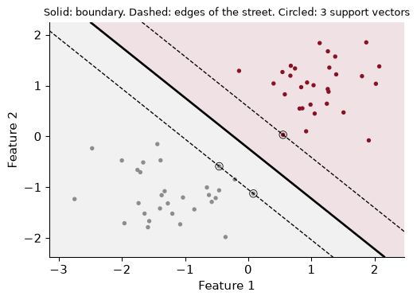

The points sitting exactly on the edges of the street are circled. These are the **support vectors**, and they give the method its name: they “support” the street the way pillars hold up a roof. Here there are only 3 of them out of 60 points.

Here is the property that makes SVMs unusual. **Only the support vectors determine the boundary.** Every other point could be moved anywhere, as long as it stays on its own side and outside the street, and the boundary would not move at all. Logistic regression is different: every observation pulls on its coefficients a little.

Why the widest street? The intuition is a safety margin. New bookings will not land exactly where the old ones did. A boundary that scrapes past the training points on one side will misclassify a new point that lands slightly closer; a boundary with room on both sides has a buffer. There is theory behind this (wider margins give tighter bounds on the error on new data), but the buffer is the idea.

### Worked example — moving a point that does not matter

Take the point furthest from the boundary and move it twice as far away. Then, instead, move one of the support vectors halfway towards the boundary. Refit the SVM each time. What happens to the boundary?

### Solution

``` python
far = np.argmax(np.abs(hard.decision_function(X_sep)))      # furthest from the boundary
X_far = X_sep.copy(); X_far[far] *= 2
m_far = SVC(kernel="linear", C=1e6).fit(X_far, y_sep)

sv0 = hard.support_[0]                                      # one support vector
X_sv = X_sep.copy(); X_sv[sv0] = X_sv[sv0] - 0.5 * hard.decision_function(X_sep[[sv0]]) * hard.coef_[0] / np.sum(hard.coef_ ** 2)
m_sv = SVC(kernel="linear", C=1e6).fit(X_sv, y_sep)
```

    original coefficients:        [[1.223 1.231]] [0.285]
    far point moved further:      [[1.223 1.231]] [0.285]
    support vector moved inward:  [[0.834 1.865]] [0.479]

Moving the far point changes nothing, to three decimal places: it was never a support vector, so the SVM never looked at it. Moving a support vector into the street forces the street to narrow and the boundary to shift, because that point now pins one edge. Width goes from 1.15 to 0.98.

That is the strength and the weakness of the maximal margin idea in one picture. It ignores easy cases, which is efficient. But it is hostage to the few cases near the boundary, and in real data those are exactly the ambiguous, noisy ones.

## Soft margins and the price `C`

Real bookings cannot be separated by a line. Take 400 bookings, half of them cancelled and half not (equal numbers make the pictures easier to read), and two features, the (log) lead time and the average daily rate, both standardized. Plenty of cancelled bookings sit right among the kept ones. No street exists that has all the cancellations on one side.

The fix is the **soft margin**. Let some points sit inside the street, or even on the wrong side of the boundary, but charge a price for each violation, in proportion to how far over the line it is. The SVM now trades off two things: a wide street, and few, small violations.

The price is the hyperparameter **`C`**. In scikit-learn:

- **Large `C`**: violations are expensive. The SVM narrows the street to keep as many training points as possible on the right side. Fewer support vectors, so the boundary is set by a handful of points near it: low bias, high variance.
- **Small `C`**: violations are cheap. The street is wide, many points sit inside it, and all of them help set the boundary. A more stable, more averaged boundary: higher bias, lower variance.

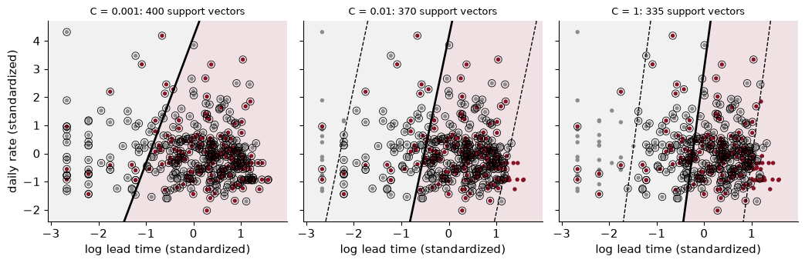

Garnet points cancelled, grey ones did not, and the shaded side is where the SVM predicts a cancellation. The boundary tilts the same way in all three panels: bookings made far ahead cancel more, which we saw in Chapter 12. What changes with `C` is the width of the street and the number of points that count. At `C` = 0.001 the street is 16.8 standard deviations wide and 400 of the 400 bookings are support vectors; at `C` = 1 it narrows to 2.5, with 335 support vectors. Raising `C` beyond 1 changes almost nothing here: once the street is as narrow as the overlap allows, a higher price for violations cannot buy a cleaner separation that does not exist.

> **Support vectors are not only the points on the edge of the street.** With a soft margin they are every point on the edge, inside the street, or on the wrong side. They are the cases the model finds hard.

A warning about notation, because it trips people up every year. In ISLP, the textbook I recommend for the statistics, $C$ is a *budget* for violations: bigger $C$ means more violations allowed. In scikit-learn, `C` is the *price* of a violation: bigger `C` means fewer allowed. They point in opposite directions. scikit-learn’s `C` works like the `C` in `LogisticRegression` from Chapter 12: it is the inverse of a ridge penalty, so bigger `C` means less regularization.

### Worked example — why so many support vectors?

At `C` = 1, 335 of the 400 bookings, 84%, are support vectors. In the made-up separable data there were 3 out of 60. Explain the difference. What does it tell you about these two features?

### Solution

A support vector is any point on the edge of the street, inside it, or on the wrong side. When the classes overlap heavily, a large share of points end up in one of those places, because there is no clean gap for them to sit outside. In the made-up data the groups were far apart, so only the few points closest to the gap mattered.

So the count is a diagnostic. Lead time and the daily rate separate cancellations from stays only weakly: a booking’s lead time and price tell you something, but most bookings look ambiguous on these two features alone. That is not a failure of the SVM. The full model, with deposit type, market segment and the rest, does much better, as we will see.

## Hinge loss and log loss, in words

The soft-margin SVM and logistic regression are closer relatives than they look. Both fit a linear score $f(x)$. Both add a ridge penalty on the coefficients (Chapter 11) to keep them from going wild. They differ in exactly one thing: **how they charge for each training point.**

To compare them, code the outcome as $y = +1$ for a cancellation and $y = -1$ for a stay. Then $y \cdot f(x)$ is positive when the booking is on the correct side of the boundary, and the larger it is, the more safely correct. Call it the booking’s **margin**. The SVM’s charge is the **hinge loss**:

$$\text{hinge loss} = \max\big(0,\ 1 - y \cdot f(x)\big)$$

In words: **a point safely beyond the edge of the street costs nothing at all. Inside the street, or on the wrong side, it costs in proportion to how far it has strayed.** Logistic regression’s charge is the log loss from Chapter 12, which in this notation is $\log(1 + e^{-y f(x)})$: it shrinks as a point gets more safely correct, but it never reaches zero.

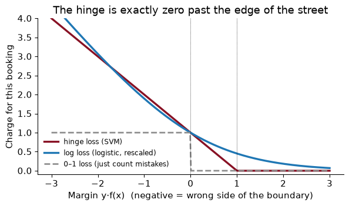

The dashed grey line is what we really care about, the count of mistakes: 1 for a misclassified point, 0 for a correct one. Nobody minimises it directly, because its jump at zero makes it impossible to search over. The hinge and the log loss are both smooth-ish stand-ins for it, and both punish a confident mistake more than a near miss.

The flat part of the hinge is the whole story. A booking that is safely classified contributes nothing to the SVM’s objective, so moving it changes nothing. That is why only support vectors matter. Logistic regression listens to everyone, a little.

In practice, when the classes overlap as much as cancellations and stays do, the two methods draw almost the same line. What really separates them is the output. Logistic regression gives probabilities as a by-product of its loss: log loss is the likelihood, so the fitted $\hat p$s are built to be honest. The hinge loss has no such interpretation. It cares only about which side of the street a point lands on.

### Worked example — three bookings, two charges

Three cancelled bookings ($y = +1$) get scores $f(x)$ of $-0.5$, $0.5$ and $2$. Compute each booking’s hinge loss and log loss. Which booking does each method care about most, and which does the SVM ignore?

### Solution

The margins $y \cdot f(x)$ are just the scores, since $y = +1$.

| Score | Where it is                   | Hinge loss | Log loss |
|-------|-------------------------------|------------|----------|
| −0.5  | wrong side                    | 1.50       | 0.974    |
| 0.5   | right side, inside the street | 0.50       | 0.474    |
| 2     | safely past the edge          | 0.00       | 0.127    |

Both methods charge most for the misclassified booking. The SVM ignores the third booking completely: its hinge loss is exactly zero, so it is not a support vector. Logistic regression still charges it 0.127, a small amount, so it still nudges the coefficients.

## Kernels: curved boundaries without the work

So far every boundary has been a straight line. Suppose, though, that the truth is curved. Here is a made-up example that is not far-fetched: bookings made at the last minute cancel often (a business trip that falls through), bookings made very far ahead cancel often (plans change), and bookings in the middle mostly show up. On a single feature, lead time, the cancellations sit at *both* ends. No single cutoff separates them.

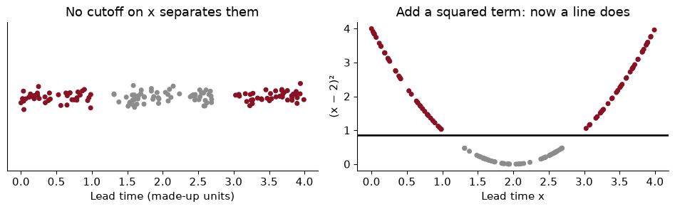

The trick on the right is one you know from econometrics: add a squared term. In the enlarged space, with $x$ and $x^2$ as two features, a straight line separates the groups, and a straight line in the enlarged space is a curve (here, two cutoffs) in the original one. Chapter 10 did the same thing with polynomial regression.

The trouble is scale. With 30 features, all the squares and pairwise interactions come to nearly 500 columns; all the terms up to degree 3 come to several thousand. Building them is slow and the model drowns in them.

Here is the **kernel trick**. When you work through the mathematics of the SVM, the data turn out to enter the problem only through one quantity: **how similar each pair of bookings is**. The SVM never needs the features themselves, only a similarity score for every pair. A **kernel** is a function that computes that similarity, and different kernels correspond to different enlarged feature spaces, *without ever building them*. You get the curved boundary of a huge feature space at the cost of computing similarities.

Three kernels do almost all the work in practice:

- **Linear**: similarity is the ordinary weighted overlap of the two bookings’ features. This is the plain SVM from the previous sections.
- **Polynomial** of degree $d$: the overlap raised to the power $d$. Equivalent to using all interactions up to degree $d$.
- **Radial basis function (RBF)**: similarity depends only on the distance between the two bookings:

$$K(x, x') = \exp\big(-\gamma \times \text{squared distance between } x \text{ and } x'\big)$$

The RBF kernel is 1 when two bookings are identical and falls towards 0 as they move apart. A prediction for a new booking is then a weighted vote of the support vectors, each weighted by how close it is to the new booking. If that sounds like nearest neighbours from Chapter 9, it should: the RBF SVM is a smooth cousin of KNN, in which every support vector votes but near ones count far more. The feature space it corresponds to is infinitely large, which is a fact worth knowing and not worth worrying about.

### Three kernels on real bookings

Back to the 400 bookings and our two features. To judge each boundary honestly, I score it on 3,000 *fresh* bookings that the SVM never saw.

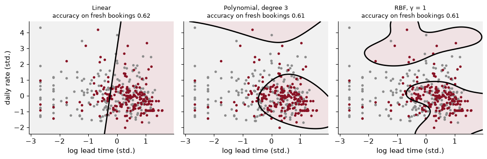

The linear boundary is a straight cut. The polynomial and RBF kernels bend it, carving out a region of long lead times and moderate prices where cancellations concentrate. On fresh bookings (also half cancellations, so guessing scores 0.50) the three are close, 0.61 to 0.62 accuracy, and the straight line is the best of them. Two weak features do not leave much room for any curve to pay off. Curves earn their keep when there are many features whose effects depend on each other, which is the full hotel data later in the chapter.

### Gamma: how local is the vote?

The RBF kernel has its own hyperparameter, $\gamma$ (“gamma”). It sets how fast similarity falls with distance, and so **how local the vote is**.

- **Small $\gamma$**: similarity falls slowly, so even distant support vectors get a say. The boundary is smooth, close to linear. Risk: underfitting.
- **Large $\gamma$**: similarity falls off a cliff, so only the very nearest support vectors count. The boundary wraps around individual points, drawing little islands. Risk: overfitting.

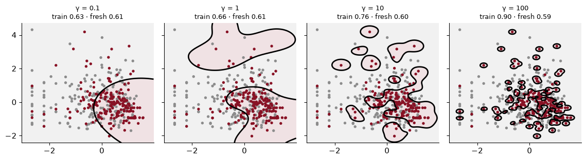

Read the titles left to right. Training accuracy climbs from 0.63 to 0.90 as the boundary gets more flexible. Accuracy on fresh bookings does not follow: it drifts down from 0.61 to 0.59. The picture shows why: at $\gamma$ = 100 the “cancels” region is a scatter of islands around individual training bookings, a map of this sample’s noise.

`C` and $\gamma$ both control flexibility, so they interact. A large $\gamma$ can be tamed by a small `C`, and the other way round. **Tune them together**, which we will do on the full data shortly.

### Worked example — similarity by hand

Two bookings, after scaling, differ by 1.0 in log lead time and by 0.5 in daily rate. What is their RBF similarity at $\gamma$ = 0.1, 1 and 10? What does that say about how much one would influence a prediction for the other?

### Solution

The squared distance is $1.0^2 + 0.5^2 = 1.25$. The similarity is $e^{-\gamma \times 1.25}$:

| $\gamma$ | Similarity |
|----------|------------|
| 0.1      | 0.882      |
| 1        | 0.287      |
| 10       | 0.000004   |

At $\gamma$ = 0.1 the two bookings are almost interchangeable: each would count nearly fully in the vote for the other. At $\gamma$ = 10 they are strangers: a distance of about one standard deviation is already far enough to cut the influence to almost nothing. Same two bookings, same distance; $\gamma$ alone decides whether they are “neighbours”.

## Scale first, always

Margins are distances and the RBF kernel is built on distances, so an SVM inherits KNN’s sensitivity to units (Chapter 9, Exercise 6). A feature measured in big numbers dominates the distance and the others barely register.

In the hotel data the problem is severe. Among the numeric features, the standard deviation of `lead_time` (in days) is 107 and of `adr` (the daily rate, in euros) 51. Meanwhile `domestic`, `is_repeated_guest` and every one-hot dummy can only differ by 1.

From here on I use a training subsample of 10,000 bookings for kernel SVMs, for a reason the section on big data below makes clear. Cross-validated on that subsample, an RBF SVM with default settings has an AUC of 0.900 with the numeric features standardized and 0.697 without. Same data, same model, same hyperparameters. The only difference is the units.

The fix is the same as in Chapter 9: put a `StandardScaler` inside the pipeline, so that the scaling is learned on the training folds only. The one-hot dummies are left at 0/1, which is the usual compromise.

### Worked example — who dominates the distance?

Two bookings are identical except that one was made 60 days earlier and one is non-refundable while the other is not. Without scaling, how much of the squared distance between them comes from lead time? With scaling?

### Solution

Unscaled, lead time contributes $60^2 = 3{,}600$ and the deposit dummy contributes $1^2 = 1$, so lead time is 99.97% of the squared distance. The kernel cannot see the deposit type at all, even though in Chapter 12 it was one of the strongest predictors of cancellation.

Scaled, 60 days is 60 / 107 = 0.56 standard deviations, which contributes 0.31, against 1 for the dummy. Lead time’s share falls to 24%. Both differences now count, which is what we want, because both matter for cancellation.

## Tuning `C` and gamma together

Two hyperparameters that interact are searched together, on a grid. I try four values of `C` and four of $\gamma$, spaced by factors of about three or ten (it is the order of magnitude that matters, not the third digit), and score each of the 16 combinations by 3-fold cross-validated AUC on the training subsample.

``` python
grid = {"svc__C": [0.1, 1, 10, 100], "svc__gamma": [0.003, 0.01, 0.03, 0.1]}
gs = GridSearchCV(make_pipeline(make_prep(), SVC()), grid, cv=cv3,
                  scoring="roc_auc", n_jobs=-1).fit(X_sub, y_sub)
```

The names `svc__C` and `svc__gamma` mean “the parameter `C` of the pipeline step called `svc`”; `make_pipeline` names each step after its class, in lower case. The whole search took 10 seconds.

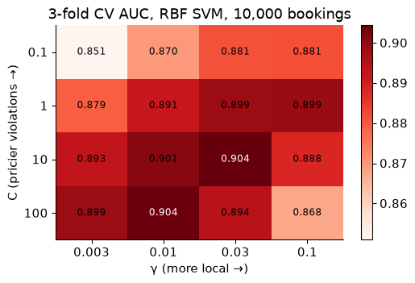

The best combination is `C` = 10 and $\gamma$ = 0.03, with a cross-validated AUC of 0.904. The worst cell on the grid scores 0.851. Notice the diagonal pattern: when $\gamma$ is large (a very local, wiggly fit), the best `C` tends to be smaller, and the other way round. That is the interaction in a picture, and the reason not to tune one and then the other.

### Worked example — is the best on the edge?

Look at where the best cell sits in the grid. If it were on the edge, what would you do, and why does it matter?

### Solution

The best cell is at `C` = 10, $\gamma$ = 0.03, which is inside the grid, not on its edge. So the search has bracketed the best region: values on either side of it score worse, in both directions. Refining further, between the grid points, would buy a third decimal place, which is noise at this sample size.

The rule is general. A best value on the boundary of the grid tells you only that the answer is *at least* that extreme. Inside the grid, it tells you that you have found the region. And because cross-validation is itself noisy, the honest reading of a heatmap is “this region is good”, not “this cell is best”.

## SVM against logistic regression, on the hotel

Now the comparison the chapter has been building to. Same leak-free features, same stratified split and the same 23,878 test bookings as Chapter 12, so the logistic regression’s AUC below is exactly the one reported there.

                                       test AUC  fit seconds
    Logistic, all training data           0.889        0.716
    Logistic, 10,000 subsample            0.887        0.045
    Linear SVM, 10,000 subsample          0.884        0.079
    RBF SVM (tuned), 10,000 subsample     0.913        1.527

Three readings.

**The tuned RBF SVM ranks bookings best**, with a test AUC of 0.913 against 0.889 for Chapter 12’s logistic regression, and it does so having seen only 10,000 of the 95,512 training bookings. The curved boundary is finding structure a linear score cannot: interactions between lead time, the type of customer and the season, say, that logistic regression would need you to type in by hand.

**The linear SVM and logistic regression are a dead heat.** On the same subsample, their AUCs are 0.884 and 0.887. As the hinge-loss section predicted, when the classes overlap this much, two linear methods with different losses draw nearly the same line. The gain comes from the kernel, not from the hinge.

**The kernel is not free.** The RBF SVM has 4,110 support vectors, and every prediction compares the new booking with each of them. Scoring the test set took 4.6 seconds, where logistic regression scores it in a blink.

### Worked example — the model or the data?

The RBF SVM was trained on 10,000 bookings and logistic regression on all of them. Is that comparison fair? What does the table let you conclude?

### Solution

It is unfair, but in the SVM’s disfavour, which makes the result stronger. The row that isolates the model is “Logistic, 10,000 subsample”: same data as the SVM, and an AUC of 0.887. Going from 10,000 bookings to all 95,512 raises logistic regression’s AUC by only 0.002: a linear model has few parameters and has learned what it can from 10,000 bookings. The kernel adds 0.026 on the same data. So the gain is the model’s flexibility, not more data.

The obvious next question is what the RBF SVM would do with all the data. The next section explains why that is harder to answer than it sounds.

## When the data are big: linear SVMs and SGD

A kernel SVM has to consider the similarity between pairs of training bookings, and the number of pairs grows with the *square* of the number of bookings. Double the data and the work roughly quadruples, or worse. Here is the fit time as the training sample grows:

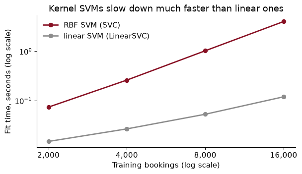

On a log–log plot, the slope of the line is the power at which time grows with $n$. For the RBF SVM it is about 1.9: each doubling of the data multiplies the fit time by about 3.8. Extrapolating that line to the full 95,512 training bookings gives roughly 2 minutes for a single fit, before any tuning, and every one of the grid’s 48 fits would take a similar time. For a card issuer with millions of accounts, kernel SVMs are simply off the table.

**Linear SVMs scale in proportion to $n$.** scikit-learn’s `LinearSVC` uses a solver that never forms the pairs, and `SGDClassifier(loss="hinge")` fits the same hinge-loss model by **stochastic gradient descent** (Chapter 10), looking at one booking at a time. SGD can even learn from data too big to fit in memory, a batch at a time. On all 95,512 training bookings:

| Model, full training data        | Fit seconds | Test AUC |
|----------------------------------|-------------|----------|
| `LinearSVC(C=0.1)`               | 1.1         | 0.887    |
| `SGDClassifier(loss="hinge")`    | 0.5         | 0.884    |
| Logistic regression (Chapter 12) | 0.7         | 0.889    |

All three are linear, all three fit in seconds, and all three land within a hair of each other. If you want the kernel’s flexibility at this scale, there are approximations (scikit-learn’s `Nystroem` builds a few hundred features that mimic the RBF kernel, and a linear SVM is then fitted to those; see Exercise 6). But on large tabular data the more common move is to reach for the trees and boosting of Chapters 14 and 15, which scale well and handle curved boundaries on their own.

### Worked example — what does a doubling cost?

Using the fitted slope, how long would one RBF SVM fit take on 32,000 bookings? On 64,000?

### Solution

The fit on 16,000 bookings took 4.0 seconds. Each doubling multiplies it by 2 raised to the power 1.9, about 3.8, so about 15 seconds at 32,000 and 57 at 64,000. A tuning grid multiplies that again by the number of combinations times the number of folds. This is a rough projection (the exponent changes with the data and the hyperparameters, and large `C` is slower), but the shape of the answer does not change: kernel methods are for thousands or tens of thousands of cases, not millions.

## From scores to probabilities

The hotel’s decision rule from Chapter 12 was: resell a room when the probability of cancellation exceeds $c_{FP}/(c_{FP} + c_{FN}) = 300/400 = 0.75$. That rule needs a probability. The SVM gives a score. On the test set, the tuned RBF SVM’s scores run from -4.4 to 5.9. A score is not a probability, and “resell if the score exceeds 0.75” means nothing.

The AUC did not care, because AUC depends only on the *ranking* of bookings, and a higher score does mean “more likely to cancel”. But a cost-based threshold, a forecast of empty rooms, or a price all need $\hat p$ to be a number you can multiply by dollars.

The fix is **calibration**: learn a mapping from scores to probabilities on data the SVM did not train on. The standard method for SVMs is **Platt scaling**: fit a one-feature logistic regression of the outcome on the SVM’s score. Since the score is already a good ranking, all the little logistic regression has to do is find the S-curve that turns scores into honest frequencies. scikit-learn’s `CalibratedClassifierCV` does this with cross-validation: it splits the training data into folds, fits the SVM on some and the S-curve on the held-out one, and averages.

``` python
cal_svm = CalibratedClassifierCV(make_pipeline(make_prep(), SVC(C=best_C, gamma=best_g)),
                                 method="sigmoid", cv=3).fit(X_sub, y_sub)
p_svm = cal_svm.predict_proba(X_test)[:, 1]
```

(`method="sigmoid"` is Platt scaling; `"isotonic"` fits a more flexible step function and needs more data. You may also see `SVC(probability=True)`, which does the same thing internally. I prefer the explicit wrapper, because it makes clear that the probabilities come from a second model fitted on held-out folds.)

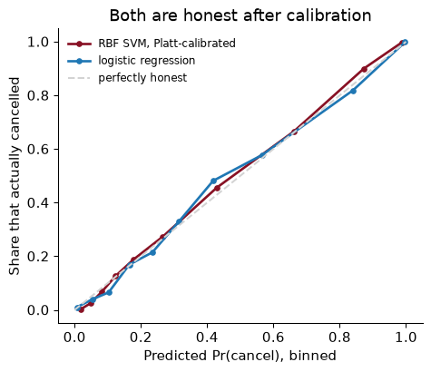

After calibration both models sit close to the diagonal. The calibrated SVM’s Brier score is 0.111, against 0.127 for logistic regression; lower is better. Its AUC is 0.914, slightly different from the uncalibrated 0.913 because the wrapper averages three SVMs fitted on different folds.

Now plug both into Chapter 12’s cost rule, resell when $\hat p > 0.75$, on the test bookings:

| Rule | Share of rooms resold | Average cost per booking (test) |
|----|----|----|
| Never resell | 0% | \$37.04 |
| Logistic regression, as in Chapter 12’s cost table | 17% | \$23.77 |
| Logistic regression, all training data | 17% | \$23.80 |
| RBF SVM, calibrated, 10,000 subsample | 21% | \$20.96 |

The SVM’s better ranking turns into money. At the same threshold it resells 21% of rooms rather than 17%, and the average cost per booking is \$2.84 lower than logistic regression’s on the same data.

### Worked example — a night at the 200-room hotel

Translate the difference in average cost into dollars per night for a full 200-room hotel. Then say what you would tell the manager about switching models.

### Solution

The SVM saves \$2.84 a booking, so about \$567 a night for 200 rooms, or roughly \$206,973 a year if every night were like the test set. That is real money for a hotel.

What I would tell the manager: the gain is real but modest, and it comes with costs that do not show up in the table. The SVM cannot be explained in a sentence the way “non-refundable bookings and long lead times cancel more” can. It has to be retrained on a subsample, or replaced by an approximation, as the data grow. Its probabilities come from a second, bolted-on model that must be refitted whenever the SVM is. And Chapter 15’s boosted trees may well do better still, at less cost. So: a strong case for *a* more flexible model than logistic regression, and a reason to try the tree ensembles before committing to this one.

## In Python

The whole analysis in one place, from download to a calibrated decision rule, runnable top to bottom. The cleaning and the split are Chapter 12’s.

``` python
from pathlib import Path
import numpy as np, pandas as pd
from sklearn.compose import ColumnTransformer
from sklearn.pipeline import make_pipeline
from sklearn.impute import SimpleImputer
from sklearn.preprocessing import StandardScaler, OneHotEncoder
from sklearn.model_selection import train_test_split, GridSearchCV, StratifiedKFold
from sklearn.svm import SVC
from sklearn.calibration import CalibratedClassifierCV
from sklearn.metrics import roc_auc_score
SEED = 368

path = Path("../data/hotels.csv")                    # download once, then reuse
if not path.exists():
    path.parent.mkdir(exist_ok=True)
    pd.read_csv(URL).to_csv(path, index=False)
hotels = pd.read_csv(path)
```

Drop the leaks and ID-like columns, split exactly as in Chapter 12, and build a preprocessing step that **scales** the numbers.

``` python
LEAKS = ["reservation_status", "reservation_status_date", "assigned_room_type"]
hotels["domestic"] = (hotels["country"] == "PRT").astype(int)
X = hotels.drop(columns=["is_canceled"] + LEAKS + ["agent", "company", "country"])
y = hotels["is_canceled"]
X_train, X_test, y_train, y_test = train_test_split(X, y, test_size=0.2, stratify=y, random_state=SEED)
num = X.select_dtypes("number").columns.tolist()
cat = X.select_dtypes(exclude="number").columns.tolist()
prep = ColumnTransformer([
    ("num", make_pipeline(SimpleImputer(strategy="median"), StandardScaler()), num),
    ("cat", OneHotEncoder(handle_unknown="ignore", sparse_output=False), cat)])
```

Kernel SVMs need a subsample. Tune `C` and $\gamma$ together by cross-validated AUC.

``` python
X_sub = X_train.sample(10_000, random_state=SEED)
y_sub = y_train.loc[X_sub.index]
grid = {"svc__C": [0.1, 1, 10, 100], "svc__gamma": [0.003, 0.01, 0.03, 0.1]}
search = GridSearchCV(make_pipeline(prep, SVC()), grid, scoring="roc_auc", n_jobs=-1,
                      cv=StratifiedKFold(3, shuffle=True, random_state=SEED)).fit(X_sub, y_sub)
C_star, g_star = search.best_params_["svc__C"], search.best_params_["svc__gamma"]
```

Calibrate the scores into probabilities, then apply the cost rule once on the test set.

``` python
cal = CalibratedClassifierCV(make_pipeline(prep, SVC(C=C_star, gamma=g_star)),
                             method="sigmoid", cv=3).fit(X_sub, y_sub)
p = cal.predict_proba(X_test)[:, 1]
resell, shows_up = p > 0.75, (y_test == 0).values
cost = (300 * (resell & shows_up) + 100 * (~resell & ~shows_up)).mean()
print(f"C = {C_star}, gamma = {g_star} | test AUC {roc_auc_score(y_test, p):.3f} | cost per booking ${cost:.2f}")
```

    C = 10, gamma = 0.03 | test AUC 0.914 | cost per booking $20.96

## What goes wrong

**Forgetting to scale.** Without a `StandardScaler`, the RBF SVM’s AUC on the hotel data drops from 0.900 to 0.697, because lead time and the daily rate swamp every dummy. Scaling is part of the model, so it goes inside the pipeline, learned on the training folds only.

**Tuning `C` and $\gamma$ one at a time, or stopping at the edge of the grid.** They interact: the best `C` depends on $\gamma$. Search them together, on a grid spaced by factors of three or ten. If the best cell is on the edge, extend the grid.

**Treating the score as a probability.** `decision_function` returns a signed distance-like score. It ranks bookings, so AUC is fine, but it cannot be compared with 0.75 or summed into a forecast of empty rooms. Calibrate it on held-out data first, and check the reliability curve.

**Running a kernel SVM on all the data.** Fit time grows roughly with the square of $n$ or faster. On a few thousand cases a kernel SVM is quick; on a hundred thousand, one fit takes minutes and a tuning grid takes an hour or more. Subsample, approximate the kernel, or switch to `LinearSVC`, `SGDClassifier` or the tree ensembles of Chapter 15.

**Reading ISLP’s $C$ as scikit-learn’s `C`.** In ISLP $C$ is a budget for violations (bigger means a wider street); in scikit-learn it is a price (bigger means a narrower street). Same letter, opposite direction.

**Using an SVM when the job is a probability.** For pricing insurance, setting a credit limit or forecasting how many rooms will be empty, the probability is the product. Logistic regression gives it directly, and a calibrated SVM gives it second-hand. Use the SVM when the flexible boundary buys enough to pay for the extra step.

## Exercises

1.  Two bookings are on the same side of an SVM’s boundary, with scores 0.4 and 3.1. A colleague proposes to drop the second one from the training data because “it is obviously a cancellation and adds nothing”. If the SVM is refitted without it, does the boundary change? Would the same be true of logistic regression?

2.  A bank fits an SVM to predict loan default and finds that 85% of its training cases are support vectors. What does that tell you about the data? Would you expect a large or small `C` to have been chosen, and why?

3.  Re-draw the soft-margin figure with the same three values of `C`, but on the two features `lead_time` and `adr` *without* standardizing them. Describe what happens to the boundary and the street, and explain why.

4.  Extend the tuning grid one step in each direction (`C` from 0.03 to 300, $\gamma$ from 0.001 to 0.3, still factors of about three). Does the best combination move? Report the best cross-validated AUC and compare it with the original grid’s.

5.  Fit `SVC(kernel="poly", degree=2, coef0=1)` and `SVC(kernel="poly", degree=3, coef0=1)` on the 10,000-booking subsample (with `C` = 1) and compute their test AUC. How do they compare with the linear and RBF SVMs? Which interactions does a degree-2 polynomial kernel let the model use?

6.  **Kernel approximation.** Build `make_pipeline(prep, Nystroem(gamma=best_gamma, n_components=500, random_state=368), LinearSVC(C=0.1))` (import `Nystroem` from `sklearn.kernel_approximation`) and fit it on the **full** training data. Report the fit time and test AUC, and compare them with the RBF SVM trained on 10,000 bookings.

7.  The calibrated SVM resells more rooms than logistic regression at the 0.75 threshold. Using the test set, compute for each model the share of resold rooms whose guest actually shows up (and so is walked). Is the SVM saving money by reselling more rooms at the same accuracy, or by being more accurate about which rooms to resell?

### Answers

**1.** For the SVM, no, provided the booking is not a support vector. A score of 3.1 is well past the edge of the street (the edge is at 1), so its hinge loss is zero and it plays no part in setting the boundary. Removing it changes nothing. (The booking with score 0.4 is inside the street, so it *is* a support vector, and removing it would move the boundary.) For logistic regression, every booking contributes to the log loss, so removing either one moves the coefficients, though removing a confidently correct case moves them very little.

**2.** That the classes overlap heavily on the features the bank uses: most borrowers sit inside the street or on the wrong side, so most are “hard” cases. Many support vectors usually go with a small `C`, because cheap violations widen the street and pull more cases into it. It is not a sign of a bug; it is a sign that the features separate defaulters from repayers only weakly, and that the model’s boundary is an average over many ambiguous cases.

**3.**

``` python
X2_raw = np.c_[d2["lead_time"], d2["adr"]]
raw = {C: SVC(kernel="linear", C=C, max_iter=200_000).fit(X2_raw, y2) for C in CS}
fig, ax = plt.subplots(1, 3, figsize=(11, 3.5), sharey=True)
for a, (C, m) in zip(ax, raw.items()):
    plot_svm(a, m, X2_raw, y2, f"unscaled, C = {C}: {len(m.support_)} support vectors")
    a.set_xlabel("lead time (days)")
ax[0].set_ylabel("daily rate (€)"); plt.tight_layout(); plt.show()
```

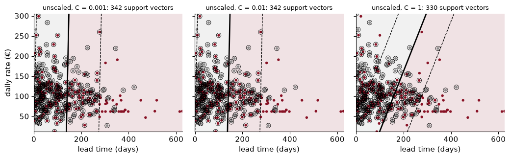

Without scaling, lead time (hundreds of days) and the daily rate (tens to hundreds of euros) are on different scales, and the margin is measured in raw units, so “a wide street” means something different along each axis. The width that the SVM maximises is dominated by whichever feature has the larger spread, and a ridge penalty on the coefficients penalises the two features unequally. The boundaries differ from the scaled ones and depend on the units chosen; quoting the daily rate in cents would change them again. (The `max_iter` cap is there because the solver struggles on badly scaled data, which is another symptom of the same problem.)

**4.**

``` python
grid2 = {"svc__C": [0.03, 0.1, 0.3, 1, 3, 10, 30, 100, 300], "svc__gamma": [0.001, 0.003, 0.01, 0.03, 0.1, 0.3]}
gs2 = GridSearchCV(make_pipeline(make_prep(), SVC()), grid2, cv=cv3, scoring="roc_auc", n_jobs=-1).fit(X_sub, y_sub)
print(gs2.best_params_, round(gs2.best_score_, 3))
```

    {'svc__C': 10, 'svc__gamma': 0.03} 0.904

The best combination on the wider grid is `C` = 10, $\gamma$ = 0.03, with a cross-validated AUC of 0.904, against 0.904 on the original grid. The gain is in the third decimal place, well within the noise of 3-fold cross-validation on 10,000 bookings. The lesson is the usual one: the grid needs to bracket the good region, not to be fine.

**5.**

``` python
poly = {deg: make_pipeline(make_prep(), SVC(kernel="poly", degree=deg, coef0=1, C=1)).fit(X_sub, y_sub)
        for deg in [2, 3]}
n_in = make_prep().fit(X_sub).transform(X_sub.head()).shape[1]
poly_auc = {deg: roc_auc_score(y_test, m.decision_function(X_test)) for deg, m in poly.items()}
print({deg: round(a, 3) for deg, a in poly_auc.items()})
```

    {2: 0.906, 3: 0.911}

The degree-2 polynomial kernel has a test AUC of 0.906 and degree 3 has 0.911, against 0.884 for the linear SVM and 0.913 for the tuned RBF. A degree-2 kernel is equivalent to adding every square and every pairwise interaction of the features: lead time × non-refundable, weekend nights × resort hotel, and so on, about 2,080 squares and interactions of the 64 model inputs, that the kernel never has to build. (These polynomial SVMs were not tuned; a fair contest would tune `C` for each.)

**6.**

``` python
from sklearn.kernel_approximation import Nystroem
nys = make_pipeline(make_prep(), Nystroem(gamma=best_g, n_components=500, random_state=SEED), LinearSVC(C=0.1))
nys, sec_nys = fit_time(nys, X_train, y_train)
auc_nys = roc_auc_score(y_test, nys.decision_function(X_test))
print(f"{sec_nys:.1f} s, test AUC {auc_nys:.3f}")
```

    8.1 s, test AUC 0.916

On all 95,512 training bookings the Nyström approximation fits in 8.1 seconds and reaches a test AUC of 0.916, against 0.913 for the exact RBF SVM on 10,000 bookings and 0.889 for logistic regression. It builds 500 features whose similarities mimic the RBF kernel, using 500 training bookings as landmarks, and then fits a linear SVM to them, so it scales like a linear model. It matches or beats the exact kernel SVM, because it can afford to learn from ten times as many bookings: an approximate kernel on all the data beats an exact one on a tenth of it.

**7.**

``` python
for name, p_ in [("logistic", p_logit_full), ("SVM", p_svm)]:
    r = p_ > 0.75
    print(f"{name}: resells {r.mean():.1%} of rooms; {(y_test.values[r] == 0).mean():.1%} of those guests show up")
```

    logistic: resells 17.1% of rooms; 5.7% of those guests show up
    SVM: resells 21.1% of rooms; 6.0% of those guests show up

Of the rooms each model resells, 5.7% (logistic) and 6.0% (SVM) belong to guests who turn up and must be walked. The SVM resells more rooms with almost the same hit rate, so it is mostly finding more of the near-certain cancellations, not gambling more: that is better ranking, which is what its higher AUC promised.

**Reading.** Géron, Appendix C, for support vector machines, including the dual problem and support vector regression. ISLP (James, Witten, Hastie, Tibshirani & Taylor 2023), ch. 9, for the maximal margin classifier, soft margins (in the budget convention) and the connection to logistic regression. Hsu, Chang & Lin, “A Practical Guide to Support Vector Classification” (National Taiwan University), for the practice of scaling and grid search. Platt (1999), “Probabilistic Outputs for Support Vector Machines”, for the calibration step.


# Chapter 14 — Decision trees

> **The question:** a housing office has to set a voucher rent for a flat nobody has advertised, and then explain the number to a sceptical landlord. Can a short list of yes-or-no questions about the flat price it about as well as a regression, in a form anyone can follow?

## Twenty questions

In the parlour game, one player thinks of an object and the other gets twenty yes-or-no questions to guess it. A good player does not ask “is it a teaspoon?” first. She asks the question that splits the remaining possibilities most evenly, “is it alive?”, and then asks the next question *given the answer*. If it is alive, the next question is about animals; if not, about objects. Each answer sends her down a different branch.

A **decision tree** predicts the same way. To price a flat, it asks a question about one feature (“is it smaller than 1,000 square feet?”), sends the flat left or right depending on the answer, asks another question on that branch, and so on until it runs out of questions. Where it stops is a **leaf**, and the prediction is the average rent of the training flats that ended up in the same leaf.

That is the entire method. There are no coefficients and no distances. A tree chops the feature space into boxes and predicts a constant in each one, and the boxes are chosen by the data.

Trees matter to economists for three reasons. They are **readable**: a short tree is a flowchart a caseworker can follow, and that matters when a prediction has to be defended to the person it affects. They **find interactions by themselves**: if bedrooms matter more in San Francisco than in Solano County, a tree can discover that without being told to look. And they are the building block of the random forests and boosted trees of Chapter 15, which are the most accurate off-the-shelf predictors for spreadsheet-style data. Kleinberg et al. (2018), in their study of bail decisions, used exactly such tree ensembles to predict which defendants would fail to appear in court.

Our data are Chapter 9’s: 62,129 Craigslist rental listings from the Bay Area, with the same cleaning, the same features (square feet, bedrooms, bathrooms, year, county and neighbourhood) and the same train/test split. That means every number in this chapter can be laid next to Chapter 9’s. There, the median baseline had a cross-validated RMSE of \$1,403, linear regression \$747, and nearest neighbours with $k$ = 10 \$671. Those are the numbers to beat.

### Worked example — playing the game well

You must guess a listing’s rent with one yes-or-no question about it. Which is the better first question: “Is it in Napa County?” or “Is it larger than 1,000 square feet?” You do not need data to answer.

### Solution

The size question, almost certainly. A good first question splits the listings into two groups that are each large and that differ a lot in rent. Only 1.6% of listings are in Napa, so the “yes” group is tiny: even if Napa rents were very different, the answer would usually be “no” and you would have learned almost nothing about most flats. About 49% of listings are over 1,000 square feet, so the size question splits the data into two substantial groups, and big flats rent for a lot more than small ones. The tree will make the same judgement, but by computing it.

## Reading a tree

Here is a tree with three levels of questions, fitted to the training listings:


Read it from the top. Each box shows a question, how many training listings reached that box (`samples`), and their average rent (`value`). A flat that answers “yes” goes left; “no” goes right. The eight boxes at the bottom are the leaves.

The first question is about **sqft**: is it at most 1,374? That is the single most useful question the tree could find, and it is not a surprise: size is the strongest predictor of rent, as Chapter 9’s scatter plot showed.

Now look at the second level. On the smaller-flat branch, the next question is about **year**; on the larger-flat branch it is about **sqft**. Different questions on different branches is how a tree builds an **interaction**. In a regression you would have to type in “size × year” to let the effect of the year depend on size; the tree did it without being asked, by asking about the year only where it helped.

Two things should make you a little suspicious. First, the leaves range from \$1,647 to \$5,592, and every flat in a leaf gets the same prediction. A depth-3 tree knows only eight rents. Second, look for a split on `county`. Trees need numbers, so I have coded the ten counties as 0 to 9 *in alphabetical order* (alameda is 0, contra costa is 1, and so on). A question like “county ≤ 1.5” therefore means “is it in Alameda or Contra Costa?”, a grouping that makes sense only because of the alphabet. It works, after a fashion, because a deep tree can keep slicing the codes until it has isolated the counties that matter. But it is clumsy, and Exercise 6 does better.

### Worked example — following a flat down the tree

Send Chapter 9’s flat, a 900 square foot, two-bedroom, one-bath flat in the Mission District advertised in 2016, down the depth-3 tree. Which questions does it answer, and what rent does the tree predict?

### Solution

``` python
Z0 = pd.DataFrame(tree3[0].transform(x0), columns=names)       # the flat, as the tree sees it
nodes = tree3[-1].decision_path(Z0).indices
for node in nodes[:-1]:
    f, thr = names[t3.feature[node]], t3.threshold[node]
    print(f"{f} = {Z0[f].iloc[0]:g}  ≤ {thr:,.1f}?  {'yes' if Z0[f].iloc[0] <= thr else 'no'}")
print(f"leaf: {t3.n_node_samples[nodes[-1]]:,} training listings, average rent ${t3.value[nodes[-1]][0][0]:,.0f}")
```

    sqft = 900  ≤ 1,373.5?  yes
    year = 2016  ≤ 2,012.5?  no
    sqft = 900  ≤ 998.5?  yes
    leaf: 13,189 training listings, average rent $2,321

The flat answers three questions and lands in a leaf with 13,189 training listings, whose average rent, \$2,321, is the prediction. Notice what the tree did *not* ask: nothing about the Mission District, nothing about San Francisco. Every flat that answers those questions the same way gets the same rent, in Vallejo or in Noe Valley. Chapter 9’s nearest-neighbour model, which found five similar Mission flats, would never make that mistake. A shallow tree is readable precisely because it ignores most of what it knows.

## How a split is chosen

How did the tree decide that “square feet at most 1,374” was the best first question? By brute force. For a regression tree, the recipe is:

1.  For every feature, and for every cutpoint between two adjacent values of it, split the listings into two groups: at or below the cutpoint, and above it.
2.  Predict each group by its own average rent, and add up the squared errors in both groups.
3.  Choose the feature and cutpoint with the smallest total.

In symbols, the tree picks the feature $j$ and cutpoint $s$ that minimise

$$\sum_{i:\ x_{ij} \le s} (y_i - \bar y_{\text{left}})^2 \;+\; \sum_{i:\ x_{ij} > s} (y_i - \bar y_{\text{right}})^2$$

which is just the sum of squared residuals you know from OLS, with each group’s mean as its prediction. Then the tree does the same thing again inside each group, and again inside each of those, until a stopping rule tells it to stop.

Two properties of this recipe matter later.

**It is greedy.** At each step the tree takes the best split *now*, without asking whether a worse split now would allow better splits later. It never goes back. A chess player who only ever looked one move ahead would play like this. The result is usually good and rarely the best possible tree, which nobody knows how to find quickly.

**It does not care about units or monotone transformations.** “Is square footage at most 1,000?” and “is log square footage at most 6.9?” send exactly the same flats left. So trees need no scaling and no logs on the features, and a few extreme values of a feature do not drag the splits around. That is a real convenience after Chapters 9 and 13.

### Worked example — the best first split, by hand

Six made-up flats have sizes 500, 650, 800, 1,000, 1,200 and 1,500 square feet, and rents \$1,800, \$2,000, \$2,100, \$2,900, \$3,100 and \$3,300. Find the best single split on size.

### Solution

There are five possible cutpoints, halfway between adjacent sizes. For each, compute each side’s mean rent and the squared errors around it:

     cut at (sq ft) total squared error
              575.0           1,408,000
              725.0             850,000
              900.0             126,667
             1100.0             720,000
             1350.0           1,348,000

The best cut is at 900 square feet: the three small flats average \$1,967 and the three large ones \$3,100. It is where the jump in rents is, which is what your eye would choose. scikit-learn agrees: a depth-1 tree on these six flats splits at 900.

## Classification trees and impurity

Trees also classify. A **classification tree** works the same way, except that each leaf predicts the share of each class among its training cases (a probability, for `predict_proba`) and the majority class (for `predict`). What changes is the yardstick for a good split. Squared error makes no sense for “cancelled” versus “showed up”, so the tree measures how **impure** each group is: how mixed its classes are.

A leaf in which every booking cancelled, or none did, is **pure**: it would classify its own cases perfectly. A leaf that is half and half is as impure as a leaf can be. scikit-learn’s default measure is the **Gini index**, which for two classes with shares $p$ and $1 - p$ is $1 - p^2 - (1 - p)^2$: zero for a pure leaf and 0.5 for a 50/50 one. You can read it as the chance that two cases drawn at random from the leaf belong to different classes. The alternative is **entropy**, a measure from information theory of how surprised you would be, on average, by the class of a case drawn from the leaf: zero for a pure leaf, 1 bit for a 50/50 one. The two almost always choose the same splits. The tree picks the split that makes the impurity of the two groups, weighted by their sizes, as low as possible.

Here is a two-level classification tree for the hotel cancellations of Chapters 12 and 13, on four features:

    |--- non_refund <= 0.50
    |   |--- lead_time <= 11.50
    |   |   |--- weights: [21101.00, 2631.00] class: 0
    |   |--- lead_time >  11.50
    |   |   |--- weights: [53972.00, 27099.00] class: 0
    |--- non_refund >  0.50
    |   |--- lead_time <= 25.50
    |   |   |--- weights: [34.00, 375.00] class: 1
    |   |--- lead_time >  25.50
    |   |   |--- weights: [59.00, 14119.00] class: 1

The `weights` are the counts of kept and cancelled bookings in each leaf. The first question is whether the booking is **non_refund**, and the answer splits off a group in which almost every booking cancels. That is Chapter 12’s non-refundable puzzle, found in one step.

### Worked example — what the first split buys

Compute the Gini impurity of all 119,390 bookings before the first split, of each of the two groups after it, and the size-weighted average after. Then compute the entropy of the same three groups.

### Solution

The share cancelled is 0.370 overall, 0.284 in the left group (104,803 bookings) and 0.994 in the right group (14,587 bookings).

| Group                     | Share cancelled | Gini  | Entropy (bits) |
|---------------------------|-----------------|-------|----------------|
| All bookings              | 0.370           | 0.466 | 0.951          |
| Left (not non-refundable) | 0.284           | 0.406 | 0.860          |
| Right (non-refundable)    | 0.994           | 0.013 | 0.056          |

The weighted Gini after the split is (104,803 × 0.406 + 14,587 × 0.013) / 119,390 = 0.358, down from 0.466. The right group is nearly pure, so it contributes almost nothing. The left group is barely purer than the whole sample, but it holds most of the bookings, which is why the gain is real but not dramatic. Entropy tells the same story on a different scale.

## Grow the whole tree, and watch it overfit

Nothing in the splitting recipe tells the tree when to stop. Left alone, it keeps splitting until every leaf is pure, meaning every listing in it has the same rent, or holds a single listing. Here is what happens as we allow more and more levels:


    depth leaves train    cv
        2      4 1,146 1,151
        4     16 1,003 1,011
        6     64   877   890
        8    248   780   818
       10    842   692   773
       12  2,457   596   761
       15  8,085   453   779
       20 23,174   254   807
     none 32,960   165   819

The grey line is the familiar overfitting picture. Training error falls with every level, all the way to \$165 for the unlimited tree, which has 32,960 leaves for 49,703 training listings. The garnet line, the honest one, falls until depth 12 (\$761) and then climbs again. A very deep tree has leaves holding a handful of listings each, so its predictions are the rents of a few specific flats, noise included. It is nearest neighbours with $k$ close to 1, by a different route.

Look where the best tree sits against Chapter 9’s models. At \$761 it does not beat linear regression (\$747) and loses to nearest neighbours (\$671). And at depth 12 it has 2,457 leaves, which is not a flowchart anyone will read. That is the tension of this chapter in one table: the trees you can read are not accurate, and the accurate ones you cannot read.

### Worked example — why is the unlimited tree’s training error not zero?

The unlimited tree splits until it cannot split any more, yet its training RMSE is \$165, not zero. Why?

### Solution

Because some training listings are identical in every feature but have different rents. A tree can separate two listings only if some feature differs between them; if two 800 square foot one-bedrooms in the same neighbourhood, in the same year, with the same number of bathrooms, ask different rents, no question can tell them apart, and they share a leaf whose prediction is their average. In our training data, 40% of listings belong to such a group of identical-looking listings with more than one rent. It is the same fact Chapter 9 met with $k = 1$ nearest neighbours: the variation our features cannot explain, however flexible the model.

## Depth and leaf size are regularization

Limiting the depth is one way to stop a tree from memorising. It is the tree’s version of the penalties in Chapter 11: a restriction that makes the model less flexible, raising its bias and lowering its variance, with the amount chosen by cross-validation. scikit-learn offers several such knobs, and two do most of the work:

- **`max_depth`**: no more than this many questions on any path. Simple, but blunt: it stops every branch at the same depth, including branches with thousands of listings that could support more questions.
- **`min_samples_leaf`**: no leaf may hold fewer than this many training listings. This is usually the better knob, because it adapts: a crowded region of the data, such as mid-sized flats in Santa Clara, can be split finely, while a thin one, such as five-bedroom houses in Napa, stays coarse. Every prediction is then an average over at least that many flats.


The best minimum leaf size on this grid is 10, with a CV RMSE of \$718, against \$761 for the best depth limit. The curve is a U again, the third time in this book: at the left, leaves of one or two listings chase noise; at the right, leaves of a hundred listings blur real differences.

> A tree’s flexibility is not a number of parameters you can count. It is how small its leaves are allowed to get.

### Worked example — what a minimum leaf size does to a small neighbourhood

31 of the 151 neighbourhoods in the training data have fewer than 50 listings. With `min_samples_leaf=50`, can the tree ever give one of them its own rent level? Is that good or bad?

### Solution

No. A leaf containing only that neighbourhood’s flats would hold fewer than 50 listings, which the rule forbids, so the neighbourhood’s flats always share a leaf with flats from somewhere else. The tree is forced to pool them.

Whether that is bad depends on how different the neighbourhood really is. With twenty listings, its average rent is a noisy estimate, and pooling it with similar flats elsewhere is a sensible hedge, the same reason Chapter 9 lumped rare neighbourhoods into an “infrequent” category. The price is that a genuinely unusual small neighbourhood gets averaged away. Cross-validation is the referee: here, leaves of 10 beat leaves of 50, so on balance the data prefer to let smaller groups stand on their own.

## Cost-complexity pruning

Stopping rules have a flaw: they decide *before* seeing what comes next. A split that looks useless on its own may set up a very useful split below it, and a depth limit kills both. The alternative is to grow a big tree and then cut it back, which is **pruning**.

The standard method is **cost-complexity pruning**. Charge the tree a price, $\alpha$, for every leaf it keeps. A branch survives only if it lowers the training error by more than the price of the extra leaves it adds. With $\alpha = 0$ nothing is pruned. As $\alpha$ rises, the weakest branches go first, then stronger ones, until at a high enough price only the root is left. This is exactly the logic of the LASSO penalty in Chapter 11, with leaves in place of coefficients: you pay for complexity, and the data must earn it back.

In scikit-learn the price is `ccp_alpha`, and it is measured in the units of the training error being saved, here mean squared error in squared dollars per month. Squared dollars are not intuitive, so I search a wide grid, from 0 to 100,000 on a log scale, and let 5-fold cross-validation choose. Every tree starts from the same unlimited tree of the previous section, the one that memorised the training data.


The best price on the grid is $\alpha$ = 215, which cuts the tree from 32,960 leaves to 650 and its CV RMSE from \$819 to \$766. Pruning trims the twigs that were fitting noise. On these data it does not do quite as well as the simple minimum leaf size of 10 (\$718), and the two can be combined, as the In Python section does. Either way, the best tree is still enormous. To get down to a tree of about twenty leaves, a flowchart you could print, takes a price near 10,000, and its CV RMSE is \$934, worse than linear regression.

### Worked example — does this branch earn its keep?

A branch of a tree splits one leaf into three, adding two leaves. On the training data it lowers the mean squared error of the whole tree by 1,500 (dollars squared). With `ccp_alpha` = 500, does the branch survive? With 1,000?

### Solution

The branch costs $\alpha$ for each of the two extra leaves. At $\alpha$ = 500 that is 1,000, less than the 1,500 it saves, so it survives. At $\alpha$ = 1,000 it costs 2,000, more than it saves, so it is pruned. (Strictly, scikit-learn compares the saving per extra leaf, 750, with $\alpha$, which gives the same verdict.) Raising $\alpha$ removes branches in order of how little each saves per leaf, which is why the pruned trees for different values of $\alpha$ are nested: each is a trimmed version of the last.

## Trees are unstable

Here is the trouble with trees, and the reason Chapter 15 exists. Fit a depth-4 tree to 1,000 listings drawn at random from the training data. Then draw a different 1,000 and fit again. Same method, same population, same depth. Here are the top two levels of each:

    Sample 1
    |--- sqft <= 1488.50
    |   |--- year <= 2012.50
    |   |   |--- sqft <= 950.50
    |   |   |   |--- truncated branch of depth 2
    |   |   |--- sqft >  950.50
    |   |   |   |--- truncated branch of depth 2
    |   |--- year >  2012.50
    |   |   |--- sqft <= 935.00
    |   |   |   |--- truncated branch of depth 2
    |   |   |--- sqft >  935.00
    |   |   |   |--- truncated branch of depth 2
    |--- sqft >  1488.50
    |   |--- sqft <= 2885.50
    |   |   |--- year <= 2012.50
    |   |   |   |--- truncated branch of depth 2
    |   |   |--- year >  2012.50
    |   |   |   |--- truncated branch of depth 2
    |   |--- sqft >  2885.50
    |   |   |--- county <= 1.50
    |   |   |   |--- truncated branch of depth 2
    |   |   |--- county >  1.50
    |   |   |   |--- truncated branch of depth 2

    Sample 2
    |--- sqft <= 1373.50
    |   |--- year <= 2014.50
    |   |   |--- sqft <= 937.00
    |   |   |   |--- truncated branch of depth 2
    |   |   |--- sqft >  937.00
    |   |   |   |--- truncated branch of depth 2
    |   |--- year >  2014.50
    |   |   |--- sqft <= 737.00
    |   |   |   |--- truncated branch of depth 2
    |   |   |--- sqft >  737.00
    |   |   |   |--- truncated branch of depth 2
    |--- sqft >  1373.50
    |   |--- year <= 2012.50
    |   |   |--- nhood <= 4.50
    |   |   |   |--- truncated branch of depth 2
    |   |   |--- nhood >  4.50
    |   |   |   |--- truncated branch of depth 2
    |   |--- year >  2012.50
    |   |   |--- sqft <= 2697.50
    |   |   |   |--- truncated branch of depth 2
    |   |   |--- sqft >  2697.50
    |   |   |   |--- truncated branch of depth 2

The first questions are sqft ≤ 1,488 and sqft ≤ 1,374. Below the top, the trees go their own ways. Two trees grown from equally good samples give the same prediction for only 8% of the test listings.

Why so fragile? Because the recipe is greedy and hierarchical. If two candidate splits are nearly tied at the top, a few listings can tip the choice, and once the first split changes, *every* question below it is asked of different groups of flats. A small change at the root cascades down the whole tree. Regression coefficients do not behave like this: drop a few observations and they move a little, not all at once.

With all 49,703 training listings the top of the tree is steadier, but the bottom, where leaves hold a handful of listings, is not. To see it, I drew 50 bootstrap samples of the training data (Chapter 8) and fitted a full tree with leaves of at least 5 to each, then asked every tree to price the Mission flat. I did the same with Chapter 9’s linear regression.


The regression’s predictions barely move: their standard deviation across bootstrap samples is \$69. The tree’s range from \$3,299 to \$5,040, a standard deviation of \$371. That is **variance**, in the bias–variance sense: how much the prediction would change if we had collected a slightly different sample. A deep tree has low bias and very high variance.

There is an obvious remedy. If fifty trees each give a noisy answer, average them. The average of the fifty predictions here is \$4,069, and an average of fifty noisy estimates is much less noisy than any one of them. That idea, called bagging, and its improvement, the random forest, are the start of Chapter 15.

### Worked example — what instability means for the housing office

The housing office uses a single deep tree to set voucher rents. Every year it refits the tree on the latest listings. What will landlords notice, and why does it matter even if the tree’s RMSE stays the same?

### Solution

They will notice that rents for the same kind of unit jump around from year to year by more than the market does: the 900 square foot Mission flat might be set at one level this year and a few hundred dollars different next year, simply because the tree’s splits shifted. The RMSE does not show this, because it measures how far predictions are from rents on average, not how stable they are for a given unit. For a public programme, stability is a value in itself: people plan around the voucher amount, and arbitrary jumps undermine trust in the system. A model with the same accuracy and less variance across refits is strictly better here, which is one more argument for averaging many trees.

## Trees on a map

Location is the feature a tree handles best, and it is worth seeing why. Only 2,862 of our listings come with latitude and longitude (the rest have only a neighbourhood name). On those, let me predict rent *per square foot*, so that size does not get in the way, from nothing but the two coordinates.

A linear regression on latitude and longitude can only fit a tilted plane: rents rising steadily as you go north, say, or west. Real rent maps are nothing like that. They have peaks (downtown San Francisco, Palo Alto) and valleys in between, and the peaks are not on a straight line. A tree does not care: each split is a north–south or east–west line, and enough of them carve the map into rectangles that follow the peaks.


| Model on longitude and latitude only | CV RMSE (\$ per sq ft per month) |
|--------------------------------------|----------------------------------|
| Predict the mean everywhere          | 1.13                             |
| Linear regression (a tilted plane)   | 0.99                             |
| Tree, depth 8 (chosen by CV)         | 0.85                             |

The plane barely beats predicting the mean; the tree cuts the error by much more. With nothing but coordinates, it has found the expensive core of San Francisco and the Peninsula, and priced the East Bay and the North Bay lower. The rectangles are crude (real neighbourhoods are not boxes aligned with lines of longitude), but the tree found them without being told where anything is.

### Worked example — why can’t the plane find San Francisco?

The linear model’s prediction is $a + b \times \text{longitude} + c \times \text{latitude}$. Explain in a sentence why no choice of $a$, $b$ and $c$ can put the highest rents in San Francisco and also lower rents both north of it (Marin, Sonoma) and south of it (San Jose), and what a regression user would do about it.

### Solution

A plane rises in one direction only: if rents go up as you move north from San Jose to San Francisco ($c > 0$), the same $c$ makes them keep rising as you continue north into Sonoma, so a peak in the middle is impossible. A regression user would add squares and interactions of the coordinates (Chapter 10’s polynomials), or distance to downtown, or neighbourhood dummies, each a way of telling the model where the peaks are. A tree needs none of that, which is the point. Its weakness is that it can only draw rectangles: a peak that runs diagonally, along the Peninsula say, takes many small boxes to approximate.

## In Python

The whole chapter in one place: Chapter 9’s data and split, a tree tuned by cross-validation, and one look at the test set next to Chapter 9’s models.

``` python
from pathlib import Path
import numpy as np, pandas as pd
from sklearn.model_selection import train_test_split, KFold, GridSearchCV
from sklearn.compose import ColumnTransformer
from sklearn.pipeline import make_pipeline
from sklearn.preprocessing import OrdinalEncoder
from sklearn.tree import DecisionTreeRegressor
from sklearn.metrics import root_mean_squared_error
SEED = 368

path = Path("../data/rent.csv")                      # download once, then reuse
if not path.exists():
    path.parent.mkdir(exist_ok=True)
    pd.read_csv(URL).to_csv(path, index=False)
rent = pd.read_csv(path)
d = (rent.dropna(subset=["beds", "sqft", "county"])
         .query("room_in_apt == 0 and beds <= 5 and 200 <= sqft <= 5000 and 500 <= price <= 15000"))
num, cat = ["sqft", "beds", "baths", "year"], ["county", "nhood"]
X, y = d[num + cat], d["price"]
X_train, X_test, y_train, y_test = train_test_split(X, y, test_size=0.2, random_state=SEED)
```

Trees need numbers but no scaling, and scikit-learn’s trees handle the missing bathrooms on their own, so the preprocessing is just a code for each category.

``` python
prep = ColumnTransformer([
    ("num", "passthrough", num),
    ("cat", OrdinalEncoder(handle_unknown="use_encoded_value", unknown_value=-1), cat)])
pipe = make_pipeline(prep, DecisionTreeRegressor(random_state=SEED))
grid = {"decisiontreeregressor__min_samples_leaf": [2, 5, 10, 20],
        "decisiontreeregressor__ccp_alpha": [0, 30, 100, 300]}
search = GridSearchCV(pipe, grid, cv=KFold(5, shuffle=True, random_state=SEED),
                      scoring="neg_root_mean_squared_error", n_jobs=-1).fit(X_train, y_train)
print(search.best_params_, f"CV RMSE ${-search.best_score_:,.0f}")
```

    {'decisiontreeregressor__ccp_alpha': 0, 'decisiontreeregressor__min_samples_leaf': 10} CV RMSE $718

Test once, and set it next to Chapter 9’s linear regression and nearest neighbours, refitted on the same training data.

``` python
tree_test = root_mean_squared_error(y_test, search.predict(X_test))
ols_test = root_mean_squared_error(y_test, ols_fit.predict(X_test))
knn_test = root_mean_squared_error(y_test, knn_fit.predict(X_test))
print(f"test RMSE: tree ${tree_test:,.0f} | linear ${ols_test:,.0f} | KNN (k = 10) ${knn_test:,.0f}")
print(f"leaves in the tuned tree: {search.best_estimator_[-1].get_n_leaves():,}")
```

    test RMSE: tree $699 | linear $741 | KNN (k = 10) $668
    leaves in the tuned tree: 3,585

On the 12,426 test listings, the tuned tree misses by \$699 a month, against \$741 for linear regression and \$668 for nearest neighbours. A single tree beats the regression and does not beat KNN, and it needs 3,585 leaves to do it. That is a fair summary of single trees on data like these: competitive, not dominant, and readable only when they are too small to be accurate.

## What goes wrong

**Letting the tree grow until it stops.** An unlimited tree has 32,960 leaves, a training RMSE of \$165 and a CV RMSE of \$819. Training error tells you nothing about a tree. Limit the leaf size or prune, and choose how much by cross-validation.

**Reading a big tree as if it were a small one.** The first two or three splits of a tuned tree are interesting, and the tree that produced them may have a thousand leaves below. Do not tell a policymaker “the model prices flats by size and then by year” when that describes the top of a tree whose accuracy comes from the thousand leaves you did not show.

**Trusting the structure of one tree.** Two trees grown on equally good samples agreed on only 8% of test predictions. If a conclusion depends on which feature a single tree split on first, refit it on a few bootstrap samples and see whether the conclusion survives. Usually it does not.

**Arbitrary codes for categories.** Coding counties or neighbourhoods as integers in alphabetical order lets a tree split on “codes 0 and 1 versus the rest”, which is meaningless. A deep tree recovers from it by splitting many times, at a cost in data. Better: order the categories by their average outcome in the training folds (Exercise 6), use one-hot dummies for a few categories, or use a model with native categorical splits (Chapter 15).

**Expecting smooth predictions.** A tree is a step function. Two flats of 1,373 and 1,374 square feet can get very different rents if a split falls between them, and a flat larger than any in the training data gets the same rent as the largest ones. Trees cannot extrapolate a trend, which matters if you predict next year’s rents with `year` as a feature.

**Reading splits as causes.** A split on square footage says that, in these listings, bigger flats rent for more. It does not say what adding a room would do to the rent of a particular flat. A tree is a $\hat y$ model, as surely as KNN.

## Exercises

1.  A tree’s first split is “beds ≤ 1.5”. A classmate concludes that “the number of bedrooms is the most important determinant of rent”. What is right and what is wrong with that conclusion?

2.  Two flats differ only in that one has 1,370 square feet and the other 1,380. The depth-3 tree predicts rents that differ by hundreds of dollars. Is that a bug? What does it tell you about the tree as a model of the rent market, and when would it matter?

3.  Fit a classification tree of depth 3 to the hotel cancellations of Chapter 12, using Chapter 12’s leak-free features (one-hot encode the categories with `OneHotEncoder` inside a pipeline) and Chapter 12’s split. Report the test AUC and compare it with Chapter 12’s logistic regression. Then read the tree: which questions does it ask?

4.  Repeat the depth curve with `criterion="absolute_error"` (the tree then minimises absolute errors, and leaves predict medians) on a 10,000-listing subsample of the training data, for depths 4, 8 and 12. How do the CV RMSE and CV MAE compare with the default squared-error trees on the same subsample? Which would the housing office prefer?

5.  Make a **time split**, as in Chapter 9’s Exercise 5: train the tuned tree from the In Python section on listings from 2015 and earlier and test on 2016 and later. Compare its RMSE with linear regression’s on the same split. Explain the difference using what a tree does with a value of `year` it has never seen.

6.  **Better codes for neighbourhoods.** Replace the `OrdinalEncoder` for `nhood` with scikit-learn’s `TargetEncoder`, which replaces each neighbourhood by its average rent, computed with cross-fitting so that a listing’s own rent never enters its own code. Keep the ordinal codes for `county`. Does the CV RMSE of the tuned tree improve?

7.  Draw 20 bootstrap samples of the *test-set-free* training data, fit a depth-3 tree to each, and count how often the first split is on `sqft`, and how often each of the second-level splits is on `year`. What does this tell you about which parts of a tree you can trust?

### Answers

**1.** What is right: in these listings, the split that most reduces squared error on its own is on bedrooms, so bedrooms carry a lot of information about rent. What is wrong, three times over. “Most important” is about the first greedy split, and a feature that never wins the first split can still matter a great deal lower down. Bedrooms and square footage are strongly correlated, so the tree splitting on one rather than the other may come down to a few listings (the instability section), and the importance is shared. And “determinant” is a causal word: the split says bigger flats rent for more, not that adding a bedroom would raise a flat’s rent.

**2.** It is not a bug; it is what a step function does. The tree has a cutpoint between the two sizes and treats everything on each side as identical. As a model of the market it is crude: nobody believes that rents jump at 1,374 square feet. It matters when decisions are made near the cutpoints (two near-identical flats getting very different vouchers is hard to defend) and it is one more reason to prefer averages of many trees, whose cutpoints differ, so that the steps blur into a smoother curve.

**3.**

``` python
from sklearn.metrics import roc_auc_score
from sklearn.linear_model import LogisticRegression
LEAKS = ["reservation_status", "reservation_status_date", "assigned_room_type"]
h = hotels.assign(domestic=(hotels["country"] == "PRT").astype(int))
Xh = h.drop(columns=["is_canceled", "non_refund"] + LEAKS + ["agent", "company", "country"])
yh = h["is_canceled"]
Xh_tr, Xh_te, yh_tr, yh_te = train_test_split(Xh, yh, test_size=0.2, stratify=yh, random_state=SEED)
hcat = Xh.select_dtypes(exclude="number").columns.tolist()
hprep = ColumnTransformer([("cat", OneHotEncoder(handle_unknown="ignore", sparse_output=False), hcat)], remainder="passthrough",
                          verbose_feature_names_out=False)
ctree3 = make_pipeline(hprep, DecisionTreeClassifier(max_depth=3, random_state=SEED)).fit(Xh_tr, yh_tr)
auc_tree3 = roc_auc_score(yh_te, ctree3.predict_proba(Xh_te)[:, 1])
logit12 = make_pipeline(ColumnTransformer([
    ("num", make_pipeline(SimpleImputer(strategy="median"), StandardScaler()), Xh.select_dtypes("number").columns.tolist()),
    ("cat", OneHotEncoder(handle_unknown="ignore"), hcat)]), LogisticRegression(max_iter=1000)).fit(Xh_tr, yh_tr)
auc_logit12 = roc_auc_score(yh_te, logit12.predict_proba(Xh_te)[:, 1])
print(f"test AUC: tree {auc_tree3:.3f}, Chapter 12's logistic regression {auc_logit12:.3f}")
print(export_text(ctree3[-1], feature_names=list(ctree3[0].get_feature_names_out()), max_depth=2))
```

    test AUC: tree 0.785, Chapter 12's logistic regression 0.889
    |--- deposit_type_Non Refund <= 0.50
    |   |--- lead_time <= 11.50
    |   |   |--- required_car_parking_spaces <= 0.50
    |   |   |   |--- class: 0
    |   |   |--- required_car_parking_spaces >  0.50
    |   |   |   |--- class: 0
    |   |--- lead_time >  11.50
    |   |   |--- domestic <= 0.50
    |   |   |   |--- class: 0
    |   |   |--- domestic >  0.50
    |   |   |   |--- class: 1
    |--- deposit_type_Non Refund >  0.50
    |   |--- booking_changes <= 0.50
    |   |   |--- previous_bookings_not_canceled <= 6.00
    |   |   |   |--- class: 1
    |   |   |--- previous_bookings_not_canceled >  6.00
    |   |   |   |--- class: 0
    |   |--- booking_changes >  0.50
    |   |   |--- domestic <= 0.50
    |   |   |   |--- class: 0
    |   |   |--- domestic >  0.50
    |   |   |   |--- class: 1

The depth-3 tree has a test AUC of 0.785, well below Chapter 12’s logistic regression at 0.889. With only eight leaves it can give only eight distinct probabilities, so it ranks bookings coarsely: every booking in a leaf is tied with every other. Its questions are about the deposit type, lead time and the like, the same features the logistic regression leaned on, which is reassuring; it just cannot use them finely enough.

**4.**

``` python
Xs = X_train.sample(10_000, random_state=SEED); ys = y_train.loc[Xs.index]
crit = []
for crit_name in ["squared_error", "absolute_error"]:
    for dep in [4, 8, 12]:
        m = make_pipeline(tree_prep(), DecisionTreeRegressor(max_depth=dep, criterion=crit_name, random_state=SEED))
        r = cross_val_score(m, Xs, ys, cv=cv, scoring="neg_root_mean_squared_error", n_jobs=-1).mean()
        a = cross_val_score(m, Xs, ys, cv=cv, scoring="neg_mean_absolute_error", n_jobs=-1).mean()
        crit.append({"criterion": crit_name, "depth": dep, "CV RMSE": -r, "CV MAE": -a})
crit = pd.DataFrame(crit); print(crit.round(0).to_string(index=False))
```

         criterion  depth  CV RMSE  CV MAE
     squared_error      4   1053.0   682.0
     squared_error      8    909.0   540.0
     squared_error     12    938.0   518.0
    absolute_error      4   1097.0   664.0
    absolute_error      8    910.0   532.0
    absolute_error     12    926.0   513.0

The best squared-error tree has a CV RMSE of \$909 and a CV MAE of \$540; the best absolute-error tree has a CV MAE of \$513 and a CV RMSE of \$926. Each tends to win on its own loss, as Chapter 9’s mean-versus-median example predicted. Absolute-error trees are also much slower to fit. The housing office budgets vouchers and is hurt more by big misses, so the squared-error tree, the default, fits its loss.

**5.**

``` python
early, late = d[d["year"] <= 2015], d[d["year"] >= 2016]
from sklearn.base import clone
tree_time = clone(search.best_estimator_).fit(early[num + cat], early["price"])
rmse_tree_late = root_mean_squared_error(late["price"], tree_time.predict(late[num + cat]))
ols_time = make_pipeline(make_prep(), LinearRegression()).fit(early[num + cat], early["price"])
rmse_ols_late = root_mean_squared_error(late["price"], ols_time.predict(late[num + cat]))
print(round(rmse_tree_late), round(rmse_ols_late))
```

    851 802

On listings from 2016 on, the tree misses by \$851 and the linear regression by \$802. A tree treats every year after its last split on `year` as the same year, so it predicts 2016–2018 listings as if they were from the latest year in the training data: rents frozen at 2015 levels. The linear model extrapolates the trend, which helps if the trend continues and hurts if it does not. Here the regression’s extrapolation helps. Either way, neither model knows anything about years it has not seen, and the housing office should be told so.

**6.**

``` python
from sklearn.preprocessing import TargetEncoder
prep_te = ColumnTransformer([
    ("num", "passthrough", num),
    ("county", OrdinalEncoder(handle_unknown="use_encoded_value", unknown_value=-1), ["county"]),
    ("nhood", TargetEncoder(random_state=SEED), ["nhood"])])
best = {k.split("__")[1]: v for k, v in search.best_params_.items()}
tree_te = make_pipeline(prep_te, DecisionTreeRegressor(random_state=SEED, **best))
cv_te = cv_rmse(tree_te).mean()
print(round(cv_te), round(-search.best_score_))
```

    736 718

With target-encoded neighbourhoods the tuned tree’s CV RMSE is \$736, against \$718 with alphabetical codes. It does not improve, which surprised me. Ordering neighbourhoods by their average rent ought to help, since one split can then group all the expensive ones. But the tuned tree, with leaves of only a few listings, had already carved out the neighbourhoods that matter from the alphabetical codes, and the cross-fitted averages are noisy for small neighbourhoods, so the codes themselves wobble from fold to fold. Encodings matter most for shallow trees and for ensembles that cannot afford many splits per tree. The cross-fitting matters either way: without it, each listing’s own rent would leak into its neighbourhood’s code.

**7.**

``` python
rng7 = np.random.default_rng(SEED)
firsts, seconds = [], []
for b in range(20):
    idx = rng7.choice(len(X_train), len(X_train), replace=True)
    t = make_pipeline(tree_prep(), DecisionTreeRegressor(max_depth=3, random_state=SEED)).fit(X_train.iloc[idx], y_train.iloc[idx])[-1].tree_
    firsts.append(names[t.feature[0]])
    seconds += [names[t.feature[t.children_left[0]]], names[t.feature[t.children_right[0]]]]
print(pd.Series(firsts).value_counts().to_dict(), pd.Series(seconds).value_counts().to_dict())
```

    {'sqft': 20} {'year': 20, 'sqft': 20}

The first split is on `sqft` in 100% of the bootstrap trees, and 50% of the second-level splits are on `year` (in these trees, the smaller-flat branch always asks about the year and the larger-flat branch about size again). With 49,703 listings, the top of the tree is stable: size first, then the year, is a robust feature of these data. What varies is the cutpoints and everything further down, where leaves are small, as the bootstrap predictions for the Mission flat showed. Trust the top of a tree fitted to lots of data; distrust the twigs.

**Reading.** Géron, ch. 5, for decision trees, including the CART training algorithm, Gini impurity and entropy, and regularization hyperparameters. ISLP (James, Witten, Hastie, Tibshirani & Taylor 2023), ch. 8.1, for regression and classification trees and cost-complexity pruning. Breiman, Friedman, Olshen & Stone (1984), *Classification and Regression Trees*, for the original. Kleinberg, Lakkaraju, Leskovec, Ludwig & Mullainathan (2018), “Human Decisions and Machine Predictions”, *Quarterly Journal of Economics*, for tree-based prediction in a policy setting.


# Chapter 15 — Ensembles: forests and boosting

> **The question:** one appraiser’s estimate of a flat’s rent is an opinion; the average of a hundred appraisers is something better. Can averaging many trees price Bay Area flats better than any single model so far, and if it can, can we still say what drives its prices?

## The wisdom of crowds

In 1906 Francis Galton visited a country fair where about 800 people paid sixpence each to guess the weight of an ox, once slaughtered and dressed. Galton, who did not think much of the judgement of ordinary people, collected the tickets afterwards. The individual guesses were all over the place. Their middle value was within one per cent of the true weight.

The lesson is not that crowds are wise. It is that **independent errors cancel**. Each guesser was wrong, some too high and some too low, and as long as their errors were not all in the same direction, averaging pulled the noise out and left the signal. Economists use the same logic whenever they average forecasts: a consensus of professional forecasters is usually more accurate than most of the forecasters in it.

Chapter 14 ended with a model that badly needs a crowd. A deep decision tree has low bias, because it can follow almost any pattern in the data, and very high variance: refit it on a slightly different sample and its predictions jump around. Fifty trees fitted to fifty bootstrap samples priced the same Mission flat over a range of well over a thousand dollars. Each tree is an erratic appraiser. What happens if we average them?

This chapter builds the two great tree ensembles. **Random forests** average many deep trees, each grown a little differently, and attack variance. **Gradient boosting** adds up many small trees, each fixing the mistakes of the ones before, and attacks bias. On spreadsheet-style data like our rents, these two are the strongest off-the-shelf methods there are. Then comes the harder part: opening them up and asking what they learned, without fooling ourselves.

The numbers to beat, all on Chapter 9’s test listings and all from models fitted to the same training data:

    Median (Ch. 9)               1400.0
    Linear regression (Ch. 9)     741.0
    KNN, k = 10 (Ch. 9)           668.0
    Single tree (Ch. 14)          699.0

### Worked example — how much does averaging help?

How much does averaging help? Suppose each of $B$ appraisers misses a flat’s rent with a standard deviation of \$400. **(a)** If their errors are independent, what is the standard deviation of the average of 100 of them? **(b)** If any two appraisers’ errors have a correlation of 0.5, what is it?

### Solution

The variance of an average of $B$ estimates, each with variance $\sigma^2$ and pairwise correlation $\rho$, is

$$\text{Var}(\text{average}) = \rho\,\sigma^2 + \frac{1 - \rho}{B}\,\sigma^2$$

**(a)** With $\rho = 0$, the variance is $\sigma^2/B$ and the standard deviation is $400/\sqrt{100}$ = \$40: a tenfold improvement.

**(b)** With $\rho = 0.5$, the first term does not shrink as $B$ grows. The standard deviation is $\sqrt{0.5 \times 400^2 + 0.5 \times 400^2/100}$ = \$284. Even with infinitely many appraisers it never falls below $\sqrt{0.5} \times 400$ = \$283.

That one equation is the whole theory of this chapter. Averaging kills the independent part of the errors and leaves the shared part untouched. **An ensemble is only as good as its members are different.** If all the appraisers went to the same school and use the same rules of thumb, a hundred of them are worth little more than one.

## Bagging: many trees, one average

The appraisers need to be different, but we have only one data set. The trick is the bootstrap from Chapter 8. Draw a sample of the same size as the training data, *with replacement*, so that some listings appear twice or three times and others not at all. Grow a deep tree on it. Draw another bootstrap sample, grow another tree. Repeat a few hundred times. To predict a flat, ask every tree and **average** their answers. This is **bagging**, short for *bootstrap aggregating*, and it is due to Breiman (1996).

The trees are deliberately left deep, with no pruning and leaves as small as they like. That sounds backwards after Chapter 14, but it is the point. Each deep tree has low bias and high variance; averaging leaves the low bias alone and removes much of the variance. Pruning each tree would raise its bias, and averaging cannot remove bias.

In scikit-learn, bagged trees are a `RandomForestRegressor` with `max_features=1.0` (the next section explains the name). Here is the test RMSE as trees are added to the average:


A single deep tree misses by about \$845 on the test set: worse than linear regression. The average of ten trees misses by \$625, of fifty by \$609, and of all 200 by \$607, better than every model of Chapters 9 to 14. None of the trees improved; only the averaging did.

Notice the shape of the curve. It falls steeply and then flattens, and it never turns up. **Adding trees to a bagged ensemble cannot make it overfit.** Each extra tree is one more vote in an average; the average settles down, and beyond a few hundred trees you are only paying for computer time. That is unlike depth in Chapter 14, where more was eventually worse.

### Worked example — the Mission flat, by committee

Chapter 14’s fifty bootstrap trees priced the 900 square foot Mission flat with a standard deviation of a few hundred dollars. The bagged ensemble here has 200 trees. What do they say about the flat, individually and together?

### Solution

The 200 trees’ predictions for the flat run from \$1,950 to \$5,400, with a standard deviation of \$493. The ensemble’s prediction is their average, \$3,827.

How stable is that average? If the trees’ errors were independent, its standard deviation would be about \$493 divided by the square root of 200, or \$35. They are not independent, so the truth is somewhere between that and the single-tree spread, which is the subject of the next section. Either way, the housing office’s problem from Chapter 14, voucher rents that jump every time the model is refitted, is much smaller for the committee than for any one member.

## Random forests: make the trees disagree

The bagged trees have a weakness, and the equation in the first section names it. They are all grown by the same greedy recipe from samples that overlap heavily, so they tend to ask the same questions in the same order. Square footage is the best first split in almost every bootstrap sample (Chapter 14, Exercise 7), so almost every tree starts by splitting on square footage at nearly the same place. Their errors are correlated, and correlated errors do not average away.

Breiman’s (2001) fix is beautifully simple. **At each split, let the tree consider only a random subset of the features.** If square footage is not among the candidates at the root of a particular tree, that tree has to start with the year or the county instead, and it grows into something genuinely different. Each tree is a little worse on its own, since it was sometimes denied the best question, but the trees are less alike, and the average gains more from their differences than it loses from their individual handicaps. This is a **random forest**, and the size of the subset is `max_features`: 1.0 means all the features (plain bagging); 0.5 means half of them at each split.

How much less alike? I measured the correlation between the test-set errors of pairs of trees in each ensemble:

|  | Bagging (`max_features=1.0`) | Random forest (`max_features=0.5`) |
|----|----|----|
| Typical single tree, test RMSE | \$845 | \$859 |
| Correlation between two trees’ errors | 0.51 | 0.49 |
| Ensemble of 200 trees, test RMSE | \$607 | \$600 |

Exactly the trade the theory predicts: the forest’s individual trees are worse (\$859 against \$845), their errors are less correlated (0.49 against 0.51), and the ensemble is better (\$600 against \$607). With only six features there is not much room to decorrelate; random forests shine more when there are dozens of features and several strong ones competing for the top.

`max_features` is the forest’s one important hyperparameter. The common defaults are a third of the features for regression and the square root of the number of features for classification, but they are only starting points; cross-validation, or the out-of-bag error of the next section, should choose.

### Worked example — the floor under the forest

Use the variance formula from the first section with the forest’s measured correlation of 0.49 between trees. As the number of trees grows without limit, what share of a single tree’s error variance is left?

### Solution

As $B \to \infty$, the second term $(1-\rho)\sigma^2/B$ vanishes and the variance of the average falls to $\rho\,\sigma^2$: a share 0.49 of a single tree’s error variance. In standard deviations, the floor is the square root of that, 0.70 of a single tree’s.

That is only a guide, because the formula is about the *spread* of the errors around their mean, and a tree’s test error also includes bias that averaging cannot touch. But it explains the flat end of the curve: after a hundred or so trees, $B$ is large enough that the second term no longer matters, and the only way to improve further is to lower $\rho$ (more randomness in the trees) or the bias (better features, or boosting).

## Out-of-bag error: a free validation set

Bagging comes with a gift. Each bootstrap sample leaves out some of the training listings, and the trees grown on that sample never saw them. So for every training listing there is a set of trees, about a third of the forest, for which it is fresh data. Average just those trees’ predictions for it and you have an honest out-of-sample prediction for every training listing, without holding anything back. The error of those predictions is the **out-of-bag (OOB) error**.

Why about a third? A bootstrap sample makes $n$ draws with replacement, and the chance that a given listing is missed by every one of them is $(1 - 1/n)^n$, which for large $n$ is very close to $e^{-1} \approx 0.37$. In one bootstrap draw from our 49,703 training listings, 36.9% were left out.

How good is the free estimate? For the random forest, the OOB RMSE is \$620. Five-fold cross-validation of a 100-tree forest gives \$630, at five times the cost. The test RMSE, which we are not supposed to use for choosing anything, is \$600. All three agree to within about \$29.

So the OOB error is the natural way to tune a forest. Here it is for four values of `max_features`, with 100 trees each:

    max_features
    0.33    648.0
    0.50    625.0
    0.67    625.0
    1.00    631.0

The best is `max_features` = 0.67. The differences are a few dollars, which is typical: forests are forgiving, and their defaults are rarely far off. That is one of their great practical virtues.

### Worked example — why is OOB error honest?

A classmate objects: “Every training listing was used to build the forest. How can its OOB prediction be out-of-sample?” Answer her.

### Solution

The forest as a whole saw every listing, but each listing’s OOB prediction comes only from the trees whose bootstrap samples did *not* contain it. Those trees were built without it, exactly as if it had been a test listing. So its OOB prediction is a genuine prediction for an unseen case. The one difference from a true test set is that the OOB prediction for a listing averages only about a third of the trees, so it is a little noisier than the full forest’s prediction would be; with a few hundred trees that hardly matters. What OOB error cannot protect against is what no validation method can: features that leak the outcome, and choices you made by looking at the test set.

## Gradient boosting: learn from the mistakes

A random forest grows its trees independently, in parallel, and averages them. **Boosting** grows them **in sequence**, each one trained to fix what the ones before it got wrong.

The recipe for squared error is short enough to state in full:

1.  Start by predicting the average rent for every flat.
2.  Compute the **residuals**: actual rent minus the current prediction. These are the mistakes so far.
3.  Fit a *small* tree, two or three levels deep, to the residuals. It learns where the current prediction is too low or too high.
4.  Add a small fraction of that tree’s prediction to the current prediction. The fraction is the **learning rate**, often 0.1.
5.  Go back to step 2, and repeat hundreds of times.

$$\text{new prediction} = \text{old prediction} + \text{learning rate} \times (\text{small tree fitted to the residuals})$$

Here it is on 2,000 training listings and a single feature, square footage, with trees of depth 2 and a learning rate of 0.3:


After one tree the prediction is a crude staircase with four steps, and its rise is damped by the learning rate. After five it has a rough shape. After a hundred it traces the relationship between size and rent, steepening and flattening where the data do. No single tree in the sum knows much; the sum knows a lot.

Boosting and forests attack different problems. A forest averages deep, low-bias trees to cut their **variance**. Boosting starts from shallow, high-bias trees, each nearly useless, and adds them up to cut the **bias**, one correction at a time. The learning rate keeps each correction small, so that no single tree, fitted to the noise in one set of residuals, can push the prediction far. Small steps and many of them generalise better than large steps and few: the same lesson as gradient descent in Chapter 10, and not by accident, since boosting turns out to be gradient descent with trees as the steps (Friedman 2001).

### Worked example — two rounds by hand

Three made-up flats rent for \$2,000, \$3,000 and \$4,000. Boosting starts at their mean. The first small tree splits off the cheapest flat from the other two and fits each side’s average residual. With a learning rate of 0.5, what are the predictions after one round, and what are the new residuals?

### Solution

The starting prediction is \$3,000 for all three, so the residuals are -1,000, +0, +1,000. The tree’s left leaf holds the cheap flat, with an average residual of -1,000; the right leaf holds the other two, with an average of +500. Adding half of that:

| Flat | Rent    | Start   | Tree’s correction | New prediction | New residual |
|------|---------|---------|-------------------|----------------|--------------|
| 1    | \$2,000 | \$3,000 | -1,000            | \$2,500        | -500         |
| 2    | \$3,000 | \$3,000 | +500              | \$3,250        | -250         |
| 3    | \$4,000 | \$3,000 | +500              | \$3,250        | +750         |

Every prediction moved halfway towards its leaf’s target, and the residuals shrank. Flats 2 and 3 still have residuals of opposite sign, because the first tree could not tell them apart; the next tree will split them. Round after round, the residuals left for later trees get smaller and more specific.

## Early stopping

A forest cannot overfit by having too many trees. Boosting can. Each new tree fits the residuals left by the others, and once the real pattern has been captured, what is left in the residuals is noise, which the next trees dutifully start to fit. So the number of trees is a hyperparameter, and an important one.

The standard way to set it is **early stopping**: set aside a slice of the training data as a validation set, add trees one at a time, track the error on the validation slice, and stop once it has not improved for a while. Here is a boosting model with a deliberately high learning rate of 0.3, allowed to run for 1,500 trees so that we can see what early stopping protects against:


The training error keeps falling for as long as we let it. The validation error bottoms out at 225 trees, at \$583, and then drifts up to \$608 by the end. Everything after the dashed line is the model memorising the training listings.

scikit-learn’s **`HistGradientBoostingRegressor`** does this bookkeeping for you. (The “Hist” is because it first sorts each feature into at most 255 bins and only considers splits between bins, which makes it very fast on large data; it also handles missing values, like our bathrooms, natively.) With `early_stopping=True` it holds out 10% of the training data, adds trees until the validation error has not improved for 20 rounds, and keeps the best number:

``` python
hgb = HistGradientBoostingRegressor(max_iter=2000, learning_rate=0.1, early_stopping=True,
                                    n_iter_no_change=20, random_state=368).fit(Z_train, y_train)
```

It stopped after 433 trees, in 3.2 seconds, with a test RMSE of \$589: the best number in this book so far.

### Worked example — slower learning, more trees

Fit the same model with learning rates of 0.03, 0.1 and 0.3, each with early stopping. How many trees does each use, and which predicts best?

### Solution

          trees used  test RMSE
    0.03        1147        590
    0.10         433        589
    0.30         162        595

A smaller learning rate takes smaller steps, so it needs more of them: 1147 trees at 0.03 against 162 at 0.3. The best test RMSE is at a learning rate of 0.1. The usual advice is to pick a small learning rate you can afford and let early stopping choose the number of trees; the gains from going smaller still are typically a few dollars, bought with a lot more computing.

## Tuning, briefly

Boosting has more knobs than a forest: the learning rate, the size of each tree (`max_leaf_nodes`), the minimum leaf size, and a ridge-style penalty on the leaf values (`l2_regularization`). A full grid over four hyperparameters with five values each is 625 combinations, each cross-validated. That is too many.

**`RandomizedSearchCV`** tries a fixed number of combinations drawn at random from ranges you specify. It sounds lazy, and it works remarkably well (Bergstra and Bengio 2012), because usually only one or two of the hyperparameters matter much, and random draws try many more distinct values of each one than a grid of the same size would.

``` python
space = {"learning_rate": loguniform(0.02, 0.3), "max_leaf_nodes": randint(8, 128),
         "min_samples_leaf": randint(5, 200), "l2_regularization": loguniform(1e-3, 10)}
rsearch = RandomizedSearchCV(HistGradientBoostingRegressor(max_iter=1000, early_stopping=True),
                             space, n_iter=12, cv=3, scoring="neg_root_mean_squared_error").fit(Z_train, y_train)
```

`loguniform(0.02, 0.3)` draws learning rates evenly on a log scale, so 0.02 to 0.03 is as likely as 0.2 to 0.3, which is right for a parameter whose effect depends on its order of magnitude. Twelve draws with 3-fold cross-validation took 10 seconds.

The best draw has a cross-validated RMSE of \$625; the default settings, cross-validated the same way, score \$622. Tuning bought essentially nothing. That is a common and useful finding. scikit-learn’s boosting defaults are good, early stopping already chooses the most important hyperparameter, and on six features there is not much structure left for clever settings to find. Tune briefly, check that the defaults are not far off, and spend your effort on features instead.

### Worked example — grid or random?

You have budget for 12 fits per fold. With a grid over two hyperparameters, you could try 4 × 3 combinations. With random search you try 12 random combinations. How many distinct learning rates does each try, and why might that matter?

### Solution

The grid tries only 4 distinct learning rates (or 3, depending on which hyperparameter gets which axis), each repeated with different values of the other. Random search tries 12 distinct learning rates, and 12 distinct values of every other hyperparameter too. If the learning rate turns out to be the one that matters and the other hardly matters, the grid wasted two-thirds of its budget repeating the same 4 learning rates, while random search explored 12. Since you rarely know in advance which hyperparameter matters, random search is the safer bet for more than two.

## The scoreboard

Every model of Part III so far, on the same 12,426 test listings, each fitted once on the same training data and scored once:


The best is **Boosting (HistGradientBoosting)**, at \$589 a month. That is 20% lower than Chapter 9’s linear regression and 12% lower than its nearest neighbours. Three things stand out.

- The four ensembles are close to one another and clearly ahead of everything else. Which ensemble you use matters much less than using one.
- “Native categories” tells `HistGradientBoostingRegressor` that county and neighbourhood are categories, not numbers, so it can group neighbourhoods in any combination at a split instead of slicing the alphabet (the problem from Chapter 14). On these data it changes the test RMSE by only \$1: with hundreds of trees, the alphabetical codes get sliced finely enough that the clumsiness hardly costs anything.
- The bagged forest is built from trees like Chapter 14’s, only deeper and two hundred of them. The difference between the tuned single tree and the forest, about \$91 a month, is entirely the averaging.

### Worked example — reporting to the housing office

Rewrite Chapter 9’s one-sentence report for the housing office using the best model. What has changed, and what has not?

### Solution

“For a typical whole unit in the Bay Area, our model’s rent estimate misses the asking rent by about \$589 a month (root mean squared error on 12,426 held-out listings), compared with \$668 for our earlier nearest-neighbour model.”

What has changed is the size of the typical miss. What has not is everything Chapter 9 said the sentence should not claim. The listings are still mostly from 2011 to 2016, still Craigslist asking rents rather than leases, and still a random split rather than a forecast of next year. A better model of the same data inherits all of the data’s limits.

## Which features matter? Impurity and permutation importance

A forest of 200 deep trees cannot be read like a flowchart. But a landlord, a regulator or a curious economist will ask what drives its predictions, and there are tools that give partial answers. The first and crudest: which features does the model rely on most?

**Impurity importance** (scikit-learn’s `feature_importances_`) adds up, for each feature, how much the splits on that feature reduced the training error, across all the trees. It is free, since it comes out of the fitting.

**Permutation importance** asks a more direct question: if I scramble one column of the *test* data, shuffling its values randomly across listings so that it carries no information, how much worse do the predictions get? A feature the model depends on will hurt a lot when scrambled; a feature it ignores will not hurt at all.

To see the difference, I add a column of pure random noise to the features, refit the forest, and compute both:


Impurity importance ranks the noise column 6th of 7, ahead of real features such as baths. That is absurd, and it has a simple cause. Deep trees split until their leaves are tiny, and once the real features have done their work, a continuous random column with tens of thousands of distinct values offers endless cutpoints that each reduce the *training* error a little, by fitting noise. Impurity importance counts that as credit. Permutation importance, computed on test data, gives the noise column -1.0 dollars: scrambling it does nothing, because it never helped predict anything.

> Impurity importance is biased towards features with many distinct values and is measured on the data the model memorised. Use permutation importance on held-out data.

Permutation importance has its own blind spot: **correlated features share credit**. Square footage and bedrooms are strongly correlated. Scramble bedrooms, and the model can still learn most of what bedrooms told it from square footage, so bedrooms look less important than they are. Neither measure tells you what *would happen* if a feature changed; both describe how the model uses the information it was given.

### Worked example — reading the permutation numbers

Scrambling `sqft` raises the test RMSE by \$667 and scrambling `county` by \$477. Does that mean the model would be \$667 worse without square footage?

### Solution

No. Scrambling a column keeps the model fixed and feeds it nonsense; the trees still split on square footage and now send flats down the wrong branches. *Dropping* the column and refitting lets the model rebuild itself around what is left, leaning harder on bedrooms and bathrooms, which carry much of the same information. A forest refitted without `sqft` has a test RMSE of \$758, against \$600 with it: worse by \$158, which is less than the permutation importance suggests. The two numbers answer different questions: “how much does this model depend on this column?” and “how much does this column add to what the others already carry?”

## SHAP: splitting the credit for one prediction

Importance measures speak about the model as a whole. Often the question is about one prediction: *why did the model price this flat at \$4,000?* The most popular answer today is **SHAP** (Lundberg and Lee 2017), which borrows an idea from cooperative game theory.

Think of a prediction as a bill run up by a team of features, and SHAP as a fair way of splitting it. Start from the **base value**, the model’s average prediction over the training data: what you would guess knowing nothing about the flat. Then each feature gets a **SHAP value**: how far it pushed *this* flat’s prediction above or below the base. The shares are computed by imagining the features joining the team in every possible order and averaging each one’s marginal contribution, which is the **Shapley value** from game theory, and it is the only way of splitting the credit that satisfies a few natural fairness rules. The key property is that the bill adds up exactly:

$$\text{prediction} = \text{base value} + \text{SHAP}(\text{sqft}) + \text{SHAP}(\text{beds}) + \dots + \text{SHAP}(\text{nhood})$$

For tree models, `shap.TreeExplainer` computes these exactly and quickly. Here is the boosting model’s explanation of the Mission flat:


Read it from the bottom. The base value is \$2,593. Each bar adds or subtracts one feature’s contribution, and the top is the prediction, \$3,687. For this flat the biggest push up comes from **county** (+1,048 dollars). The flat is smaller than average, so `sqft` pulls the prediction down by \$378, while being in San Francisco, in the Mission, in 2016 pushes it up.

Averaging the absolute SHAP values over many listings gives a global ranking, and the **beeswarm** plot shows the whole distribution:


Each row is a feature, each dot a listing, placed by how much that feature moved its prediction, and coloured red for a high value of the feature and blue for a low one. For `sqft`, red dots sit far to the right and blue ones to the left: big flats are priced up, small ones down, and the spread is wide. For `year`, late listings (red) are pushed up: the Bay Area boom. The ranking by mean absolute SHAP value is sqft, county, year, nhood, beds, baths. For `county` and `nhood` the colours mean little, because the codes are alphabetical, which is one more reason to read SHAP for categories with care.

### A SHAP value is not a treatment effect

This deserves its own heading, because it is the mistake that matters most. “Being in San Francisco adds \$1,048 to this flat’s predicted rent” is a statement about **the model**: about how it combines the features it was given to produce a number. It is not a statement about **the world**: it does not say that moving this flat to San Francisco would raise its rent by that amount, or that a policy raising some feature would raise rents.

The reasons are the ones you know from econometrics. The model was trained to predict, not to isolate causes, and county stands in for everything that comes with it in these data: commuting time, schools, amenities, the kind of flat that gets built there. SHAP divides the credit for a prediction among correlated features by a fairness rule, not by a causal design. Mullainathan and Spiess’s warning from Chapter 9 applies with full force: many different models predict equally well and split the credit differently. **SHAP explains the model, not the economy.** If you want what a feature does, you need a research design (Chapter 7’s experiments, or the identification strategies of econometrics), not a better explanation of a predictor.

### Worked example — checking that the bill adds up

Verify the additivity property for the Mission flat: add the base value and the six SHAP values, and compare with the model’s prediction.

### Solution

``` python
print(f"base value          {base:>9,.2f}")
for f, v in contrib.items():
    print(f"  + SHAP({f:<6})    {v:>+9,.2f}")
print(f"= sum               {base + contrib.sum():>9,.2f}")
print(f"model prediction    {pred0:>9,.2f}")
```

    base value           2,593.03
      + SHAP(sqft  )      -377.95
      + SHAP(beds  )       -31.87
      + SHAP(baths )       -96.58
      + SHAP(year  )      +519.34
      + SHAP(county)    +1,048.04
      + SHAP(nhood )       +32.75
    = sum                3,686.76
    model prediction     3,686.76

The sum is \$3,686.76 and the prediction is \$3,686.76: the same, up to rounding in the last digit. Every dollar of the prediction is assigned to some feature, and none is left over. That is what makes SHAP easy to present (“here is where your \$3,687 comes from”) and also what makes it easy to over-read: a tidy accounting identity looks like an explanation of causes, and it is not one.

## Partial dependence: one feature at a time

A **partial dependence plot** (PDP) shows how the model’s prediction changes as one feature changes, on average over the data. Take 1,000 test listings. Set every one of them to 500 square feet, leaving all their other features as they are, and average the model’s predictions. Then set them all to 600, and so on. The curve of those averages is the partial dependence on square footage. The thin lines are **individual conditional expectation** (ICE) curves: the same exercise for each listing separately, before averaging.


The size curve rises fairly steadily across the range where most flats are (the plot covers the middle 90% of sizes), and turns jagged near the top, where listings thin out and the model has little to go on. Notice that it is not a straight line drawn by assumption: the model learned the shape, steps and all. Averaged over the listings, going from 900 to 1,100 square feet raises the predicted rent by \$360. The year curve is flat-ish until the early 2010s and then climbs steeply: on average the model predicts \$1,147 more for an otherwise identical listing in 2016 than in 2010. That is the boom, as the model sees it.

The ICE lines for size fan out: for some listings the curve is steep and for others nearly flat. Lines that are not parallel mean an **interaction**: the effect of size on the prediction depends on the other features, most obviously on where the flat is. A partial dependence curve averages that away, so always draw the ICE lines too.

PDPs carry two warnings. First, by setting every listing to 500 square feet while keeping its five bedrooms, the plot asks the model about flats that do not exist, and a model’s answers about impossible flats are guesses. Second, and once again, the curve describes the model. It says what the model predicts when you change one input; it does not say what would happen to a real flat’s rent if you changed it.

### Worked example — the landlord’s wall

A landlord reads the partial dependence plot and says: “Going from 900 to 1,100 square feet adds \$360 to predicted rent. If I knock through into the storeroom and add 200 square feet, I’ll get \$360 more a month.” Give two reasons why that does not follow.

### Solution

First, the curve is a comparison between flats, not a change to one flat. In the training data, flats of 1,100 square feet differ from flats of 900 in many ways the model only partly sees: they are in different buildings, with different finishes, more often have parking or a view, and are rented to different tenants. The model’s \$360 is how much more it predicts for *a bigger flat*, carrying whatever comes with bigger flats in these listings. Knocking through a wall changes the size and nothing else.

Second, the plot holds the other features fixed at combinations that may not exist. A 1,100 square foot flat with one bedroom, which is what the knocked-through flat would be, may be rare in the data, so the model is extrapolating. A better (still imperfect) approach would compare listings that differ mainly in size within the same building and year; a convincing one would need something like a design, such as renovations in similar units at different times. That is a $\hat\beta$ question, and Chapter 9 warned us not to ask it of a $\hat y$ model.

## In Python

The whole pipeline in one place: Chapter 9’s data and split, Chapter 14’s coding of the categories, a random forest tuned by its out-of-bag error, boosting with early stopping, one look at the test set, and an explanation.

``` python
from pathlib import Path
import numpy as np, pandas as pd
from sklearn.model_selection import train_test_split
from sklearn.compose import ColumnTransformer
from sklearn.preprocessing import OrdinalEncoder
from sklearn.ensemble import RandomForestRegressor, HistGradientBoostingRegressor
from sklearn.inspection import permutation_importance
from sklearn.metrics import root_mean_squared_error
import shap
SEED = 368

path = Path("../data/rent.csv")                      # download once, then reuse
if not path.exists():
    path.parent.mkdir(exist_ok=True)
    pd.read_csv(URL).to_csv(path, index=False)
rent = pd.read_csv(path)
d = (rent.dropna(subset=["beds", "sqft", "county"])
         .query("room_in_apt == 0 and beds <= 5 and 200 <= sqft <= 5000 and 500 <= price <= 15000"))
num, cat = ["sqft", "beds", "baths", "year"], ["county", "nhood"]
X_train, X_test, y_train, y_test = train_test_split(d[num + cat], d["price"], test_size=0.2, random_state=SEED)
```

Code the categories as integers, learning the list of categories from the training data only.

``` python
enc = ColumnTransformer([
    ("num", "passthrough", num),
    ("cat", OrdinalEncoder(handle_unknown="use_encoded_value", unknown_value=-1), cat)],
    verbose_feature_names_out=False).set_output(transform="pandas")
Z_train, Z_test = enc.fit_transform(X_train).astype(float), enc.transform(X_test).astype(float)
```

A forest, choosing `max_features` by out-of-bag error, and boosting with early stopping.

``` python
oob = {}
for mf in [0.33, 0.5, 0.67]:
    f = RandomForestRegressor(200, max_features=mf, oob_score=True, n_jobs=-1, random_state=SEED).fit(Z_train, y_train)
    oob[mf] = (root_mean_squared_error(y_train, f.oob_prediction_), f)
mf_star = min(oob, key=lambda k: oob[k][0])
forest = oob[mf_star][1]
boost = HistGradientBoostingRegressor(max_iter=2000, early_stopping=True, random_state=SEED).fit(Z_train, y_train)
```

Test once, then explain the better model with permutation importance and SHAP.

``` python
for name, m in [(f"forest (max_features={mf_star})", forest), (f"boosting ({boost.n_iter_} trees)", boost)]:
    print(f"{name:<28} test RMSE ${root_mean_squared_error(y_test, m.predict(Z_test)):,.0f}")
perm = permutation_importance(boost, Z_test, y_test, n_repeats=5, random_state=SEED,
                              scoring="neg_root_mean_squared_error", n_jobs=-1)
shap_values = shap.TreeExplainer(boost)(Z_test.iloc[:2000])
print(pd.DataFrame({"permutation ($)": perm.importances_mean,
                    "mean |SHAP| ($)": np.abs(shap_values.values).mean(axis=0)}, index=Z_test.columns).round(0))
```

    forest (max_features=0.5)    test RMSE $600
    boosting (313 trees)         test RMSE $594
            permutation ($)  mean |SHAP| ($)
    sqft              625.0            523.0
    beds              167.0            127.0
    baths              20.0             35.0
    year              302.0            404.0
    county            482.0            419.0
    nhood             312.0            242.0

## What goes wrong

**Pruning the trees in a forest.** The trees in a bagged ensemble or random forest should be deep: averaging removes variance but cannot remove bias. Limit them too much and the forest inherits the bias of shallow trees. (The opposite is true for boosting, whose trees should be small.)

**Running boosting without early stopping.** A forest cannot overfit by having more trees; boosting can. With a learning rate of 0.3, the validation error was lowest at 225 trees and rose to \$608 by 1,500. Always use early stopping, or choose the number of trees by cross-validation.

**Trusting impurity importance.** It is computed on the training data and favours features with many distinct values, so a column of random noise ranked 6th of 7. Use permutation importance on held-out data, and add a noise column as a sanity check whenever you report importances.

**Over-tuning.** Random search over four boosting hyperparameters found a best cross-validated RMSE of \$625, against \$622 for the defaults. A long search is another chance to fit the noise in the folds. Tune briefly and coarsely; features matter more.

**Reading SHAP values or partial dependence as causal effects.** “San Francisco adds \$1,048 to this prediction” describes how the model uses the county code alongside correlated features. It is not what moving the flat would do. These tools explain a predictor; they do not identify anything.

**Explaining categories coded as arbitrary numbers.** With alphabetical codes, a PDP or beeswarm for `nhood` plots neighbourhoods in alphabetical order, as if code 40 were “more” neighbourhood than code 39. Read such plots for categories with great care, or use target-ordered codes (Chapter 14, Exercise 6). And `shap.TreeExplainer` does not correctly handle `HistGradientBoosting`’s native categorical splits, so do not use it on that model.

## Exercises

1.  A colleague fits a random forest with 2,000 trees instead of 200 and worries that it “will overfit, like a tree that is too deep”. Is she right? What *does* change when you add trees?

2.  A random forest’s trees each have a test RMSE of about \$850 and their errors have a pairwise correlation of 0.5. Roughly what RMSE should you expect from a forest of 500 trees, ignoring bias? Compare your answer with the forest in this chapter. Why can’t the formula be the whole story?

3.  Tune the random forest’s `min_samples_leaf` (1, 2, 5, 10) and `max_features` (0.33, 0.5, 0.67) together using out-of-bag error, with 100 trees each. Which combination is best? Is the improvement over the defaults worth reporting?

4.  Exercise 18 in the course fits the models to **log** rent. Fit `HistGradientBoostingRegressor` with early stopping to log rent, convert its test predictions back to dollars with `np.exp`, and compute the test RMSE in dollars. Compare it with the model fitted to dollars. Which is better on RMSE, and why might a model fitted in logs do worse on a dollar loss?

5.  Make a **time split**: train boosting on listings from 2015 and earlier and test on 2016 and later, and compare its RMSE with linear regression’s on the same split (Chapter 14, Exercise 5 did this for a single tree). Does the ensemble’s advantage survive? Use the year partial dependence plot to explain what the boosting model predicts for 2017.

6.  The SHAP beeswarm shows that late listings (high `year`) have positive SHAP values. A journalist writes: “Machine learning shows that time itself caused Bay Area rents to rise.” Rewrite the sentence so that it says only what the model shows.

7.  Repeat the noise-feature experiment for the boosting model instead of the forest: add a noise column, refit `HistGradientBoostingRegressor` with early stopping, and compute mean absolute SHAP values and permutation importance. Does SHAP give the noise column credit? Why is the boosting model less fooled than the forest’s impurity importance?

### Answers

**1.** She is wrong. More trees in a forest only make the average more stable: the test error falls quickly and then levels off, and it does not rise. The overfitting she has in mind comes from each tree being too flexible, which the number of trees does not change. What changes is cost: fitting, storing and predicting with 2,000 trees takes ten times as long as with 200, for a gain of a few dollars at most. (For *boosting*, her worry would be right.)

**2.** Ignoring bias, the variance of the average is $\rho\sigma^2 + (1-\rho)\sigma^2/B = 0.5 \times 850^2 + 0.5 \times 850^2/500$, so the standard deviation is about $850 \times \sqrt{0.501}$ ≈ \$602. The forest in this chapter, with trees at about \$859 and a measured correlation of 0.49, actually reaches \$600. The formula is about the variation of errors around their average, but RMSE also includes bias, the part of the error all trees share because none of them can learn it from these features. Averaging cannot remove that; the formula treats the whole error as if it could, at least down to $\rho\sigma^2$.

**3.**

``` python
oob3 = {(msl, mf): rmse(y_train, RandomForestRegressor(100, max_features=mf, min_samples_leaf=msl, oob_score=True,
                                                       n_jobs=-1, random_state=SEED).fit(Z_train, y_train).oob_prediction_)
        for msl in [1, 2, 5, 10] for mf in [0.33, 0.5, 0.67]}
oob3 = pd.Series(oob3).unstack(); print(oob3.round(0))
```

         0.33   0.50   0.67
    1   648.0  625.0  625.0
    2   661.0  626.0  622.0
    5   701.0  648.0  641.0
    10  733.0  671.0  665.0

The best combination is `min_samples_leaf` = 2 and `max_features` = 0.67, with an OOB RMSE of \$622. The worst on the grid is \$733. Within the sensible part of the grid (small leaves, half or more of the features) the differences are a few dollars, well inside the noise. Larger leaves hurt, because they make each tree more biased, and averaging cannot remove bias. I would report “the forest is insensitive to its settings”, not the third digit of the best one.

**4.**

``` python
hgb_log = HistGradientBoostingRegressor(max_iter=2000, early_stopping=True, random_state=SEED).fit(Z_train, np.log(y_train))
rmse_log = rmse(y_test, np.exp(hgb_log.predict(Z_test)))
print(round(rmse_log), round(test["Boosting (HistGradientBoosting)"]))
```

    598 589

Fitted in logs and converted back, boosting has a test RMSE of \$598, against \$589 when fitted in dollars. The log model does worse on the dollar loss. A model fitted to log rent minimises errors in *percentages*, so it cares as much about a 10% miss on a \$1,500 studio as on a \$9,000 house, while dollar RMSE is dominated by the expensive units. And $e^{\widehat{\log y}}$ estimates something closer to the median rent than the mean, which biases dollar predictions down for a right-skewed outcome. Choose the scale of the fit from the loss you will be judged on.

**5.**

``` python
early, late = X[d["year"] <= 2015], X[d["year"] >= 2016]
y_early, y_late = y[d["year"] <= 2015], y[d["year"] >= 2016]
hgb_time = HistGradientBoostingRegressor(max_iter=2000, early_stopping=True, random_state=SEED).fit(enc.transform(early).astype(float), y_early)
ols_time = make_pipeline(make_prep(), LinearRegression()).fit(early, y_early)
r_boost_late = rmse(y_late, hgb_time.predict(enc.transform(late).astype(float)))
r_ols_late = rmse(y_late, ols_time.predict(late))
print(round(r_boost_late), round(r_ols_late))
```

    706 802

On listings from 2016 onwards, boosting trained on earlier years misses by \$706 and linear regression by \$802. The ensemble’s advantage survives, but it shrinks. A tree ensemble cannot extrapolate: its year partial dependence curve is flat beyond the last year it was trained on, so it prices a 2017 flat as if it were a 2015 one. Linear regression extends the trend, which helps when the boom continues. For forecasting, a common fix is to model the trend separately (or to predict rents relative to a current price index) and let the trees handle the rest.

**6.** Something like: “A machine-learning model trained on Craigslist listings predicts higher rents for listings posted in later years, holding fixed the size, bedrooms and location it can see.” The model shows that later listings rent for more than earlier listings with the same recorded features. It says nothing about why: the year stands in for everything that changed in the Bay Area over the period (jobs, incomes, construction, interest rates) and for changes in which flats were advertised on Craigslist. “Caused” claims a counterfactual the model never estimated.

**7.**

``` python
hgb_noise = HistGradientBoostingRegressor(max_iter=2000, early_stopping=True, random_state=SEED).fit(Zn_train, y_train)
sv_noise = shap.TreeExplainer(hgb_noise)(Zn_test.iloc[:2000])
perm_b = permutation_importance(hgb_noise, Zn_test, y_test, n_repeats=5, random_state=SEED, n_jobs=-1,
                                scoring="neg_root_mean_squared_error")
noise_tab = pd.DataFrame({"mean |SHAP| ($)": np.abs(sv_noise.values).mean(axis=0),
                          "permutation ($)": perm_b.importances_mean}, index=Zn_test.columns)
print(noise_tab.round(1))
```

            mean |SHAP| ($)  permutation ($)
    sqft              536.9            631.9
    beds              108.0            118.3
    baths              34.2             13.5
    year              408.6            293.6
    county            421.0            468.3
    nhood             214.7            275.9
    noise               6.1              0.1

The boosting model’s mean absolute SHAP value for the noise column is \$6.1, against \$34 for the least important real feature, and its permutation importance is +0.1 dollars. The boosting model is less fooled because its trees are small and early stopping halts it before it starts fitting noise, so it rarely has a reason to split on the noise column at all. SHAP faithfully reports how the model uses each feature: if a model had leaned on noise, SHAP would show it. It is a tool for describing a model, good or bad, not for certifying that the model learned something true.

**Reading.** Géron, ch. 6, for ensembles: voting, bagging and pasting, out-of-bag evaluation, random forests, boosting and stacking. ISLP (James, Witten, Hastie, Tibshirani & Taylor 2023), ch. 8.2, for bagging, random forests and boosting, with the variance argument. Breiman (2001), “Random Forests”, *Machine Learning* 45; Friedman (2001), “Greedy Function Approximation: A Gradient Boosting Machine”, *Annals of Statistics* 29. Lundberg & Lee (2017), “A Unified Approach to Interpreting Model Predictions”, *NeurIPS*, for SHAP, and Molnar, *Interpretable Machine Learning* (online), for partial dependence, ICE and their pitfalls.


# Chapter 16 — Dimensionality reduction

> **The question:** eight numbers describe each country’s health and demography. Is there really a single thing called “development” hiding in them, and if so, how do we measure it?

## Too many columns

Economists like to say that a country is “more developed” or “less developed”, as if development were one number. The data never come that way. The CIA World Factbook, in the version distributed by TidyTuesday, gives for each country its birth and death rates, infant and maternal mortality, life expectancy, internet use, net migration and population growth. Keep the 177 countries that report all eight and you have a table with eight columns. Which country is more developed, one with longer lives but slower internet adoption, or the reverse?

The **Human Development Index** answers by fiat: a committee picks three ingredients and averages them with equal weights. **Principal components analysis** (PCA) answers from the data: it finds the weighted average of the columns that varies most across countries, and lets you check how much of the table that one average captures. This chapter is about PCA, the workhorse of **dimensionality reduction**: replacing many correlated variables with a few new ones that keep most of the information.

It is the first method in the book with no outcome variable. Chapters 9 to 15 were **supervised**: there was a $y$ (rent, cancellation) and we learned to predict it. Here there is only $x$, and the goal is to describe its structure. Chapter 17, on clustering, is the other half of this **unsupervised** toolkit.

Economists use PCA more than they tend to admit:

- **Indices.** The DHS wealth index, used across development economics to rank households when income is not measured, is the first principal component of a list of assets (a radio, a fridge, a tin roof).
- **Factor models.** A few common forces drive hundreds of macroeconomic series. Stock and Watson (2002) forecast inflation and output from a handful of principal components of about 150 series, and central banks still use the idea.
- **Bond markets.** Seven Treasury yields move almost as one, and three components describe nearly all their movements. We will find them later in the chapter.

### Worked example — what one number throws away

Across the 177 countries, the correlation between life expectancy and infant mortality is -0.89, and between net migration and life expectancy it is 0.13. If you had to summarise all eight indicators with one number, which of these two pieces of information would survive, and which would be lost?

### Solution

Life expectancy and infant mortality are close to mirror images: knowing one, you nearly know the other, so a single “development” score can carry both with little loss. Net migration is almost unrelated to life expectancy, so it is telling you something else (where people are moving, which depends on wars, oil money and labour markets, not only on health). One number cannot carry two unrelated pieces of information; the second needs a second dimension. That is the whole logic of PCA in one sentence: **correlated columns can be compressed, uncorrelated ones cannot.**

## The curse of dimensionality

Why bother reducing dimensions at all? Partly for interpretation: eight columns are hard to think about, one or two are easy. But there is a deeper reason, and it bites every method in this book that relies on distances.

Recall nearest neighbours from Chapter 9: to predict the rent of a flat, find the most similar flats and average their rents. “Most similar” means “closest”, and closeness behaves strangely when there are many dimensions. Scatter 500 points at random in a cube, and for each point compare the distance to its farthest neighbour with the distance to its nearest one:

``` python
from scipy.spatial.distance import pdist, squareform
rng = np.random.default_rng(368)
ratio = {}
for d in [2, 10, 100, 1000]:
    D = squareform(pdist(rng.uniform(size=(500, d))))       # all pairwise distances
    np.fill_diagonal(D, np.nan)
    ratio[d] = np.nanmean(np.nanmax(D, 1) / np.nanmin(D, 1))   # farthest / nearest, averaged
print({d: round(r, 2) for d, r in ratio.items()})
```

    {2: np.float64(91.21), 10: np.float64(3.45), 100: np.float64(1.4), 1000: np.float64(1.11)}

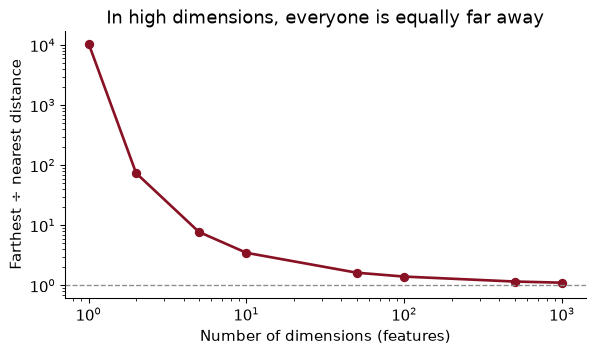

In two dimensions the farthest point is, on average, 91 times as far away as the nearest. In 100 dimensions the ratio is 1.40; in 1,000 it is 1.11. Distances **concentrate**: every point is roughly the same distance from every other, so “nearest” stops meaning “similar”. This is the **curse of dimensionality**.

There is a second way to see it. To capture 10% of the points in a unit cube by taking a smaller cube around one of them, the small cube needs an edge of $0.1^{1/d}$. In one dimension that is 0.1, a genuinely local neighbourhood. In ten dimensions it is 0.79: to find 10% of the data you must reach across most of the range of *every* variable. Neighbourhoods stop being local.

For an economist this is not abstract. Matching estimators find, for each treated person, the most similar untreated person. With age and education, that is easy. With fifty covariates, nobody is similar to anybody, and the matches are poor. The cure is the same in both settings: find the few directions in which the data really vary, and work there. Real data, unlike random points in a cube, nearly always have such directions, because real variables are correlated.

### Worked example — how big is a neighbourhood?

You want a neighbourhood containing 1% of the data, using a cube around a point in a unit cube with $d$ dimensions. How long must its edge be when $d$ = 2, 10, and 50?

### Solution

The edge is $0.01^{1/d}$: 0.10 for $d$ = 2, 0.63 for $d$ = 10, and 0.91 for $d$ = 50. With fifty features, a “neighbourhood” holding 1% of the data spans more than nine-tenths of the range of every feature. It is not a neighbourhood at all, and a nearest-neighbour prediction made from it is really an average over very different cases.

## PCA in words, then in one equation

Start with two columns, life expectancy and infant mortality, each **standardized** (minus its mean, divided by its standard deviation) so that both are measured in standard deviations. The left panel below plots them. The points lie along a line sloping down: countries where babies die are countries where adults die young.

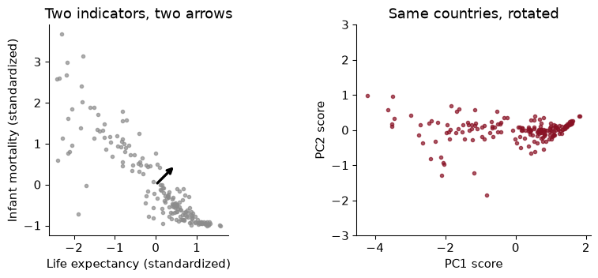

PCA asks: along which direction are the points most spread out? That is the garnet arrow, the **first principal component** (PC1). Then: at right angles to it, which direction has the most remaining spread? That is the black arrow, PC2. With two variables there is nothing left to choose; with eight, PCA keeps going, each new direction at right angles to all the previous ones. Then it **rotates** the data so that the new directions are the axes, which is the right panel. Nothing is lost by rotating. Something is lost only when you decide to keep fewer components than you started with.

Here, PC1 accounts for 94% of the total variance of the two standardized columns. Throw PC2 away and you keep almost all the information in one number.

Now the one equation. A principal component **score** for country $i$ is a weighted sum of its standardized variables:

$$z_{i1} = \phi_{1}\, x_{i1} + \phi_{2}\, x_{i2} + \dots + \phi_{p}\, x_{ip}$$

The weights $\phi$ are the **loadings**. PC1’s loadings are the ones that make the scores $z_{i1}$ as spread out across countries as possible, subject to the squared weights adding to one (otherwise you could inflate the spread just by doubling every weight). PC2’s loadings do the same, subject also to PC2’s scores being uncorrelated with PC1’s. The loadings tell you what a component *means*; the scores tell you where each country sits on it.

**Going further.** If $\Sigma$ is the correlation matrix of the standardized data, PC1’s loadings solve $\max_{\phi} \phi^\top \Sigma \phi$ subject to $\phi^\top\phi = 1$. The solution is the eigenvector of $\Sigma$ with the largest eigenvalue, and that eigenvalue is the variance of the PC1 scores. Software computes all of them at once from the singular value decomposition of the data matrix. You will never need to do it by hand, but it is why PCA always gives the same answer: there is no random start and no tuning.

### Worked example — a score by hand

For the two-variable PCA, PC1’s loadings are 0.707 on life expectancy and -0.707 on infant mortality. Brazil’s standardized values are 0.299 and -0.316. What is its PC1 score, and what does the sign mean?

### Solution

Multiply and add: 0.707 × 0.299 + (-0.707) × -0.316 = 0.435, which matches `PCA().transform` (0.435). The loadings have opposite signs, so PC1 is “long lives and few infant deaths” at one end and the reverse at the other. Which end is positive is arbitrary: flip both loadings and every score changes sign, and the component explains exactly the same variance. Read signs from the loadings, never assume them.

## Standardize first

PCA chases variance, and variance depends on units. In the Factbook, maternal mortality is measured in deaths per 100,000 births, with a standard deviation across countries of 222. Internet use is a share, with a standard deviation of 0.27. Run PCA on the raw numbers and see what happens:

``` python
PCA().fit(df[FEAT]).components_[0].round(3)          # PC1 loadings, unstandardized
```

    array([ 0.035,  0.005,  0.095, -0.001, -0.032,  0.994, -0.004,  0.003])

PC1 puts a loading of 0.994 on maternal mortality and almost nothing on anything else, and it “explains” 99.3% of the variance. That is not a discovery about development. It is a discovery that 222 is bigger than 0.27. Measure maternal mortality per 1,000 births instead and the answer would change completely.

So **standardize** before PCA unless every variable is in the same, meaningful unit. Standardizing gives each variable a variance of one, so each gets an equal say before PCA decides which combinations matter. The exception, which we meet with interest rates, is when all the columns share a unit and the differences in their variances are real information.

### Worked example — when not to standardize

Which of these should be standardized before PCA? **(a)** Monthly returns on 30 stocks, all in percent. **(b)** A household survey with income in dollars, years of schooling, and number of children. **(c)** Yields on seven Treasury bonds, all in percent.

### Solution

**(b)**, certainly: dollars and years are not comparable, and unstandardized PCA would return “income”. **(a)** and **(c)** are judgement calls, and the usual practice is *not* to standardize. All the columns are in the same unit, and if one stock is more volatile than another, that volatility is exactly what a portfolio manager cares about. Standardizing would give a sleepy utility stock the same weight as a volatile tech stock. With interest rates, short rates genuinely move more than long rates, and we want PCA to see that.

## How many components? The scree plot

Eight standardized indicators carry eight units of variance in total, one each. PCA re-divides that total among the components, largest first. The share each captures is its **explained variance ratio**, and a bar chart of them is a **scree plot** (scree is the rubble at the foot of a cliff, which is what the small components look like).

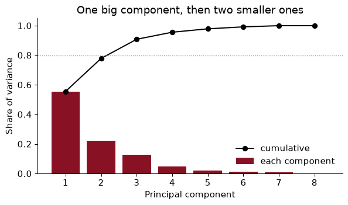

PC1 alone captures 56% of the variance in the eight indicators. PC2 adds 22% and PC3 13%; together the first three hold 91%. After that the bars are rubble.

How many to keep has no single right answer. Common rules are to keep enough for 80% or 90% of the variance (here 3 components reach 80%), or to cut at the “elbow” where the bars flatten, or to keep components with more variance than an average original variable (an eigenvalue above one, in the standardized case). In practice the purpose decides. For an index, one component; for a picture, two; as inputs to a regression, as many as cross-validation likes (later in the chapter).

### Worked example — reading the scree

A classmate says: “PC1 explains 56%, so development is about half of what varies between countries, and the other half is noise.” Is that right?

### Solution

The first half is a fair reading; the second is not. The remaining 44% is not noise. PC2 and PC3 together carry 35% of the variance, and as the next section shows, they have clear meanings of their own. “Explained variance” is a statement about the eight columns we chose to include, too: add five more health indicators and PC1’s share would rise, add five unrelated ones and it would fall. The share describes the table, not the world.

## Reading the loadings

The loadings say what each component is made of. I orient each one so that life expectancy loads positively, which only flips signs and changes nothing else:

                              PC1   PC2   PC3
    birth_rate              -0.44  0.04  0.20
    death_rate              -0.15 -0.36 -0.79
    infant_mortality_rate   -0.45 -0.06  0.00
    internet_pc              0.37 -0.03 -0.36
    life_exp_at_birth        0.45  0.14  0.10
    maternal_mortality_rate -0.43 -0.07 -0.12
    net_migration_rate       0.01  0.66 -0.43
    population_growth_rate  -0.25  0.63 -0.05

**PC1 is development.** Life expectancy and internet use load positively; birth rates, infant mortality and maternal mortality load negatively, all with similar weights. It is the familiar demographic transition, from high fertility and high mortality to low fertility and long lives, read straight out of the data.

**PC2 is migration and growth.** It is dominated by net migration and population growth, loading together. Countries high on PC2 are gaining people, either by births or by arrivals; those low on it are losing them.

**PC3 is mostly the death rate**, once the other components have taken what they can. That sounds odd until you remember that the crude death rate depends on age structure: a rich, old country like Japan and a poor, young one can have similar death rates for opposite reasons. PC1 had to handle “poor countries die young” and could not also handle “old countries die more”; PC3 picks up the second.

A **biplot** shows countries (points) and loadings (arrows) together on the first two components:

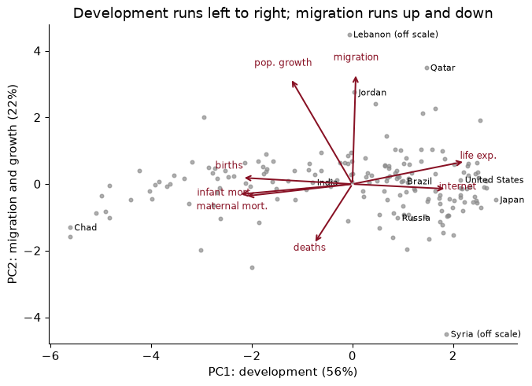

Rich, ageing countries sit on the right with low PC2; the poorest and youngest on the left. The countries far up the PC2 axis are Lebanon, by a wide margin, and Jordan, which took in refugees from Syria’s civil war, along with Gulf states such as Qatar whose populations are swollen by migrant workers. Syria itself sits far below everyone else. That is a real feature of the world which a one-dimensional development index would miss entirely.

### Worked example — naming a component

Without looking at the data, a colleague guesses that PC2 is “being rich but not healthy”. What would you check to test the guess, and what does the table say?

### Solution

Check the loadings: a “rich but unhealthy” component would load positively on internet use and positively on mortality. PC2 does neither in any strong way. Its two large loadings are net migration (0.66) and population growth (0.63), with everything else small. Then check the countries at the extremes of the scores: the top of PC2 is Lebanon and Jordan (refugee inflows) and the Gulf states (migrant workers), and the bottom is Syria, so “migration” is the better name. Naming a component is a hypothesis about its loadings and its extreme cases, and you should check both.

## PC1 as a development index

PC1’s scores are a development index built by the data. Here are the ten lowest and ten highest countries:

                      lowest  score       highest  score
                        Chad   -5.61        Japan   2.85
                     Somalia   -5.61 Korea, South   2.67
    Central African Republic   -5.10      Iceland   2.65
                        Mali   -4.99  Netherlands   2.61
                 Afghanistan   -4.91      Germany   2.55
               Guinea-Bissau   -4.84    Singapore   2.53
                       Niger   -4.83       Sweden   2.50
                Sierra Leone   -4.41  Switzerland   2.50
                     Burundi   -4.23       Norway   2.47
                      Zambia   -4.04      Finland   2.47

The bottom of the list is the Sahel and Central Africa; the top is Japan, Western Europe and the rich East Asian economies. No one told PCA about income, region or history, and it produced a ranking that any development economist would recognise. The index correlates 0.94 with life expectancy and 0.79 with internet use.

Two cautions. First, it is a *descriptive* index of these eight indicators, from an older edition of the Factbook; it is not GDP and not welfare, and it inherits whatever the eight indicators leave out (income, inequality, freedom). Second, the weights are chosen to maximise variance, not to reflect anyone’s values. If you think infant mortality matters more than internet use, PCA will not respect that. The HDI’s equal weights are arbitrary too, but they are arbitrary *in public*, by a choice someone can defend or criticise. PCA’s weights are data-driven, which is not the same as neutral.

### Worked example — why not just use life expectancy?

The index and life expectancy are correlated at 0.94. If they agree that closely, why build an index at all?

### Solution

Because a correlation of 0.94 still leaves room for large disagreements about individual countries, and for some purposes those are what matter. The biggest is Syria: 121st by life expectancy, 36th by the index. At the other end, Lebanon is 43rd by life expectancy but 112th by the index. Both moves come from the migration columns, which PC1 weights lightly but not at zero: a population shrinking through emigration nudges the index up, and one swelling with refugees nudges it down. That is a reminder to read an index’s loadings before trusting its rankings. An index averages over several noisy indicators, so a country’s position does not hinge on one statistic that may be badly measured. That is the same reason we prefer a test score built from many questions to a score on one question.

## The yield curve: level, slope and curvature

Now a setting where the columns share a unit. FRED publishes daily yields on US Treasury securities at many maturities, free and without an API key. Take seven, from three months to ten years, and average them by month: 542 months from September 1981 to October 2026.

``` python
FRED = "https://fred.stlouisfed.org/graph/fredgraph.csv?id=DGS3MO,DGS1,DGS2,DGS3,DGS5,DGS7,DGS10"
ypath = Path("../data/treasury_yields.csv")                 # download once, then reuse
if not ypath.exists():
    pd.read_csv(FRED, na_values=".").to_csv(ypath, index=False)
yields = (pd.read_csv(ypath, parse_dates=["observation_date"], index_col="observation_date")
          .resample("ME").mean().dropna())
yields.columns = ["3m", "1y", "2y", "3y", "5y", "7y", "10y"]
dy = yields.diff().dropna()               # monthly changes, percentage points
pca_y = PCA().fit(dy)                     # same units: no standardizing
```

I run PCA on monthly *changes*, because that is what moves bond prices and what a trader hedges; and I do not standardize, because all seven are in percentage points and the extra volatility of short rates is real. The result is one of the cleanest in empirical economics. PC1 explains 87.3% of the variance of yield changes, PC2 10.4% and PC3 1.7%: three components, 99.3% of everything that happens to the yield curve.

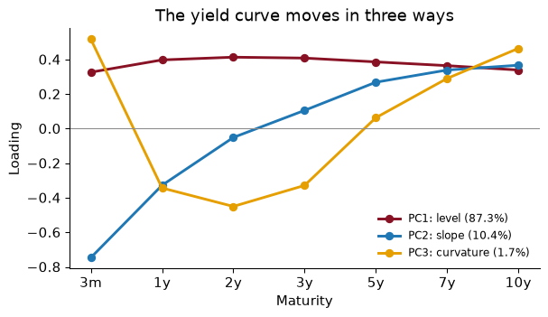

The loadings have a shape you can name at a glance:

- **Level** (PC1): all seven loadings are positive and similar. The whole curve shifts up or down together, as when the Fed raises rates or inflation expectations rise.
- **Slope** (PC2): short maturities move one way, long ones the other. The curve steepens or flattens.
- **Curvature** (PC3): the ends move one way and the middle the other. The curve bends.

Litterman and Scheinkman (1991) found these three factors in the early 1990s, and bond desks still hedge them: a portfolio protected against level, slope and curvature is protected against nearly everything rates do.

The slope factor has an economic payoff. Fit the same PCA to the *levels* of yields and plot PC2’s score over time next to the term spread, the 10-year yield minus the 3-month:

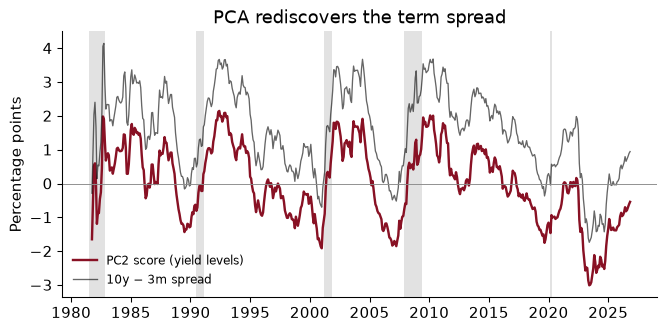

The two lines are almost the same, with a correlation of 0.996. PCA was told nothing about spreads, recessions, or which maturity is which; it found the slope because the slope is how the curve actually moves. And the term spread is one of the best-known recession predictors in macroeconomics: it has turned negative (an “inverted” curve) before each of the recessions shaded in the chart.

### Worked example — a level shock to a bond portfolio

A one-standard-deviation move in the level component, in a typical month, shifts each yield by its loading times the component’s standard deviation (0.73 percentage points). How much do the 3-month and 10-year yields move?

### Solution

The 3-month yield moves by 0.33 × 0.73 = 0.24 points and the 10-year by 0.34 × 0.73 = 0.25 points: roughly 24 and 25 basis points. “Level” does not mean every yield moves by exactly the same amount; the loadings are similar, not equal. A bond trader who wants to be immune to level shocks weights her positions so that their sensitivities, multiplied by these loadings, sum to zero.

## Principal components regression, briefly

Principal components can also be inputs to a regression. **Principal components regression** (PCR) replaces the $p$ original features with their first $M$ component scores and runs OLS on those. With $M = p$ it is exactly OLS; with smaller $M$ it throws away the low-variance directions, which reduces variance at the cost of some bias, the same trade as ridge regression in Chapter 11. Stock and Watson’s diffusion-index forecasts are PCR on a large macro panel.

To try it here, predict life expectancy from the other seven Factbook indicators, choosing $M$ by five-fold cross-validation (Chapter 9):

    components M
    1    3.78
    2    3.15
    3    2.91
    4    2.86
    5    2.81
    6    2.81
    7    2.83

One component already predicts life expectancy to within 3.8 years (its standard deviation across countries is 8.8), because PC1 of the other seven indicators is mostly the development axis, and life expectancy lives on it. The best cross-validated choice is $M$ = 5, with an RMSE of 2.81, against 2.83 for OLS on all seven: a small gain, from dropping noisy directions.

The caveat is the important part. PCA chooses components **without looking at $y$**. The directions in which the features vary most need not be the directions that predict the outcome. Here they happen to be, because life expectancy is part of the same demographic story; in other problems the top components predict nothing and the useful signal sits in a small component that PCR throws away. Ridge and LASSO (Chapter 11) look at $y$ and are usually the safer default.

### Worked example — PCR versus the full regression

With $M = 7$, PCR’s cross-validated RMSE is 2.828 and OLS’s is 2.828. Coincidence?

### Solution

No. With all seven components, PCR has only rotated the features, and OLS on a rotation of the features gives exactly the same fitted values as OLS on the features themselves: the same column space, the same projection. Dimensionality reduction starts only when $M < p$. This is a useful check that your pipeline is wired correctly.

## Pictures: PCA versus t-SNE

The first two components make a decent map of high-dimensional data: here they hold 78% of the variance. But PCA is linear; it can only rotate and flatten. **t-SNE** (van der Maaten and Hinton 2008) is a popular non-linear alternative that tries to place points so that each one’s *nearest neighbours* in the original space stay near it on the page. It is very good at showing local groups:

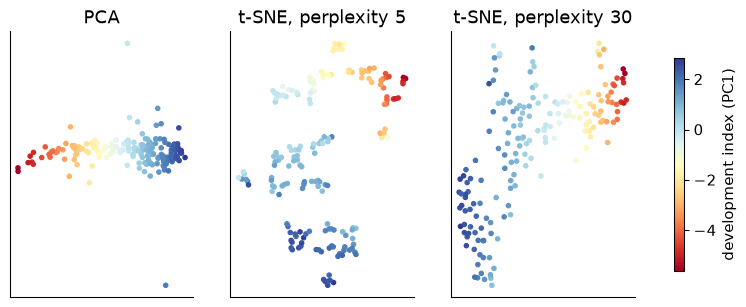

The PCA map is a straight development gradient. The t-SNE maps break the same countries into islands, and the islands depend on the **perplexity**, a tuning parameter that sets roughly how many neighbours each point cares about. Neither t-SNE map is wrong. Both are answers to a vaguer question than PCA’s.

The rules for reading t-SNE, which matter because the pictures are so persuasive:

- **The sizes of clusters mean nothing**, and neither do **the distances between them**. t-SNE preserves who is near whom, not how far apart groups are.
- **Results change with the perplexity and the seed.** Try several before believing any island.
- **There are no loadings** and no `transform` for new data. You cannot say what an axis means, and you should never feed t-SNE coordinates into a regression.

My rule of thumb: **PCA to measure and compress, t-SNE to look.** In this book, t-SNE’s natural home is Chapter 20, where documents and words live in hundreds of dimensions and a picture of who is near whom is genuinely useful. UMAP, a faster cousin, has the same caveats.

### Worked example — reading an island

In the perplexity-5 map, a student spots a small island well separated from the rest and writes: “these countries form a distinct development type, very different from all the others.” What can and cannot be concluded?

### Solution

What can be concluded: those countries are each other’s nearest neighbours in the eight-dimensional data, so they are similar to one another. What cannot: that they are *very different* from the rest. t-SNE does not preserve distances between groups, and a smaller perplexity tends to cut the data into more, tighter islands, so the gap on the page says more about the setting than about the countries. To check, go back to the data: compare the island’s average indicators with everyone else’s, or look at where those countries fall on PCA’s map, where distances do mean something. Clustering, in Chapter 17, gives a more disciplined way to ask whether groups exist.

## In Python

The whole analysis, runnable top to bottom: the Factbook index, then the yield curve.

``` python
from pathlib import Path
import numpy as np, pandas as pd
from sklearn.decomposition import PCA
from sklearn.preprocessing import StandardScaler

path = Path("../data/cia_factbook.csv")                     # download once, then reuse
if not path.exists():
    path.parent.mkdir(exist_ok=True)
    pd.read_csv(CIA_URL).to_csv(path, index=False)
cia = pd.read_csv(path)
cia["internet_pc"] = cia["internet_users"] / cia["population"]   # a count is not comparable
FEAT = ["birth_rate", "death_rate", "infant_mortality_rate", "internet_pc", "life_exp_at_birth",
        "maternal_mortality_rate", "net_migration_rate", "population_growth_rate"]
df = cia.dropna(subset=FEAT).set_index("country")
```

Standardize, fit, and orient PC1 so that higher means longer lives.

``` python
Z = StandardScaler().fit_transform(df[FEAT])
pca = PCA().fit(Z)
print("explained variance:", pca.explained_variance_ratio_.round(3))
sign = np.sign(pca.components_[0][FEAT.index("life_exp_at_birth")])
loadings = pd.DataFrame(sign * pca.components_[:2].T, index=FEAT, columns=["PC1", "PC2"])
dev_index = pd.Series(sign * pca.transform(Z)[:, 0], index=df.index).sort_values()
print(loadings.round(2)); print(dev_index.tail(5).round(2))
```

    explained variance: [0.556 0.223 0.129 0.048 0.023 0.013 0.008 0.   ]
                              PC1   PC2
    birth_rate              -0.44 -0.04
    death_rate              -0.15  0.36
    infant_mortality_rate   -0.45  0.06
    internet_pc              0.37  0.03
    life_exp_at_birth        0.45 -0.14
    maternal_mortality_rate -0.43  0.07
    net_migration_rate       0.01 -0.66
    population_growth_rate  -0.25 -0.63
    country
    Germany         2.55
    Netherlands     2.61
    Iceland         2.65
    Korea, South    2.67
    Japan           2.85
    dtype: float64

The yield curve: PCA on monthly changes, no standardizing.

``` python
yields = (pd.read_csv(ypath, parse_dates=["observation_date"], index_col="observation_date")
          .resample("ME").mean().dropna())
yields.columns = ["3m", "1y", "2y", "3y", "5y", "7y", "10y"]
pca_y = PCA(3).fit(yields.diff().dropna())
print("explained variance:", pca_y.explained_variance_ratio_.round(3))
print(pd.DataFrame(pca_y.components_.T, index=yields.columns,
                   columns=["level", "slope", "curvature"]).round(2))
```

    explained variance: [0.873 0.104 0.017]
         level  slope  curvature
    3m    0.33   0.75       0.52
    1y    0.40   0.33      -0.34
    2y    0.41   0.05      -0.45
    3y    0.41  -0.11      -0.33
    5y    0.39  -0.27       0.06
    7y    0.36  -0.34       0.29
    10y   0.34  -0.37       0.46

Principal components regression, with the number of components chosen by cross-validation.

``` python
from sklearn.pipeline import make_pipeline
from sklearn.linear_model import LinearRegression
from sklearn.model_selection import GridSearchCV, KFold
X, y = df[[f for f in FEAT if f != "life_exp_at_birth"]], df["life_exp_at_birth"]
pcr = make_pipeline(StandardScaler(), PCA(), LinearRegression())
grid = GridSearchCV(pcr, {"pca__n_components": range(1, 8)}, cv=KFold(5, shuffle=True, random_state=368),
                    scoring="neg_root_mean_squared_error").fit(X, y)
print(grid.best_params_, round(-grid.best_score_, 2))
```

    {'pca__n_components': 5} 2.81

## What goes wrong

**Forgetting to standardize.** Unstandardized PCA on the Factbook put a loading of 0.99 on maternal mortality, because it is measured in the biggest units. Standardize whenever the columns are in different units, and think before standardizing when they are not.

**Reading the sign of a component.** Software may return PC1 with “development” pointing either way, and a different version of the library may flip it. Orient components deliberately (here, so that life expectancy loads positively) and say so.

**Treating explained variance as importance.** A component that explains 2% of the variance can be the one that matters for your question; in the yield curve, curvature is 1.7% of the variance and still something traders hedge. And PCR’s top components are not guaranteed to predict anything, because PCA never looked at $y$.

**Fitting PCA on the test set.** PCA is a learned transformation like a scaler. In a prediction problem, fit it inside the pipeline on training data only, exactly as in Chapter 9, or information from the test set leaks into the features.

**Over-reading a t-SNE map.** Cluster sizes and distances between clusters are not meaningful, and the picture changes with the perplexity. Use t-SNE to look and PCA (or the original variables) to measure.

**Forgetting what went in.** PCA describes the columns you chose. A “development index” built from eight demographic and health indicators says nothing about income, inequality or institutions, and its weights are chosen to maximise variance, not to reflect anyone’s values.

## Exercises

1.  A country’s PC1 score is 0 in the standardized Factbook PCA. What does that mean? Which of these is right: (a) it has average values on all eight indicators; (b) its weighted combination of standardized indicators equals the average country’s; (c) it is exactly in the middle of the development ranking?

2.  Compute the correlation matrix of the eight Factbook indicators and find the pair with the strongest correlation. How does that fit with PC1’s loadings?

3.  Drop `net_migration_rate` and `population_growth_rate`, refit the standardized PCA on the remaining six indicators, and report the share of variance PC1 explains. Explain why it rose.

4.  Rebuild the development index using `log` of maternal and infant mortality instead of their raw values. Which countries move most in the ranking?

5.  Run the yield-curve PCA on monthly changes for the period from January 2008 onwards only. Do level, slope and curvature survive, and how do their shares change?

6.  Using the curse-of-dimensionality simulation, compute the standard deviation of all pairwise distances divided by their mean, for 2, 10, 100 and 1,000 dimensions. What happens, and why does it matter for nearest neighbours?

7.  Fit t-SNE on the standardized Factbook data with perplexity 30, `init="random"`, and two different seeds. Do the two maps look the same? What does that tell you?

### Answers

**1.** (b). A PC1 score is a weighted sum of standardized values, so zero means the weighted sum equals that of a country with every indicator at its mean. That does not require (a): a country can be above average on some indicators and below on others in a way that cancels. Nor (c): the scores are not symmetric, so zero need not be the median.

    countries with a PC1 score below zero: 40%

In fact 40% of countries have a negative development score, so zero is not the middle of the ranking.

**2.**

``` python
corr = df[FEAT].corr()
pairs = corr.where(np.triu(np.ones(corr.shape, dtype=bool), k=1)).stack()
print(pairs.abs().sort_values(ascending=False).head(3).round(3))
```

    infant_mortality_rate  life_exp_at_birth          0.887
    birth_rate             infant_mortality_rate      0.865
    infant_mortality_rate  maternal_mortality_rate    0.857
    dtype: float64

The strongest pair is infant_mortality_rate and life_exp_at_birth, with a correlation of -0.89. Both have large PC1 loadings (-0.45 and 0.45). Strongly correlated variables are exactly what PC1 bundles together: one direction can describe both.

**3.**

``` python
six = [f for f in FEAT if f not in ("net_migration_rate", "population_growth_rate")]
evr6 = PCA().fit(StandardScaler().fit_transform(df[six])).explained_variance_ratio_
print(evr6.round(3))
```

    [0.704 0.178 0.062 0.029 0.017 0.011]

PC1 now explains 70% of the variance of the six indicators, up from 56% with eight. The two dropped variables were the ones PC1 did not capture (they formed PC2), so removing them leaves a table that is more nearly one-dimensional. This is the warning from the scree section in action: explained variance describes the columns you chose.

**4.**

``` python
logged = df[FEAT].assign(maternal_mortality_rate=np.log(df["maternal_mortality_rate"]),
                         infant_mortality_rate=np.log(df["infant_mortality_rate"]))
pl = PCA().fit(StandardScaler().fit_transform(logged))
s_log = pl.transform(StandardScaler().fit_transform(logged))[:, 0]
s_log *= np.sign(pl.components_[0][FEAT.index("life_exp_at_birth")])
shift = (pd.Series(s_log, index=df.index).rank() - dev.reindex(df.index).rank()).sort_values()
print(shift.head(3), shift.tail(3))
```

    country
    Syria                              -21.0
    Saint Vincent and the Grenadines   -14.0
    Saint Lucia                        -12.0
    dtype: float64 country
    Russia     17.0
    Ukraine    20.0
    Belarus    22.0
    dtype: float64

The two indices correlate at 0.975, so the broad ranking is unchanged. The biggest risers under the logged version are Belarus, Ukraine, Russia, and the biggest fallers Syria, Saint Vincent and the Grenadines, Saint Lucia. Logging compresses the differences among very high mortality rates and stretches those among low ones, so the countries that move most are those whose mortality rates are low relative to their other indicators (they gain) or high relative to them (they lose). Any index is a set of choices; it is worth knowing which ones move the answer.

**5.**

``` python
recent = yields.loc["2008-01-01":].diff().dropna()
pca_r = PCA(3).fit(recent)
print(pca_r.explained_variance_ratio_.round(3))
print(pd.DataFrame(pca_r.components_.T, index=yields.columns).round(2))
```

    [0.813 0.142 0.033]
            0     1     2
    3m   0.23  0.67  0.57
    1y   0.32  0.45 -0.10
    2y   0.37  0.20 -0.48
    3y   0.41  0.04 -0.42
    5y   0.44 -0.22 -0.06
    7y   0.43 -0.33  0.21
    10y  0.41 -0.38  0.46

Since 2008 the first three components explain 81.3%, 14.2% and 3.3% of the variance of yield changes, against 87.3%, 10.4% and 1.7% over the full sample. The level share is smaller and the slope share larger: for much of the period short rates were pinned near zero, so a lot of the action was in long rates alone, which looks like a change in slope. The shapes of the loadings are the familiar three, which is why practitioners trust them.

**6.**

``` python
rng = np.random.default_rng(368)
cv_dist = {d: (lambda D: D.std() / D.mean())(pdist(rng.uniform(size=(500, d)))) for d in [2, 10, 100, 1000]}
print({d: round(float(v), 3) for d, v in cv_dist.items()})
```

    {2: 0.477, 10: 0.192, 100: 0.059, 1000: 0.019}

The relative spread of distances falls from 0.48 in two dimensions to 0.019 in 1,000. When all distances are nearly equal, the “nearest” neighbour is barely nearer than a random point, so a nearest-neighbour prediction is close to an average over everyone. That is the curse: methods built on distance lose their meaning as the number of features grows, unless the data really live in a few dimensions.

**7.**

``` python
from scipy.stats import spearmanr
from scipy.spatial.distance import pdist
e1 = TSNE(2, perplexity=30, init="random", random_state=1).fit_transform(Z)
e2 = TSNE(2, perplexity=30, init="random", random_state=2).fit_transform(Z)
rho_d = spearmanr(pdist(e1), pdist(e2)).statistic
```

The two maps differ in layout (islands can be rotated, reflected, or placed differently), and the rank correlation between their pairwise distances is 0.98. Who is close to whom is broadly stable; the overall arrangement is partly an accident of the run. That is the right way to use t-SNE: trust the local neighbourhoods that persist across seeds and settings, and nothing else.

**Reading.** Géron, ch. 7, for PCA, its randomized and incremental variants, and other dimensionality-reduction methods. ISLP (James, Witten, Hastie, Tibshirani & Taylor 2023), §12.2, for PCA, and §6.3 for principal components regression. Litterman & Scheinkman (1991), “Common Factors Affecting Bond Returns”, for level, slope and curvature; Stock & Watson (2002), “Forecasting Using Principal Components from a Large Number of Predictors”, for factor models in macroeconomics.
